# Software Requirements Specification (SRS) — OpenBB Open Data Platform

| Thuộc tính | Giá trị |
|---|---|
| Chuẩn áp dụng | ISO/IEC/IEEE 29148:2018 |
| Phiên bản mã nguồn | `openbb` 5.0.0 (`openbb_platform/pyproject.toml`), `openbb-core` >= 2.0.1, `openbb-cli` >= 2.0.1, Desktop 2.0.0 (`desktop/package.json`) |
| Phương pháp | Reverse-engineering từ mã nguồn; dữ liệu cấu trúc quét thủ công do công cụ ARE chưa được cài đặt và thư mục `.are/` không tồn tại |
| Nhãn bằng chứng | `[OK]` đã xác minh trong mã; `[SPEC]` suy ra từ cấu trúc, chưa xác minh runtime; `[ASSUMPTION]`, `[UNKNOWN]`, `[OPEN]` theo mục 1.4 |

---

## 1. INTRODUCTION

### 1.1 Purpose
Tài liệu xác định yêu cầu hệ thống của OpenBB Open Data Platform theo hiện trạng mã nguồn. Đối tượng tiếp nhận: Business Analyst, Solution Architect, đội phát triển extension/provider, đội kiểm thử và đội vận hành.

### 1.2 Scope
| Hạng mục | Nội dung |
|---|---|
| Tên sản phẩm | OpenBB Platform (gói `openbb`), gồm Core, Extensions (router), Providers, OBBject Extensions, CLI, Desktop, MCP Server, Platform API |
| Mục tiêu thiết kế | Hệ thống hợp nhất truy xuất dữ liệu tài chính từ nhiều nhà cung cấp qua một mô hình truy vấn chuẩn (`QueryParams` / `Data`) và một đối tượng kết quả chuẩn (`OBBject`) |
| Trong phạm vi | Thực thi lệnh qua Python SDK, REST API (FastAPI), CLI, MCP, ứng dụng Desktop quản lý môi trường và backend |
| Ngoài phạm vi | Dữ liệu và dịch vụ nội bộ của nhà cung cấp bên thứ ba; dịch vụ `my.openbb.co` (chỉ được tham chiếu trong biểu ngữ khởi động, `openbb_core/api/rest_api.py`) |

### 1.3 Product Overview
Hệ thống vận hành theo mô hình plugin dựa trên Python entry points. Mỗi extension router khai báo lệnh bằng `@router.command(model=...)`; mỗi provider khai báo các `Fetcher` ánh xạ tên model tới logic gọi API ngoài. Hệ thống sinh chữ ký lệnh động từ `ProviderInterface` và đăng ký lệnh vào cả Python SDK lẫn REST API.

Quy mô khảo sát (đếm `@router.command` trong `openbb_platform/extensions/*`):

| Router extension | Số lệnh | Router extension | Số lệnh |
|---|---|---|---|
| equity | 70 | technical | 59 |
| economy | 42 | fixedincome | 25 |
| quantitative | 23 | econometrics | 21 |
| etf | 9 | derivatives | 8 |
| index | 7 | commodity | 7 |
| news | 5 | currency | 4 |
| crypto | 2 | | |

Provider khảo sát (`openbb_platform/providers/*`): bls, cboe, cftc, deribit, ecb, eia, famafrench, federal_reserve, finra, fred, government_us, imf, jodi, nasdaq, oecd, sec, tmx.

### 1.4 Definitions, Acronyms, and Abbreviations
| Thuật ngữ | Định nghĩa (nguồn trong mã) |
|---|---|
| OBBject | Đối tượng kết quả chuẩn gồm `results`, `provider`, `warnings`, `chart`, `extra` (`core/openbb_core/app/model/obbject.py`) |
| Fetcher | Lớp trừu tượng với chuỗi `transform_query` -> `extract_data`/`aextract_data` -> `transform_data` (`core/openbb_core/provider/abstract/fetcher.py`) |
| QueryParams / Data | Mô hình pydantic chuẩn cho tham số truy vấn và bản ghi dữ liệu (`provider/abstract/query_params.py`, `data.py`) |
| Provider | Nhà cung cấp dữ liệu: `name`, `credentials`, `fetcher_dict`, `website`, `instructions` (`provider/abstract/provider.py`) |
| Router / Command | Nhóm lệnh có tiền tố đường dẫn; lệnh được đăng ký bằng `Router.command` (`app/router.py`) |
| CommandMap | Bản đồ route -> hàm lệnh, kèm độ phủ provider (`app/router.py`) |
| ProviderInterface | Thành phần sinh `StandardParams`, `ExtraParams`, `ProviderChoices` từ registry (`app/provider_interface.py`) |
| ExecutionContext | Ngữ cảnh thực thi: command map, route, system settings, user settings (`app/command_runner.py`) |
| Credentials | Khóa API theo định dạng `<provider>_<credential>`, ví dụ `fred_api_key` (`provider/abstract/provider.py`) |
| OBBject Extension | Extension gắn accessor vào OBBject (ví dụ `charting`) |
| Backend Service | Tiến trình backend (FastAPI/MCP) do Desktop quản lý (`desktop/src-tauri/src/tauri_handlers/backends.rs`) |
| MCP | Model Context Protocol; transport `streamable-http`, `sse`, `stdio` (`mcp_server/app/args.py`) |
| `[ASSUMPTION]` / `[UNKNOWN]` / `[OPEN]` | Giả định chưa xác minh / thông tin không tìm thấy trong mã / vấn đề chưa quyết định |

---

## 2. REFERENCES
| Mã | Tài liệu | Nguồn trong kho |
|---|---|---|
| REF-01 | ISO/IEC/IEEE 29148:2018 | `.claude/skills/ba-wf-srs-generator/SKILL.md` |
| REF-02 | Hướng dẫn phát triển platform | `openbb_platform/CONTRIBUTING.md`, `openbb_platform/README.md` |
| REF-03 | Tài liệu extension | `openbb_platform/extensions/README.md` |
| REF-04 | Tài liệu Desktop | `desktop/README.md` |
| REF-05 | Tài liệu CLI | `cli/README.md`, `cli/CODEGEN_EODHD_DEMO.md` |
| REF-06 | Tài liệu MCP Server | `openbb_platform/extensions/mcp_server/README.md` |
| REF-07 | Tài liệu Platform API | `openbb_platform/extensions/platform_api/README.md` |
| REF-08 | Hướng dẫn API keys | https://docs.openbb.co/odp/python/settings/user_settings/api_keys (trích từ thông báo lỗi `query_executor.py`) |
| REF-09 | Chính sách bảo mật | `SECURITY.md` |
| REF-10 | Giấy phép | `LICENSE` (Apache-2.0 theo `pyproject.toml`; Desktop có `desktop/LICENSE`) |
| REF-11 | Phụ thuộc chính | FastAPI, Starlette, pydantic, uvicorn, Flask (`openbb-core[flask,pandas]`), Tauri (`desktop/src-tauri`), React + Vite (`desktop/package.json`) |
| REF-12 | HTTP Basic Auth (RFC 7617) | Cơ chế `HTTPBasic` trong `core/openbb_core/api/auth/user.py` |

---

## 3. SPECIFIC SYSTEM CONSTRAINTS

### 3.1 Regulatory & Compliance Constraints
| ID | Ràng buộc | Bằng chứng |
|---|---|---|
| CON-REG-01 | Mã nguồn phân phối theo Apache-2.0. | `openbb_platform/pyproject.toml` |
| CON-REG-02 | Khóa API phải được lọc theo provider và không được ghi vào metadata kết quả; `Credentials.__repr__` che giá trị. | `provider/query_executor.py:38`, `app/model/credentials.py:205` |
| CON-REG-03 | Tệp `.secrets.baseline` và hook pre-commit kiểm soát rò rỉ bí mật trong kho. | `.secrets.baseline`, `.pre-commit-config.yaml` |
| CON-REG-04 | Điều khoản sử dụng dữ liệu của từng provider áp dụng độc lập. | `[UNKNOWN]` — không có tệp điều khoản tổng hợp trong kho |

### 3.2 Hardware and Environment Limitations
| ID | Ràng buộc | Bằng chứng |
|---|---|---|
| CON-ENV-01 | Python >= 3.11, < 4 cho gói `openbb`. | `openbb_platform/pyproject.toml` |
| CON-ENV-02 | Hệ điều hành mục tiêu của Desktop: Windows, macOS, Linux (Tauri); CLI/backend chạy trong môi trường conda do Desktop tạo. | `desktop/src-tauri/src/tauri_handlers/environments.rs`, `startup.rs` |
| CON-ENV-03 | Thư mục dữ liệu người dùng mặc định `~/OpenBBUserData` (cache, export, styles). | `app/model/preferences.py` |
| CON-ENV-04 | Cấu hình CPU/RAM/Storage tối thiểu. | `[UNKNOWN]` |
| CON-ENV-05 | Triển khai container qua `Dockerfile`, `docker-compose.yml`, `openbb.docker.toml`. | `openbb_platform/` |

### 3.3 Technology Stack Constraints
| Lớp | Công nghệ | Bằng chứng |
|---|---|---|
| Core/API | Python, FastAPI, uvicorn, pydantic, Flask (mount tùy chọn) | `core/openbb_core/api/rest_api.py` |
| Dữ liệu | pandas (bắt buộc extra), polars, numpy (định dạng `output_type`) | `app/model/preferences.py` |
| Lưu trữ cấu hình | Tệp JSON `user_settings.json`, `system_settings.json`, `.env` | `app/service/user_service.py`, `env.py`, `system_settings.py` |
| Cơ sở dữ liệu quan hệ | Không có. Hệ thống không dùng RDBMS. | `[OK]` không có migration/ORM trong `openbb_core` |
| Desktop | Tauri (Rust), React, Vite, TypeScript, Tailwind | `desktop/package.json`, `desktop/src-tauri/Cargo.toml` |
| Đóng gói | hatchling, uv (`uv.lock`) | `pyproject.toml` |
| Mở rộng | Python entry points: nhóm `openbb_core_extension`, `openbb_provider_extension`, `openbb_obbject_extension` | `app/extension_loader.py` |

---

## 4. SYSTEM ARCHITECTURE & HIGH LEVEL DESIGN (HLD)

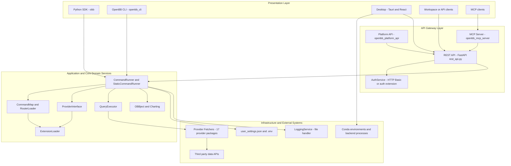

Tầng và trách nhiệm:

| Tầng | Thành phần | Trách nhiệm | Bằng chứng |
|---|---|---|---|
| Presentation | Python SDK, CLI, Desktop | Nhận lệnh từ tác nhân; Desktop quản lý môi trường và tiến trình backend | `cli/openbb_cli/cli.py`, `desktop/src/routes/*` |
| Gateway | `rest_api.py` | Dựng FastAPI, CORS, router, exception handler, OpenAPI | `core/openbb_core/api/rest_api.py` |
| Gateway | MCP Server | Phơi bày lệnh dưới dạng công cụ MCP | `extensions/mcp_server/openbb_mcp_server/` |
| Gateway | Platform API | Hợp nhất widgets/apps/agents cho Workspace | `extensions/platform_api/openbb_platform_api/service/` |
| Core | `CommandRunner` | Dựng tham số, thực thi, ghi metadata, gọi callback đầu ra | `core/openbb_core/app/command_runner.py` |
| Core | `QueryExecutor` | Chọn provider/fetcher, lọc credential, gọi `fetch_data` | `core/openbb_core/provider/query_executor.py` |
| Infrastructure | Provider package | Gọi API ngoài, chuẩn hóa dữ liệu | `openbb_platform/providers/*` |

### Integration Context
| ID | Cổng kết nối | Giao thức | Điểm cấu hình |
|---|---|---|---|
| INT-01 | API dữ liệu của provider (ví dụ FRED `series/observations`) | HTTPS REST | Credential `<provider>_api_key`; timeout cố định 5 giây trong `FredSeriesFetcher` |
| INT-02 | REST API của Platform | HTTP/JSON | `api_settings` trong `system_settings.json`; tiền tố `api_settings.prefix` |
| INT-03 | MCP clients | `streamable-http` (mặc định), `sse`, `stdio` | Tham số `--transport`, `--host`, `--port` |
| INT-04 | Workspace (Platform API) | HTTP/JSON, tệp `widgets.json`, `apps.json`, `agents.json` | `openbb_platform_api/service/*` |
| INT-05 | Jupyter server do Desktop quản lý | HTTP cục bộ | `tauri_handlers/jupyter.rs` |
| INT-06 | Flask extension | WSGI mount vào FastAPI | `app/utils/flask/`, `mount_flask_extensions` |

---

## 5. USER CHARACTERISTICS & ROLES

Hệ thống không có bảng User/Role. Phân quyền chỉ tồn tại ở cấp xác thực truy cập API (`[OK]` `api/auth/user.py`). Bảng sau tổng hợp Actor suy ra từ điểm vào.

| Actor | Mô tả | Điểm vào | Quyền truy cập | Bằng chứng |
|---|---|---|---|---|
| ACT-01 Nhà phân tích (Python) | Gọi `obb.<router>.<command>` | Python SDK | Toàn bộ lệnh; không xác thực | `app/static/` |
| ACT-02 Người vận hành CLI | Nhập lệnh trong CLI hoặc chạy routine | `openbb` CLI | Toàn bộ lệnh; chuyển đổi menu `settings`, `user`, `feature`, `exe` | `cli_controller.py` |
| ACT-03 API Client | Gọi REST | HTTP | Mặc định không xác thực; khi `OPENBB_API_AUTH` bật, bắt buộc HTTP Basic | `api/auth/user.py` |
| ACT-04 Quản trị Desktop | Quản lý môi trường, extension, backend, khóa API | Desktop | Quyền cục bộ trên hệ thống tệp và tiến trình | `tauri_handlers/*` |
| ACT-05 MCP Client / AI Agent | Gọi công cụ MCP | MCP | Bearer token `base64(username:password)` khi cấu hình | `mcp_server/app/auth.py` |
| ACT-06 Nhà phát triển extension | Viết router, provider | Entry points | Cài đặt gói Python | `extensions/README.md` |

Ma trận xác thực (chỉ cho REST):

| Cấu hình | Hành vi | Bằng chứng |
|---|---|---|
| `OPENBB_API_AUTH` không đặt hoặc false | `security` là hàm trả `None`; `authenticate_user` bỏ qua kiểm tra | `api/auth/user.py:12` |
| `OPENBB_API_AUTH` = true | Yêu cầu `HTTPBasic`; so sánh username/password bằng `secrets.compare_digest`; sai -> HTTP 401 | `api/auth/user.py:16-40` |
| `OPENBB_API_AUTH_EXTENSION` đặt và đã cài | Thay router, `auth_hook`, `user_settings_hook` bằng extension | `app/service/auth_service.py` |
| `OPENBB_DEV_MODE` bật | Gắn thêm router `/user`, `/system` | `api/rest_api.py:81-90` |

---

## 6. OPERATIONAL SCENARIOS & USE CASE MODELING

### Use Case Matrix
| UC ID | Tên | Primary Actor | Preconditions | Postconditions | FR |
|---|---|---|---|---|---|
| UC-01 | Truy vấn dữ liệu qua REST | ACT-03 | Backend chạy; credential provider hợp lệ khi `require_credentials` | Trả `OBBject` JSON hoặc lỗi chuẩn | FR-CORE-001, FR-PRV-001 |
| UC-02 | Truy vấn dữ liệu qua Python SDK | ACT-01 | Package `openbb` đã build | Trả `OBBject` hoặc kiểu theo `output_type` | FR-CORE-002 |
| UC-03 | Xem độ phủ lệnh/provider | ACT-03 | Backend chạy | Trả bản đồ coverage | FR-CORE-003 |
| UC-04 | Xác thực truy cập API | ACT-03 | `OPENBB_API_AUTH` bật | Yêu cầu hợp lệ được chuyển tiếp | FR-AUTH-001 |
| UC-05 | Nạp extension và đăng ký lệnh | ACT-06 | Gói extension đã cài | Lệnh xuất hiện trong CommandMap | FR-EXT-001 |
| UC-06 | Thiết lập khóa API | ACT-02, ACT-04 | `user_settings.json` ghi được | Khóa lưu trong `credentials` | FR-CLI-002, FR-DESK-003 |
| UC-07 | Thực thi lệnh trong CLI | ACT-02 | CLI khởi động | Kết quả hiển thị/xuất | FR-CLI-001 |
| UC-08 | Quản lý backend service | ACT-04 | Có môi trường conda | Tiến trình backend chạy/dừng | FR-DESK-001 |
| UC-09 | Cài đặt và cập nhật extension | ACT-04 | Môi trường tồn tại | Extension được cài/gỡ/cập nhật | FR-DESK-002 |
| UC-10 | Phơi bày lệnh dưới dạng công cụ MCP | ACT-05 | Cài `openbb-mcp-server` | Công cụ MCP khả dụng | FR-MCP-001 |

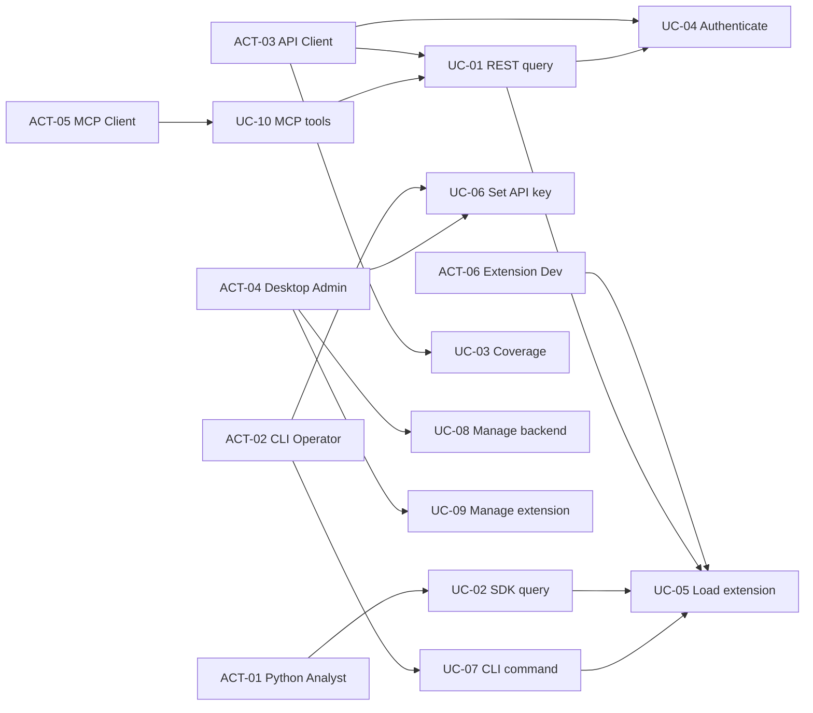

---

## 7. DATA REQUIREMENTS & LOGICAL DATABASE

Hệ thống không sử dụng cơ sở dữ liệu quan hệ. Dữ liệu cấu hình lưu dưới dạng tệp JSON/`.env`; dữ liệu truy vấn tồn tại trong bộ nhớ dưới dạng mô hình pydantic. ERD dưới đây mô tả mô hình logic của các thực thể pydantic, không phải bảng vật lý. Khóa `PK`/`FK` là khóa logic `[ASSUMPTION]`.

### 7.1 Entity-Relationship Diagram
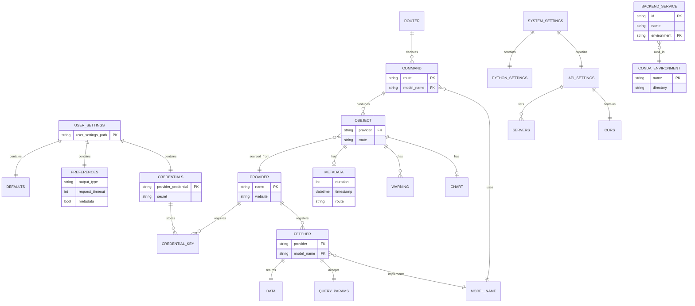

### 7.2 Data Dictionary

**Bảng 7.2.1 — `Preferences`** (`app/model/preferences.py`)
| Trường | Kiểu | Mặc định | Ràng buộc |
|---|---|---|---|
| `cache_directory` | str | `~/OpenBBUserData/cache` | — |
| `chart_style` | Literal | `dark` | `dark` hoặc `light` |
| `data_directory` | str | `~/OpenBBUserData` | — |
| `export_directory` | str | `~/OpenBBUserData/exports` | — |
| `metadata` | bool | `True` | Điều khiển việc ghi `Metadata` vào `OBBject.extra` |
| `output_type` | Literal | `OBBject` (xác minh `preferences.py:17-23`) | `OBBject`, `dataframe`, `polars`, `numpy`, `dict`, `llm` |
| `request_timeout` | PositiveInt | `60` | > 0 |
| `show_warnings` | bool | `False` | — |
| `table_style` | Literal | `dark` | `dark` hoặc `light` |
| `user_styles_directory` | str | `~/OpenBBUserData/styles/user` | — |

**Bảng 7.2.2 — `OBBject`** (`app/model/obbject.py:34`)
| Trường | Kiểu | Mô tả |
|---|---|---|
| `results` | `T` hoặc None | Dữ liệu kết quả |
| `provider` | str hoặc None | Provider đã phục vụ truy vấn |
| `warnings` | list[`Warning_`] hoặc None | Cảnh báo ghi nhận khi thực thi |
| `chart` | `Chart` hoặc None | Biểu đồ (`content`, `format`, `fig`) |
| `extra` | dict | Chứa `metadata` |

**Bảng 7.2.3 — `Metadata`** (`app/model/metadata.py:12`)
| Trường | Kiểu | Ràng buộc |
|---|---|---|
| `arguments` | dict | Chứa `standard_params`, `extra_params`, `provider_choices` |
| `duration` | int | Nano giây (`perf_counter_ns`) |
| `route` | str | Bắt buộc |
| `timestamp` | datetime | Bắt buộc |

**Bảng 7.2.4 — `SystemSettings`** (`app/model/system_settings.py`)
| Nhóm | Trường |
|---|---|
| Môi trường | `os`, `python_version`, `platform`, `version`, `core`, `home_directory`, `openbb_directory`, `user_settings_path`, `system_settings_path` |
| Logging | `logging_app_name`, `logging_commit_hash`, `logging_frequency` (D/H/M/S), `logging_handlers` (mặc định `file`), `logging_rolling_clock`, `logging_verbosity` (20), `logging_sub_app` (python/api/pro/cli), `logging_suppress` |
| API | `api_settings` (`APISettings`), `python_settings` (`PythonSettings.uvicorn`) |
| Cờ | `debug_mode`, `test_mode`, `headless`, `allow_mutable_extensions`, `allow_on_command_output`, `charting_extension`, `charting_backend` |

**Bảng 7.2.5 — `APISettings`** (`app/model/api_settings.py`)
| Trường | Mặc định |
|---|---|
| `version` | `1` |
| `title` | `OpenBB Platform API` |
| `cors.allow_origins` / `allow_methods` / `allow_headers` | `["*"]` |
| `custom_headers` | None |
| `servers` | Danh sách `Servers` mặc định |

**Bảng 7.2.6 — Biến môi trường** (`core/openbb_core/env.py`)
| Biến | Mặc định | Tác dụng |
|---|---|---|
| `OPENBB_API_AUTH` | false | Bật xác thực HTTP Basic |
| `OPENBB_API_USERNAME` / `OPENBB_API_PASSWORD` | None | Thông tin xác thực |
| `OPENBB_API_AUTH_EXTENSION` | None | Tên extension xác thực |
| `OPENBB_AUTO_BUILD` | true | Tự build package khi import |
| `OPENBB_DEBUG_MODE` | false | Nâng lỗi callback/metadata thành `OpenBBError` |
| `OPENBB_DEV_MODE` | false | Gắn router `/user`, `/system` |
| `OPENBB_ALLOW_MUTABLE_EXTENSIONS` | false | Cho phép extension sửa OBBject |
| `OPENBB_ALLOW_ON_COMMAND_OUTPUT` | false | Cho phép callback đầu ra lệnh |

Giá trị không phải boolean hợp lệ làm `Env.str2bool` phát sinh `ValueError`.

**Bảng 7.2.7 — Ví dụ `QueryParams`/`Data` chuẩn: Equity Historical** (`provider/standard_models/equity_historical.py`)
| Mô hình | Trường | Kiểu | Bắt buộc | Ràng buộc |
|---|---|---|---|---|
| QueryParams | `symbol` | str | Có | Chuyển thành chữ hoa |
| QueryParams | `start_date`, `end_date` | date | Không | — |
| Data | `date` | date hoặc datetime | Có | Chuỗi chứa `:` được phân tích ISO 8601 |
| Data | `open`, `high`, `low`, `close` | float | Có | — |
| Data | `volume` | float/int | Không | — |
| Data | `vwap` | float | Không | — |

---

## 8. EXTERNAL INTERFACE REQUIREMENTS

### 8.1 User Interfaces
| ID | Giao diện | Yêu cầu | Bằng chứng |
|---|---|---|---|
| UI-01 | CLI | Giao diện dòng lệnh dạng menu phân cấp theo router; hỗ trợ autocomplete, routine script (`exe`), chạy tập lệnh | `cli_controller.py`, `config/completer.py` |
| UI-02 | Desktop | Ứng dụng Tauri với các màn hình: `setup`, `installation-progress`, `environments`, `backends`, `api-keys`, `backend-logs`, `jupyter-logs`, `uninstall` | `desktop/src/routes/` |
| UI-03 | Swagger UI | `docExpansion` = `none` | `rest_api.py` |
| UI-04 | Biểu đồ | Do OBBject Extension `charting` cung cấp; kiểu `dark`/`light` | `obbject_extensions/charting`, `Preferences.chart_style` |

### 8.2 Software & API Interfaces
| Hạng mục | Đặc tả | Bằng chứng |
|---|---|---|
| Định dạng | REST JSON; mã hóa bằng `jsonable_encoder` | `api/router/commands.py` |
| Tiền tố | `api_settings.prefix` (mặc định theo `APISettings.prefix`) | `rest_api.py` |
| Tuyến cố định | `GET /coverage/command_model`, `/coverage/providers`, `/coverage/commands`; `GET /system` và `GET /user/me` chỉ khi `DEV_MODE` | `api/router/coverage.py`, `system.py`, `user.py` |
| Tuyến lệnh | Sinh động từ CommandMap: `/<router>/<sub>/<command>` | `commands.py: add_command_map` |
| Header xác thực | `Authorization: Basic <base64(username:password)>` khi `API_AUTH` bật | `api/auth/user.py` |
| Header tùy chọn | `Header` của lệnh (`include_in_schema=False`) và `custom_headers` | `commands.py:20`, `api_settings.py` |
| Streaming | `StreamingResponse` cho `OBBStream` | `commands.py`, `app/model/stream.py` |
| MCP | Công cụ MCP sinh từ lệnh REST; xác thực Bearer `base64(username:password)` | `mcp_server/app/auth.py` |

**Response wrapper (OBBject JSON)**
```json
{
  "results": [],
  "provider": "fred",
  "warnings": null,
  "chart": null,
  "extra": { "metadata": { "arguments": {}, "duration": 0, "route": "", "timestamp": "" } }
}
```

**Bảng mã lỗi chuẩn** (`api/exception_handlers.py`)
| Exception | HTTP | Điều kiện kích hoạt | Rollback |
|---|---|---|---|
| `OpenBBError` | 400 | Lỗi nghiệp vụ, thiếu credential, lỗi provider | Không có giao dịch; không ghi trạng thái |
| `ValidationError` từ `QueryParams` / `RequestValidationError` | 422 | Tham số sai kiểu hoặc thiếu | Không ghi trạng thái |
| `UnauthorizedError` | 502 | Provider từ chối khóa API (`ExceptionHandlers.unauthorized`, `status_code=502`) | Không có |
| `EmptyDataError` | 204 | Provider không trả dữ liệu | Không có |
| `Exception` khác | 500 (422 với một số nhánh `errors.args`) | Lỗi không xác định; thông báo `Unexpected Error -> <class> -> <msg>` | Không có |
| `HTTPException` 401 | 401 | Sai username/password, kèm `WWW-Authenticate: Basic` | Không có |

### 8.3 Communication Protocols
| ID | Giao thức | Giá trị | Bằng chứng |
|---|---|---|---|
| COM-01 | REST API | HTTP/HTTPS qua uvicorn; host/port lấy từ `python_settings.uvicorn` | `rest_api.py:__main__` |
| COM-02 | Platform API | Mặc định host `0.0.0.0`, cổng `6900` | `platform_api/app/args.py:110-111` |
| COM-03 | MCP Server | Host mặc định `127.0.0.1`, cổng `8001` (trợ giúp) | `mcp_server/app/args.py:72-73`; lưu ý mâu thuẫn với giá trị `0.0.0.0:8005` tại dòng 89-90 `[OPEN]` |
| COM-04 | Desktop dev server | Cổng `1470` | `desktop/package.json` |
| COM-05 | Kết nối ra provider | HTTPS | `[ASSUMPTION]` TLS do thư viện HTTP và `provider/utils/client.py` xử lý; Desktop có `utils/certs.rs` |

---

## 9. SYSTEM REQUIREMENTS

### 9.1 Functional Requirements

Quy ước: giao diện mockup mô tả điểm tương tác thực tế (Swagger UI, CLI, Desktop). Nhãn `[SPEC]` cho biết bố cục là minh họa suy ra từ mã, không phải ảnh chụp giao diện.

### Module A — Command Execution Core (CORE)

#### FR-CORE-001 — Thực thi lệnh dữ liệu qua REST API

**Code Traceability**

| Thuộc tính | Giá trị |
|---|---|
| Controller/Handler | `openbb_platform/core/openbb_core/api/router/commands.py` — `build_api_wrapper` (`wrapper`), `add_command_map`, `validate_output` |
| Service | `openbb_platform/core/openbb_core/app/command_runner.py` — `CommandRunner.run`, `StaticCommandRunner.run`, `_execute_func`, `_command` |
| Router | `openbb_platform/core/openbb_core/api/rest_api.py` — `AppLoader.add_routers` |
| Data Entities & Tables | `UserSettings`, `OBBject`, `Metadata`, `Warning_` (mô hình pydantic; không có bảng CSDL) |

Các mã `ERR-*` là nhãn đặt trong tài liệu; mã nguồn chỉ định trạng thái HTTP, không định nghĩa mã lỗi chuỗi `[ASSUMPTION]`.

**UI / Interaction Mockup** `[SPEC]`

```text
┌────────────────────────────────────────────────────────────────────────┐
│ GET /equity/price/historical  (Swagger UI - Try it out)                │
├────────────────────────────────────────────────────────────────────────┤
│ FILTERS: symbol=[AAPL] provider=[fmp ▼] [Execute]                      │
├────────────────────────────────────────────────────────────────────────┤
│ │ date       │ open   │ high   │ low    │ close  │ volume   │          │
│ │ 2026-10-30 │ 230.10 │ 232.00 │ 229.50 │ 231.40 │ 51200000 │          │
├────────────────────────────────────────────────────────────────────────┤
│ Response 200 OBBject: provider=fmp, warnings=null, extra.metadata      │
└────────────────────────────────────────────────────────────────────────┘
```

**Preconditions & Postconditions**

| Loại | Nội dung |
|---|---|
| Tiền điều kiện | Backend FastAPI đã khởi động; lệnh có trong CommandMap. |
| Tiền điều kiện | Khi `OPENBB_API_AUTH` bật, yêu cầu mang thông tin Basic hợp lệ (FR-AUTH-001). |
| Hậu điều kiện | Hệ thống trả `OBBject` dạng JSON; `extra.metadata` được ghi khi `preferences.metadata` = true. |
| Hậu điều kiện | Hệ thống gỡ các giá trị callable, rỗng hoặc không mã hóa JSON được khỏi `metadata.arguments`. |

**Inputs & Validation Rules**

| Trường | Kiểu | Bắt buộc | Ràng buộc |
|---|---|---|---|
| path/query theo lệnh | theo model | Theo model | Kiểm tra bằng pydantic từ `StandardParams`/`ExtraParams` |
| `provider` | str | Theo lệnh | Phải thuộc `ProviderChoices` |
| `chart` | bool | Không | Chỉ khả dụng khi charting extension có hàm cho route |
| header tùy chỉnh | str | Không | Khai báo qua `api_settings.custom_headers` |

**Logic Decision Flowchart**

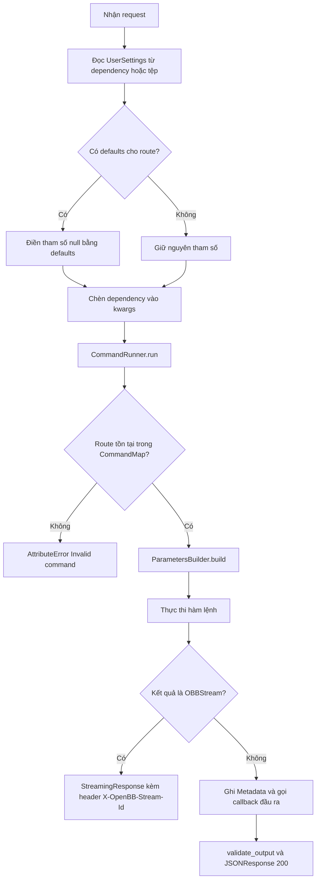

**Call-Stack Sequence Diagram**

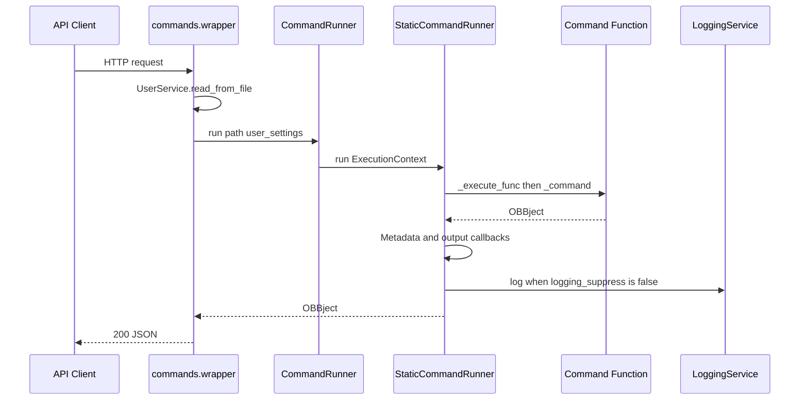

**Exception & Error Handling**

| Error Code | HTTP/Kênh | Điều kiện kích hoạt | Rollback / Xử lý |
|---|---|---|---|
| `ERR-400` | 400 | `OpenBBError` phát sinh trong lệnh hoặc provider | Không có giao dịch cần hoàn tác; handler `ExceptionHandlers.openbb` |
| `ERR-422` | 422 | `ValidationError` từ `QueryParams` hoặc request | Handler `ExceptionHandlers.validation` |
| `ERR-500` | 500 | Ngoại lệ không xác định | Thông báo `Unexpected Error -> <class> -> <msg>` |
| `ERR-204` | 204 | `EmptyDataError` | Trả thân rỗng |
| `AttributeError` | 500 | Route không có trong CommandMap | Chuyển thành lỗi 500 qua handler chung |

#### FR-CORE-002 — Thực thi lệnh qua Python SDK và chuyển đổi kiểu đầu ra

**Code Traceability**

| Thuộc tính | Giá trị |
|---|---|
| Handler | `openbb_platform/core/openbb_core/app/command_runner.py` — `CommandRunner.sync_run`, `CommandRunner.run` |
| Service | `openbb_platform/core/openbb_core/app/model/obbject.py` — `to_df`, `to_dataframe`, `to_polars`, `to_numpy`, `to_dict`, `to_llm` |
| Static container | `openbb_platform/core/openbb_core/app/static/container.py`, `package_builder/` (sinh mã gói `openbb`) |
| Data Entities & Tables | `OBBject`, `Preferences.output_type` |

Chi tiết nhánh lỗi của `to_dataframe` `[SPEC]`: chưa đọc toàn bộ thân hàm.

**UI / Interaction Mockup** `[SPEC]`

```text
┌────────────────────────────────────────────────────────────────────────┐
│ Python SDK: obb.equity.price.historical(symbol=AAPL)                   │
├────────────────────────────────────────────────────────────────────────┤
│ FILTERS: output_type=[OBBject ▼]  index=[date]                         │
├────────────────────────────────────────────────────────────────────────┤
│ │ date       │ close  │ volume   │                                     │
│ │ 2026-10-30 │ 231.40 │ 51200000 │                                     │
├────────────────────────────────────────────────────────────────────────┤
│ OBBject.to_df() -> DataFrame (index=date)                              │
└────────────────────────────────────────────────────────────────────────┘
```

**Preconditions & Postconditions**

| Loại | Nội dung |
|---|---|
| Tiền điều kiện | Gói `openbb` đã được build (`OPENBB_AUTO_BUILD` mặc định true). |
| Tiền điều kiện | Lệnh tồn tại trong CommandMap. |
| Hậu điều kiện | Hệ thống trả đối tượng theo `preferences.output_type`. |

**Inputs & Validation Rules**

| Trường | Kiểu | Bắt buộc | Ràng buộc |
|---|---|---|---|
| `output_type` | Literal | Không | `OBBject`, `dataframe`, `polars`, `numpy`, `dict`, `llm` |
| `index` | str hoặc None | Không | Mặc định `date` khi gọi `to_df` |
| `sort_by`, `ascending` | str, bool | Không | Sắp xếp DataFrame |

**Logic Decision Flowchart**

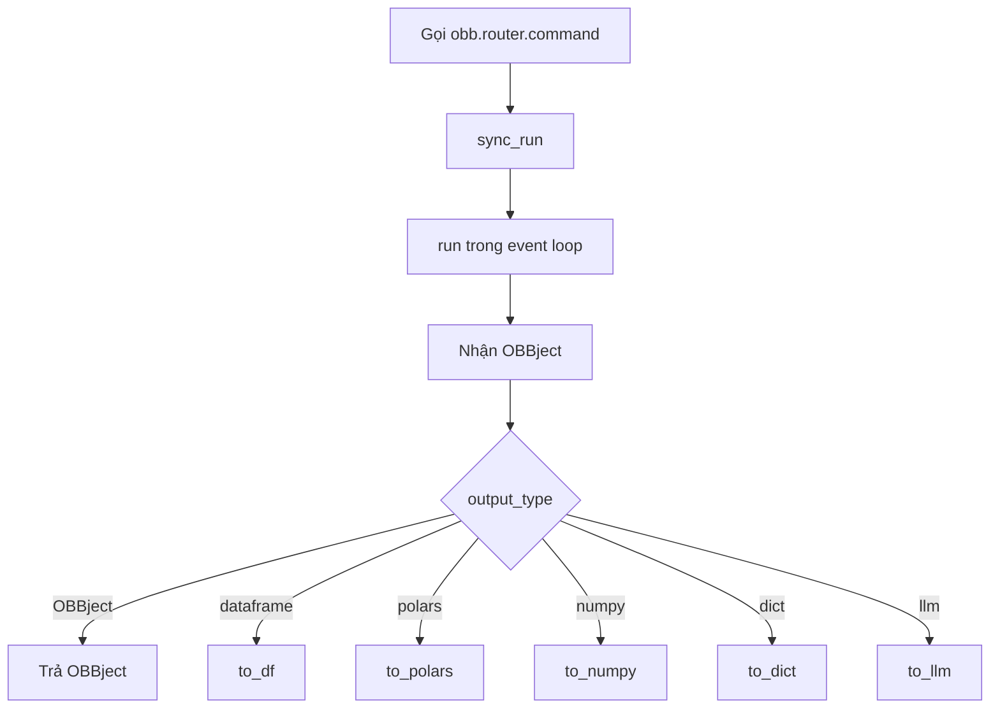

**Call-Stack Sequence Diagram**

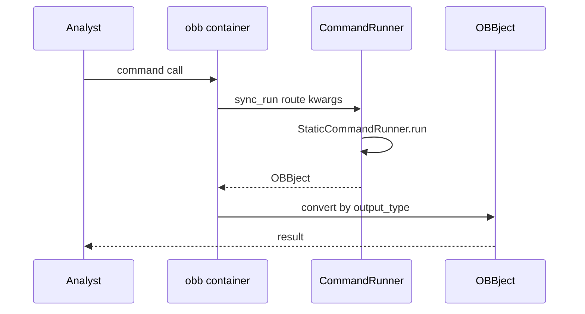

**Exception & Error Handling**

| Error Code | HTTP/Kênh | Điều kiện kích hoạt | Rollback / Xử lý |
|---|---|---|---|
| `AttributeError` | Python exception | Route không hợp lệ | Phát sinh ngoại lệ tới người gọi |
| `OpenBBError` | Python exception | Lỗi lệnh hoặc provider | Phát sinh ngoại lệ; không ghi trạng thái |
| `ValueError` / `OpenBBError` | Python exception | `to_dataframe` không chuyển đổi được `results` | Phát sinh ngoại lệ |

#### FR-CORE-003 — Tra cứu độ phủ lệnh và provider

**Code Traceability**

| Thuộc tính | Giá trị |
|---|---|
| Handler | `openbb_platform/core/openbb_core/api/router/coverage.py` — `get_commands_model_map`, `get_provider_coverage`, `get_command_coverage` |
| Service | `openbb_platform/core/openbb_core/app/router.py` — `CommandMap.get_provider_coverage`, `get_command_coverage`, `get_commands_model` |
| Data Entities & Tables | `CommandMap`, `RegistryMap` (trong bộ nhớ) |

**UI / Interaction Mockup** `[SPEC]`

```text
┌────────────────────────────────────────────────────────────────────────┐
│ GET /coverage/providers                                                │
├────────────────────────────────────────────────────────────────────────┤
│ FILTERS: reference=[providers]                                         │
├────────────────────────────────────────────────────────────────────────┤
│ │ provider │ commands covered                                        │ │
│ │ fred     │ economy.fred_series, economy.cpi, ...                   │ │
├────────────────────────────────────────────────────────────────────────┤
│ Response 200: {provider: [command, ...]}                               │
└────────────────────────────────────────────────────────────────────────┘
```

**Preconditions & Postconditions**

| Loại | Nội dung |
|---|---|
| Tiền điều kiện | Backend đang chạy. |
| Hậu điều kiện | Hệ thống trả bản đồ provider -> lệnh hoặc lệnh -> provider. |

**Inputs & Validation Rules**

| Trường | Kiểu | Bắt buộc | Ràng buộc |
|---|---|---|---|
| (không có tham số truy vấn) | — | — | Các tuyến `coverage/*` loại khỏi widget (`widget_config.exclude`) |

**Logic Decision Flowchart**

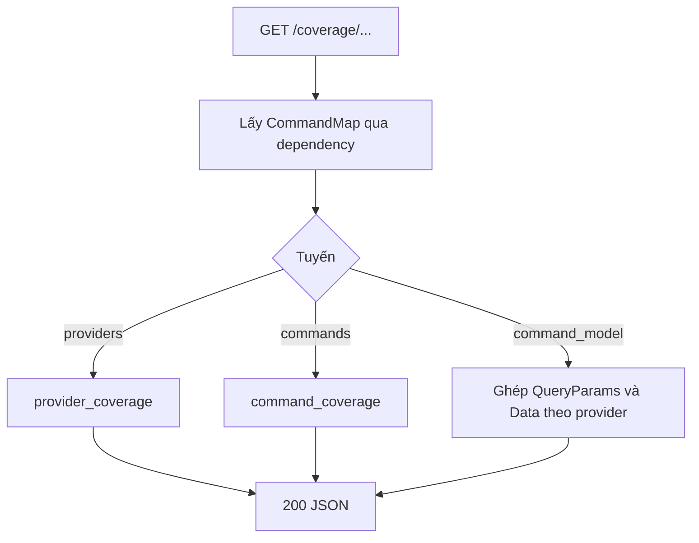

**Call-Stack Sequence Diagram**

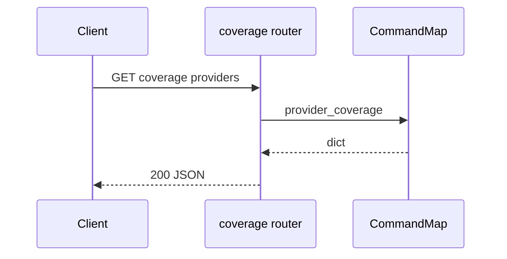

**Exception & Error Handling**

| Error Code | HTTP/Kênh | Điều kiện kích hoạt | Rollback / Xử lý |
|---|---|---|---|
| `ERR-500` | 500 | Lỗi tuần tự hóa `serializer` | Handler chung |

### Module B — Provider Query & Credentials (PRV)

#### FR-PRV-001 — Thực thi truy vấn qua Provider/Fetcher

**Code Traceability**

| Thuộc tính | Giá trị |
|---|---|
| Service | `openbb_platform/core/openbb_core/provider/query_executor.py` — `QueryExecutor.execute`, `get_provider`, `get_fetcher` |
| Fetcher | `openbb_platform/core/openbb_core/provider/abstract/fetcher.py` — `Fetcher.fetch_data`, `transform_query`, `extract_data`/`aextract_data`, `transform_data` |
| Caller | `openbb_platform/core/openbb_core/app/query.py`, `OBBject.from_query` (`obbject.py:359`) |
| Data Entities & Tables | `Provider`, `Registry`, `QueryParams`, `Data` |

**UI / Interaction Mockup** `[SPEC]`

```text
┌────────────────────────────────────────────────────────────────────────┐
│ PROVIDER FETCH PIPELINE                                                │
├────────────────────────────────────────────────────────────────────────┤
│ STEP INDICATOR: (1) transform_query ── [2] extract_data ── (3) transfo │
│ Current: extract_data                                                  │
├────────────────────────────────────────────────────────────────────────┤
│ Provider: [fred]   Model: [FredSeries]                                 │
│ Fetcher.is_streaming: [False]                                          │
│ Timeout: [5 s per request, FredSeriesFetcher]                          │
│                                                                        │
│ [!] Missing credential 'fred_api_key' when require_credentials is true │
├────────────────────────────────────────────────────────────────────────┤
│ [Retry later]                                                          │
└────────────────────────────────────────────────────────────────────────┘
```

**Preconditions & Postconditions**

| Loại | Nội dung |
|---|---|
| Tiền điều kiện | Provider đã đăng ký trong `Registry` qua entry point. |
| Tiền điều kiện | Fetcher cho `model_name` tồn tại trong `fetcher_dict`. |
| Hậu điều kiện | Hệ thống trả `R` hoặc `AnnotatedResult[R]` hoặc luồng (khi `is_streaming`). |

**Inputs & Validation Rules**

| Trường | Kiểu | Bắt buộc | Ràng buộc |
|---|---|---|---|
| `provider_name` | str | Có | Phải tồn tại trong `Registry` |
| `model_name` | str | Có | Phải có trong `Provider.fetcher_dict` |
| `params` | dict | Có | Chuyển thành `QueryParams` bởi `transform_query` |
| `credentials` | dict[str, SecretStr] | Theo provider | Lọc theo `Provider.credentials` |

**Logic Decision Flowchart**

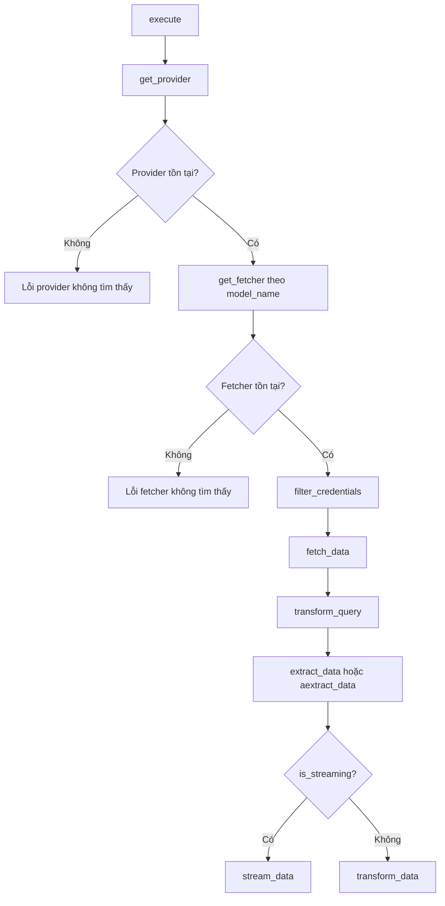

**Call-Stack Sequence Diagram**

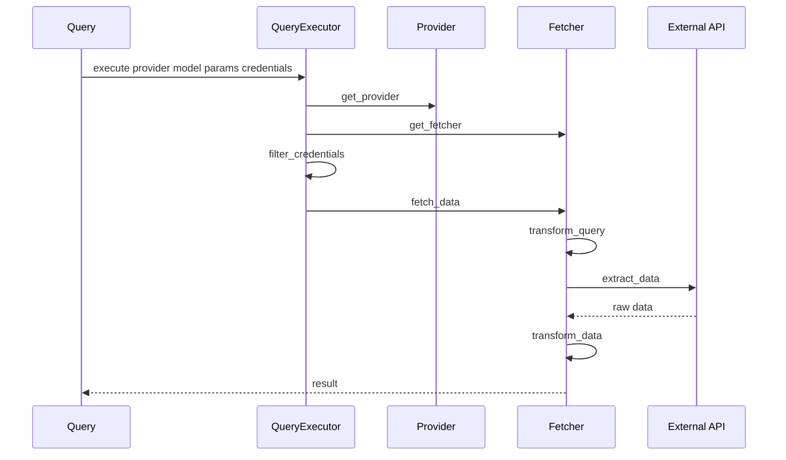

**Exception & Error Handling**

| Error Code | HTTP/Kênh | Điều kiện kích hoạt | Rollback / Xử lý |
|---|---|---|---|
| Provider không tìm thấy | 400 | Tên provider không có trong `Registry` | `get_provider` phát sinh `OpenBBError` `[SPEC]` chưa đọc thân hàm |
| Fetcher không tìm thấy | 400 | Model không có trong `fetcher_dict` | `get_fetcher` phát sinh lỗi `[SPEC]` |
| Lỗi từ API ngoài | 400 | Ngoại lệ trong `extract_data` | Chuyển thành `OpenBBError` |

#### FR-PRV-002 — Kiểm tra và lọc thông tin xác thực provider

**Code Traceability**

| Thuộc tính | Giá trị |
|---|---|
| Service | `openbb_platform/core/openbb_core/provider/query_executor.py:38` — `QueryExecutor.filter_credentials` |
| Model | `openbb_platform/core/openbb_core/app/model/credentials.py` — `CredentialsLoader`, `Credentials` |
| Provider | `openbb_platform/core/openbb_core/provider/abstract/provider.py` — tạo khóa `<name>_<credential>` |
| Data Entities & Tables | `Credentials` trong `user_settings.json` (khóa `credentials`) |

**UI / Interaction Mockup** `[SPEC]`

```text
┌────────────────────────────────────────────────────────────────────────┐
│ CREDENTIAL CHECK                                                       │
├────────────────────────────────────────────────────────────────────────┤
│ FILTERS: provider=[fred]                                               │
├────────────────────────────────────────────────────────────────────────┤
│ │ key          │ status                                                │
│ │ fred_api_key │ [OK] Set / [!] Missing                                │
├────────────────────────────────────────────────────────────────────────┤
│ Missing credential 'fred_api_key'. Check <website> to get it.          │
└────────────────────────────────────────────────────────────────────────┘
```

**Preconditions & Postconditions**

| Loại | Nội dung |
|---|---|
| Tiền điều kiện | Provider khai báo `credentials`. |
| Hậu điều kiện | Hệ thống trả dict chỉ gồm khóa của provider có giá trị khác rỗng. |

**Inputs & Validation Rules**

| Trường | Kiểu | Bắt buộc | Ràng buộc |
|---|---|---|---|
| `credentials` | dict[str, SecretStr] hoặc None | Theo `require_credentials` | Giá trị rỗng coi như vắng mặt |
| `require_credentials` | bool | Có | Thuộc tính của `Fetcher` |

**Logic Decision Flowchart**

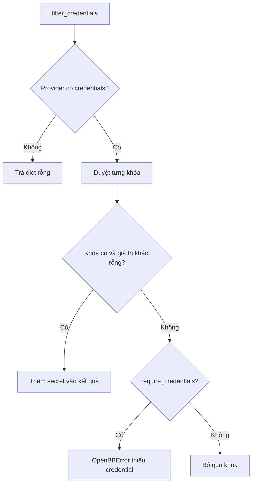

**Call-Stack Sequence Diagram**

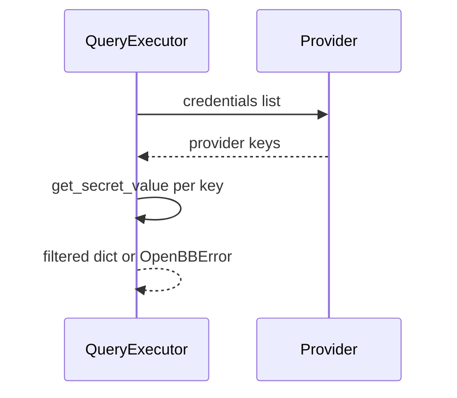

**Exception & Error Handling**

| Error Code | HTTP/Kênh | Điều kiện kích hoạt | Rollback / Xử lý |
|---|---|---|---|
| `OpenBBError` | 400 | `require_credentials` = true và khóa thiếu/rỗng. Thông báo kèm website provider và liên kết tài liệu API keys | Dừng thực thi trước khi gọi `fetch_data`; không gọi API ngoài |

#### FR-PRV-003 — Truy xuất chuỗi thời gian FRED (mẫu Fetcher cụ thể)

**Code Traceability**

| Thuộc tính | Giá trị |
|---|---|
| Fetcher | `openbb_platform/providers/fred/openbb_fred/models/series.py` — `FredSeriesFetcher.transform_query`, `aextract_data`, `transform_data` |
| Provider | `openbb_platform/providers/fred/openbb_fred/__init__.py` — `fred_provider`, credential `api_key` |
| Utility | `openbb_fred/utils/api.py: build_url`, `utils/rate_limiter.py: fred_get` |
| Data Entities & Tables | `FredSeriesQueryParams`, `FredSeriesData`, `SeriesQueryParams` chuẩn `fred_series` |

**UI / Interaction Mockup** `[SPEC]`

```text
┌────────────────────────────────────────────────────────────────────────┐
│ economy.fred_series                                                    │
├────────────────────────────────────────────────────────────────────────┤
│ FILTERS: symbol=[GDP,CPIAUCSL]  frequency=[q ▼]  transform=[pch ▼]     │
├────────────────────────────────────────────────────────────────────────┤
│ │ date       │ GDP       │ CPIAUCSL │                                  │
│ │ 2026-01-01 │ 31000.0   │ 330.1    │                                  │
├────────────────────────────────────────────────────────────────────────┤
│ Metadata per series: title, units, frequency, notes                    │
└────────────────────────────────────────────────────────────────────────┘
```

**Preconditions & Postconditions**

| Loại | Nội dung |
|---|---|
| Tiền điều kiện | Khóa `fred_api_key` đã thiết lập. |
| Tiền điều kiện | `symbol` là một hoặc nhiều series_id cách nhau bằng dấu phẩy. |
| Hậu điều kiện | Hệ thống trả danh sách `FredSeriesData` cùng metadata từng chuỗi trong `AnnotatedResult`. |

**Inputs & Validation Rules**

| Trường | Kiểu | Bắt buộc | Ràng buộc |
|---|---|---|---|
| `symbol` | str | Có | Nhiều giá trị được phép (`multiple_items_allowed`); ánh xạ `series_id` |
| `start_date`/`end_date` | date | Không | Ánh xạ `observation_start`/`observation_end` |
| `frequency` | Literal | Không | `a q m w d wef weth wew wetu wem wesu wesa bwew bwem` |
| `aggregation_method` | Literal | Không | `avg sum eop`, mặc định `eop` |
| `transform` | Literal | Không | `chg ch1 pch pc1 pca cch cca log`; ánh xạ `units` |
| `use_cache` | bool | Không | Từ `UseCacheQueryParams` |

**Logic Decision Flowchart**

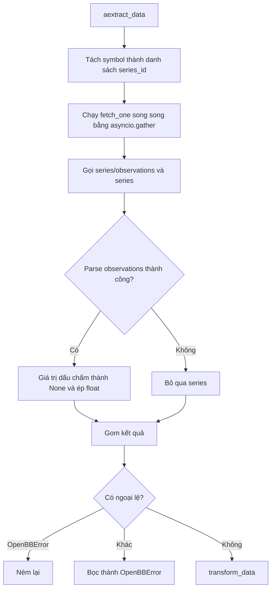

**Call-Stack Sequence Diagram**

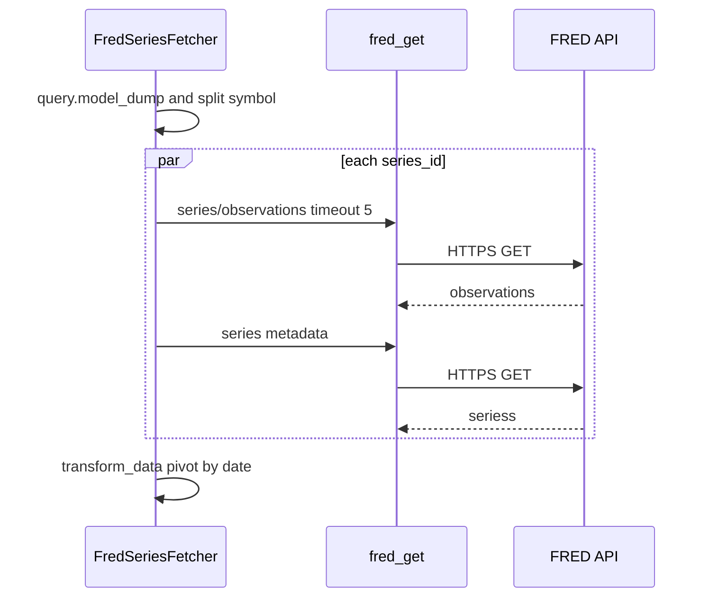

**Exception & Error Handling**

| Error Code | HTTP/Kênh | Điều kiện kích hoạt | Rollback / Xử lý |
|---|---|---|---|
| `OpenBBError` | 400 | Ngoại lệ HTTP/parse; thông báo gốc hoặc `FRED request failed (<type>)` | Ném `OpenBBError` từ ngoại lệ gốc |
| Missing credential | 400 | Thiếu `fred_api_key` (FR-PRV-002) | Dừng trước extract |

### Module C — Authentication (AUTH)

#### FR-AUTH-001 — Xác thực truy cập REST API bằng HTTP Basic

**Code Traceability**

| Thuộc tính | Giá trị |
|---|---|
| Handler | `openbb_platform/core/openbb_core/api/auth/user.py` — `authenticate_user`, `get_user_settings` |
| Service | `openbb_platform/core/openbb_core/app/service/auth_service.py` — `AuthService` |
| Config | `openbb_platform/core/openbb_core/env.py` — `API_AUTH`, `API_USERNAME`, `API_PASSWORD`, `API_AUTH_EXTENSION` |
| Data Entities & Tables | Biến môi trường; `UserSettings` từ `user_settings.json` |

**UI / Interaction Mockup** `[SPEC]`

```text
┌────────────────────────────────────────────────────────────────────────┐
│ API AUTHENTICATION (HTTP Basic prompt)                                 │
├────────────────────────────────────────────────────────────────────────┤
│ STEP INDICATOR: (1) Request ── [2] Verify ── (3) Dispatch              │
│ Current: Verify                                                        │
├────────────────────────────────────────────────────────────────────────┤
│ * Username: [openbb_user]                                              │
│ * Password: [**********]                                               │
│                                                                        │
│ [!] 401 Incorrect email or password                                    │
├────────────────────────────────────────────────────────────────────────┤
│ [ Sign in ]                                                            │
└────────────────────────────────────────────────────────────────────────┘
```

**Preconditions & Postconditions**

| Loại | Nội dung |
|---|---|
| Tiền điều kiện | `OPENBB_API_AUTH` = true. |
| Tiền điều kiện | `OPENBB_API_USERNAME` và `OPENBB_API_PASSWORD` đã đặt. |
| Hậu điều kiện | Yêu cầu hợp lệ được chuyển tiếp và `UserSettings` được nạp từ tệp. |
| Hậu điều kiện | Yêu cầu không hợp lệ bị từ chối. |

**Inputs & Validation Rules**

| Trường | Kiểu | Bắt buộc | Ràng buộc |
|---|---|---|---|
| `Authorization` | Basic base64 | Khi `API_AUTH` bật | username và password so sánh bằng `secrets.compare_digest` trên byte UTF-8 |

**Logic Decision Flowchart**

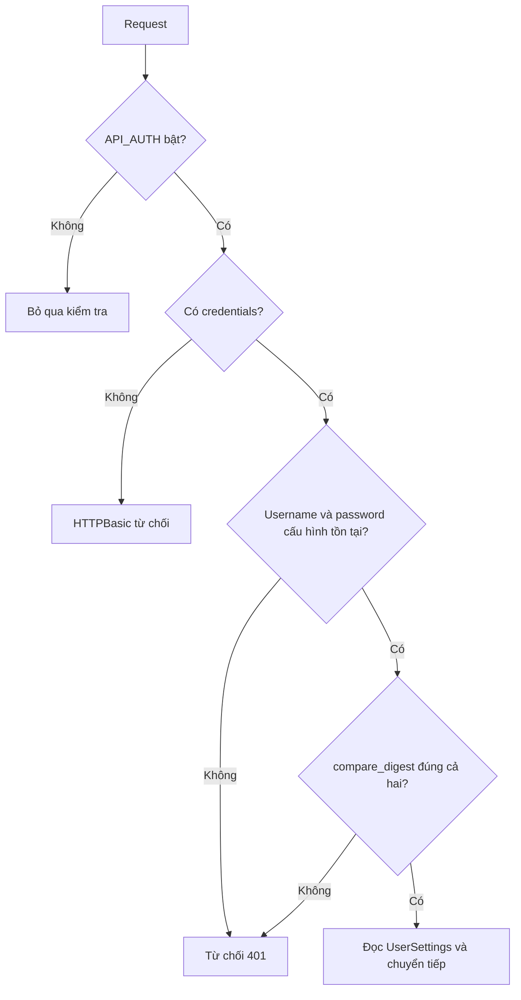

**Call-Stack Sequence Diagram**

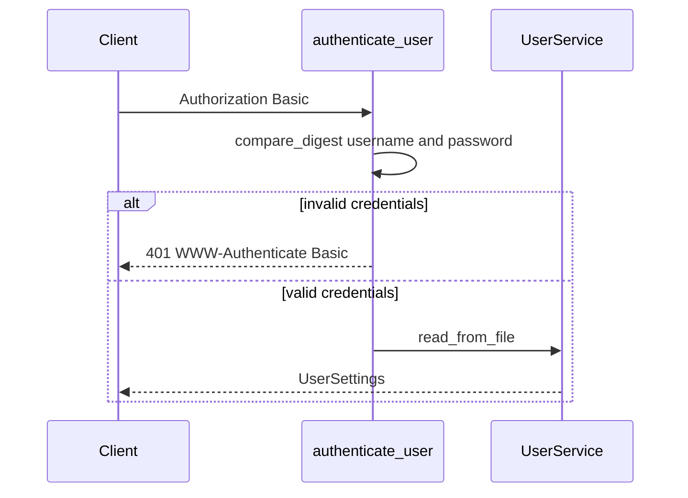

**Exception & Error Handling**

| Error Code | HTTP/Kênh | Điều kiện kích hoạt | Rollback / Xử lý |
|---|---|---|---|
| `HTTP_401_UNAUTHORIZED` | 401 | Sai hoặc thiếu username/password, hoặc biến môi trường chưa đặt | Header `WWW-Authenticate: Basic`; không thực thi lệnh |

### Module D — Extension & Router Loading (EXT)

#### FR-EXT-001 — Nạp extension và đăng ký lệnh vào CommandMap

**Code Traceability**

| Thuộc tính | Giá trị |
|---|---|
| Service | `openbb_platform/core/openbb_core/app/extension_loader.py` — `ExtensionLoader`, `core_objects`, `provider_objects`, `obbject_objects` |
| Router | `openbb_platform/core/openbb_core/app/router.py` — `RouterLoader.from_extensions`, `Router.command`, `CommandMap` |
| Interface | `openbb_platform/core/openbb_core/app/provider_interface.py` — `ProviderInterface` |
| Data Entities & Tables | Entry points nhóm `openbb_core_extension`, `openbb_provider_extension`, `openbb_obbject_extension` |

**UI / Interaction Mockup** `[SPEC]`

```text
┌────────────────────────────────────────────────────────────────────────┐
│ EXTENSION REGISTRY                                                     │
├────────────────────────────────────────────────────────────────────────┤
│ FILTERS: group=[core ▼]                                                │
├────────────────────────────────────────────────────────────────────────┤
│ │ extension  │ type     │ commands                                     │
│ │ equity     │ core     │ 70                                           │
├────────────────────────────────────────────────────────────────────────┤
│ Loaded via importlib.metadata entry points                             │
└────────────────────────────────────────────────────────────────────────┘
```

**Preconditions & Postconditions**

| Loại | Nội dung |
|---|---|
| Tiền điều kiện | Gói extension đã cài trong môi trường Python. |
| Hậu điều kiện | Hệ thống đăng ký router với tiền tố `/<name>`. |
| Hậu điều kiện | Hệ thống phát cảnh báo `OpenBBWarning` và bỏ qua extension lỗi khi `DEBUG_MODE` tắt. |

**Inputs & Validation Rules**

| Trường | Kiểu | Bắt buộc | Ràng buộc |
|---|---|---|---|
| `DEBUG_MODE` | bool | Không | Bật: ném `LoadingError`; tắt: cảnh báo |
| `@router.command(model=...)` | str | Có | Tên model phải có trong `ProviderInterface` |

**Logic Decision Flowchart**

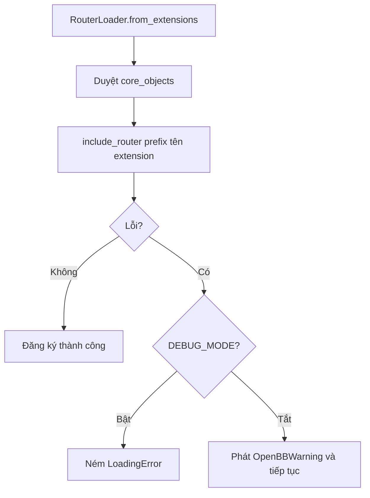

**Call-Stack Sequence Diagram**

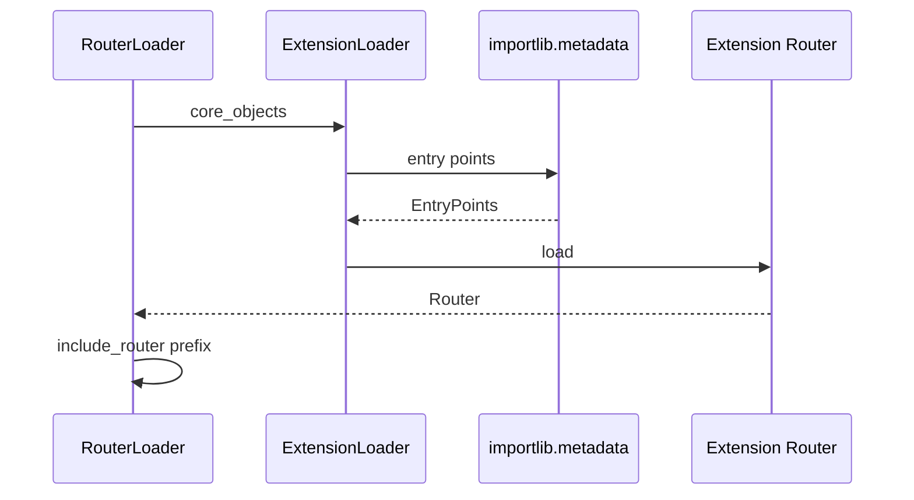

**Exception & Error Handling**

| Error Code | HTTP/Kênh | Điều kiện kích hoạt | Rollback / Xử lý |
|---|---|---|---|
| `LoadingError` | Python exception | Extension lỗi khi `DEBUG_MODE` bật | Dừng khởi động |
| `OpenBBWarning` | Cảnh báo | Extension lỗi khi `DEBUG_MODE` tắt | Bỏ qua extension, tiếp tục nạp phần còn lại |

### Module E — OpenBB CLI (CLI)

#### FR-CLI-001 — Thực thi lệnh nền tảng trong CLI

**Code Traceability**

| Thuộc tính | Giá trị |
|---|---|
| Controller | `cli/openbb_cli/controllers/cli_controller.py` — `CLIController`, `_generate_platform_commands`, `run_cli`, `main`, `parse_args_and_run` |
| Service | `cli/openbb_cli/argparse_translator/argparse_translator.py`, `cli/openbb_cli/backend.py` (`LocalBackend`) |
| Session | `cli/openbb_cli/session.py` — `Session` (singleton), `obbject_registry` |
| Data Entities & Tables | `OBBject` registry trong bộ nhớ; `Settings` (`cli/openbb_cli/models/settings.py`) |

**UI / Interaction Mockup** `[SPEC]`

```text
┌────────────────────────────────────────────────────────────────────────┐
│ OpenBB CLI  /equity/price                                              │
├────────────────────────────────────────────────────────────────────────┤
│ FILTERS: command=[historical --symbol AAPL --provider fmp]             │
├────────────────────────────────────────────────────────────────────────┤
│ │ date       │ open   │ high   │ low    │ close  │                     │
│ │ 2026-10-30 │ 230.10 │ 232.00 │ 229.50 │ 231.40 │                     │
├────────────────────────────────────────────────────────────────────────┤
│ Menus: settings | user | feature | exe   [help] [..] [/]               │
└────────────────────────────────────────────────────────────────────────┘
```

**Preconditions & Postconditions**

| Loại | Nội dung |
|---|---|
| Tiền điều kiện | CLI khởi động; gói `openbb` có sẵn. |
| Hậu điều kiện | Hệ thống hiển thị kết quả dạng bảng/biểu đồ và lưu `OBBject` vào registry (giới hạn bởi `max_obbjects_exceeded`). |

**Inputs & Validation Rules**

| Trường | Kiểu | Bắt buộc | Ràng buộc |
|---|---|---|---|
| Lệnh con | str | Có | Phân giải theo cây router; `ArgparseTranslator` sinh tham số từ chữ ký hàm |
| `--provider` | str | Theo lệnh | Giá trị trong `ProviderChoices` |
| Cờ tham số lệnh | argparse | Theo lệnh | Kiểu dữ liệu từ chú thích; lỗi thể hiện bằng thông báo argparse |

**Logic Decision Flowchart**

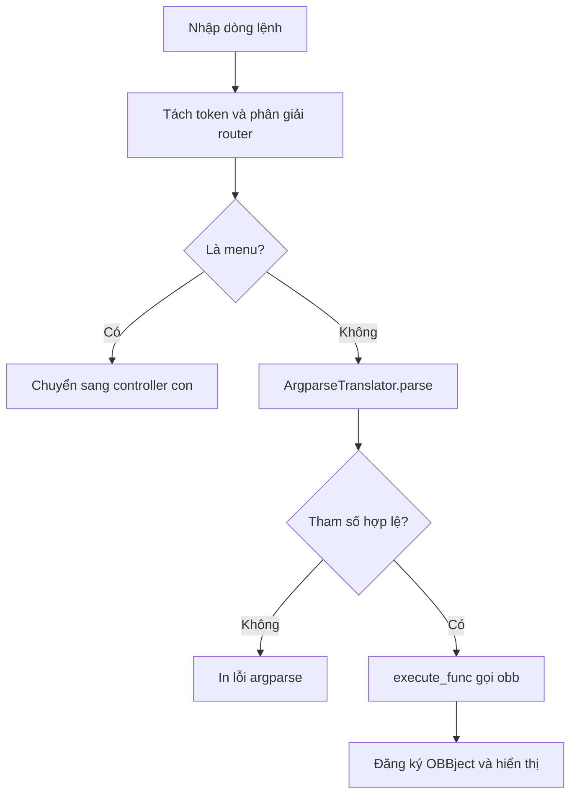

**Call-Stack Sequence Diagram**

```mermaid
sequenceDiagram
    participant U as CLI Operator
    participant C as CLIController
    participant T as ArgparseTranslator
    participant O as obb
    participant S as Session
    U->>C: command line
    C->>T: parse args
    T->>O: execute_func
    O-->>T: OBBject
    T->>S: register in obbject_registry
    S-->>U: render output
```

**Exception & Error Handling**

| Error Code | HTTP/Kênh | Điều kiện kích hoạt | Rollback / Xử lý |
|---|---|---|---|
| Lỗi argparse | Console | Tham số sai hoặc thiếu | In thông báo; không gọi lệnh |
| `OpenBBError` | Console | Lỗi từ lệnh nền tảng | In thông báo lỗi; phiên CLI tiếp tục |

#### FR-CLI-002 — Thiết lập khóa API qua menu credentials

**Code Traceability**

| Thuộc tính | Giá trị |
|---|---|
| Controller | `cli/openbb_cli/controllers/credentials_controller.py` — `CredentialsController._generate_credential_command`, `_set_credential`, `_credential_status` |
| Service | `obb.user.credentials` (`openbb_core/app/model/credentials.py`) |
| Data Entities & Tables | `Credentials` trong `user_settings.json` |

Ghi chú: việc ghi xuống `user_settings.json` do `obb.user` quyết định, mã controller chỉ gán thuộc tính `[UNKNOWN]` nếu tự động lưu.

**UI / Interaction Mockup** `[SPEC]`

```text
┌────────────────────────────────────────────────────────────────────────┐
│ CLI /settings credentials                                              │
├────────────────────────────────────────────────────────────────────────┤
│ STEP INDICATOR: (1) Select key ── [2] Set value ── (3) Confirm         │
│ Current: Set value                                                     │
├────────────────────────────────────────────────────────────────────────┤
│ Command: [fred_api_key --value <KEY>]                                  │
│ Status without value: [Set] / [Not set]                                │
│                                                                        │
│ [!] Không nhập --value thì CLI chỉ hiển thị trạng thái                 │
├────────────────────────────────────────────────────────────────────────┤
│ [ Enter ]                                                              │
└────────────────────────────────────────────────────────────────────────┘
```

**Preconditions & Postconditions**

| Loại | Nội dung |
|---|---|
| Tiền điều kiện | Menu `credentials` được mở; tên trường thuộc `Credentials`. |
| Hậu điều kiện | Hệ thống gán giá trị cho `obb.user.credentials.<field>` và in `Set`. |

**Inputs & Validation Rules**

| Trường | Kiểu | Bắt buộc | Ràng buộc |
|---|---|---|---|
| `-v/--value` | str | Không | Nếu vắng và không có đối số khác, hệ thống in trạng thái của khóa |

**Logic Decision Flowchart**

```mermaid
flowchart TD
    A["Lệnh credential"] --> B["Parse -v value"]
    B --> C{"value khác None?"}
    C -->|Có| D["setattr obb.user.credentials"]
    D --> E["In Set"]
    C -->|Không| F{"Có other_args?"}
    F -->|Không| G["In trạng thái hiện tại"]
    F -->|Có| H["Không thực hiện"]
```

**Call-Stack Sequence Diagram**

```mermaid
sequenceDiagram
    participant U as CLI Operator
    participant C as CredentialsController
    participant K as obb.user.credentials
    U->>C: fred_api_key -v KEY
    C->>K: setattr
    K-->>C: updated
    C-->>U: Set
```

**Exception & Error Handling**

| Error Code | HTTP/Kênh | Điều kiện kích hoạt | Rollback / Xử lý |
|---|---|---|---|
| Lỗi argparse | Console | Tùy chọn không hợp lệ | In thông báo; không đổi khóa |

#### FR-CLI-003 — Chạy routine script bằng lệnh exe

**Code Traceability**

| Thuộc tính | Giá trị |
|---|---|
| Controller | `cli/openbb_cli/controllers/cli_controller.py` — `CLIController.call_exe`, `run_routine`, `run_scripts`, `replace_dynamic` |
| Parser | `cli/openbb_cli/controllers/script_parser.py` |
| Data Entities & Tables | Tệp `.openbb` (văn bản) |

**UI / Interaction Mockup** `[SPEC]`

```text
┌────────────────────────────────────────────────────────────────────────┐
│ EXE ROUTINE                                                            │
├────────────────────────────────────────────────────────────────────────┤
│ STEP INDICATOR: (1) Select file ── [2] Substitute inputs ── (3) Run    │
│ Current: Substitute inputs                                             │
├────────────────────────────────────────────────────────────────────────┤
│ * File: [routines/example.openbb]                                      │
│ * Inputs (-i): [GME,AMC,BTC-USD]                                       │
│                                                                        │
│ [!] Thiếu --file khi không dùng -h hoặc -e                             │
├────────────────────────────────────────────────────────────────────────┤
│ [ Run ]                                                                │
└────────────────────────────────────────────────────────────────────────┘
```

**Preconditions & Postconditions**

| Loại | Nội dung |
|---|---|
| Tiền điều kiện | Tệp routine tồn tại. |
| Hậu điều kiện | Hệ thống thực thi tuần tự từng dòng lệnh, thay biến động bằng giá trị `-i`. |

**Inputs & Validation Rules**

| Trường | Kiểu | Bắt buộc | Ràng buộc |
|---|---|---|---|
| `-f/--file` | str (nhiều) | Có, trừ khi `-h` hoặc `-e` | Đường dẫn tệp `.openbb` |
| `-i/--input` | str | Không | Danh sách phân tách bằng dấu phẩy |
| `-e/--example` | cờ | Không | In ví dụ routine |

**Logic Decision Flowchart**

```mermaid
flowchart TD
    A["exe"] --> B{"other_args rỗng?"}
    B -->|Có| C["In hướng dẫn"]
    B -->|Không| D["Parse file input example"]
    D --> E{"Có example?"}
    E -->|Có| F["In routine mẫu"]
    E -->|Không| G["run_routine"]
    G --> H["Thay biến và chạy từng dòng"]
```

**Call-Stack Sequence Diagram**

```mermaid
sequenceDiagram
    participant U as CLI Operator
    participant C as CLIController
    participant P as script_parser
    U->>C: exe -f file -i args
    C->>P: parse and substitute
    P-->>C: command list
    C->>C: run each command
    C-->>U: output
```

**Exception & Error Handling**

| Error Code | HTTP/Kênh | Điều kiện kích hoạt | Rollback / Xử lý |
|---|---|---|---|
| Lỗi argparse | Console | Thiếu `--file` | In thông báo trợ giúp |

### Module F — Desktop Application (DESK)

#### FR-DESK-001 — Quản lý vòng đời Backend Service

**Code Traceability**

| Thuộc tính | Giá trị |
|---|---|
| UI | `desktop/src/routes/backends.tsx` |
| Handler | `desktop/src-tauri/src/tauri_handlers/backends.rs` — `start_backend_service`, `stop_backend_service`, `list_backend_services`, `create_backend_service`, `update_backend_service`, `delete_backend_service`, `initialize_backends` |
| Validation | `desktop/src-tauri/src/utils/command_sanitizer.rs` — `validate_command_input` |
| Data Entities & Tables | `backends` config JSON (`load_backends_config`/`save_backends_config`); trạng thái `running`, `stopped`, `starting`, `stopping`, `error` |

**UI / Interaction Mockup** `[SPEC]`

```text
┌────────────────────────────────────────────────────────────────────────┐
│ BACKEND SERVICES                                                       │
├────────────────────────────────────────────────────────────────────────┤
│ FILTERS: Search:[ name ]  Status:[ All ▼ ]  [ + New backend ]          │
├────────────────────────────────────────────────────────────────────────┤
│ │ Name        │ Environment │ Port │ Status  │ PID   │ Action        │ │
│ │ openbb-api  │ obb         │ 6900 │ running │ 4312  │ [Stop] [Logs] │ │
│ │ mcp-server  │ obb         │ 8001 │ stopped │ -     │ [Start]       │ │
├────────────────────────────────────────────────────────────────────────┤
│ Fields: name, command, host, port, environment, envFile, autoStart     │
└────────────────────────────────────────────────────────────────────────┘
```

**Preconditions & Postconditions**

| Loại | Nội dung |
|---|---|
| Tiền điều kiện | Bản ghi backend tồn tại trong cấu hình. |
| Tiền điều kiện | Môi trường conda được chỉ định tồn tại. |
| Hậu điều kiện | Hệ thống đặt `status` = `running`, ghi `pid`, `startedAt` khi khởi động thành công. |
| Hậu điều kiện | Hệ thống đặt `status` = `error` và ghi `error` khi lệnh không hợp lệ. |

**Inputs & Validation Rules**

| Trường | Kiểu | Bắt buộc | Ràng buộc |
|---|---|---|---|
| `id` | str | Có | Phải tìm thấy trong cấu hình; nếu không: `Backend not found` |
| `command` | str | Có | Bị từ chối nếu khớp mẫu nguy hiểm (`sudo`, `rm` qua `;`/`|`/`&&`, `$()`, `eval`, `curl | sh`, PowerShell `iex`...) |
| `host`, `port` | str, u16 | Không | — |
| `environment` | str | Có | Tên môi trường conda |
| `envFile`, `envVars` | str, map | Không | Nạp qua `load_env_file` |
| `autoStart` | bool | Không | Khởi động tự động khi `initialize_backends` |

**Logic Decision Flowchart**

```mermaid
flowchart TD
    A["start_backend_service"] --> B["load_backends_config"]
    B --> C{"Tìm thấy id?"}
    C -->|Không| X["Lỗi Backend not found"]
    C -->|Có| D["validate_command_input"]
    D --> E{"Lệnh an toàn?"}
    E -->|Không| F["status = error; lưu cấu hình; trả lỗi"]
    E -->|Có| G{"Đã running và PID còn sống?"}
    G -->|Có| H["Trả backend hiện tại"]
    G -->|Không| I["Khởi tạo tiến trình trong môi trường"]
    I --> J["Theo dõi log và chọn URL tốt nhất"]
    J --> K["status = running"]
```

**Call-Stack Sequence Diagram**

```mermaid
sequenceDiagram
    participant UI as backends.tsx
    participant T as Tauri invoke
    participant H as backends.rs
    participant V as command_sanitizer
    participant P as OS Process
    UI->>T: start_backend_service id
    T->>H: start_backend_service_impl
    H->>H: load_backends_config
    H->>V: validate_command_input
    V-->>H: ok
    H->>P: spawn in conda environment
    P-->>H: stdout stderr
    H->>H: save_backends_config
    H-->>UI: BackendService
```

**Exception & Error Handling**

| Error Code | HTTP/Kênh | Điều kiện kích hoạt | Rollback / Xử lý |
|---|---|---|---|
| `Backend not found` | Tauri Err(String) | `id` không có trong cấu hình | Không đổi trạng thái |
| `Cannot start backend: <reason>` | Tauri Err(String) | Lệnh khớp mẫu nguy hiểm | Ghi `status`=`error`, `error`=`Dangerous command detected`; lưu cấu hình |
| Lỗi khởi tạo tiến trình | Tauri Err(String) | Không spawn được tiến trình `[SPEC]` | Chuẩn hóa thông báo qua `clean_error_message` |

#### FR-DESK-002 — Quản lý môi trường và extension

**Code Traceability**

| Thuộc tính | Giá trị |
|---|---|
| UI | `desktop/src/routes/environments.tsx`, `desktop/src/components/AddExtensionSelector.tsx` |
| Handler | `desktop/src-tauri/src/tauri_handlers/environments.rs` — `create_environment`, `create_environment_from_requirements`, `list_conda_environments`, `get_environment_extensions`, `install_extensions`, `update_extension`, `remove_extension`, `update_environment`, `remove_environment` |
| Data Entities & Tables | Môi trường conda; danh sách gói Python |

**UI / Interaction Mockup** `[SPEC]`

```text
┌────────────────────────────────────────────────────────────────────────┐
│ ENVIRONMENTS                                                           │
├────────────────────────────────────────────────────────────────────────┤
│ FILTERS: Environment:[ obb ▼ ]  [ + New ]  [ From requirements ]       │
├────────────────────────────────────────────────────────────────────────┤
│ │ Extension          │ Version │ Status    │ Action                  │ │
│ │ openbb-equity      │ 2.0.0   │ installed │ [Update] [Remove]       │ │
│ │ openbb-fred        │ 2.0.0   │ installed │ [Update] [Remove]       │ │
├────────────────────────────────────────────────────────────────────────┤
│ [ Install extensions ]   Selected: 0                                   │
└────────────────────────────────────────────────────────────────────────┘
```

**Preconditions & Postconditions**

| Loại | Nội dung |
|---|---|
| Tiền điều kiện | Conda đã cài (FR-DESK-004). |
| Hậu điều kiện | Hệ thống thêm/gỡ/cập nhật gói trong môi trường được chọn. |

**Inputs & Validation Rules**

| Trường | Kiểu | Bắt buộc | Ràng buộc |
|---|---|---|---|
| `name` | str | Có | Tên môi trường conda |
| `directory` | str | Có (`update_environment`) | Thư mục cài đặt |
| `requirements` | tệp | Không | Chọn bằng `select_requirements_file` |

**Logic Decision Flowchart**

```mermaid
flowchart TD
    A["Chọn môi trường"] --> B["get_environment_extensions"]
    B --> C{"Hành động"}
    C -->|Install| D["install_extensions"]
    C -->|Update| E["update_extension"]
    C -->|Remove| F["remove_extension"]
    D --> G["Chạy lệnh trong môi trường"]
    E --> G
    F --> G
    G --> H{"Thành công?"}
    H -->|Có| I["Làm mới danh sách"]
    H -->|Không| J["update_installation_error"]
```

**Call-Stack Sequence Diagram**

```mermaid
sequenceDiagram
    participant UI as environments.tsx
    participant H as environments.rs
    participant C as conda or pip
    UI->>H: install_extensions env packages
    H->>C: execute_in_environment
    C-->>H: exit status
    H-->>UI: result or error string
```

**Exception & Error Handling**

| Error Code | HTTP/Kênh | Điều kiện kích hoạt | Rollback / Xử lý |
|---|---|---|---|
| Lỗi cài đặt | Tauri Err(String) | Lệnh pip/conda trả mã lỗi | Ghi lỗi qua `update_installation_error`; không hoàn tác gói đã cài `[SPEC]` |

#### FR-DESK-003 — Cập nhật khóa API người dùng

**Code Traceability**

| Thuộc tính | Giá trị |
|---|---|
| UI | `desktop/src/routes/api-keys.tsx` |
| Handler | `desktop/src-tauri/src/tauri_handlers/credentials.rs` — `get_user_credentials`, `update_user_credentials`, `open_credentials_file` |
| Data Entities & Tables | `~/.openbb_platform/user_settings.json` (mặc định `{"credentials": {}}`) |

**UI / Interaction Mockup** `[SPEC]`

```text
┌────────────────────────────────────────────────────────────────────────┐
│ API KEYS                                                               │
├────────────────────────────────────────────────────────────────────────┤
│ STEP INDICATOR: (1) Load ── [2] Edit ── (3) Save                       │
│ Current: Edit                                                          │
├────────────────────────────────────────────────────────────────────────┤
│ * fred_api_key        [**********]                                     │
│ * fmp_api_key         [**********]                                     │
│                                                                        │
│ [!] user_settings.json is created with defaults if missing             │
├────────────────────────────────────────────────────────────────────────┤
│ [ Save ]  [ Open file ]                                                │
└────────────────────────────────────────────────────────────────────────┘
```

**Preconditions & Postconditions**

| Loại | Nội dung |
|---|---|
| Tiền điều kiện | Thư mục `~/.openbb_platform` truy cập được. |
| Hậu điều kiện | Hệ thống ghi khóa vào `user_settings.json`; tạo tệp mặc định nếu chưa tồn tại. |

**Inputs & Validation Rules**

| Trường | Kiểu | Bắt buộc | Ràng buộc |
|---|---|---|---|
| `credentials` | JSON object | Có | Cặp `<provider>_<credential>` -> chuỗi |
| `file_name` | str | Không | `user_settings.json` (mặc định), `system_settings.json`, `mcp_settings.json`, `.env`, `.condarc` |

**Logic Decision Flowchart**

```mermaid
flowchart TD
    A["update_user_credentials"] --> B["Đọc user_settings.json"]
    B --> C["Hợp nhất credentials"]
    C --> D["Ghi tệp"]
    D --> E{"Ghi thành công?"}
    E -->|Có| F["Trả true"]
    E -->|Không| G["Trả Err String"]
```

**Call-Stack Sequence Diagram**

```mermaid
sequenceDiagram
    participant UI as api-keys.tsx
    participant H as credentials.rs
    participant FS as File System
    UI->>H: update_user_credentials json
    H->>FS: read user_settings.json
    H->>FS: write merged json
    H-->>UI: true or error
```

**Exception & Error Handling**

| Error Code | HTTP/Kênh | Điều kiện kích hoạt | Rollback / Xử lý |
|---|---|---|---|
| `Could not determine home directory` | Tauri Err(String) | Không xác định được thư mục home | Không ghi tệp |

#### FR-DESK-004 — Cài đặt Conda và giám sát nhật ký backend

**Code Traceability**

| Thuộc tính | Giá trị |
|---|---|
| UI | `desktop/src/routes/setup.tsx`, `installation-progress.tsx`, `backend-logs.tsx`, `desktop/src/components/BackendLogsPage.tsx` |
| Handler | `desktop/src-tauri/src/tauri_handlers/startup.rs` — `install_conda`, `install_to_directory`, `setup_python_environment`, `abort_installation`, `get_installation_status`; `backends.rs: open_backend_logs_window` |
| Data Entities & Tables | Thư mục cài đặt; tệp trạng thái cài đặt |

**UI / Interaction Mockup** `[SPEC]`

```text
┌────────────────────────────────────────────────────────────────────────┐
│ BACKEND LOGS / INSTALLATION MONITOR                                    │
├────────────────────────────────────────────────────────────────────────┤
│ KEY METRICS: Status: running | PID: 4312 | Port: 6900 | Uptime: 02:14: │
├────────────────────────────────────────────────────────────────────────┤
│ [OK]    openbb-api: INFO Uvicorn running on http://0.0.0.0:6900        │
│ [WARN]  openbb-api: OpenBBWarning extension skipped                    │
└────────────────────────────────────────────────────────────────────────┘
```

**Preconditions & Postconditions**

| Loại | Nội dung |
|---|---|
| Tiền điều kiện | Người vận hành chọn thư mục cài đặt hợp lệ. |
| Hậu điều kiện | Hệ thống cài Conda, tạo môi trường Python và cho phép hủy bằng `abort_installation`. |

**Inputs & Validation Rules**

| Trường | Kiểu | Bắt buộc | Ràng buộc |
|---|---|---|---|
| `directory` | str | Có | Phải tồn tại hoặc tạo được (`check_directory_exists`) |

**Logic Decision Flowchart**

```mermaid
flowchart TD
    A["Chọn thư mục"] --> B["check_directory_exists"]
    B --> C["install_conda"]
    C --> D{"Thành công?"}
    D -->|Không| E["update_installation_error"]
    D -->|Có| F["setup_python_environment"]
    F --> G["create_default_backend_services"]
```

**Call-Stack Sequence Diagram**

```mermaid
sequenceDiagram
    participant UI as setup.tsx
    participant S as startup.rs
    participant W as Window events
    UI->>S: install_conda directory
    S->>W: progress events
    S-->>UI: true or error
    UI->>S: setup_python_environment
```

**Exception & Error Handling**

| Error Code | HTTP/Kênh | Điều kiện kích hoạt | Rollback / Xử lý |
|---|---|---|---|
| Lỗi cài đặt Conda | Tauri Err(String) | Tải hoặc chạy trình cài đặt thất bại | Ghi lỗi; cho phép hủy và thử lại |

### Module G — MCP Server & Platform API (MCP)

#### FR-MCP-001 — Khởi chạy MCP Server và xác thực Bearer

**Code Traceability**

| Thuộc tính | Giá trị |
|---|---|
| Entry | `openbb_platform/extensions/mcp_server/openbb_mcp_server/main.py`, `app/args.py` — `parse_args` |
| Service | `openbb_platform/extensions/mcp_server/openbb_mcp_server/app/app.py`, `service/mcp_service.py` — `MCPService` |
| Auth | `openbb_platform/extensions/mcp_server/openbb_mcp_server/app/auth.py` — `TokenAuthProvider.verify_token`, `get_auth_provider` |
| Data Entities & Tables | `mcp_settings.json`; biến môi trường (`MCPService._load_settings_from_env`) |

Mâu thuẫn giá trị mặc định host/port giữa trợ giúp (127.0.0.1:8001) và khối mặc định tại `args.py:89-90` (0.0.0.0:8005) được ghi nhận là `[OPEN]`.

**UI / Interaction Mockup** `[SPEC]`

```text
┌────────────────────────────────────────────────────────────────────────┐
│ MCP SERVER LAUNCH                                                      │
├────────────────────────────────────────────────────────────────────────┤
│ STEP INDICATOR: (1) Parse args ── [2] Build tools ── (3) Serve         │
│ Current: Build tools                                                   │
├────────────────────────────────────────────────────────────────────────┤
│ * transport: [streamable-http ▼]   * host: [127.0.0.1]   * port: [8001 │
│ (•) Bearer auth enabled   ( ) No auth                                  │
│                                                                        │
│ [!] Transport không hợp lệ bị từ chối                                  │
├────────────────────────────────────────────────────────────────────────┤
│ [ Start ]                                                              │
└────────────────────────────────────────────────────────────────────────┘
```

**Preconditions & Postconditions**

| Loại | Nội dung |
|---|---|
| Tiền điều kiện | Gói `openbb-mcp-server` đã cài. |
| Hậu điều kiện | Hệ thống phơi bày lệnh FastAPI dưới dạng công cụ MCP. |
| Hậu điều kiện | Hệ thống chấp nhận Bearer token khi đúng `base64(username:password)`. |

**Inputs & Validation Rules**

| Trường | Kiểu | Bắt buộc | Ràng buộc |
|---|---|---|---|
| `--transport` | str | Không | `streamable-http` (mặc định), `sse`, `stdio` |
| `--host` | str | Không | Mặc định `127.0.0.1` theo trợ giúp |
| `--port` | int | Không | Mặc định `8001` theo trợ giúp |
| Bearer token | base64 | Khi bật auth | Giải mã `validate=True`; thiếu `:` hoặc sai -> `None` |

**Logic Decision Flowchart**

```mermaid
flowchart TD
    A["parse_args"] --> B["Nạp MCPSettings và ghi đè bằng tham số"]
    B --> C["Nhập hoặc dựng ứng dụng FastAPI"]
    C --> D["Đăng ký công cụ từ route"]
    D --> E{"Cấu hình auth?"}
    E -->|Có| F["TokenAuthProvider"]
    E -->|Không| G["Không xác thực"]
    F --> H["Chạy transport"]
    G --> H
```

**Call-Stack Sequence Diagram**

```mermaid
sequenceDiagram
    participant A as MCP Client
    participant S as MCP Server
    participant V as TokenAuthProvider
    participant F as FastAPI app
    A->>S: request with Bearer
    S->>V: verify_token
    V-->>S: AccessToken or None
    S->>F: call tool as route
    F-->>S: JSON
    S-->>A: tool result
```

**Exception & Error Handling**

| Error Code | HTTP/Kênh | Điều kiện kích hoạt | Rollback / Xử lý |
|---|---|---|---|
| Token không hợp lệ | 401 (HTTP transport) | Giải mã base64 lỗi, thiếu dấu `:`, hoặc sai thông tin | `verify_token` trả `None`; không gọi công cụ |

### Module G (bổ sung) — Platform API

| Thuộc tính | Giá trị |
|---|---|
| Mã | FR-MCP-002 `[SPEC]` |
| Chức năng | Hệ thống phải hợp nhất `widgets.json`, `apps.json`, `agents.json` từ ứng dụng FastAPI để Workspace sử dụng |
| Code Traceability | `openbb_platform/extensions/platform_api/openbb_platform_api/service/widgets_service.py`, `apps_service.py`, `agents_service.py`; `utils/merge_widgets.py`, `merge_apps.py`, `merge_agents.py`; `app/args.py` (mặc định host `0.0.0.0`, cổng `6900`) |
| Data Entities | Tệp JSON widgets/apps/agents; `assets/default_apps.json`, `assets/landing_page.html` |
| Ghi chú | Chưa đọc chi tiết logic hợp nhất; mockup, flowchart và sequence diagram cấp chi tiết `[OPEN]` cho vòng bóc tách tiếp theo |

### Module H — Equity Router (EQ) — bóc tách chi tiết 70 lệnh

Phạm vi: toàn bộ lệnh `@router.command` trong `openbb_platform/extensions/equity/openbb_equity/` (70 lệnh, đã đếm bằng AST). Cả 70 lệnh dùng thân hàm chuẩn `return await OBBject.from_query(Query(**locals()))`, nên luồng thực thi chung tuân theo FR-CORE-001, FR-PRV-001, FR-PRV-002; mỗi FR dưới đây xác định route, model, tham số chuẩn, trường dữ liệu và provider theo mã nguồn. Tham số và trường lấy từ lớp `<Model>QueryParams` / `<Model>Data` trong `core/openbb_core/provider/standard_models/`. Provider được liệt kê chỉ gồm gói trong kho; provider ngoài kho (ví dụ fmp, yfinance, intrinio) không kiểm chứng được và ghi `[UNKNOWN]` khi không có provider nào trong kho. Trường riêng của provider (ExtraParams) nằm ngoài phạm vi bảng đầu vào.

#### Module H1 — Equity Core (`/equity`)

##### FR-EQ-001 — `/equity/search` — Search for stock symbol, CIK, LEI, or company name.

**Code Traceability**

| Thuộc tính | Giá trị |
|---|---|
| Controller / Handler | `openbb_platform/extensions/equity/openbb_equity/equity_router.py` — `search` (dòng 50), thân hàm `OBBject.from_query(Query(**locals()))` |
| Model | `EquitySearch` |
| Service | `core/openbb_core/app/query.py` `Query.execute`; `core/openbb_core/provider/query_executor.py` `QueryExecutor.execute` |
| Standard model | `openbb_platform/core/openbb_core/provider/standard_models/equity_search.py` |
| Provider Fetcher | `cboe`: `CboeEquitySearchFetcher` (`openbb_platform/providers/cboe/openbb_cboe/models/equity_search.py`); `finra`: `FinraEquitySearchFetcher` (`openbb_platform/providers/finra/openbb_finra/models/equity_search.py`); `nasdaq`: `NasdaqEquitySearchFetcher` (`openbb_platform/providers/nasdaq/openbb_nasdaq/models/equity_search.py`); `sec`: `SecEquitySearchFetcher` (`openbb_platform/providers/sec/openbb_sec/models/equity_search.py`); `tmx`: `TmxEquitySearchFetcher` (`openbb_platform/providers/tmx/openbb_tmx/models/equity_search.py`) |
| Data Entities & Tables | `EquitySearch` QueryParams/Data (pydantic, trong bộ nhớ); không có bảng CSDL |

**UI / Interaction Mockup** `[SPEC]` — Pattern C

```text
┌────────────────────────────────────────────────────────────────────────┐
│ GET /equity/search  (REST)  |  obb.equity.search  (SDK)                │
├────────────────────────────────────────────────────────────────────────┤
│ FILTERS: provider=[cboe v] query=[<text>] is_symbol=[<bool>]           │
├────────────────────────────────────────────────────────────────────────┤
│  symbol         │ name                                                 │
│  <text>         │ <text>                                               │
├────────────────────────────────────────────────────────────────────────┤
│ Response: OBBject { results[], provider, warnings, extra }             │
└────────────────────────────────────────────────────────────────────────┘
```

**Preconditions & Postconditions**

| Loại | Nội dung |
|---|---|
| Tiền điều kiện | Gói `openbb-equity` đã cài và ít nhất một provider hỗ trợ model `EquitySearch` đã cài. |
| Hậu điều kiện | Hệ thống trả `OBBject` với `results` là danh sách `EquitySearchData` và `provider` là provider đã phục vụ. |
| Hậu điều kiện | Hệ thống không ghi trạng thái; không có giao dịch cần hoàn tác. |

**Inputs & Validation Rules**

| Trường | Kiểu | Bắt buộc | Ràng buộc |
|---|---|---|---|
| `provider` | str | Không (có mặc định) | Thuộc `ProviderChoices`: cboe, finra, nasdaq, sec, tmx |
| `query` | `str` | Không | Chuẩn hóa theo `QueryParams` chuẩn; trường riêng của provider bổ sung qua `ExtraParams` |
| `is_symbol` | `bool` | Không | Chuẩn hóa theo `QueryParams` chuẩn; trường riêng của provider bổ sung qua `ExtraParams` |

**Output fields (`EquitySearchData`)**: `symbol`, `name`

**Logic Decision Flowchart**

```mermaid
flowchart TD
    A["Request /equity/search"] --> B["Validate StandardParams and ExtraParams"]
    B --> C{"Params valid?"}
    C -->|No| E1["422 validation error"]
    C -->|Yes| D["Select provider"]
    D --> G["fetch_data"]
    G --> H{"Provider returned rows?"}
    H -->|No| E3["204 EmptyDataError"]
    H -->|Yes| I["OBBject 200"]
```

**Call-Stack Sequence Diagram**

```mermaid
sequenceDiagram
    participant C as Client
    participant R as search router
    participant Q as Query
    participant X as QueryExecutor
    participant F as Provider Fetcher
    participant E as External API
    C->>R: search params
    R->>Q: from_query
    Q->>X: execute provider EquitySearch
    X->>F: fetch_data
    F->>E: HTTPS request
    E-->>F: raw data
    F-->>X: EquitySearchData list
    X-->>R: result
    R-->>C: OBBject
```

**Exception & Error Handling**

| Error Code | HTTP | Điều kiện kích hoạt | Rollback / Xử lý |
|---|---|---|---|
| `ERR-422` | 422 | Tham số sai kiểu hoặc thiếu trường bắt buộc | Từ chối trước khi gọi provider |
| `ERR-400` | 400 | Provider ném `OpenBBError` hoặc lỗi API ngoài | Chuyển thành `OpenBBError`; không ghi trạng thái |
| `ERR-204` | 204 | `EmptyDataError` | Trả thân rỗng |

##### FR-EQ-002 — `/equity/screener` — Screen for companies meeting various criteria.

**Code Traceability**

| Thuộc tính | Giá trị |
|---|---|
| Controller / Handler | `openbb_platform/extensions/equity/openbb_equity/equity_router.py` — `screener` (dòng 63), thân hàm `OBBject.from_query(Query(**locals()))` |
| Model | `EquityScreener` |
| Service | `core/openbb_core/app/query.py` `Query.execute`; `core/openbb_core/provider/query_executor.py` `QueryExecutor.execute` |
| Standard model | `openbb_platform/core/openbb_core/provider/standard_models/equity_screener.py` |
| Provider Fetcher | `nasdaq`: `NasdaqEquityScreenerFetcher` (`openbb_platform/providers/nasdaq/openbb_nasdaq/models/equity_screener.py`); `tmx`: `TmxEquityScreenerFetcher` (`openbb_platform/providers/tmx/openbb_tmx/models/equity_screener.py`) |
| Data Entities & Tables | `EquityScreener` QueryParams/Data (pydantic, trong bộ nhớ); không có bảng CSDL |

**UI / Interaction Mockup** `[SPEC]` — Pattern C

```text
┌────────────────────────────────────────────────────────────────────────┐
│ GET /equity/screener  (REST)  |  obb.equity.screener  (SDK)            │
├────────────────────────────────────────────────────────────────────────┤
│ FILTERS: provider=[nasdaq v]                                           │
├────────────────────────────────────────────────────────────────────────┤
│  symbol         │ name                                                 │
│  <text>         │ <text>                                               │
├────────────────────────────────────────────────────────────────────────┤
│ Response: OBBject { results[], provider, warnings, extra }             │
└────────────────────────────────────────────────────────────────────────┘
```

**Preconditions & Postconditions**

| Loại | Nội dung |
|---|---|
| Tiền điều kiện | Gói `openbb-equity` đã cài và ít nhất một provider hỗ trợ model `EquityScreener` đã cài. |
| Hậu điều kiện | Hệ thống trả `OBBject` với `results` là danh sách `EquityScreenerData` và `provider` là provider đã phục vụ. |
| Hậu điều kiện | Hệ thống không ghi trạng thái; không có giao dịch cần hoàn tác. |

**Inputs & Validation Rules**

| Trường | Kiểu | Bắt buộc | Ràng buộc |
|---|---|---|---|
| `provider` | str | Không (có mặc định) | Thuộc `ProviderChoices`: nasdaq, tmx |
| (tham số chuẩn) | — | — | `[UNKNOWN]` — không xác định từ `standard_models` |

**Output fields (`EquityScreenerData`)**: `symbol`, `name`

**Logic Decision Flowchart**

```mermaid
flowchart TD
    A["Request /equity/screener"] --> B["Validate StandardParams and ExtraParams"]
    B --> C{"Params valid?"}
    C -->|No| E1["422 validation error"]
    C -->|Yes| D["Select provider"]
    D --> G["fetch_data"]
    G --> H{"Provider returned rows?"}
    H -->|No| E3["204 EmptyDataError"]
    H -->|Yes| I["OBBject 200"]
```

**Call-Stack Sequence Diagram**

```mermaid
sequenceDiagram
    participant C as Client
    participant R as screener router
    participant Q as Query
    participant X as QueryExecutor
    participant F as Provider Fetcher
    participant E as External API
    C->>R: screener params
    R->>Q: from_query
    Q->>X: execute provider EquityScreener
    X->>F: fetch_data
    F->>E: HTTPS request
    E-->>F: raw data
    F-->>X: EquityScreenerData list
    X-->>R: result
    R-->>C: OBBject
```

**Exception & Error Handling**

| Error Code | HTTP | Điều kiện kích hoạt | Rollback / Xử lý |
|---|---|---|---|
| `ERR-422` | 422 | Tham số sai kiểu hoặc thiếu trường bắt buộc | Từ chối trước khi gọi provider |
| `ERR-400` | 400 | Provider ném `OpenBBError` hoặc lỗi API ngoài | Chuyển thành `OpenBBError`; không ghi trạng thái |
| `ERR-204` | 204 | `EmptyDataError` | Trả thân rỗng |

##### FR-EQ-003 — `/equity/profile` — Get general information about a company. This includes company name, industry, sector and price data.

**Code Traceability**

| Thuộc tính | Giá trị |
|---|---|
| Controller / Handler | `openbb_platform/extensions/equity/openbb_equity/equity_router.py` — `profile` (dòng 80), thân hàm `OBBject.from_query(Query(**locals()))` |
| Model | `EquityInfo` |
| Service | `core/openbb_core/app/query.py` `Query.execute`; `core/openbb_core/provider/query_executor.py` `QueryExecutor.execute` |
| Standard model | `openbb_platform/core/openbb_core/provider/standard_models/equity_info.py` |
| Provider Fetcher | `finra`: `FinraEquityInfoFetcher` (`openbb_platform/providers/finra/openbb_finra/models/equity_info.py`); `nasdaq`: `NasdaqEquityInfoFetcher` (`openbb_platform/providers/nasdaq/openbb_nasdaq/models/equity_info.py`); `tmx`: `TmxEquityProfileFetcher` (`openbb_platform/providers/tmx/openbb_tmx/models/equity_profile.py`) |
| Data Entities & Tables | `EquityInfo` QueryParams/Data (pydantic, trong bộ nhớ); không có bảng CSDL |

**UI / Interaction Mockup** `[SPEC]` — Pattern C

```text
┌────────────────────────────────────────────────────────────────────────┐
│ GET /equity/profile  (REST)  |  obb.equity.profile  (SDK)              │
├────────────────────────────────────────────────────────────────────────┤
│ FILTERS: provider=[finra v] symbol=[<text>]                            │
├────────────────────────────────────────────────────────────────────────┤
│  symbol         │ name           │ cik            │ cusip              │
│  <text>         │ <text>         │ <text>         │ <text>             │
├────────────────────────────────────────────────────────────────────────┤
│ Response: OBBject { results[], provider, warnings, extra }             │
└────────────────────────────────────────────────────────────────────────┘
```

**Preconditions & Postconditions**

| Loại | Nội dung |
|---|---|
| Tiền điều kiện | Gói `openbb-equity` đã cài và ít nhất một provider hỗ trợ model `EquityInfo` đã cài. |
| Hậu điều kiện | Hệ thống trả `OBBject` với `results` là danh sách `EquityInfoData` và `provider` là provider đã phục vụ. |
| Hậu điều kiện | Hệ thống không ghi trạng thái; không có giao dịch cần hoàn tác. |

**Inputs & Validation Rules**

| Trường | Kiểu | Bắt buộc | Ràng buộc |
|---|---|---|---|
| `provider` | str | Không (có mặc định) | Thuộc `ProviderChoices`: finra, nasdaq, tmx |
| `symbol` | `str` | Có | Chuẩn hóa theo `QueryParams` chuẩn; trường riêng của provider bổ sung qua `ExtraParams` |

**Output fields (`EquityInfoData`)**: `symbol`, `name`, `cik`, `cusip`, `isin`, `lei`, `legal_name`, `stock_exchange`, `sic`, `short_description`, `long_description`, `ceo`, `company_url`, `business_address`, `mailing_address`, `business_phone_no`, `hq_address1`, `hq_address2`, `hq_address_city`, `hq_address_postal_code`, `hq_state`, `hq_country`, `inc_state`, `inc_country`, `employees` ...

**Logic Decision Flowchart**

```mermaid
flowchart TD
    A["Request /equity/profile"] --> B["Validate StandardParams and ExtraParams"]
    B --> C{"Params valid?"}
    C -->|No| E1["422 validation error"]
    C -->|Yes| D["Select provider"]
    D --> G["fetch_data"]
    G --> H{"Provider returned rows?"}
    H -->|No| E3["204 EmptyDataError"]
    H -->|Yes| I["OBBject 200"]
```

**Call-Stack Sequence Diagram**

```mermaid
sequenceDiagram
    participant C as Client
    participant R as profile router
    participant Q as Query
    participant X as QueryExecutor
    participant F as Provider Fetcher
    participant E as External API
    C->>R: profile params
    R->>Q: from_query
    Q->>X: execute provider EquityInfo
    X->>F: fetch_data
    F->>E: HTTPS request
    E-->>F: raw data
    F-->>X: EquityInfoData list
    X-->>R: result
    R-->>C: OBBject
```

**Exception & Error Handling**

| Error Code | HTTP | Điều kiện kích hoạt | Rollback / Xử lý |
|---|---|---|---|
| `ERR-422` | 422 | Tham số sai kiểu hoặc thiếu trường bắt buộc | Từ chối trước khi gọi provider |
| `ERR-400` | 400 | Provider ném `OpenBBError` hoặc lỗi API ngoài | Chuyển thành `OpenBBError`; không ghi trạng thái |
| `ERR-204` | 204 | `EmptyDataError` | Trả thân rỗng |

##### FR-EQ-004 — `/equity/market_snapshots` — Get an updated equity market snapshot. This includes price data for thousands of stocks.

**Code Traceability**

| Thuộc tính | Giá trị |
|---|---|
| Controller / Handler | `openbb_platform/extensions/equity/openbb_equity/equity_router.py` — `market_snapshots` (dòng 93), thân hàm `OBBject.from_query(Query(**locals()))` |
| Model | `MarketSnapshots` |
| Service | `core/openbb_core/app/query.py` `Query.execute`; `core/openbb_core/provider/query_executor.py` `QueryExecutor.execute` |
| Standard model | `openbb_platform/core/openbb_core/provider/standard_models/market_snapshots.py` |
| Provider Fetcher | `[UNKNOWN]` — không có provider trong kho (`openbb_platform/providers/*`) đăng ký model này; triển khai nằm ở gói provider ngoài kho (ví dụ fmp, yfinance) |
| Data Entities & Tables | `MarketSnapshots` QueryParams/Data (pydantic, trong bộ nhớ); không có bảng CSDL |

**UI / Interaction Mockup** `[SPEC]` — Pattern C

```text
┌────────────────────────────────────────────────────────────────────────┐
│ GET /equity/market_snapshots  (REST)  |  obb.equity.market_snapshots   │
├────────────────────────────────────────────────────────────────────────┤
│ FILTERS: provider=[provider v]                                         │
├────────────────────────────────────────────────────────────────────────┤
│  exchange       │ symbol         │ name           │ open               │
│  <text>         │ <text>         │ <text>         │ <number>           │
├────────────────────────────────────────────────────────────────────────┤
│ Response: OBBject { results[], provider, warnings, extra }             │
└────────────────────────────────────────────────────────────────────────┘
```

**Preconditions & Postconditions**

| Loại | Nội dung |
|---|---|
| Tiền điều kiện | Gói `openbb-equity` đã cài và ít nhất một provider hỗ trợ model `MarketSnapshots` đã cài. |
| Hậu điều kiện | Hệ thống trả `OBBject` với `results` là danh sách `MarketSnapshotsData` và `provider` là provider đã phục vụ. |
| Hậu điều kiện | Hệ thống không ghi trạng thái; không có giao dịch cần hoàn tác. |

**Inputs & Validation Rules**

| Trường | Kiểu | Bắt buộc | Ràng buộc |
|---|---|---|---|
| `provider` | str | Không (có mặc định) | Thuộc `ProviderChoices`: [UNKNOWN] |
| (tham số chuẩn) | — | — | `[UNKNOWN]` — không xác định từ `standard_models` |

**Output fields (`MarketSnapshotsData`)**: `exchange`, `symbol`, `name`, `open`, `high`, `low`, `close`, `volume`, `prev_close`, `change`, `change_percent`

**Logic Decision Flowchart**

```mermaid
flowchart TD
    A["Request /equity/market_snapshots"] --> B["Validate StandardParams and ExtraParams"]
    B --> C{"Params valid?"}
    C -->|No| E1["422 validation error"]
    C -->|Yes| D["Select provider"]
    D --> G["fetch_data"]
    G --> H{"Provider returned rows?"}
    H -->|No| E3["204 EmptyDataError"]
    H -->|Yes| I["OBBject 200"]
```

**Call-Stack Sequence Diagram**

```mermaid
sequenceDiagram
    participant C as Client
    participant R as market_snapshots router
    participant Q as Query
    participant X as QueryExecutor
    participant F as Provider Fetcher
    participant E as External API
    C->>R: market_snapshots params
    R->>Q: from_query
    Q->>X: execute provider MarketSnapshots
    X->>F: fetch_data
    F->>E: HTTPS request
    E-->>F: raw data
    F-->>X: MarketSnapshotsData list
    X-->>R: result
    R-->>C: OBBject
```

**Exception & Error Handling**

| Error Code | HTTP | Điều kiện kích hoạt | Rollback / Xử lý |
|---|---|---|---|
| `ERR-422` | 422 | Tham số sai kiểu hoặc thiếu trường bắt buộc | Từ chối trước khi gọi provider |
| `ERR-400` | 400 | Provider ném `OpenBBError` hoặc lỗi API ngoài | Chuyển thành `OpenBBError`; không ghi trạng thái |
| `ERR-204` | 204 | `EmptyDataError` | Trả thân rỗng |

##### FR-EQ-005 — `/equity/historical_market_cap` — Get the historical market cap of a ticker symbol.

**Code Traceability**

| Thuộc tính | Giá trị |
|---|---|
| Controller / Handler | `openbb_platform/extensions/equity/openbb_equity/equity_router.py` — `historical_market_cap` (dòng 107), thân hàm `OBBject.from_query(Query(**locals()))` |
| Model | `HistoricalMarketCap` |
| Service | `core/openbb_core/app/query.py` `Query.execute`; `core/openbb_core/provider/query_executor.py` `QueryExecutor.execute` |
| Standard model | `openbb_platform/core/openbb_core/provider/standard_models/historical_market_cap.py` |
| Provider Fetcher | `[UNKNOWN]` — không có provider trong kho (`openbb_platform/providers/*`) đăng ký model này; triển khai nằm ở gói provider ngoài kho (ví dụ fmp, yfinance) |
| Data Entities & Tables | `HistoricalMarketCap` QueryParams/Data (pydantic, trong bộ nhớ); không có bảng CSDL |

**UI / Interaction Mockup** `[SPEC]` — Pattern C

```text
┌────────────────────────────────────────────────────────────────────────┐
│ GET /equity/historical_market_cap  (REST)  |  obb.equity.historical_ma │
├────────────────────────────────────────────────────────────────────────┤
│ FILTERS: provider=[provider v] symbol=[<text>] start_date=[YYYY-MM-DD] │
├────────────────────────────────────────────────────────────────────────┤
│  date           │ symbol         │ market_cap                          │
│  YYYY-MM-DD     │ <text>         │ <number>                            │
├────────────────────────────────────────────────────────────────────────┤
│ Response: OBBject { results[], provider, warnings, extra }             │
└────────────────────────────────────────────────────────────────────────┘
```

**Preconditions & Postconditions**

| Loại | Nội dung |
|---|---|
| Tiền điều kiện | Gói `openbb-equity` đã cài và ít nhất một provider hỗ trợ model `HistoricalMarketCap` đã cài. |
| Hậu điều kiện | Hệ thống trả `OBBject` với `results` là danh sách `HistoricalMarketCapData` và `provider` là provider đã phục vụ. |
| Hậu điều kiện | Hệ thống không ghi trạng thái; không có giao dịch cần hoàn tác. |

**Inputs & Validation Rules**

| Trường | Kiểu | Bắt buộc | Ràng buộc |
|---|---|---|---|
| `provider` | str | Không (có mặc định) | Thuộc `ProviderChoices`: [UNKNOWN] |
| `symbol` | `str` | Có | Chuẩn hóa theo `QueryParams` chuẩn; trường riêng của provider bổ sung qua `ExtraParams` |
| `start_date` | `dateType \| None` | Không | Chuẩn hóa theo `QueryParams` chuẩn; trường riêng của provider bổ sung qua `ExtraParams` |
| `end_date` | `dateType \| None` | Không | Chuẩn hóa theo `QueryParams` chuẩn; trường riêng của provider bổ sung qua `ExtraParams` |

**Output fields (`HistoricalMarketCapData`)**: `date`, `symbol`, `market_cap`

**Logic Decision Flowchart**

```mermaid
flowchart TD
    A["Request /equity/historical_market_cap"] --> B["Validate StandardParams and ExtraParams"]
    B --> C{"Params valid?"}
    C -->|No| E1["422 validation error"]
    C -->|Yes| D["Select provider"]
    D --> G["fetch_data"]
    G --> H{"Provider returned rows?"}
    H -->|No| E3["204 EmptyDataError"]
    H -->|Yes| I["OBBject 200"]
```

**Call-Stack Sequence Diagram**

```mermaid
sequenceDiagram
    participant C as Client
    participant R as historical_market_cap router
    participant Q as Query
    participant X as QueryExecutor
    participant F as Provider Fetcher
    participant E as External API
    C->>R: historical_market_cap params
    R->>Q: from_query
    Q->>X: execute provider HistoricalMarketCap
    X->>F: fetch_data
    F->>E: HTTPS request
    E-->>F: raw data
    F-->>X: HistoricalMarketCapData list
    X-->>R: result
    R-->>C: OBBject
```

**Exception & Error Handling**

| Error Code | HTTP | Điều kiện kích hoạt | Rollback / Xử lý |
|---|---|---|---|
| `ERR-422` | 422 | Tham số sai kiểu hoặc thiếu trường bắt buộc | Từ chối trước khi gọi provider |
| `ERR-400` | 400 | Provider ném `OpenBBError` hoặc lỗi API ngoài | Chuyển thành `OpenBBError`; không ghi trạng thái |
| `ERR-204` | 204 | `EmptyDataError` | Trả thân rỗng |

#### Module H2 — Price (`/equity/price`)

##### FR-EQ-006 — `/equity/price/quote` — Get the latest quote for a given stock. Quote includes price, volume, and other data.

**Code Traceability**

| Thuộc tính | Giá trị |
|---|---|
| Controller / Handler | `openbb_platform/extensions/equity/openbb_equity/price/price_router.py` — `quote` (dòng 21), thân hàm `OBBject.from_query(Query(**locals()))` |
| Model | `EquityQuote` |
| Service | `core/openbb_core/app/query.py` `Query.execute`; `core/openbb_core/provider/query_executor.py` `QueryExecutor.execute` |
| Standard model | `openbb_platform/core/openbb_core/provider/standard_models/equity_quote.py` |
| Provider Fetcher | `cboe`: `CboeEquityQuoteFetcher` (`openbb_platform/providers/cboe/openbb_cboe/models/equity_quote.py`); `nasdaq`: `NasdaqEquityQuoteFetcher` (`openbb_platform/providers/nasdaq/openbb_nasdaq/models/equity_quote.py`); `tmx`: `TmxEquityQuoteFetcher` (`openbb_platform/providers/tmx/openbb_tmx/models/equity_quote.py`) |
| Data Entities & Tables | `EquityQuote` QueryParams/Data (pydantic, trong bộ nhớ); không có bảng CSDL |

**UI / Interaction Mockup** `[SPEC]` — Pattern C

```text
┌────────────────────────────────────────────────────────────────────────┐
│ GET /equity/price/quote  (REST)  |  obb.equity.price.quote  (SDK)      │
├────────────────────────────────────────────────────────────────────────┤
│ FILTERS: provider=[cboe v] symbol=[<text>]                             │
├────────────────────────────────────────────────────────────────────────┤
│  symbol         │ asset_type     │ name           │ exchange           │
│  <text>         │ <text>         │ <text>         │ <text>             │
├────────────────────────────────────────────────────────────────────────┤
│ Response: OBBject { results[], provider, warnings, extra }             │
└────────────────────────────────────────────────────────────────────────┘
```

**Preconditions & Postconditions**

| Loại | Nội dung |
|---|---|
| Tiền điều kiện | Gói `openbb-equity` đã cài và ít nhất một provider hỗ trợ model `EquityQuote` đã cài. |
| Hậu điều kiện | Hệ thống trả `OBBject` với `results` là danh sách `EquityQuoteData` và `provider` là provider đã phục vụ. |
| Hậu điều kiện | Hệ thống không ghi trạng thái; không có giao dịch cần hoàn tác. |

**Inputs & Validation Rules**

| Trường | Kiểu | Bắt buộc | Ràng buộc |
|---|---|---|---|
| `provider` | str | Không (có mặc định) | Thuộc `ProviderChoices`: cboe, nasdaq, tmx |
| `symbol` | `str` | Có | Chuẩn hóa theo `QueryParams` chuẩn; trường riêng của provider bổ sung qua `ExtraParams` |

**Output fields (`EquityQuoteData`)**: `symbol`, `asset_type`, `name`, `exchange`, `bid`, `bid_size`, `bid_exchange`, `ask`, `ask_size`, `ask_exchange`, `quote_conditions`, `quote_indicators`, `sales_conditions`, `sequence_number`, `market_center`, `participant_timestamp`, `trf_timestamp`, `sip_timestamp`, `last_price`, `last_tick`, `last_size`, `last_timestamp`, `open`, `high`, `low` ...

**Logic Decision Flowchart**

```mermaid
flowchart TD
    A["Request /equity/price/quote"] --> B["Validate StandardParams and ExtraParams"]
    B --> C{"Params valid?"}
    C -->|No| E1["422 validation error"]
    C -->|Yes| D["Select provider"]
    D --> G["fetch_data"]
    G --> H{"Provider returned rows?"}
    H -->|No| E3["204 EmptyDataError"]
    H -->|Yes| I["OBBject 200"]
```

**Call-Stack Sequence Diagram**

```mermaid
sequenceDiagram
    participant C as Client
    participant R as quote router
    participant Q as Query
    participant X as QueryExecutor
    participant F as Provider Fetcher
    participant E as External API
    C->>R: quote params
    R->>Q: from_query
    Q->>X: execute provider EquityQuote
    X->>F: fetch_data
    F->>E: HTTPS request
    E-->>F: raw data
    F-->>X: EquityQuoteData list
    X-->>R: result
    R-->>C: OBBject
```

**Exception & Error Handling**

| Error Code | HTTP | Điều kiện kích hoạt | Rollback / Xử lý |
|---|---|---|---|
| `ERR-422` | 422 | Tham số sai kiểu hoặc thiếu trường bắt buộc | Từ chối trước khi gọi provider |
| `ERR-400` | 400 | Provider ném `OpenBBError` hoặc lỗi API ngoài | Chuyển thành `OpenBBError`; không ghi trạng thái |
| `ERR-204` | 204 | `EmptyDataError` | Trả thân rỗng |

##### FR-EQ-007 — `/equity/price/nbbo` — Get the National Best Bid and Offer for a given stock.

**Code Traceability**

| Thuộc tính | Giá trị |
|---|---|
| Controller / Handler | `openbb_platform/extensions/equity/openbb_equity/price/price_router.py` — `nbbo` (dòng 34), thân hàm `OBBject.from_query(Query(**locals()))` |
| Model | `EquityNBBO` |
| Service | `core/openbb_core/app/query.py` `Query.execute`; `core/openbb_core/provider/query_executor.py` `QueryExecutor.execute` |
| Standard model | `openbb_platform/core/openbb_core/provider/standard_models/equity_nbbo.py` |
| Provider Fetcher | `[UNKNOWN]` — không có provider trong kho (`openbb_platform/providers/*`) đăng ký model này; triển khai nằm ở gói provider ngoài kho (ví dụ fmp, yfinance) |
| Data Entities & Tables | `EquityNBBO` QueryParams/Data (pydantic, trong bộ nhớ); không có bảng CSDL |

**UI / Interaction Mockup** `[SPEC]` — Pattern C

```text
┌────────────────────────────────────────────────────────────────────────┐
│ GET /equity/price/nbbo  (REST)  |  obb.equity.price.nbbo  (SDK)        │
├────────────────────────────────────────────────────────────────────────┤
│ FILTERS: provider=[provider v] symbol=[<text>]                         │
├────────────────────────────────────────────────────────────────────────┤
│  ask_exchange   │ ask            │ ask_size       │ bid_size           │
│  <text>         │ <number>       │ <number>       │ <number>           │
├────────────────────────────────────────────────────────────────────────┤
│ Response: OBBject { results[], provider, warnings, extra }             │
└────────────────────────────────────────────────────────────────────────┘
```

**Preconditions & Postconditions**

| Loại | Nội dung |
|---|---|
| Tiền điều kiện | Gói `openbb-equity` đã cài và ít nhất một provider hỗ trợ model `EquityNBBO` đã cài. |
| Hậu điều kiện | Hệ thống trả `OBBject` với `results` là danh sách `EquityNBBOData` và `provider` là provider đã phục vụ. |
| Hậu điều kiện | Hệ thống không ghi trạng thái; không có giao dịch cần hoàn tác. |

**Inputs & Validation Rules**

| Trường | Kiểu | Bắt buộc | Ràng buộc |
|---|---|---|---|
| `provider` | str | Không (có mặc định) | Thuộc `ProviderChoices`: [UNKNOWN] |
| `symbol` | `str` | Có | Chuẩn hóa theo `QueryParams` chuẩn; trường riêng của provider bổ sung qua `ExtraParams` |

**Output fields (`EquityNBBOData`)**: `ask_exchange`, `ask`, `ask_size`, `bid_size`, `bid`, `bid_exchange`

**Logic Decision Flowchart**

```mermaid
flowchart TD
    A["Request /equity/price/nbbo"] --> B["Validate StandardParams and ExtraParams"]
    B --> C{"Params valid?"}
    C -->|No| E1["422 validation error"]
    C -->|Yes| D["Select provider"]
    D --> G["fetch_data"]
    G --> H{"Provider returned rows?"}
    H -->|No| E3["204 EmptyDataError"]
    H -->|Yes| I["OBBject 200"]
```

**Call-Stack Sequence Diagram**

```mermaid
sequenceDiagram
    participant C as Client
    participant R as nbbo router
    participant Q as Query
    participant X as QueryExecutor
    participant F as Provider Fetcher
    participant E as External API
    C->>R: nbbo params
    R->>Q: from_query
    Q->>X: execute provider EquityNBBO
    X->>F: fetch_data
    F->>E: HTTPS request
    E-->>F: raw data
    F-->>X: EquityNBBOData list
    X-->>R: result
    R-->>C: OBBject
```

**Exception & Error Handling**

| Error Code | HTTP | Điều kiện kích hoạt | Rollback / Xử lý |
|---|---|---|---|
| `ERR-422` | 422 | Tham số sai kiểu hoặc thiếu trường bắt buộc | Từ chối trước khi gọi provider |
| `ERR-400` | 400 | Provider ném `OpenBBError` hoặc lỗi API ngoài | Chuyển thành `OpenBBError`; không ghi trạng thái |
| `ERR-204` | 204 | `EmptyDataError` | Trả thân rỗng |

##### FR-EQ-008 — `/equity/price/historical` — Get historical price data for a given stock. This includes open, high, low, close, and volume.

**Code Traceability**

| Thuộc tính | Giá trị |
|---|---|
| Controller / Handler | `openbb_platform/extensions/equity/openbb_equity/price/price_router.py` — `historical` (dòng 51), thân hàm `OBBject.from_query(Query(**locals()))` |
| Model | `EquityHistorical` |
| Service | `core/openbb_core/app/query.py` `Query.execute`; `core/openbb_core/provider/query_executor.py` `QueryExecutor.execute` |
| Standard model | `openbb_platform/core/openbb_core/provider/standard_models/equity_historical.py` |
| Provider Fetcher | `cboe`: `CboeEquityHistoricalFetcher` (`openbb_platform/providers/cboe/openbb_cboe/models/equity_historical.py`); `nasdaq`: `NasdaqEquityHistoricalFetcher` (`openbb_platform/providers/nasdaq/openbb_nasdaq/models/equity_historical.py`); `tmx`: `TmxEquityHistoricalFetcher` (`openbb_platform/providers/tmx/openbb_tmx/models/equity_historical.py`) |
| Data Entities & Tables | `EquityHistorical` QueryParams/Data (pydantic, trong bộ nhớ); không có bảng CSDL |

**UI / Interaction Mockup** `[SPEC]` — Pattern C

```text
┌────────────────────────────────────────────────────────────────────────┐
│ GET /equity/price/historical  (REST)  |  obb.equity.price.historical   │
├────────────────────────────────────────────────────────────────────────┤
│ FILTERS: provider=[cboe v] symbol=[<text>] start_date=[YYYY-MM-DD] end │
├────────────────────────────────────────────────────────────────────────┤
│  date           │ open           │ high           │ low                │
│  YYYY-MM-DD     │ <number>       │ <number>       │ <number>           │
├────────────────────────────────────────────────────────────────────────┤
│ Response: OBBject { results[], provider, warnings, extra }             │
└────────────────────────────────────────────────────────────────────────┘
```

**Preconditions & Postconditions**

| Loại | Nội dung |
|---|---|
| Tiền điều kiện | Gói `openbb-equity` đã cài và ít nhất một provider hỗ trợ model `EquityHistorical` đã cài. |
| Hậu điều kiện | Hệ thống trả `OBBject` với `results` là danh sách `EquityHistoricalData` và `provider` là provider đã phục vụ. |
| Hậu điều kiện | Hệ thống không ghi trạng thái; không có giao dịch cần hoàn tác. |

**Inputs & Validation Rules**

| Trường | Kiểu | Bắt buộc | Ràng buộc |
|---|---|---|---|
| `provider` | str | Không (có mặc định) | Thuộc `ProviderChoices`: cboe, nasdaq, tmx |
| `symbol` | `str` | Có | Chuẩn hóa theo `QueryParams` chuẩn; trường riêng của provider bổ sung qua `ExtraParams` |
| `start_date` | `dateType \| None` | Không | Chuẩn hóa theo `QueryParams` chuẩn; trường riêng của provider bổ sung qua `ExtraParams` |
| `end_date` | `dateType \| None` | Không | Chuẩn hóa theo `QueryParams` chuẩn; trường riêng của provider bổ sung qua `ExtraParams` |

**Output fields (`EquityHistoricalData`)**: `date`, `open`, `high`, `low`, `close`, `volume`, `vwap`

**Logic Decision Flowchart**

```mermaid
flowchart TD
    A["Request /equity/price/historical"] --> B["Validate StandardParams and ExtraParams"]
    B --> C{"Params valid?"}
    C -->|No| E1["422 validation error"]
    C -->|Yes| D["Select provider"]
    D --> G["fetch_data"]
    G --> H{"Provider returned rows?"}
    H -->|No| E3["204 EmptyDataError"]
    H -->|Yes| I["OBBject 200"]
```

**Call-Stack Sequence Diagram**

```mermaid
sequenceDiagram
    participant C as Client
    participant R as historical router
    participant Q as Query
    participant X as QueryExecutor
    participant F as Provider Fetcher
    participant E as External API
    C->>R: historical params
    R->>Q: from_query
    Q->>X: execute provider EquityHistorical
    X->>F: fetch_data
    F->>E: HTTPS request
    E-->>F: raw data
    F-->>X: EquityHistoricalData list
    X-->>R: result
    R-->>C: OBBject
```

**Exception & Error Handling**

| Error Code | HTTP | Điều kiện kích hoạt | Rollback / Xử lý |
|---|---|---|---|
| `ERR-422` | 422 | Tham số sai kiểu hoặc thiếu trường bắt buộc | Từ chối trước khi gọi provider |
| `ERR-400` | 400 | Provider ném `OpenBBError` hoặc lỗi API ngoài | Chuyển thành `OpenBBError`; không ghi trạng thái |
| `ERR-204` | 204 | `EmptyDataError` | Trả thân rỗng |

##### FR-EQ-009 — `/equity/price/performance` — Get price performance data for a given stock. This includes price changes for different time periods.

**Code Traceability**

| Thuộc tính | Giá trị |
|---|---|
| Controller / Handler | `openbb_platform/extensions/equity/openbb_equity/price/price_router.py` — `performance` (dòng 65), thân hàm `OBBject.from_query(Query(**locals()))` |
| Model | `PricePerformance` |
| Service | `core/openbb_core/app/query.py` `Query.execute`; `core/openbb_core/provider/query_executor.py` `QueryExecutor.execute` |
| Standard model | `openbb_platform/core/openbb_core/provider/standard_models/recent_performance.py` |
| Provider Fetcher | `[UNKNOWN]` — không có provider trong kho (`openbb_platform/providers/*`) đăng ký model này; triển khai nằm ở gói provider ngoài kho (ví dụ fmp, yfinance) |
| Data Entities & Tables | `PricePerformance` QueryParams/Data (pydantic, trong bộ nhớ); không có bảng CSDL |

**UI / Interaction Mockup** `[SPEC]` — Pattern C

```text
┌────────────────────────────────────────────────────────────────────────┐
│ GET /equity/price/performance  (REST)  |  obb.equity.price.performance │
├────────────────────────────────────────────────────────────────────────┤
│ FILTERS: provider=[provider v] symbol=[<text>]                         │
├────────────────────────────────────────────────────────────────────────┤
│  symbol         │ one_day        │ wtd            │ one_week           │
│  <text>         │ <number>       │ <number>       │ <number>           │
├────────────────────────────────────────────────────────────────────────┤
│ Response: OBBject { results[], provider, warnings, extra }             │
└────────────────────────────────────────────────────────────────────────┘
```

**Preconditions & Postconditions**

| Loại | Nội dung |
|---|---|
| Tiền điều kiện | Gói `openbb-equity` đã cài và ít nhất một provider hỗ trợ model `PricePerformance` đã cài. |
| Hậu điều kiện | Hệ thống trả `OBBject` với `results` là danh sách `PricePerformanceData` và `provider` là provider đã phục vụ. |
| Hậu điều kiện | Hệ thống không ghi trạng thái; không có giao dịch cần hoàn tác. |

**Inputs & Validation Rules**

| Trường | Kiểu | Bắt buộc | Ràng buộc |
|---|---|---|---|
| `provider` | str | Không (có mặc định) | Thuộc `ProviderChoices`: [UNKNOWN] |
| `symbol` | `str` | Có | Chuẩn hóa theo `QueryParams` chuẩn; trường riêng của provider bổ sung qua `ExtraParams` |

**Output fields (`PricePerformanceData`)**: `symbol`, `one_day`, `wtd`, `one_week`, `mtd`, `one_month`, `qtd`, `three_month`, `six_month`, `ytd`, `one_year`, `two_year`, `three_year`, `four_year`, `five_year`, `ten_year`, `max`

**Logic Decision Flowchart**

```mermaid
flowchart TD
    A["Request /equity/price/performance"] --> B["Validate StandardParams and ExtraParams"]
    B --> C{"Params valid?"}
    C -->|No| E1["422 validation error"]
    C -->|Yes| D["Select provider"]
    D --> G["fetch_data"]
    G --> H{"Provider returned rows?"}
    H -->|No| E3["204 EmptyDataError"]
    H -->|Yes| I["OBBject 200"]
```

**Call-Stack Sequence Diagram**

```mermaid
sequenceDiagram
    participant C as Client
    participant R as performance router
    participant Q as Query
    participant X as QueryExecutor
    participant F as Provider Fetcher
    participant E as External API
    C->>R: performance params
    R->>Q: from_query
    Q->>X: execute provider PricePerformance
    X->>F: fetch_data
    F->>E: HTTPS request
    E-->>F: raw data
    F-->>X: PricePerformanceData list
    X-->>R: result
    R-->>C: OBBject
```

**Exception & Error Handling**

| Error Code | HTTP | Điều kiện kích hoạt | Rollback / Xử lý |
|---|---|---|---|
| `ERR-422` | 422 | Tham số sai kiểu hoặc thiếu trường bắt buộc | Từ chối trước khi gọi provider |
| `ERR-400` | 400 | Provider ném `OpenBBError` hoặc lỗi API ngoài | Chuyển thành `OpenBBError`; không ghi trạng thái |
| `ERR-204` | 204 | `EmptyDataError` | Trả thân rỗng |

#### Module H3 — Fundamental (`/equity/fundamental`)

##### FR-EQ-010 — `/equity/fundamental/balance` — Get the balance sheet for a given company.

**Code Traceability**

| Thuộc tính | Giá trị |
|---|---|
| Controller / Handler | `openbb_platform/extensions/equity/openbb_equity/fundamental/fundamental_router.py` — `balance` (dòng 31), thân hàm `OBBject.from_query(Query(**locals()))` |
| Model | `BalanceSheet` |
| Service | `core/openbb_core/app/query.py` `Query.execute`; `core/openbb_core/provider/query_executor.py` `QueryExecutor.execute` |
| Standard model | `openbb_platform/core/openbb_core/provider/standard_models/balance_sheet.py` |
| Provider Fetcher | `nasdaq`: `NasdaqBalanceSheetFetcher` (`openbb_platform/providers/nasdaq/openbb_nasdaq/models/balance_sheet.py`); `sec`: `SecBalanceSheetFetcher` (`openbb_platform/providers/sec/openbb_sec/models/balance_sheet.py`); `tmx`: `TmxBalanceSheetFetcher` (`openbb_platform/providers/tmx/openbb_tmx/models/balance_sheet.py`) |
| Data Entities & Tables | `BalanceSheet` QueryParams/Data (pydantic, trong bộ nhớ); không có bảng CSDL |

**UI / Interaction Mockup** `[SPEC]` — Pattern C

```text
┌────────────────────────────────────────────────────────────────────────┐
│ GET /equity/fundamental/balance  (REST)  |  obb.equity.fundamental.bal │
├────────────────────────────────────────────────────────────────────────┤
│ FILTERS: provider=[nasdaq v] symbol=[<text>] limit=[<number>]          │
├────────────────────────────────────────────────────────────────────────┤
│  period_ending  │ fiscal_period  │ fiscal_year                         │
│  YYYY-MM-DD     │ <text>         │ <number>                            │
├────────────────────────────────────────────────────────────────────────┤
│ Response: OBBject { results[], provider, warnings, extra }             │
└────────────────────────────────────────────────────────────────────────┘
```

**Preconditions & Postconditions**

| Loại | Nội dung |
|---|---|
| Tiền điều kiện | Gói `openbb-equity` đã cài và ít nhất một provider hỗ trợ model `BalanceSheet` đã cài. |
| Hậu điều kiện | Hệ thống trả `OBBject` với `results` là danh sách `BalanceSheetData` và `provider` là provider đã phục vụ. |
| Hậu điều kiện | Hệ thống không ghi trạng thái; không có giao dịch cần hoàn tác. |

**Inputs & Validation Rules**

| Trường | Kiểu | Bắt buộc | Ràng buộc |
|---|---|---|---|
| `provider` | str | Không (có mặc định) | Thuộc `ProviderChoices`: nasdaq, sec, tmx |
| `symbol` | `str` | Có | Chuẩn hóa theo `QueryParams` chuẩn; trường riêng của provider bổ sung qua `ExtraParams` |
| `limit` | `NonNegativeInt \| None` | Không | Chuẩn hóa theo `QueryParams` chuẩn; trường riêng của provider bổ sung qua `ExtraParams` |

**Output fields (`BalanceSheetData`)**: `period_ending`, `fiscal_period`, `fiscal_year`

**Logic Decision Flowchart**

```mermaid
flowchart TD
    A["Request /equity/fundamental/balance"] --> B["Validate StandardParams and ExtraParams"]
    B --> C{"Params valid?"}
    C -->|No| E1["422 validation error"]
    C -->|Yes| D["Select provider"]
    D --> G["fetch_data"]
    G --> H{"Provider returned rows?"}
    H -->|No| E3["204 EmptyDataError"]
    H -->|Yes| I["OBBject 200"]
```

**Call-Stack Sequence Diagram**

```mermaid
sequenceDiagram
    participant C as Client
    participant R as balance router
    participant Q as Query
    participant X as QueryExecutor
    participant F as Provider Fetcher
    participant E as External API
    C->>R: balance params
    R->>Q: from_query
    Q->>X: execute provider BalanceSheet
    X->>F: fetch_data
    F->>E: HTTPS request
    E-->>F: raw data
    F-->>X: BalanceSheetData list
    X-->>R: result
    R-->>C: OBBject
```

**Exception & Error Handling**

| Error Code | HTTP | Điều kiện kích hoạt | Rollback / Xử lý |
|---|---|---|---|
| `ERR-422` | 422 | Tham số sai kiểu hoặc thiếu trường bắt buộc | Từ chối trước khi gọi provider |
| `ERR-400` | 400 | Provider ném `OpenBBError` hoặc lỗi API ngoài | Chuyển thành `OpenBBError`; không ghi trạng thái |
| `ERR-204` | 204 | `EmptyDataError` | Trả thân rỗng |

##### FR-EQ-011 — `/equity/fundamental/balance_growth` — Get the growth of a company's balance sheet items over time.

**Code Traceability**

| Thuộc tính | Giá trị |
|---|---|
| Controller / Handler | `openbb_platform/extensions/equity/openbb_equity/fundamental/fundamental_router.py` — `balance_growth` (dòng 48), thân hàm `OBBject.from_query(Query(**locals()))` |
| Model | `BalanceSheetGrowth` |
| Service | `core/openbb_core/app/query.py` `Query.execute`; `core/openbb_core/provider/query_executor.py` `QueryExecutor.execute` |
| Standard model | `openbb_platform/core/openbb_core/provider/standard_models/balance_sheet_growth.py` |
| Provider Fetcher | `sec`: `SecBalanceSheetGrowthFetcher` (`openbb_platform/providers/sec/openbb_sec/models/balance_sheet_growth.py`) |
| Data Entities & Tables | `BalanceSheetGrowth` QueryParams/Data (pydantic, trong bộ nhớ); không có bảng CSDL |

**UI / Interaction Mockup** `[SPEC]` — Pattern C

```text
┌────────────────────────────────────────────────────────────────────────┐
│ GET /equity/fundamental/balance_growth  (REST)  |  obb.equity.fundamen │
├────────────────────────────────────────────────────────────────────────┤
│ FILTERS: provider=[sec v] symbol=[<text>] limit=[<number>]             │
├────────────────────────────────────────────────────────────────────────┤
│  period_ending  │ fiscal_period  │ fiscal_year                         │
│  YYYY-MM-DD     │ <text>         │ <number>                            │
├────────────────────────────────────────────────────────────────────────┤
│ Response: OBBject { results[], provider, warnings, extra }             │
└────────────────────────────────────────────────────────────────────────┘
```

**Preconditions & Postconditions**

| Loại | Nội dung |
|---|---|
| Tiền điều kiện | Gói `openbb-equity` đã cài và ít nhất một provider hỗ trợ model `BalanceSheetGrowth` đã cài. |
| Hậu điều kiện | Hệ thống trả `OBBject` với `results` là danh sách `BalanceSheetGrowthData` và `provider` là provider đã phục vụ. |
| Hậu điều kiện | Hệ thống không ghi trạng thái; không có giao dịch cần hoàn tác. |

**Inputs & Validation Rules**

| Trường | Kiểu | Bắt buộc | Ràng buộc |
|---|---|---|---|
| `provider` | str | Không (có mặc định) | Thuộc `ProviderChoices`: sec |
| `symbol` | `str` | Có | Chuẩn hóa theo `QueryParams` chuẩn; trường riêng của provider bổ sung qua `ExtraParams` |
| `limit` | `int \| None` | Không | Chuẩn hóa theo `QueryParams` chuẩn; trường riêng của provider bổ sung qua `ExtraParams` |

**Output fields (`BalanceSheetGrowthData`)**: `period_ending`, `fiscal_period`, `fiscal_year`

**Logic Decision Flowchart**

```mermaid
flowchart TD
    A["Request /equity/fundamental/balance_growth"] --> B["Validate StandardParams and ExtraParams"]
    B --> C{"Params valid?"}
    C -->|No| E1["422 validation error"]
    C -->|Yes| D["Select provider"]
    D --> G["fetch_data"]
    G --> H{"Provider returned rows?"}
    H -->|No| E3["204 EmptyDataError"]
    H -->|Yes| I["OBBject 200"]
```

**Call-Stack Sequence Diagram**

```mermaid
sequenceDiagram
    participant C as Client
    participant R as balance_growth router
    participant Q as Query
    participant X as QueryExecutor
    participant F as Provider Fetcher
    participant E as External API
    C->>R: balance_growth params
    R->>Q: from_query
    Q->>X: execute provider BalanceSheetGrowth
    X->>F: fetch_data
    F->>E: HTTPS request
    E-->>F: raw data
    F-->>X: BalanceSheetGrowthData list
    X-->>R: result
    R-->>C: OBBject
```

**Exception & Error Handling**

| Error Code | HTTP | Điều kiện kích hoạt | Rollback / Xử lý |
|---|---|---|---|
| `ERR-422` | 422 | Tham số sai kiểu hoặc thiếu trường bắt buộc | Từ chối trước khi gọi provider |
| `ERR-400` | 400 | Provider ném `OpenBBError` hoặc lỗi API ngoài | Chuyển thành `OpenBBError`; không ghi trạng thái |
| `ERR-204` | 204 | `EmptyDataError` | Trả thân rỗng |

##### FR-EQ-012 — `/equity/fundamental/cash` — Get the cash flow statement for a given company.

**Code Traceability**

| Thuộc tính | Giá trị |
|---|---|
| Controller / Handler | `openbb_platform/extensions/equity/openbb_equity/fundamental/fundamental_router.py` — `cash` (dòng 72), thân hàm `OBBject.from_query(Query(**locals()))` |
| Model | `CashFlowStatement` |
| Service | `core/openbb_core/app/query.py` `Query.execute`; `core/openbb_core/provider/query_executor.py` `QueryExecutor.execute` |
| Standard model | `openbb_platform/core/openbb_core/provider/standard_models/cash_flow.py` |
| Provider Fetcher | `nasdaq`: `NasdaqCashFlowStatementFetcher` (`openbb_platform/providers/nasdaq/openbb_nasdaq/models/cash_flow.py`); `sec`: `SecCashFlowStatementFetcher` (`openbb_platform/providers/sec/openbb_sec/models/cash_flow.py`); `tmx`: `TmxCashFlowStatementFetcher` (`openbb_platform/providers/tmx/openbb_tmx/models/cash_flow.py`) |
| Data Entities & Tables | `CashFlowStatement` QueryParams/Data (pydantic, trong bộ nhớ); không có bảng CSDL |

**UI / Interaction Mockup** `[SPEC]` — Pattern C

```text
┌────────────────────────────────────────────────────────────────────────┐
│ GET /equity/fundamental/cash  (REST)  |  obb.equity.fundamental.cash   │
├────────────────────────────────────────────────────────────────────────┤
│ FILTERS: provider=[nasdaq v] symbol=[<text>] limit=[<number>]          │
├────────────────────────────────────────────────────────────────────────┤
│  period_ending  │ fiscal_period  │ fiscal_year                         │
│  YYYY-MM-DD     │ <text>         │ <number>                            │
├────────────────────────────────────────────────────────────────────────┤
│ Response: OBBject { results[], provider, warnings, extra }             │
└────────────────────────────────────────────────────────────────────────┘
```

**Preconditions & Postconditions**

| Loại | Nội dung |
|---|---|
| Tiền điều kiện | Gói `openbb-equity` đã cài và ít nhất một provider hỗ trợ model `CashFlowStatement` đã cài. |
| Hậu điều kiện | Hệ thống trả `OBBject` với `results` là danh sách `CashFlowStatementData` và `provider` là provider đã phục vụ. |
| Hậu điều kiện | Hệ thống không ghi trạng thái; không có giao dịch cần hoàn tác. |

**Inputs & Validation Rules**

| Trường | Kiểu | Bắt buộc | Ràng buộc |
|---|---|---|---|
| `provider` | str | Không (có mặc định) | Thuộc `ProviderChoices`: nasdaq, sec, tmx |
| `symbol` | `str` | Có | Chuẩn hóa theo `QueryParams` chuẩn; trường riêng của provider bổ sung qua `ExtraParams` |
| `limit` | `NonNegativeInt \| None` | Không | Chuẩn hóa theo `QueryParams` chuẩn; trường riêng của provider bổ sung qua `ExtraParams` |

**Output fields (`CashFlowStatementData`)**: `period_ending`, `fiscal_period`, `fiscal_year`

**Logic Decision Flowchart**

```mermaid
flowchart TD
    A["Request /equity/fundamental/cash"] --> B["Validate StandardParams and ExtraParams"]
    B --> C{"Params valid?"}
    C -->|No| E1["422 validation error"]
    C -->|Yes| D["Select provider"]
    D --> G["fetch_data"]
    G --> H{"Provider returned rows?"}
    H -->|No| E3["204 EmptyDataError"]
    H -->|Yes| I["OBBject 200"]
```

**Call-Stack Sequence Diagram**

```mermaid
sequenceDiagram
    participant C as Client
    participant R as cash router
    participant Q as Query
    participant X as QueryExecutor
    participant F as Provider Fetcher
    participant E as External API
    C->>R: cash params
    R->>Q: from_query
    Q->>X: execute provider CashFlowStatement
    X->>F: fetch_data
    F->>E: HTTPS request
    E-->>F: raw data
    F-->>X: CashFlowStatementData list
    X-->>R: result
    R-->>C: OBBject
```

**Exception & Error Handling**

| Error Code | HTTP | Điều kiện kích hoạt | Rollback / Xử lý |
|---|---|---|---|
| `ERR-422` | 422 | Tham số sai kiểu hoặc thiếu trường bắt buộc | Từ chối trước khi gọi provider |
| `ERR-400` | 400 | Provider ném `OpenBBError` hoặc lỗi API ngoài | Chuyển thành `OpenBBError`; không ghi trạng thái |
| `ERR-204` | 204 | `EmptyDataError` | Trả thân rỗng |

##### FR-EQ-013 — `/equity/fundamental/reported_financials` — Get financial statements as reported by the company.

**Code Traceability**

| Thuộc tính | Giá trị |
|---|---|
| Controller / Handler | `openbb_platform/extensions/equity/openbb_equity/fundamental/fundamental_router.py` — `reported_financials` (dòng 114), thân hàm `OBBject.from_query(Query(**locals()))` |
| Model | `ReportedFinancials` |
| Service | `core/openbb_core/app/query.py` `Query.execute`; `core/openbb_core/provider/query_executor.py` `QueryExecutor.execute` |
| Standard model | `openbb_platform/core/openbb_core/provider/standard_models/reported_financials.py` |
| Provider Fetcher | `[UNKNOWN]` — không có provider trong kho (`openbb_platform/providers/*`) đăng ký model này; triển khai nằm ở gói provider ngoài kho (ví dụ fmp, yfinance) |
| Data Entities & Tables | `ReportedFinancials` QueryParams/Data (pydantic, trong bộ nhớ); không có bảng CSDL |

**UI / Interaction Mockup** `[SPEC]` — Pattern C

```text
┌────────────────────────────────────────────────────────────────────────┐
│ GET /equity/fundamental/reported_financials  (REST)  |  obb.equity.fun │
├────────────────────────────────────────────────────────────────────────┤
│ FILTERS: provider=[provider v] symbol=[<text>] period=[<text>] stateme │
├────────────────────────────────────────────────────────────────────────┤
│  period_ending  │ fiscal_period  │ fiscal_year                         │
│  YYYY-MM-DD     │ <text>         │ <number>                            │
├────────────────────────────────────────────────────────────────────────┤
│ Response: OBBject { results[], provider, warnings, extra }             │
└────────────────────────────────────────────────────────────────────────┘
```

**Preconditions & Postconditions**

| Loại | Nội dung |
|---|---|
| Tiền điều kiện | Gói `openbb-equity` đã cài và ít nhất một provider hỗ trợ model `ReportedFinancials` đã cài. |
| Hậu điều kiện | Hệ thống trả `OBBject` với `results` là danh sách `ReportedFinancialsData` và `provider` là provider đã phục vụ. |
| Hậu điều kiện | Hệ thống không ghi trạng thái; không có giao dịch cần hoàn tác. |

**Inputs & Validation Rules**

| Trường | Kiểu | Bắt buộc | Ràng buộc |
|---|---|---|---|
| `provider` | str | Không (có mặc định) | Thuộc `ProviderChoices`: [UNKNOWN] |
| `symbol` | `str` | Có | Chuẩn hóa theo `QueryParams` chuẩn; trường riêng của provider bổ sung qua `ExtraParams` |
| `period` | `str` | Không | Chuẩn hóa theo `QueryParams` chuẩn; trường riêng của provider bổ sung qua `ExtraParams` |
| `statement_type` | `str` | Không | Chuẩn hóa theo `QueryParams` chuẩn; trường riêng của provider bổ sung qua `ExtraParams` |
| `limit` | `int \| None` | Không | Chuẩn hóa theo `QueryParams` chuẩn; trường riêng của provider bổ sung qua `ExtraParams` |

**Output fields (`ReportedFinancialsData`)**: `period_ending`, `fiscal_period`, `fiscal_year`

**Logic Decision Flowchart**

```mermaid
flowchart TD
    A["Request /equity/fundamental/reported_financials"] --> B["Validate StandardParams and ExtraParams"]
    B --> C{"Params valid?"}
    C -->|No| E1["422 validation error"]
    C -->|Yes| D["Select provider"]
    D --> G["fetch_data"]
    G --> H{"Provider returned rows?"}
    H -->|No| E3["204 EmptyDataError"]
    H -->|Yes| I["OBBject 200"]
```

**Call-Stack Sequence Diagram**

```mermaid
sequenceDiagram
    participant C as Client
    participant R as reported_financials router
    participant Q as Query
    participant X as QueryExecutor
    participant F as Provider Fetcher
    participant E as External API
    C->>R: reported_financials params
    R->>Q: from_query
    Q->>X: execute provider ReportedFinancials
    X->>F: fetch_data
    F->>E: HTTPS request
    E-->>F: raw data
    F-->>X: ReportedFinancialsData list
    X-->>R: result
    R-->>C: OBBject
```

**Exception & Error Handling**

| Error Code | HTTP | Điều kiện kích hoạt | Rollback / Xử lý |
|---|---|---|---|
| `ERR-422` | 422 | Tham số sai kiểu hoặc thiếu trường bắt buộc | Từ chối trước khi gọi provider |
| `ERR-400` | 400 | Provider ném `OpenBBError` hoặc lỗi API ngoài | Chuyển thành `OpenBBError`; không ghi trạng thái |
| `ERR-204` | 204 | `EmptyDataError` | Trả thân rỗng |

##### FR-EQ-014 — `/equity/fundamental/cash_growth` — Get the growth of a company's cash flow statement items over time.

**Code Traceability**

| Thuộc tính | Giá trị |
|---|---|
| Controller / Handler | `openbb_platform/extensions/equity/openbb_equity/fundamental/fundamental_router.py` — `cash_growth` (dòng 131), thân hàm `OBBject.from_query(Query(**locals()))` |
| Model | `CashFlowStatementGrowth` |
| Service | `core/openbb_core/app/query.py` `Query.execute`; `core/openbb_core/provider/query_executor.py` `QueryExecutor.execute` |
| Standard model | `openbb_platform/core/openbb_core/provider/standard_models/cash_flow_growth.py` |
| Provider Fetcher | `sec`: `SecCashFlowStatementGrowthFetcher` (`openbb_platform/providers/sec/openbb_sec/models/cash_flow_growth.py`) |
| Data Entities & Tables | `CashFlowStatementGrowth` QueryParams/Data (pydantic, trong bộ nhớ); không có bảng CSDL |

**UI / Interaction Mockup** `[SPEC]` — Pattern C

```text
┌────────────────────────────────────────────────────────────────────────┐
│ GET /equity/fundamental/cash_growth  (REST)  |  obb.equity.fundamental │
├────────────────────────────────────────────────────────────────────────┤
│ FILTERS: provider=[sec v] symbol=[<text>] limit=[<number>]             │
├────────────────────────────────────────────────────────────────────────┤
│  period_ending  │ fiscal_period  │ fiscal_year                         │
│  YYYY-MM-DD     │ <text>         │ <number>                            │
├────────────────────────────────────────────────────────────────────────┤
│ Response: OBBject { results[], provider, warnings, extra }             │
└────────────────────────────────────────────────────────────────────────┘
```

**Preconditions & Postconditions**

| Loại | Nội dung |
|---|---|
| Tiền điều kiện | Gói `openbb-equity` đã cài và ít nhất một provider hỗ trợ model `CashFlowStatementGrowth` đã cài. |
| Hậu điều kiện | Hệ thống trả `OBBject` với `results` là danh sách `CashFlowStatementGrowthData` và `provider` là provider đã phục vụ. |
| Hậu điều kiện | Hệ thống không ghi trạng thái; không có giao dịch cần hoàn tác. |

**Inputs & Validation Rules**

| Trường | Kiểu | Bắt buộc | Ràng buộc |
|---|---|---|---|
| `provider` | str | Không (có mặc định) | Thuộc `ProviderChoices`: sec |
| `symbol` | `str` | Có | Chuẩn hóa theo `QueryParams` chuẩn; trường riêng của provider bổ sung qua `ExtraParams` |
| `limit` | `int \| None` | Không | Chuẩn hóa theo `QueryParams` chuẩn; trường riêng của provider bổ sung qua `ExtraParams` |

**Output fields (`CashFlowStatementGrowthData`)**: `period_ending`, `fiscal_period`, `fiscal_year`

**Logic Decision Flowchart**

```mermaid
flowchart TD
    A["Request /equity/fundamental/cash_growth"] --> B["Validate StandardParams and ExtraParams"]
    B --> C{"Params valid?"}
    C -->|No| E1["422 validation error"]
    C -->|Yes| D["Select provider"]
    D --> G["fetch_data"]
    G --> H{"Provider returned rows?"}
    H -->|No| E3["204 EmptyDataError"]
    H -->|Yes| I["OBBject 200"]
```

**Call-Stack Sequence Diagram**

```mermaid
sequenceDiagram
    participant C as Client
    participant R as cash_growth router
    participant Q as Query
    participant X as QueryExecutor
    participant F as Provider Fetcher
    participant E as External API
    C->>R: cash_growth params
    R->>Q: from_query
    Q->>X: execute provider CashFlowStatementGrowth
    X->>F: fetch_data
    F->>E: HTTPS request
    E-->>F: raw data
    F-->>X: CashFlowStatementGrowthData list
    X-->>R: result
    R-->>C: OBBject
```

**Exception & Error Handling**

| Error Code | HTTP | Điều kiện kích hoạt | Rollback / Xử lý |
|---|---|---|---|
| `ERR-422` | 422 | Tham số sai kiểu hoặc thiếu trường bắt buộc | Từ chối trước khi gọi provider |
| `ERR-400` | 400 | Provider ném `OpenBBError` hoặc lỗi API ngoài | Chuyển thành `OpenBBError`; không ghi trạng thái |
| `ERR-204` | 204 | `EmptyDataError` | Trả thân rỗng |

##### FR-EQ-015 — `/equity/fundamental/dividends` — Get historical dividend data for a given company.

**Code Traceability**

| Thuộc tính | Giá trị |
|---|---|
| Controller / Handler | `openbb_platform/extensions/equity/openbb_equity/fundamental/fundamental_router.py` — `dividends` (dòng 145), thân hàm `OBBject.from_query(Query(**locals()))` |
| Model | `HistoricalDividends` |
| Service | `core/openbb_core/app/query.py` `Query.execute`; `core/openbb_core/provider/query_executor.py` `QueryExecutor.execute` |
| Standard model | `openbb_platform/core/openbb_core/provider/standard_models/historical_dividends.py` |
| Provider Fetcher | `nasdaq`: `NasdaqHistoricalDividendsFetcher` (`openbb_platform/providers/nasdaq/openbb_nasdaq/models/historical_dividends.py`); `tmx`: `TmxHistoricalDividendsFetcher` (`openbb_platform/providers/tmx/openbb_tmx/models/historical_dividends.py`) |
| Data Entities & Tables | `HistoricalDividends` QueryParams/Data (pydantic, trong bộ nhớ); không có bảng CSDL |

**UI / Interaction Mockup** `[SPEC]` — Pattern C

```text
┌────────────────────────────────────────────────────────────────────────┐
│ GET /equity/fundamental/dividends  (REST)  |  obb.equity.fundamental.d │
├────────────────────────────────────────────────────────────────────────┤
│ FILTERS: provider=[nasdaq v] symbol=[<text>] start_date=[YYYY-MM-DD] e │
├────────────────────────────────────────────────────────────────────────┤
│  symbol         │ ex_dividend_dat│ amount                              │
│  <text>         │ YYYY-MM-DD     │ <number>                            │
├────────────────────────────────────────────────────────────────────────┤
│ Response: OBBject { results[], provider, warnings, extra }             │
└────────────────────────────────────────────────────────────────────────┘
```

**Preconditions & Postconditions**

| Loại | Nội dung |
|---|---|
| Tiền điều kiện | Gói `openbb-equity` đã cài và ít nhất một provider hỗ trợ model `HistoricalDividends` đã cài. |
| Hậu điều kiện | Hệ thống trả `OBBject` với `results` là danh sách `HistoricalDividendsData` và `provider` là provider đã phục vụ. |
| Hậu điều kiện | Hệ thống không ghi trạng thái; không có giao dịch cần hoàn tác. |

**Inputs & Validation Rules**

| Trường | Kiểu | Bắt buộc | Ràng buộc |
|---|---|---|---|
| `provider` | str | Không (có mặc định) | Thuộc `ProviderChoices`: nasdaq, tmx |
| `symbol` | `str` | Có | Chuẩn hóa theo `QueryParams` chuẩn; trường riêng của provider bổ sung qua `ExtraParams` |
| `start_date` | `dateType \| None` | Không | Chuẩn hóa theo `QueryParams` chuẩn; trường riêng của provider bổ sung qua `ExtraParams` |
| `end_date` | `dateType \| None` | Không | Chuẩn hóa theo `QueryParams` chuẩn; trường riêng của provider bổ sung qua `ExtraParams` |

**Output fields (`HistoricalDividendsData`)**: `symbol`, `ex_dividend_date`, `amount`

**Logic Decision Flowchart**

```mermaid
flowchart TD
    A["Request /equity/fundamental/dividends"] --> B["Validate StandardParams and ExtraParams"]
    B --> C{"Params valid?"}
    C -->|No| E1["422 validation error"]
    C -->|Yes| D["Select provider"]
    D --> G["fetch_data"]
    G --> H{"Provider returned rows?"}
    H -->|No| E3["204 EmptyDataError"]
    H -->|Yes| I["OBBject 200"]
```

**Call-Stack Sequence Diagram**

```mermaid
sequenceDiagram
    participant C as Client
    participant R as dividends router
    participant Q as Query
    participant X as QueryExecutor
    participant F as Provider Fetcher
    participant E as External API
    C->>R: dividends params
    R->>Q: from_query
    Q->>X: execute provider HistoricalDividends
    X->>F: fetch_data
    F->>E: HTTPS request
    E-->>F: raw data
    F-->>X: HistoricalDividendsData list
    X-->>R: result
    R-->>C: OBBject
```

**Exception & Error Handling**

| Error Code | HTTP | Điều kiện kích hoạt | Rollback / Xử lý |
|---|---|---|---|
| `ERR-422` | 422 | Tham số sai kiểu hoặc thiếu trường bắt buộc | Từ chối trước khi gọi provider |
| `ERR-400` | 400 | Provider ném `OpenBBError` hoặc lỗi API ngoài | Chuyển thành `OpenBBError`; không ghi trạng thái |
| `ERR-204` | 204 | `EmptyDataError` | Trả thân rỗng |

##### FR-EQ-016 — `/equity/fundamental/historical_eps` — Get historical earnings per share data for a given company.

**Code Traceability**

| Thuộc tính | Giá trị |
|---|---|
| Controller / Handler | `openbb_platform/extensions/equity/openbb_equity/fundamental/fundamental_router.py` — `historical_eps` (dòng 159), thân hàm `OBBject.from_query(Query(**locals()))` |
| Model | `HistoricalEps` |
| Service | `core/openbb_core/app/query.py` `Query.execute`; `core/openbb_core/provider/query_executor.py` `QueryExecutor.execute` |
| Standard model | `openbb_platform/core/openbb_core/provider/standard_models/historical_eps.py` |
| Provider Fetcher | `nasdaq`: `NasdaqHistoricalEpsFetcher` (`openbb_platform/providers/nasdaq/openbb_nasdaq/models/historical_eps.py`) |
| Data Entities & Tables | `HistoricalEps` QueryParams/Data (pydantic, trong bộ nhớ); không có bảng CSDL |

**UI / Interaction Mockup** `[SPEC]` — Pattern C

```text
┌────────────────────────────────────────────────────────────────────────┐
│ GET /equity/fundamental/historical_eps  (REST)  |  obb.equity.fundamen │
├────────────────────────────────────────────────────────────────────────┤
│ FILTERS: provider=[nasdaq v] symbol=[<text>]                           │
├────────────────────────────────────────────────────────────────────────┤
│  symbol         │ date           │ eps_actual     │ eps_estimated      │
│  <text>         │ YYYY-MM-DD     │ <number>       │ <number>           │
├────────────────────────────────────────────────────────────────────────┤
│ Response: OBBject { results[], provider, warnings, extra }             │
└────────────────────────────────────────────────────────────────────────┘
```

**Preconditions & Postconditions**

| Loại | Nội dung |
|---|---|
| Tiền điều kiện | Gói `openbb-equity` đã cài và ít nhất một provider hỗ trợ model `HistoricalEps` đã cài. |
| Hậu điều kiện | Hệ thống trả `OBBject` với `results` là danh sách `HistoricalEpsData` và `provider` là provider đã phục vụ. |
| Hậu điều kiện | Hệ thống không ghi trạng thái; không có giao dịch cần hoàn tác. |

**Inputs & Validation Rules**

| Trường | Kiểu | Bắt buộc | Ràng buộc |
|---|---|---|---|
| `provider` | str | Không (có mặc định) | Thuộc `ProviderChoices`: nasdaq |
| `symbol` | `str` | Có | Chuẩn hóa theo `QueryParams` chuẩn; trường riêng của provider bổ sung qua `ExtraParams` |

**Output fields (`HistoricalEpsData`)**: `symbol`, `date`, `eps_actual`, `eps_estimated`

**Logic Decision Flowchart**

```mermaid
flowchart TD
    A["Request /equity/fundamental/historical_eps"] --> B["Validate StandardParams and ExtraParams"]
    B --> C{"Params valid?"}
    C -->|No| E1["422 validation error"]
    C -->|Yes| D["Select provider"]
    D --> G["fetch_data"]
    G --> H{"Provider returned rows?"}
    H -->|No| E3["204 EmptyDataError"]
    H -->|Yes| I["OBBject 200"]
```

**Call-Stack Sequence Diagram**

```mermaid
sequenceDiagram
    participant C as Client
    participant R as historical_eps router
    participant Q as Query
    participant X as QueryExecutor
    participant F as Provider Fetcher
    participant E as External API
    C->>R: historical_eps params
    R->>Q: from_query
    Q->>X: execute provider HistoricalEps
    X->>F: fetch_data
    F->>E: HTTPS request
    E-->>F: raw data
    F-->>X: HistoricalEpsData list
    X-->>R: result
    R-->>C: OBBject
```

**Exception & Error Handling**

| Error Code | HTTP | Điều kiện kích hoạt | Rollback / Xử lý |
|---|---|---|---|
| `ERR-422` | 422 | Tham số sai kiểu hoặc thiếu trường bắt buộc | Từ chối trước khi gọi provider |
| `ERR-400` | 400 | Provider ném `OpenBBError` hoặc lỗi API ngoài | Chuyển thành `OpenBBError`; không ghi trạng thái |
| `ERR-204` | 204 | `EmptyDataError` | Trả thân rỗng |

##### FR-EQ-017 — `/equity/fundamental/employee_count` — Get historical employee count data for a given company.

**Code Traceability**

| Thuộc tính | Giá trị |
|---|---|
| Controller / Handler | `openbb_platform/extensions/equity/openbb_equity/fundamental/fundamental_router.py` — `employee_count` (dòng 173), thân hàm `OBBject.from_query(Query(**locals()))` |
| Model | `HistoricalEmployees` |
| Service | `core/openbb_core/app/query.py` `Query.execute`; `core/openbb_core/provider/query_executor.py` `QueryExecutor.execute` |
| Standard model | `openbb_platform/core/openbb_core/provider/standard_models/historical_employees.py` |
| Provider Fetcher | `[UNKNOWN]` — không có provider trong kho (`openbb_platform/providers/*`) đăng ký model này; triển khai nằm ở gói provider ngoài kho (ví dụ fmp, yfinance) |
| Data Entities & Tables | `HistoricalEmployees` QueryParams/Data (pydantic, trong bộ nhớ); không có bảng CSDL |

**UI / Interaction Mockup** `[SPEC]` — Pattern C

```text
┌────────────────────────────────────────────────────────────────────────┐
│ GET /equity/fundamental/employee_count  (REST)  |  obb.equity.fundamen │
├────────────────────────────────────────────────────────────────────────┤
│ FILTERS: provider=[provider v] symbol=[<text>] start_date=[YYYY-MM-DD] │
├────────────────────────────────────────────────────────────────────────┤
│  date           │ symbol         │ employees                           │
│  YYYY-MM-DD     │ <text>         │ <number>                            │
├────────────────────────────────────────────────────────────────────────┤
│ Response: OBBject { results[], provider, warnings, extra }             │
└────────────────────────────────────────────────────────────────────────┘
```

**Preconditions & Postconditions**

| Loại | Nội dung |
|---|---|
| Tiền điều kiện | Gói `openbb-equity` đã cài và ít nhất một provider hỗ trợ model `HistoricalEmployees` đã cài. |
| Hậu điều kiện | Hệ thống trả `OBBject` với `results` là danh sách `HistoricalEmployeesData` và `provider` là provider đã phục vụ. |
| Hậu điều kiện | Hệ thống không ghi trạng thái; không có giao dịch cần hoàn tác. |

**Inputs & Validation Rules**

| Trường | Kiểu | Bắt buộc | Ràng buộc |
|---|---|---|---|
| `provider` | str | Không (có mặc định) | Thuộc `ProviderChoices`: [UNKNOWN] |
| `symbol` | `str` | Có | Chuẩn hóa theo `QueryParams` chuẩn; trường riêng của provider bổ sung qua `ExtraParams` |
| `start_date` | `dateType \| None` | Không | Chuẩn hóa theo `QueryParams` chuẩn; trường riêng của provider bổ sung qua `ExtraParams` |
| `end_date` | `dateType \| None` | Không | Chuẩn hóa theo `QueryParams` chuẩn; trường riêng của provider bổ sung qua `ExtraParams` |

**Output fields (`HistoricalEmployeesData`)**: `date`, `symbol`, `employees`

**Logic Decision Flowchart**

```mermaid
flowchart TD
    A["Request /equity/fundamental/employee_count"] --> B["Validate StandardParams and ExtraParams"]
    B --> C{"Params valid?"}
    C -->|No| E1["422 validation error"]
    C -->|Yes| D["Select provider"]
    D --> G["fetch_data"]
    G --> H{"Provider returned rows?"}
    H -->|No| E3["204 EmptyDataError"]
    H -->|Yes| I["OBBject 200"]
```

**Call-Stack Sequence Diagram**

```mermaid
sequenceDiagram
    participant C as Client
    participant R as employee_count router
    participant Q as Query
    participant X as QueryExecutor
    participant F as Provider Fetcher
    participant E as External API
    C->>R: employee_count params
    R->>Q: from_query
    Q->>X: execute provider HistoricalEmployees
    X->>F: fetch_data
    F->>E: HTTPS request
    E-->>F: raw data
    F-->>X: HistoricalEmployeesData list
    X-->>R: result
    R-->>C: OBBject
```

**Exception & Error Handling**

| Error Code | HTTP | Điều kiện kích hoạt | Rollback / Xử lý |
|---|---|---|---|
| `ERR-422` | 422 | Tham số sai kiểu hoặc thiếu trường bắt buộc | Từ chối trước khi gọi provider |
| `ERR-400` | 400 | Provider ném `OpenBBError` hoặc lỗi API ngoài | Chuyển thành `OpenBBError`; không ghi trạng thái |
| `ERR-204` | 204 | `EmptyDataError` | Trả thân rỗng |

##### FR-EQ-018 — `/equity/fundamental/search_attributes` — Search Intrinio data tags to search in latest or historical attributes.

**Code Traceability**

| Thuộc tính | Giá trị |
|---|---|
| Controller / Handler | `openbb_platform/extensions/equity/openbb_equity/fundamental/fundamental_router.py` — `search_attributes` (dòng 187), thân hàm `OBBject.from_query(Query(**locals()))` |
| Model | `SearchAttributes` |
| Service | `core/openbb_core/app/query.py` `Query.execute`; `core/openbb_core/provider/query_executor.py` `QueryExecutor.execute` |
| Standard model | `openbb_platform/core/openbb_core/provider/standard_models/search_attributes.py` |
| Provider Fetcher | `[UNKNOWN]` — không có provider trong kho (`openbb_platform/providers/*`) đăng ký model này; triển khai nằm ở gói provider ngoài kho (ví dụ fmp, yfinance) |
| Data Entities & Tables | `SearchAttributes` QueryParams/Data (pydantic, trong bộ nhớ); không có bảng CSDL |

**UI / Interaction Mockup** `[SPEC]` — Pattern C

```text
┌────────────────────────────────────────────────────────────────────────┐
│ GET /equity/fundamental/search_attributes  (REST)  |  obb.equity.funda │
├────────────────────────────────────────────────────────────────────────┤
│ FILTERS: provider=[provider v] query=[<text>] limit=[<number>]         │
├────────────────────────────────────────────────────────────────────────┤
│  id             │ name           │ tag            │ statement_code     │
│  <text>         │ <text>         │ <text>         │ <text>             │
├────────────────────────────────────────────────────────────────────────┤
│ Response: OBBject { results[], provider, warnings, extra }             │
└────────────────────────────────────────────────────────────────────────┘
```

**Preconditions & Postconditions**

| Loại | Nội dung |
|---|---|
| Tiền điều kiện | Gói `openbb-equity` đã cài và ít nhất một provider hỗ trợ model `SearchAttributes` đã cài. |
| Hậu điều kiện | Hệ thống trả `OBBject` với `results` là danh sách `SearchAttributesData` và `provider` là provider đã phục vụ. |
| Hậu điều kiện | Hệ thống không ghi trạng thái; không có giao dịch cần hoàn tác. |

**Inputs & Validation Rules**

| Trường | Kiểu | Bắt buộc | Ràng buộc |
|---|---|---|---|
| `provider` | str | Không (có mặc định) | Thuộc `ProviderChoices`: [UNKNOWN] |
| `query` | `str` | Có | Chuẩn hóa theo `QueryParams` chuẩn; trường riêng của provider bổ sung qua `ExtraParams` |
| `limit` | `int \| None` | Không | Chuẩn hóa theo `QueryParams` chuẩn; trường riêng của provider bổ sung qua `ExtraParams` |

**Output fields (`SearchAttributesData`)**: `id`, `name`, `tag`, `statement_code`, `statement_type`, `parent_name`, `sequence`, `factor`, `transaction`, `type`, `unit`

**Logic Decision Flowchart**

```mermaid
flowchart TD
    A["Request /equity/fundamental/search_attributes"] --> B["Validate StandardParams and ExtraParams"]
    B --> C{"Params valid?"}
    C -->|No| E1["422 validation error"]
    C -->|Yes| D["Select provider"]
    D --> G["fetch_data"]
    G --> H{"Provider returned rows?"}
    H -->|No| E3["204 EmptyDataError"]
    H -->|Yes| I["OBBject 200"]
```

**Call-Stack Sequence Diagram**

```mermaid
sequenceDiagram
    participant C as Client
    participant R as search_attributes router
    participant Q as Query
    participant X as QueryExecutor
    participant F as Provider Fetcher
    participant E as External API
    C->>R: search_attributes params
    R->>Q: from_query
    Q->>X: execute provider SearchAttributes
    X->>F: fetch_data
    F->>E: HTTPS request
    E-->>F: raw data
    F-->>X: SearchAttributesData list
    X-->>R: result
    R-->>C: OBBject
```

**Exception & Error Handling**

| Error Code | HTTP | Điều kiện kích hoạt | Rollback / Xử lý |
|---|---|---|---|
| `ERR-422` | 422 | Tham số sai kiểu hoặc thiếu trường bắt buộc | Từ chối trước khi gọi provider |
| `ERR-400` | 400 | Provider ném `OpenBBError` hoặc lỗi API ngoài | Chuyển thành `OpenBBError`; không ghi trạng thái |
| `ERR-204` | 204 | `EmptyDataError` | Trả thân rỗng |

##### FR-EQ-019 — `/equity/fundamental/latest_attributes` — Get the latest value of a data tag from Intrinio.

**Code Traceability**

| Thuộc tính | Giá trị |
|---|---|
| Controller / Handler | `openbb_platform/extensions/equity/openbb_equity/fundamental/fundamental_router.py` — `latest_attributes` (dòng 203), thân hàm `OBBject.from_query(Query(**locals()))` |
| Model | `LatestAttributes` |
| Service | `core/openbb_core/app/query.py` `Query.execute`; `core/openbb_core/provider/query_executor.py` `QueryExecutor.execute` |
| Standard model | `openbb_platform/core/openbb_core/provider/standard_models/latest_attributes.py` |
| Provider Fetcher | `[UNKNOWN]` — không có provider trong kho (`openbb_platform/providers/*`) đăng ký model này; triển khai nằm ở gói provider ngoài kho (ví dụ fmp, yfinance) |
| Data Entities & Tables | `LatestAttributes` QueryParams/Data (pydantic, trong bộ nhớ); không có bảng CSDL |

**UI / Interaction Mockup** `[SPEC]` — Pattern C

```text
┌────────────────────────────────────────────────────────────────────────┐
│ GET /equity/fundamental/latest_attributes  (REST)  |  obb.equity.funda │
├────────────────────────────────────────────────────────────────────────┤
│ FILTERS: provider=[provider v] symbol=[<text>] tag=[<text>]            │
├────────────────────────────────────────────────────────────────────────┤
│  symbol         │ tag            │ value                               │
│  <text>         │ <text>         │ <number>                            │
├────────────────────────────────────────────────────────────────────────┤
│ Response: OBBject { results[], provider, warnings, extra }             │
└────────────────────────────────────────────────────────────────────────┘
```

**Preconditions & Postconditions**

| Loại | Nội dung |
|---|---|
| Tiền điều kiện | Gói `openbb-equity` đã cài và ít nhất một provider hỗ trợ model `LatestAttributes` đã cài. |
| Hậu điều kiện | Hệ thống trả `OBBject` với `results` là danh sách `LatestAttributesData` và `provider` là provider đã phục vụ. |
| Hậu điều kiện | Hệ thống không ghi trạng thái; không có giao dịch cần hoàn tác. |

**Inputs & Validation Rules**

| Trường | Kiểu | Bắt buộc | Ràng buộc |
|---|---|---|---|
| `provider` | str | Không (có mặc định) | Thuộc `ProviderChoices`: [UNKNOWN] |
| `symbol` | `str` | Có | Chuẩn hóa theo `QueryParams` chuẩn; trường riêng của provider bổ sung qua `ExtraParams` |
| `tag` | `str` | Có | Chuẩn hóa theo `QueryParams` chuẩn; trường riêng của provider bổ sung qua `ExtraParams` |

**Output fields (`LatestAttributesData`)**: `symbol`, `tag`, `value`

**Logic Decision Flowchart**

```mermaid
flowchart TD
    A["Request /equity/fundamental/latest_attributes"] --> B["Validate StandardParams and ExtraParams"]
    B --> C{"Params valid?"}
    C -->|No| E1["422 validation error"]
    C -->|Yes| D["Select provider"]
    D --> G["fetch_data"]
    G --> H{"Provider returned rows?"}
    H -->|No| E3["204 EmptyDataError"]
    H -->|Yes| I["OBBject 200"]
```

**Call-Stack Sequence Diagram**

```mermaid
sequenceDiagram
    participant C as Client
    participant R as latest_attributes router
    participant Q as Query
    participant X as QueryExecutor
    participant F as Provider Fetcher
    participant E as External API
    C->>R: latest_attributes params
    R->>Q: from_query
    Q->>X: execute provider LatestAttributes
    X->>F: fetch_data
    F->>E: HTTPS request
    E-->>F: raw data
    F-->>X: LatestAttributesData list
    X-->>R: result
    R-->>C: OBBject
```

**Exception & Error Handling**

| Error Code | HTTP | Điều kiện kích hoạt | Rollback / Xử lý |
|---|---|---|---|
| `ERR-422` | 422 | Tham số sai kiểu hoặc thiếu trường bắt buộc | Từ chối trước khi gọi provider |
| `ERR-400` | 400 | Provider ném `OpenBBError` hoặc lỗi API ngoài | Chuyển thành `OpenBBError`; không ghi trạng thái |
| `ERR-204` | 204 | `EmptyDataError` | Trả thân rỗng |

##### FR-EQ-020 — `/equity/fundamental/historical_attributes` — Get the historical values of a data tag from Intrinio.

**Code Traceability**

| Thuộc tính | Giá trị |
|---|---|
| Controller / Handler | `openbb_platform/extensions/equity/openbb_equity/fundamental/fundamental_router.py` — `historical_attributes` (dòng 219), thân hàm `OBBject.from_query(Query(**locals()))` |
| Model | `HistoricalAttributes` |
| Service | `core/openbb_core/app/query.py` `Query.execute`; `core/openbb_core/provider/query_executor.py` `QueryExecutor.execute` |
| Standard model | `openbb_platform/core/openbb_core/provider/standard_models/historical_attributes.py` |
| Provider Fetcher | `[UNKNOWN]` — không có provider trong kho (`openbb_platform/providers/*`) đăng ký model này; triển khai nằm ở gói provider ngoài kho (ví dụ fmp, yfinance) |
| Data Entities & Tables | `HistoricalAttributes` QueryParams/Data (pydantic, trong bộ nhớ); không có bảng CSDL |

**UI / Interaction Mockup** `[SPEC]` — Pattern C

```text
┌────────────────────────────────────────────────────────────────────────┐
│ GET /equity/fundamental/historical_attributes  (REST)  |  obb.equity.f │
├────────────────────────────────────────────────────────────────────────┤
│ FILTERS: provider=[provider v] symbol=[<text>] tag=[<text>] start_date │
├────────────────────────────────────────────────────────────────────────┤
│  date           │ symbol         │ tag            │ value              │
│  YYYY-MM-DD     │ <text>         │ <text>         │ <number>           │
├────────────────────────────────────────────────────────────────────────┤
│ Response: OBBject { results[], provider, warnings, extra }             │
└────────────────────────────────────────────────────────────────────────┘
```

**Preconditions & Postconditions**

| Loại | Nội dung |
|---|---|
| Tiền điều kiện | Gói `openbb-equity` đã cài và ít nhất một provider hỗ trợ model `HistoricalAttributes` đã cài. |
| Hậu điều kiện | Hệ thống trả `OBBject` với `results` là danh sách `HistoricalAttributesData` và `provider` là provider đã phục vụ. |
| Hậu điều kiện | Hệ thống không ghi trạng thái; không có giao dịch cần hoàn tác. |

**Inputs & Validation Rules**

| Trường | Kiểu | Bắt buộc | Ràng buộc |
|---|---|---|---|
| `provider` | str | Không (có mặc định) | Thuộc `ProviderChoices`: [UNKNOWN] |
| `symbol` | `str` | Có | Chuẩn hóa theo `QueryParams` chuẩn; trường riêng của provider bổ sung qua `ExtraParams` |
| `tag` | `str` | Có | Chuẩn hóa theo `QueryParams` chuẩn; trường riêng của provider bổ sung qua `ExtraParams` |
| `start_date` | `dateType \| None` | Không | Chuẩn hóa theo `QueryParams` chuẩn; trường riêng của provider bổ sung qua `ExtraParams` |
| `end_date` | `dateType \| None` | Không | Chuẩn hóa theo `QueryParams` chuẩn; trường riêng của provider bổ sung qua `ExtraParams` |
| `frequency` | `Literal['daily', 'weekly', 'monthly', 'quarterly', 'yearl...` | Không | Chuẩn hóa theo `QueryParams` chuẩn; trường riêng của provider bổ sung qua `ExtraParams` |
| `limit` | `int \| None` | Không | Chuẩn hóa theo `QueryParams` chuẩn; trường riêng của provider bổ sung qua `ExtraParams` |
| `tag_type` | `str \| None` | Không | Chuẩn hóa theo `QueryParams` chuẩn; trường riêng của provider bổ sung qua `ExtraParams` |
| `sort` | `Literal['asc', 'desc'] \| None` | Không | Chuẩn hóa theo `QueryParams` chuẩn; trường riêng của provider bổ sung qua `ExtraParams` |

**Output fields (`HistoricalAttributesData`)**: `date`, `symbol`, `tag`, `value`

**Logic Decision Flowchart**

```mermaid
flowchart TD
    A["Request /equity/fundamental/historical_attributes"] --> B["Validate StandardParams and ExtraParams"]
    B --> C{"Params valid?"}
    C -->|No| E1["422 validation error"]
    C -->|Yes| D["Select provider"]
    D --> G["fetch_data"]
    G --> H{"Provider returned rows?"}
    H -->|No| E3["204 EmptyDataError"]
    H -->|Yes| I["OBBject 200"]
```

**Call-Stack Sequence Diagram**

```mermaid
sequenceDiagram
    participant C as Client
    participant R as historical_attributes router
    participant Q as Query
    participant X as QueryExecutor
    participant F as Provider Fetcher
    participant E as External API
    C->>R: historical_attributes params
    R->>Q: from_query
    Q->>X: execute provider HistoricalAttributes
    X->>F: fetch_data
    F->>E: HTTPS request
    E-->>F: raw data
    F-->>X: HistoricalAttributesData list
    X-->>R: result
    R-->>C: OBBject
```

**Exception & Error Handling**

| Error Code | HTTP | Điều kiện kích hoạt | Rollback / Xử lý |
|---|---|---|---|
| `ERR-422` | 422 | Tham số sai kiểu hoặc thiếu trường bắt buộc | Từ chối trước khi gọi provider |
| `ERR-400` | 400 | Provider ném `OpenBBError` hoặc lỗi API ngoài | Chuyển thành `OpenBBError`; không ghi trạng thái |
| `ERR-204` | 204 | `EmptyDataError` | Trả thân rỗng |

##### FR-EQ-021 — `/equity/fundamental/income` — Get the income statement for a given company.

**Code Traceability**

| Thuộc tính | Giá trị |
|---|---|
| Controller / Handler | `openbb_platform/extensions/equity/openbb_equity/fundamental/fundamental_router.py` — `income` (dòng 243), thân hàm `OBBject.from_query(Query(**locals()))` |
| Model | `IncomeStatement` |
| Service | `core/openbb_core/app/query.py` `Query.execute`; `core/openbb_core/provider/query_executor.py` `QueryExecutor.execute` |
| Standard model | `openbb_platform/core/openbb_core/provider/standard_models/income_statement.py` |
| Provider Fetcher | `nasdaq`: `NasdaqIncomeStatementFetcher` (`openbb_platform/providers/nasdaq/openbb_nasdaq/models/income_statement.py`); `sec`: `SecIncomeStatementFetcher` (`openbb_platform/providers/sec/openbb_sec/models/income_statement.py`); `tmx`: `TmxIncomeStatementFetcher` (`openbb_platform/providers/tmx/openbb_tmx/models/income_statement.py`) |
| Data Entities & Tables | `IncomeStatement` QueryParams/Data (pydantic, trong bộ nhớ); không có bảng CSDL |

**UI / Interaction Mockup** `[SPEC]` — Pattern C

```text
┌────────────────────────────────────────────────────────────────────────┐
│ GET /equity/fundamental/income  (REST)  |  obb.equity.fundamental.inco │
├────────────────────────────────────────────────────────────────────────┤
│ FILTERS: provider=[nasdaq v] symbol=[<text>] limit=[<number>]          │
├────────────────────────────────────────────────────────────────────────┤
│  period_ending  │ fiscal_period  │ fiscal_year                         │
│  YYYY-MM-DD     │ <text>         │ <number>                            │
├────────────────────────────────────────────────────────────────────────┤
│ Response: OBBject { results[], provider, warnings, extra }             │
└────────────────────────────────────────────────────────────────────────┘
```

**Preconditions & Postconditions**

| Loại | Nội dung |
|---|---|
| Tiền điều kiện | Gói `openbb-equity` đã cài và ít nhất một provider hỗ trợ model `IncomeStatement` đã cài. |
| Hậu điều kiện | Hệ thống trả `OBBject` với `results` là danh sách `IncomeStatementData` và `provider` là provider đã phục vụ. |
| Hậu điều kiện | Hệ thống không ghi trạng thái; không có giao dịch cần hoàn tác. |

**Inputs & Validation Rules**

| Trường | Kiểu | Bắt buộc | Ràng buộc |
|---|---|---|---|
| `provider` | str | Không (có mặc định) | Thuộc `ProviderChoices`: nasdaq, sec, tmx |
| `symbol` | `str` | Có | Chuẩn hóa theo `QueryParams` chuẩn; trường riêng của provider bổ sung qua `ExtraParams` |
| `limit` | `NonNegativeInt \| None` | Không | Chuẩn hóa theo `QueryParams` chuẩn; trường riêng của provider bổ sung qua `ExtraParams` |

**Output fields (`IncomeStatementData`)**: `period_ending`, `fiscal_period`, `fiscal_year`

**Logic Decision Flowchart**

```mermaid
flowchart TD
    A["Request /equity/fundamental/income"] --> B["Validate StandardParams and ExtraParams"]
    B --> C{"Params valid?"}
    C -->|No| E1["422 validation error"]
    C -->|Yes| D["Select provider"]
    D --> G["fetch_data"]
    G --> H{"Provider returned rows?"}
    H -->|No| E3["204 EmptyDataError"]
    H -->|Yes| I["OBBject 200"]
```

**Call-Stack Sequence Diagram**

```mermaid
sequenceDiagram
    participant C as Client
    participant R as income router
    participant Q as Query
    participant X as QueryExecutor
    participant F as Provider Fetcher
    participant E as External API
    C->>R: income params
    R->>Q: from_query
    Q->>X: execute provider IncomeStatement
    X->>F: fetch_data
    F->>E: HTTPS request
    E-->>F: raw data
    F-->>X: IncomeStatementData list
    X-->>R: result
    R-->>C: OBBject
```

**Exception & Error Handling**

| Error Code | HTTP | Điều kiện kích hoạt | Rollback / Xử lý |
|---|---|---|---|
| `ERR-422` | 422 | Tham số sai kiểu hoặc thiếu trường bắt buộc | Từ chối trước khi gọi provider |
| `ERR-400` | 400 | Provider ném `OpenBBError` hoặc lỗi API ngoài | Chuyển thành `OpenBBError`; không ghi trạng thái |
| `ERR-204` | 204 | `EmptyDataError` | Trả thân rỗng |

##### FR-EQ-022 — `/equity/fundamental/income_growth` — Get the growth of a company's income statement items over time.

**Code Traceability**

| Thuộc tính | Giá trị |
|---|---|
| Controller / Handler | `openbb_platform/extensions/equity/openbb_equity/fundamental/fundamental_router.py` — `income_growth` (dòng 267), thân hàm `OBBject.from_query(Query(**locals()))` |
| Model | `IncomeStatementGrowth` |
| Service | `core/openbb_core/app/query.py` `Query.execute`; `core/openbb_core/provider/query_executor.py` `QueryExecutor.execute` |
| Standard model | `openbb_platform/core/openbb_core/provider/standard_models/income_statement_growth.py` |
| Provider Fetcher | `sec`: `SecIncomeStatementGrowthFetcher` (`openbb_platform/providers/sec/openbb_sec/models/income_statement_growth.py`) |
| Data Entities & Tables | `IncomeStatementGrowth` QueryParams/Data (pydantic, trong bộ nhớ); không có bảng CSDL |

**UI / Interaction Mockup** `[SPEC]` — Pattern C

```text
┌────────────────────────────────────────────────────────────────────────┐
│ GET /equity/fundamental/income_growth  (REST)  |  obb.equity.fundament │
├────────────────────────────────────────────────────────────────────────┤
│ FILTERS: provider=[sec v] symbol=[<text>] limit=[<number>]             │
├────────────────────────────────────────────────────────────────────────┤
│  period_ending  │ fiscal_period  │ fiscal_year                         │
│  YYYY-MM-DD     │ <text>         │ <number>                            │
├────────────────────────────────────────────────────────────────────────┤
│ Response: OBBject { results[], provider, warnings, extra }             │
└────────────────────────────────────────────────────────────────────────┘
```

**Preconditions & Postconditions**

| Loại | Nội dung |
|---|---|
| Tiền điều kiện | Gói `openbb-equity` đã cài và ít nhất một provider hỗ trợ model `IncomeStatementGrowth` đã cài. |
| Hậu điều kiện | Hệ thống trả `OBBject` với `results` là danh sách `IncomeStatementGrowthData` và `provider` là provider đã phục vụ. |
| Hậu điều kiện | Hệ thống không ghi trạng thái; không có giao dịch cần hoàn tác. |

**Inputs & Validation Rules**

| Trường | Kiểu | Bắt buộc | Ràng buộc |
|---|---|---|---|
| `provider` | str | Không (có mặc định) | Thuộc `ProviderChoices`: sec |
| `symbol` | `str` | Có | Chuẩn hóa theo `QueryParams` chuẩn; trường riêng của provider bổ sung qua `ExtraParams` |
| `limit` | `int \| None` | Không | Chuẩn hóa theo `QueryParams` chuẩn; trường riêng của provider bổ sung qua `ExtraParams` |

**Output fields (`IncomeStatementGrowthData`)**: `period_ending`, `fiscal_period`, `fiscal_year`

**Logic Decision Flowchart**

```mermaid
flowchart TD
    A["Request /equity/fundamental/income_growth"] --> B["Validate StandardParams and ExtraParams"]
    B --> C{"Params valid?"}
    C -->|No| E1["422 validation error"]
    C -->|Yes| D["Select provider"]
    D --> G["fetch_data"]
    G --> H{"Provider returned rows?"}
    H -->|No| E3["204 EmptyDataError"]
    H -->|Yes| I["OBBject 200"]
```

**Call-Stack Sequence Diagram**

```mermaid
sequenceDiagram
    participant C as Client
    participant R as income_growth router
    participant Q as Query
    participant X as QueryExecutor
    participant F as Provider Fetcher
    participant E as External API
    C->>R: income_growth params
    R->>Q: from_query
    Q->>X: execute provider IncomeStatementGrowth
    X->>F: fetch_data
    F->>E: HTTPS request
    E-->>F: raw data
    F-->>X: IncomeStatementGrowthData list
    X-->>R: result
    R-->>C: OBBject
```

**Exception & Error Handling**

| Error Code | HTTP | Điều kiện kích hoạt | Rollback / Xử lý |
|---|---|---|---|
| `ERR-422` | 422 | Tham số sai kiểu hoặc thiếu trường bắt buộc | Từ chối trước khi gọi provider |
| `ERR-400` | 400 | Provider ném `OpenBBError` hoặc lỗi API ngoài | Chuyển thành `OpenBBError`; không ghi trạng thái |
| `ERR-204` | 204 | `EmptyDataError` | Trả thân rỗng |

##### FR-EQ-023 — `/equity/fundamental/metrics` — Get fundamental metrics for a given company.

**Code Traceability**

| Thuộc tính | Giá trị |
|---|---|
| Controller / Handler | `openbb_platform/extensions/equity/openbb_equity/fundamental/fundamental_router.py` — `metrics` (dòng 291), thân hàm `OBBject.from_query(Query(**locals()))` |
| Model | `KeyMetrics` |
| Service | `core/openbb_core/app/query.py` `Query.execute`; `core/openbb_core/provider/query_executor.py` `QueryExecutor.execute` |
| Standard model | `openbb_platform/core/openbb_core/provider/standard_models/key_metrics.py` |
| Provider Fetcher | `[UNKNOWN]` — không có provider trong kho (`openbb_platform/providers/*`) đăng ký model này; triển khai nằm ở gói provider ngoài kho (ví dụ fmp, yfinance) |
| Data Entities & Tables | `KeyMetrics` QueryParams/Data (pydantic, trong bộ nhớ); không có bảng CSDL |

**UI / Interaction Mockup** `[SPEC]` — Pattern C

```text
┌────────────────────────────────────────────────────────────────────────┐
│ GET /equity/fundamental/metrics  (REST)  |  obb.equity.fundamental.met │
├────────────────────────────────────────────────────────────────────────┤
│ FILTERS: provider=[provider v] symbol=[<text>]                         │
├────────────────────────────────────────────────────────────────────────┤
│  symbol         │ period_ending  │ fiscal_year    │ fiscal_period      │
│  <text>         │ YYYY-MM-DD     │ <number>       │ <text>             │
├────────────────────────────────────────────────────────────────────────┤
│ Response: OBBject { results[], provider, warnings, extra }             │
└────────────────────────────────────────────────────────────────────────┘
```

**Preconditions & Postconditions**

| Loại | Nội dung |
|---|---|
| Tiền điều kiện | Gói `openbb-equity` đã cài và ít nhất một provider hỗ trợ model `KeyMetrics` đã cài. |
| Hậu điều kiện | Hệ thống trả `OBBject` với `results` là danh sách `KeyMetricsData` và `provider` là provider đã phục vụ. |
| Hậu điều kiện | Hệ thống không ghi trạng thái; không có giao dịch cần hoàn tác. |

**Inputs & Validation Rules**

| Trường | Kiểu | Bắt buộc | Ràng buộc |
|---|---|---|---|
| `provider` | str | Không (có mặc định) | Thuộc `ProviderChoices`: [UNKNOWN] |
| `symbol` | `str` | Có | Chuẩn hóa theo `QueryParams` chuẩn; trường riêng của provider bổ sung qua `ExtraParams` |

**Output fields (`KeyMetricsData`)**: `symbol`, `period_ending`, `fiscal_year`, `fiscal_period`, `currency`, `market_cap`

**Logic Decision Flowchart**

```mermaid
flowchart TD
    A["Request /equity/fundamental/metrics"] --> B["Validate StandardParams and ExtraParams"]
    B --> C{"Params valid?"}
    C -->|No| E1["422 validation error"]
    C -->|Yes| D["Select provider"]
    D --> G["fetch_data"]
    G --> H{"Provider returned rows?"}
    H -->|No| E3["204 EmptyDataError"]
    H -->|Yes| I["OBBject 200"]
```

**Call-Stack Sequence Diagram**

```mermaid
sequenceDiagram
    participant C as Client
    participant R as metrics router
    participant Q as Query
    participant X as QueryExecutor
    participant F as Provider Fetcher
    participant E as External API
    C->>R: metrics params
    R->>Q: from_query
    Q->>X: execute provider KeyMetrics
    X->>F: fetch_data
    F->>E: HTTPS request
    E-->>F: raw data
    F-->>X: KeyMetricsData list
    X-->>R: result
    R-->>C: OBBject
```

**Exception & Error Handling**

| Error Code | HTTP | Điều kiện kích hoạt | Rollback / Xử lý |
|---|---|---|---|
| `ERR-422` | 422 | Tham số sai kiểu hoặc thiếu trường bắt buộc | Từ chối trước khi gọi provider |
| `ERR-400` | 400 | Provider ném `OpenBBError` hoặc lỗi API ngoài | Chuyển thành `OpenBBError`; không ghi trạng thái |
| `ERR-204` | 204 | `EmptyDataError` | Trả thân rỗng |

##### FR-EQ-024 — `/equity/fundamental/management` — Get executive management team data for a given company.

**Code Traceability**

| Thuộc tính | Giá trị |
|---|---|
| Controller / Handler | `openbb_platform/extensions/equity/openbb_equity/fundamental/fundamental_router.py` — `management` (dòng 305), thân hàm `OBBject.from_query(Query(**locals()))` |
| Model | `KeyExecutives` |
| Service | `core/openbb_core/app/query.py` `Query.execute`; `core/openbb_core/provider/query_executor.py` `QueryExecutor.execute` |
| Standard model | `openbb_platform/core/openbb_core/provider/standard_models/key_executives.py` |
| Provider Fetcher | `[UNKNOWN]` — không có provider trong kho (`openbb_platform/providers/*`) đăng ký model này; triển khai nằm ở gói provider ngoài kho (ví dụ fmp, yfinance) |
| Data Entities & Tables | `KeyExecutives` QueryParams/Data (pydantic, trong bộ nhớ); không có bảng CSDL |

**UI / Interaction Mockup** `[SPEC]` — Pattern C

```text
┌────────────────────────────────────────────────────────────────────────┐
│ GET /equity/fundamental/management  (REST)  |  obb.equity.fundamental. │
├────────────────────────────────────────────────────────────────────────┤
│ FILTERS: provider=[provider v] symbol=[<text>]                         │
├────────────────────────────────────────────────────────────────────────┤
│  title          │ name           │ pay            │ currency_pay       │
│  <text>         │ <text>         │ <number>       │ <text>             │
├────────────────────────────────────────────────────────────────────────┤
│ Response: OBBject { results[], provider, warnings, extra }             │
└────────────────────────────────────────────────────────────────────────┘
```

**Preconditions & Postconditions**

| Loại | Nội dung |
|---|---|
| Tiền điều kiện | Gói `openbb-equity` đã cài và ít nhất một provider hỗ trợ model `KeyExecutives` đã cài. |
| Hậu điều kiện | Hệ thống trả `OBBject` với `results` là danh sách `KeyExecutivesData` và `provider` là provider đã phục vụ. |
| Hậu điều kiện | Hệ thống không ghi trạng thái; không có giao dịch cần hoàn tác. |

**Inputs & Validation Rules**

| Trường | Kiểu | Bắt buộc | Ràng buộc |
|---|---|---|---|
| `provider` | str | Không (có mặc định) | Thuộc `ProviderChoices`: [UNKNOWN] |
| `symbol` | `str` | Có | Chuẩn hóa theo `QueryParams` chuẩn; trường riêng của provider bổ sung qua `ExtraParams` |

**Output fields (`KeyExecutivesData`)**: `title`, `name`, `pay`, `currency_pay`, `gender`, `year_born`

**Logic Decision Flowchart**

```mermaid
flowchart TD
    A["Request /equity/fundamental/management"] --> B["Validate StandardParams and ExtraParams"]
    B --> C{"Params valid?"}
    C -->|No| E1["422 validation error"]
    C -->|Yes| D["Select provider"]
    D --> G["fetch_data"]
    G --> H{"Provider returned rows?"}
    H -->|No| E3["204 EmptyDataError"]
    H -->|Yes| I["OBBject 200"]
```

**Call-Stack Sequence Diagram**

```mermaid
sequenceDiagram
    participant C as Client
    participant R as management router
    participant Q as Query
    participant X as QueryExecutor
    participant F as Provider Fetcher
    participant E as External API
    C->>R: management params
    R->>Q: from_query
    Q->>X: execute provider KeyExecutives
    X->>F: fetch_data
    F->>E: HTTPS request
    E-->>F: raw data
    F-->>X: KeyExecutivesData list
    X-->>R: result
    R-->>C: OBBject
```

**Exception & Error Handling**

| Error Code | HTTP | Điều kiện kích hoạt | Rollback / Xử lý |
|---|---|---|---|
| `ERR-422` | 422 | Tham số sai kiểu hoặc thiếu trường bắt buộc | Từ chối trước khi gọi provider |
| `ERR-400` | 400 | Provider ném `OpenBBError` hoặc lỗi API ngoài | Chuyển thành `OpenBBError`; không ghi trạng thái |
| `ERR-204` | 204 | `EmptyDataError` | Trả thân rỗng |

##### FR-EQ-025 — `/equity/fundamental/management_compensation` — Get executive management team compensation for a given company over time.

**Code Traceability**

| Thuộc tính | Giá trị |
|---|---|
| Controller / Handler | `openbb_platform/extensions/equity/openbb_equity/fundamental/fundamental_router.py` — `management_compensation` (dòng 319), thân hàm `OBBject.from_query(Query(**locals()))` |
| Model | `ExecutiveCompensation` |
| Service | `core/openbb_core/app/query.py` `Query.execute`; `core/openbb_core/provider/query_executor.py` `QueryExecutor.execute` |
| Standard model | `openbb_platform/core/openbb_core/provider/standard_models/executive_compensation.py` |
| Provider Fetcher | `[UNKNOWN]` — không có provider trong kho (`openbb_platform/providers/*`) đăng ký model này; triển khai nằm ở gói provider ngoài kho (ví dụ fmp, yfinance) |
| Data Entities & Tables | `ExecutiveCompensation` QueryParams/Data (pydantic, trong bộ nhớ); không có bảng CSDL |

**UI / Interaction Mockup** `[SPEC]` — Pattern C

```text
┌────────────────────────────────────────────────────────────────────────┐
│ GET /equity/fundamental/management_compensation  (REST)  |  obb.equity │
├────────────────────────────────────────────────────────────────────────┤
│ FILTERS: provider=[provider v] symbol=[<text>]                         │
├────────────────────────────────────────────────────────────────────────┤
│  symbol         │ cik            │ report_date    │ company_name       │
│  <text>         │ <text>         │ YYYY-MM-DD     │ <text>             │
├────────────────────────────────────────────────────────────────────────┤
│ Response: OBBject { results[], provider, warnings, extra }             │
└────────────────────────────────────────────────────────────────────────┘
```

**Preconditions & Postconditions**

| Loại | Nội dung |
|---|---|
| Tiền điều kiện | Gói `openbb-equity` đã cài và ít nhất một provider hỗ trợ model `ExecutiveCompensation` đã cài. |
| Hậu điều kiện | Hệ thống trả `OBBject` với `results` là danh sách `ExecutiveCompensationData` và `provider` là provider đã phục vụ. |
| Hậu điều kiện | Hệ thống không ghi trạng thái; không có giao dịch cần hoàn tác. |

**Inputs & Validation Rules**

| Trường | Kiểu | Bắt buộc | Ràng buộc |
|---|---|---|---|
| `provider` | str | Không (có mặc định) | Thuộc `ProviderChoices`: [UNKNOWN] |
| `symbol` | `str` | Có | Chuẩn hóa theo `QueryParams` chuẩn; trường riêng của provider bổ sung qua `ExtraParams` |

**Output fields (`ExecutiveCompensationData`)**: `symbol`, `cik`, `report_date`, `company_name`, `executive`, `year`, `salary`, `bonus`, `stock_award`, `option_award`, `incentive_plan_compensation`, `all_other_compensation`, `total`

**Logic Decision Flowchart**

```mermaid
flowchart TD
    A["Request /equity/fundamental/management_compensation"] --> B["Validate StandardParams and ExtraParams"]
    B --> C{"Params valid?"}
    C -->|No| E1["422 validation error"]
    C -->|Yes| D["Select provider"]
    D --> G["fetch_data"]
    G --> H{"Provider returned rows?"}
    H -->|No| E3["204 EmptyDataError"]
    H -->|Yes| I["OBBject 200"]
```

**Call-Stack Sequence Diagram**

```mermaid
sequenceDiagram
    participant C as Client
    participant R as management_compensation router
    participant Q as Query
    participant X as QueryExecutor
    participant F as Provider Fetcher
    participant E as External API
    C->>R: management_compensation params
    R->>Q: from_query
    Q->>X: execute provider ExecutiveCompensation
    X->>F: fetch_data
    F->>E: HTTPS request
    E-->>F: raw data
    F-->>X: ExecutiveCompensationData list
    X-->>R: result
    R-->>C: OBBject
```

**Exception & Error Handling**

| Error Code | HTTP | Điều kiện kích hoạt | Rollback / Xử lý |
|---|---|---|---|
| `ERR-422` | 422 | Tham số sai kiểu hoặc thiếu trường bắt buộc | Từ chối trước khi gọi provider |
| `ERR-400` | 400 | Provider ném `OpenBBError` hoặc lỗi API ngoài | Chuyển thành `OpenBBError`; không ghi trạng thái |
| `ERR-204` | 204 | `EmptyDataError` | Trả thân rỗng |

##### FR-EQ-026 — `/equity/fundamental/ratios` — Get an extensive set of financial and accounting ratios for a given company over time.

**Code Traceability**

| Thuộc tính | Giá trị |
|---|---|
| Controller / Handler | `openbb_platform/extensions/equity/openbb_equity/fundamental/fundamental_router.py` — `ratios` (dòng 343), thân hàm `OBBject.from_query(Query(**locals()))` |
| Model | `FinancialRatios` |
| Service | `core/openbb_core/app/query.py` `Query.execute`; `core/openbb_core/provider/query_executor.py` `QueryExecutor.execute` |
| Standard model | `openbb_platform/core/openbb_core/provider/standard_models/financial_ratios.py` |
| Provider Fetcher | `nasdaq`: `NasdaqFinancialRatiosFetcher` (`openbb_platform/providers/nasdaq/openbb_nasdaq/models/financial_ratios.py`) |
| Data Entities & Tables | `FinancialRatios` QueryParams/Data (pydantic, trong bộ nhớ); không có bảng CSDL |

**UI / Interaction Mockup** `[SPEC]` — Pattern C

```text
┌────────────────────────────────────────────────────────────────────────┐
│ GET /equity/fundamental/ratios  (REST)  |  obb.equity.fundamental.rati │
├────────────────────────────────────────────────────────────────────────┤
│ FILTERS: provider=[nasdaq v] symbol=[<text>] limit=[<number>]          │
├────────────────────────────────────────────────────────────────────────┤
│  symbol         │ period_ending  │ fiscal_period  │ fiscal_year        │
│  <text>         │ YYYY-MM-DD     │ <text>         │ <number>           │
├────────────────────────────────────────────────────────────────────────┤
│ Response: OBBject { results[], provider, warnings, extra }             │
└────────────────────────────────────────────────────────────────────────┘
```

**Preconditions & Postconditions**

| Loại | Nội dung |
|---|---|
| Tiền điều kiện | Gói `openbb-equity` đã cài và ít nhất một provider hỗ trợ model `FinancialRatios` đã cài. |
| Hậu điều kiện | Hệ thống trả `OBBject` với `results` là danh sách `FinancialRatiosData` và `provider` là provider đã phục vụ. |
| Hậu điều kiện | Hệ thống không ghi trạng thái; không có giao dịch cần hoàn tác. |

**Inputs & Validation Rules**

| Trường | Kiểu | Bắt buộc | Ràng buộc |
|---|---|---|---|
| `provider` | str | Không (có mặc định) | Thuộc `ProviderChoices`: nasdaq |
| `symbol` | `str` | Có | Chuẩn hóa theo `QueryParams` chuẩn; trường riêng của provider bổ sung qua `ExtraParams` |
| `limit` | `int \| None` | Không | Chuẩn hóa theo `QueryParams` chuẩn; trường riêng của provider bổ sung qua `ExtraParams` |

**Output fields (`FinancialRatiosData`)**: `symbol`, `period_ending`, `fiscal_period`, `fiscal_year`

**Logic Decision Flowchart**

```mermaid
flowchart TD
    A["Request /equity/fundamental/ratios"] --> B["Validate StandardParams and ExtraParams"]
    B --> C{"Params valid?"}
    C -->|No| E1["422 validation error"]
    C -->|Yes| D["Select provider"]
    D --> G["fetch_data"]
    G --> H{"Provider returned rows?"}
    H -->|No| E3["204 EmptyDataError"]
    H -->|Yes| I["OBBject 200"]
```

**Call-Stack Sequence Diagram**

```mermaid
sequenceDiagram
    participant C as Client
    participant R as ratios router
    participant Q as Query
    participant X as QueryExecutor
    participant F as Provider Fetcher
    participant E as External API
    C->>R: ratios params
    R->>Q: from_query
    Q->>X: execute provider FinancialRatios
    X->>F: fetch_data
    F->>E: HTTPS request
    E-->>F: raw data
    F-->>X: FinancialRatiosData list
    X-->>R: result
    R-->>C: OBBject
```

**Exception & Error Handling**

| Error Code | HTTP | Điều kiện kích hoạt | Rollback / Xử lý |
|---|---|---|---|
| `ERR-422` | 422 | Tham số sai kiểu hoặc thiếu trường bắt buộc | Từ chối trước khi gọi provider |
| `ERR-400` | 400 | Provider ném `OpenBBError` hoặc lỗi API ngoài | Chuyển thành `OpenBBError`; không ghi trạng thái |
| `ERR-204` | 204 | `EmptyDataError` | Trả thân rỗng |

##### FR-EQ-027 — `/equity/fundamental/revenue_per_geography` — Get the geographic breakdown of revenue for a given company over time.

**Code Traceability**

| Thuộc tính | Giá trị |
|---|---|
| Controller / Handler | `openbb_platform/extensions/equity/openbb_equity/fundamental/fundamental_router.py` — `revenue_per_geography` (dòng 366), thân hàm `OBBject.from_query(Query(**locals()))` |
| Model | `RevenueGeographic` |
| Service | `core/openbb_core/app/query.py` `Query.execute`; `core/openbb_core/provider/query_executor.py` `QueryExecutor.execute` |
| Standard model | `openbb_platform/core/openbb_core/provider/standard_models/revenue_geographic.py` |
| Provider Fetcher | `[UNKNOWN]` — không có provider trong kho (`openbb_platform/providers/*`) đăng ký model này; triển khai nằm ở gói provider ngoài kho (ví dụ fmp, yfinance) |
| Data Entities & Tables | `RevenueGeographic` QueryParams/Data (pydantic, trong bộ nhớ); không có bảng CSDL |

**UI / Interaction Mockup** `[SPEC]` — Pattern C

```text
┌────────────────────────────────────────────────────────────────────────┐
│ GET /equity/fundamental/revenue_per_geography  (REST)  |  obb.equity.f │
├────────────────────────────────────────────────────────────────────────┤
│ FILTERS: provider=[provider v] symbol=[<text>]                         │
├────────────────────────────────────────────────────────────────────────┤
│  period_ending  │ fiscal_period  │ fiscal_year    │ filing_date        │
│  YYYY-MM-DD     │ <text>         │ <number>       │ YYYY-MM-DD         │
├────────────────────────────────────────────────────────────────────────┤
│ Response: OBBject { results[], provider, warnings, extra }             │
└────────────────────────────────────────────────────────────────────────┘
```

**Preconditions & Postconditions**

| Loại | Nội dung |
|---|---|
| Tiền điều kiện | Gói `openbb-equity` đã cài và ít nhất một provider hỗ trợ model `RevenueGeographic` đã cài. |
| Hậu điều kiện | Hệ thống trả `OBBject` với `results` là danh sách `RevenueGeographicData` và `provider` là provider đã phục vụ. |
| Hậu điều kiện | Hệ thống không ghi trạng thái; không có giao dịch cần hoàn tác. |

**Inputs & Validation Rules**

| Trường | Kiểu | Bắt buộc | Ràng buộc |
|---|---|---|---|
| `provider` | str | Không (có mặc định) | Thuộc `ProviderChoices`: [UNKNOWN] |
| `symbol` | `str` | Có | Chuẩn hóa theo `QueryParams` chuẩn; trường riêng của provider bổ sung qua `ExtraParams` |

**Output fields (`RevenueGeographicData`)**: `period_ending`, `fiscal_period`, `fiscal_year`, `filing_date`, `region`, `revenue`

**Logic Decision Flowchart**

```mermaid
flowchart TD
    A["Request /equity/fundamental/revenue_per_geography"] --> B["Validate StandardParams and ExtraParams"]
    B --> C{"Params valid?"}
    C -->|No| E1["422 validation error"]
    C -->|Yes| D["Select provider"]
    D --> G["fetch_data"]
    G --> H{"Provider returned rows?"}
    H -->|No| E3["204 EmptyDataError"]
    H -->|Yes| I["OBBject 200"]
```

**Call-Stack Sequence Diagram**

```mermaid
sequenceDiagram
    participant C as Client
    participant R as revenue_per_geography router
    participant Q as Query
    participant X as QueryExecutor
    participant F as Provider Fetcher
    participant E as External API
    C->>R: revenue_per_geography params
    R->>Q: from_query
    Q->>X: execute provider RevenueGeographic
    X->>F: fetch_data
    F->>E: HTTPS request
    E-->>F: raw data
    F-->>X: RevenueGeographicData list
    X-->>R: result
    R-->>C: OBBject
```

**Exception & Error Handling**

| Error Code | HTTP | Điều kiện kích hoạt | Rollback / Xử lý |
|---|---|---|---|
| `ERR-422` | 422 | Tham số sai kiểu hoặc thiếu trường bắt buộc | Từ chối trước khi gọi provider |
| `ERR-400` | 400 | Provider ném `OpenBBError` hoặc lỗi API ngoài | Chuyển thành `OpenBBError`; không ghi trạng thái |
| `ERR-204` | 204 | `EmptyDataError` | Trả thân rỗng |

##### FR-EQ-028 — `/equity/fundamental/revenue_per_segment` — Get the revenue breakdown by business segment for a given company over time.

**Code Traceability**

| Thuộc tính | Giá trị |
|---|---|
| Controller / Handler | `openbb_platform/extensions/equity/openbb_equity/fundamental/fundamental_router.py` — `revenue_per_segment` (dòng 389), thân hàm `OBBject.from_query(Query(**locals()))` |
| Model | `RevenueBusinessLine` |
| Service | `core/openbb_core/app/query.py` `Query.execute`; `core/openbb_core/provider/query_executor.py` `QueryExecutor.execute` |
| Standard model | `openbb_platform/core/openbb_core/provider/standard_models/revenue_business_line.py` |
| Provider Fetcher | `[UNKNOWN]` — không có provider trong kho (`openbb_platform/providers/*`) đăng ký model này; triển khai nằm ở gói provider ngoài kho (ví dụ fmp, yfinance) |
| Data Entities & Tables | `RevenueBusinessLine` QueryParams/Data (pydantic, trong bộ nhớ); không có bảng CSDL |

**UI / Interaction Mockup** `[SPEC]` — Pattern C

```text
┌────────────────────────────────────────────────────────────────────────┐
│ GET /equity/fundamental/revenue_per_segment  (REST)  |  obb.equity.fun │
├────────────────────────────────────────────────────────────────────────┤
│ FILTERS: provider=[provider v] symbol=[<text>]                         │
├────────────────────────────────────────────────────────────────────────┤
│  period_ending  │ fiscal_period  │ fiscal_year    │ filing_date        │
│  YYYY-MM-DD     │ <text>         │ <number>       │ YYYY-MM-DD         │
├────────────────────────────────────────────────────────────────────────┤
│ Response: OBBject { results[], provider, warnings, extra }             │
└────────────────────────────────────────────────────────────────────────┘
```

**Preconditions & Postconditions**

| Loại | Nội dung |
|---|---|
| Tiền điều kiện | Gói `openbb-equity` đã cài và ít nhất một provider hỗ trợ model `RevenueBusinessLine` đã cài. |
| Hậu điều kiện | Hệ thống trả `OBBject` với `results` là danh sách `RevenueBusinessLineData` và `provider` là provider đã phục vụ. |
| Hậu điều kiện | Hệ thống không ghi trạng thái; không có giao dịch cần hoàn tác. |

**Inputs & Validation Rules**

| Trường | Kiểu | Bắt buộc | Ràng buộc |
|---|---|---|---|
| `provider` | str | Không (có mặc định) | Thuộc `ProviderChoices`: [UNKNOWN] |
| `symbol` | `str` | Có | Chuẩn hóa theo `QueryParams` chuẩn; trường riêng của provider bổ sung qua `ExtraParams` |

**Output fields (`RevenueBusinessLineData`)**: `period_ending`, `fiscal_period`, `fiscal_year`, `filing_date`, `business_line`, `revenue`

**Logic Decision Flowchart**

```mermaid
flowchart TD
    A["Request /equity/fundamental/revenue_per_segment"] --> B["Validate StandardParams and ExtraParams"]
    B --> C{"Params valid?"}
    C -->|No| E1["422 validation error"]
    C -->|Yes| D["Select provider"]
    D --> G["fetch_data"]
    G --> H{"Provider returned rows?"}
    H -->|No| E3["204 EmptyDataError"]
    H -->|Yes| I["OBBject 200"]
```

**Call-Stack Sequence Diagram**

```mermaid
sequenceDiagram
    participant C as Client
    participant R as revenue_per_segment router
    participant Q as Query
    participant X as QueryExecutor
    participant F as Provider Fetcher
    participant E as External API
    C->>R: revenue_per_segment params
    R->>Q: from_query
    Q->>X: execute provider RevenueBusinessLine
    X->>F: fetch_data
    F->>E: HTTPS request
    E-->>F: raw data
    F-->>X: RevenueBusinessLineData list
    X-->>R: result
    R-->>C: OBBject
```

**Exception & Error Handling**

| Error Code | HTTP | Điều kiện kích hoạt | Rollback / Xử lý |
|---|---|---|---|
| `ERR-422` | 422 | Tham số sai kiểu hoặc thiếu trường bắt buộc | Từ chối trước khi gọi provider |
| `ERR-400` | 400 | Provider ném `OpenBBError` hoặc lỗi API ngoài | Chuyển thành `OpenBBError`; không ghi trạng thái |
| `ERR-204` | 204 | `EmptyDataError` | Trả thân rỗng |

##### FR-EQ-029 — `/equity/fundamental/filings` — Get public company filings.

**Code Traceability**

| Thuộc tính | Giá trị |
|---|---|
| Controller / Handler | `openbb_platform/extensions/equity/openbb_equity/fundamental/fundamental_router.py` — `filings` (dòng 406), thân hàm `OBBject.from_query(Query(**locals()))` |
| Model | `CompanyFilings` |
| Service | `core/openbb_core/app/query.py` `Query.execute`; `core/openbb_core/provider/query_executor.py` `QueryExecutor.execute` |
| Standard model | `openbb_platform/core/openbb_core/provider/standard_models/company_filings.py` |
| Provider Fetcher | `nasdaq`: `NasdaqCompanyFilingsFetcher` (`openbb_platform/providers/nasdaq/openbb_nasdaq/models/company_filings.py`); `sec`: `SecCompanyFilingsFetcher` (`openbb_platform/providers/sec/openbb_sec/models/company_filings.py`); `tmx`: `TmxCompanyFilingsFetcher` (`openbb_platform/providers/tmx/openbb_tmx/models/company_filings.py`) |
| Data Entities & Tables | `CompanyFilings` QueryParams/Data (pydantic, trong bộ nhớ); không có bảng CSDL |

**UI / Interaction Mockup** `[SPEC]` — Pattern C

```text
┌────────────────────────────────────────────────────────────────────────┐
│ GET /equity/fundamental/filings  (REST)  |  obb.equity.fundamental.fil │
├────────────────────────────────────────────────────────────────────────┤
│ FILTERS: provider=[nasdaq v] symbol=[<text>]                           │
├────────────────────────────────────────────────────────────────────────┤
│  filing_date    │ report_type    │ report_url                          │
│  YYYY-MM-DD     │ <text>         │ <text>                              │
├────────────────────────────────────────────────────────────────────────┤
│ Response: OBBject { results[], provider, warnings, extra }             │
└────────────────────────────────────────────────────────────────────────┘
```

**Preconditions & Postconditions**

| Loại | Nội dung |
|---|---|
| Tiền điều kiện | Gói `openbb-equity` đã cài và ít nhất một provider hỗ trợ model `CompanyFilings` đã cài. |
| Hậu điều kiện | Hệ thống trả `OBBject` với `results` là danh sách `CompanyFilingsData` và `provider` là provider đã phục vụ. |
| Hậu điều kiện | Hệ thống không ghi trạng thái; không có giao dịch cần hoàn tác. |

**Inputs & Validation Rules**

| Trường | Kiểu | Bắt buộc | Ràng buộc |
|---|---|---|---|
| `provider` | str | Không (có mặc định) | Thuộc `ProviderChoices`: nasdaq, sec, tmx |
| `symbol` | `str \| None` | Không | Chuẩn hóa theo `QueryParams` chuẩn; trường riêng của provider bổ sung qua `ExtraParams` |

**Output fields (`CompanyFilingsData`)**: `filing_date`, `report_type`, `report_url`

**Logic Decision Flowchart**

```mermaid
flowchart TD
    A["Request /equity/fundamental/filings"] --> B["Validate StandardParams and ExtraParams"]
    B --> C{"Params valid?"}
    C -->|No| E1["422 validation error"]
    C -->|Yes| D["Select provider"]
    D --> G["fetch_data"]
    G --> H{"Provider returned rows?"}
    H -->|No| E3["204 EmptyDataError"]
    H -->|Yes| I["OBBject 200"]
```

**Call-Stack Sequence Diagram**

```mermaid
sequenceDiagram
    participant C as Client
    participant R as filings router
    participant Q as Query
    participant X as QueryExecutor
    participant F as Provider Fetcher
    participant E as External API
    C->>R: filings params
    R->>Q: from_query
    Q->>X: execute provider CompanyFilings
    X->>F: fetch_data
    F->>E: HTTPS request
    E-->>F: raw data
    F-->>X: CompanyFilingsData list
    X-->>R: result
    R-->>C: OBBject
```

**Exception & Error Handling**

| Error Code | HTTP | Điều kiện kích hoạt | Rollback / Xử lý |
|---|---|---|---|
| `ERR-422` | 422 | Tham số sai kiểu hoặc thiếu trường bắt buộc | Từ chối trước khi gọi provider |
| `ERR-400` | 400 | Provider ném `OpenBBError` hoặc lỗi API ngoài | Chuyển thành `OpenBBError`; không ghi trạng thái |
| `ERR-204` | 204 | `EmptyDataError` | Trả thân rỗng |

##### FR-EQ-030 — `/equity/fundamental/historical_splits` — Get historical stock splits for a given company.

**Code Traceability**

| Thuộc tính | Giá trị |
|---|---|
| Controller / Handler | `openbb_platform/extensions/equity/openbb_equity/fundamental/fundamental_router.py` — `historical_splits` (dòng 420), thân hàm `OBBject.from_query(Query(**locals()))` |
| Model | `HistoricalSplits` |
| Service | `core/openbb_core/app/query.py` `Query.execute`; `core/openbb_core/provider/query_executor.py` `QueryExecutor.execute` |
| Standard model | `openbb_platform/core/openbb_core/provider/standard_models/historical_splits.py` |
| Provider Fetcher | `tmx`: `TmxHistoricalSplitsFetcher` (`openbb_platform/providers/tmx/openbb_tmx/models/historical_splits.py`) |
| Data Entities & Tables | `HistoricalSplits` QueryParams/Data (pydantic, trong bộ nhớ); không có bảng CSDL |

**UI / Interaction Mockup** `[SPEC]` — Pattern C

```text
┌────────────────────────────────────────────────────────────────────────┐
│ GET /equity/fundamental/historical_splits  (REST)  |  obb.equity.funda │
├────────────────────────────────────────────────────────────────────────┤
│ FILTERS: provider=[tmx v] symbol=[<text>]                              │
├────────────────────────────────────────────────────────────────────────┤
│  date           │ numerator      │ denominator    │ split_ratio        │
│  YYYY-MM-DD     │ <number>       │ <number>       │ <text>             │
├────────────────────────────────────────────────────────────────────────┤
│ Response: OBBject { results[], provider, warnings, extra }             │
└────────────────────────────────────────────────────────────────────────┘
```

**Preconditions & Postconditions**

| Loại | Nội dung |
|---|---|
| Tiền điều kiện | Gói `openbb-equity` đã cài và ít nhất một provider hỗ trợ model `HistoricalSplits` đã cài. |
| Hậu điều kiện | Hệ thống trả `OBBject` với `results` là danh sách `HistoricalSplitsData` và `provider` là provider đã phục vụ. |
| Hậu điều kiện | Hệ thống không ghi trạng thái; không có giao dịch cần hoàn tác. |

**Inputs & Validation Rules**

| Trường | Kiểu | Bắt buộc | Ràng buộc |
|---|---|---|---|
| `provider` | str | Không (có mặc định) | Thuộc `ProviderChoices`: tmx |
| `symbol` | `str` | Có | Chuẩn hóa theo `QueryParams` chuẩn; trường riêng của provider bổ sung qua `ExtraParams` |

**Output fields (`HistoricalSplitsData`)**: `date`, `numerator`, `denominator`, `split_ratio`

**Logic Decision Flowchart**

```mermaid
flowchart TD
    A["Request /equity/fundamental/historical_splits"] --> B["Validate StandardParams and ExtraParams"]
    B --> C{"Params valid?"}
    C -->|No| E1["422 validation error"]
    C -->|Yes| D["Select provider"]
    D --> G["fetch_data"]
    G --> H{"Provider returned rows?"}
    H -->|No| E3["204 EmptyDataError"]
    H -->|Yes| I["OBBject 200"]
```

**Call-Stack Sequence Diagram**

```mermaid
sequenceDiagram
    participant C as Client
    participant R as historical_splits router
    participant Q as Query
    participant X as QueryExecutor
    participant F as Provider Fetcher
    participant E as External API
    C->>R: historical_splits params
    R->>Q: from_query
    Q->>X: execute provider HistoricalSplits
    X->>F: fetch_data
    F->>E: HTTPS request
    E-->>F: raw data
    F-->>X: HistoricalSplitsData list
    X-->>R: result
    R-->>C: OBBject
```

**Exception & Error Handling**

| Error Code | HTTP | Điều kiện kích hoạt | Rollback / Xử lý |
|---|---|---|---|
| `ERR-422` | 422 | Tham số sai kiểu hoặc thiếu trường bắt buộc | Từ chối trước khi gọi provider |
| `ERR-400` | 400 | Provider ném `OpenBBError` hoặc lỗi API ngoài | Chuyển thành `OpenBBError`; không ghi trạng thái |
| `ERR-204` | 204 | `EmptyDataError` | Trả thân rỗng |

##### FR-EQ-031 — `/equity/fundamental/transcript` — Get earnings call transcripts for a given company.

**Code Traceability**

| Thuộc tính | Giá trị |
|---|---|
| Controller / Handler | `openbb_platform/extensions/equity/openbb_equity/fundamental/fundamental_router.py` — `transcript` (dòng 438), thân hàm `OBBject.from_query(Query(**locals()))` |
| Model | `EarningsCallTranscript` |
| Service | `core/openbb_core/app/query.py` `Query.execute`; `core/openbb_core/provider/query_executor.py` `QueryExecutor.execute` |
| Standard model | `openbb_platform/core/openbb_core/provider/standard_models/earnings_call_transcript.py` |
| Provider Fetcher | `[UNKNOWN]` — không có provider trong kho (`openbb_platform/providers/*`) đăng ký model này; triển khai nằm ở gói provider ngoài kho (ví dụ fmp, yfinance) |
| Data Entities & Tables | `EarningsCallTranscript` QueryParams/Data (pydantic, trong bộ nhớ); không có bảng CSDL |

**UI / Interaction Mockup** `[SPEC]` — Pattern C

```text
┌────────────────────────────────────────────────────────────────────────┐
│ GET /equity/fundamental/transcript  (REST)  |  obb.equity.fundamental. │
├────────────────────────────────────────────────────────────────────────┤
│ FILTERS: provider=[provider v] symbol=[<text>] year=[<number>] quarter │
├────────────────────────────────────────────────────────────────────────┤
│  symbol         │ year           │ quarter        │ date               │
│  <text>         │ <number>       │ <text>         │ YYYY-MM-DD         │
├────────────────────────────────────────────────────────────────────────┤
│ Response: OBBject { results[], provider, warnings, extra }             │
└────────────────────────────────────────────────────────────────────────┘
```

**Preconditions & Postconditions**

| Loại | Nội dung |
|---|---|
| Tiền điều kiện | Gói `openbb-equity` đã cài và ít nhất một provider hỗ trợ model `EarningsCallTranscript` đã cài. |
| Hậu điều kiện | Hệ thống trả `OBBject` với `results` là danh sách `EarningsCallTranscriptData` và `provider` là provider đã phục vụ. |
| Hậu điều kiện | Hệ thống không ghi trạng thái; không có giao dịch cần hoàn tác. |

**Inputs & Validation Rules**

| Trường | Kiểu | Bắt buộc | Ràng buộc |
|---|---|---|---|
| `provider` | str | Không (có mặc định) | Thuộc `ProviderChoices`: [UNKNOWN] |
| `symbol` | `str` | Có | Chuẩn hóa theo `QueryParams` chuẩn; trường riêng của provider bổ sung qua `ExtraParams` |
| `year` | `int \| None` | Không | Chuẩn hóa theo `QueryParams` chuẩn; trường riêng của provider bổ sung qua `ExtraParams` |
| `quarter` | `Literal[1, 2, 3, 4] \| None` | Không | Chuẩn hóa theo `QueryParams` chuẩn; trường riêng của provider bổ sung qua `ExtraParams` |

**Output fields (`EarningsCallTranscriptData`)**: `symbol`, `year`, `quarter`, `date`, `content`

**Logic Decision Flowchart**

```mermaid
flowchart TD
    A["Request /equity/fundamental/transcript"] --> B["Validate StandardParams and ExtraParams"]
    B --> C{"Params valid?"}
    C -->|No| E1["422 validation error"]
    C -->|Yes| D["Select provider"]
    D --> G["fetch_data"]
    G --> H{"Provider returned rows?"}
    H -->|No| E3["204 EmptyDataError"]
    H -->|Yes| I["OBBject 200"]
```

**Call-Stack Sequence Diagram**

```mermaid
sequenceDiagram
    participant C as Client
    participant R as transcript router
    participant Q as Query
    participant X as QueryExecutor
    participant F as Provider Fetcher
    participant E as External API
    C->>R: transcript params
    R->>Q: from_query
    Q->>X: execute provider EarningsCallTranscript
    X->>F: fetch_data
    F->>E: HTTPS request
    E-->>F: raw data
    F-->>X: EarningsCallTranscriptData list
    X-->>R: result
    R-->>C: OBBject
```

**Exception & Error Handling**

| Error Code | HTTP | Điều kiện kích hoạt | Rollback / Xử lý |
|---|---|---|---|
| `ERR-422` | 422 | Tham số sai kiểu hoặc thiếu trường bắt buộc | Từ chối trước khi gọi provider |
| `ERR-400` | 400 | Provider ném `OpenBBError` hoặc lỗi API ngoài | Chuyển thành `OpenBBError`; không ghi trạng thái |
| `ERR-204` | 204 | `EmptyDataError` | Trả thân rỗng |

##### FR-EQ-032 — `/equity/fundamental/trailing_dividend_yield` — Get the 1 year trailing dividend yield for a given company over time.

**Code Traceability**

| Thuộc tính | Giá trị |
|---|---|
| Controller / Handler | `openbb_platform/extensions/equity/openbb_equity/fundamental/fundamental_router.py` — `trailing_dividend_yield` (dòng 455), thân hàm `OBBject.from_query(Query(**locals()))` |
| Model | `TrailingDividendYield` |
| Service | `core/openbb_core/app/query.py` `Query.execute`; `core/openbb_core/provider/query_executor.py` `QueryExecutor.execute` |
| Standard model | `[UNKNOWN]` — không tìm thấy lớp `QueryParams`/`Data` khớp tên trong `standard_models` |
| Provider Fetcher | `[UNKNOWN]` — không có provider trong kho (`openbb_platform/providers/*`) đăng ký model này; triển khai nằm ở gói provider ngoài kho (ví dụ fmp, yfinance) |
| Data Entities & Tables | `TrailingDividendYield` QueryParams/Data (pydantic, trong bộ nhớ); không có bảng CSDL |

**UI / Interaction Mockup** `[SPEC]` — Pattern C

```text
┌────────────────────────────────────────────────────────────────────────┐
│ GET /equity/fundamental/trailing_dividend_yield  (REST)  |  obb.equity │
├────────────────────────────────────────────────────────────────────────┤
│ FILTERS: provider=[provider v]                                         │
├────────────────────────────────────────────────────────────────────────┤
│  results                                                               │
│  <text>                                                                │
├────────────────────────────────────────────────────────────────────────┤
│ Response: OBBject { results[], provider, warnings, extra }             │
└────────────────────────────────────────────────────────────────────────┘
```

**Preconditions & Postconditions**

| Loại | Nội dung |
|---|---|
| Tiền điều kiện | Gói `openbb-equity` đã cài và ít nhất một provider hỗ trợ model `TrailingDividendYield` đã cài. |
| Hậu điều kiện | Hệ thống trả `OBBject` với `results` là danh sách `TrailingDividendYieldData` và `provider` là provider đã phục vụ. |
| Hậu điều kiện | Hệ thống không ghi trạng thái; không có giao dịch cần hoàn tác. |

**Inputs & Validation Rules**

| Trường | Kiểu | Bắt buộc | Ràng buộc |
|---|---|---|---|
| `provider` | str | Không (có mặc định) | Thuộc `ProviderChoices`: [UNKNOWN] |
| (tham số chuẩn) | — | — | `[UNKNOWN]` — không xác định từ `standard_models` |

**Logic Decision Flowchart**

```mermaid
flowchart TD
    A["Request /equity/fundamental/trailing_dividend_yield"] --> B["Validate StandardParams and ExtraParams"]
    B --> C{"Params valid?"}
    C -->|No| E1["422 validation error"]
    C -->|Yes| D["Select provider"]
    D --> G["fetch_data"]
    G --> H{"Provider returned rows?"}
    H -->|No| E3["204 EmptyDataError"]
    H -->|Yes| I["OBBject 200"]
```

**Call-Stack Sequence Diagram**

```mermaid
sequenceDiagram
    participant C as Client
    participant R as trailing_dividend_yield router
    participant Q as Query
    participant X as QueryExecutor
    participant F as Provider Fetcher
    participant E as External API
    C->>R: trailing_dividend_yield params
    R->>Q: from_query
    Q->>X: execute provider TrailingDividendYield
    X->>F: fetch_data
    F->>E: HTTPS request
    E-->>F: raw data
    F-->>X: TrailingDividendYieldData list
    X-->>R: result
    R-->>C: OBBject
```

**Exception & Error Handling**

| Error Code | HTTP | Điều kiện kích hoạt | Rollback / Xử lý |
|---|---|---|---|
| `ERR-422` | 422 | Tham số sai kiểu hoặc thiếu trường bắt buộc | Từ chối trước khi gọi provider |
| `ERR-400` | 400 | Provider ném `OpenBBError` hoặc lỗi API ngoài | Chuyển thành `OpenBBError`; không ghi trạng thái |
| `ERR-204` | 204 | `EmptyDataError` | Trả thân rỗng |

##### FR-EQ-033 — `/equity/fundamental/management_discussion_analysis` — Get the Management Discussion & Analysis section from the financial statements for a given company.

**Code Traceability**

| Thuộc tính | Giá trị |
|---|---|
| Controller / Handler | `openbb_platform/extensions/equity/openbb_equity/fundamental/fundamental_router.py` — `management_discussion_analysis` (dòng 510), thân hàm `OBBject.from_query(Query(**locals()))` |
| Model | `ManagementDiscussionAnalysis` |
| Service | `core/openbb_core/app/query.py` `Query.execute`; `core/openbb_core/provider/query_executor.py` `QueryExecutor.execute` |
| Standard model | `openbb_platform/core/openbb_core/provider/standard_models/management_discussion_analysis.py` |
| Provider Fetcher | `sec`: `SecManagementDiscussionAnalysisFetcher` (`openbb_platform/providers/sec/openbb_sec/models/management_discussion_analysis.py`) |
| Data Entities & Tables | `ManagementDiscussionAnalysis` QueryParams/Data (pydantic, trong bộ nhớ); không có bảng CSDL |

**UI / Interaction Mockup** `[SPEC]` — Pattern C

```text
┌────────────────────────────────────────────────────────────────────────┐
│ GET /equity/fundamental/management_discussion_analysis  (REST)  |  obb │
├────────────────────────────────────────────────────────────────────────┤
│ FILTERS: provider=[sec v] symbol=[<text>] calendar_year=[<number>] cal │
├────────────────────────────────────────────────────────────────────────┤
│  symbol         │ calendar_year  │ calendar_period│ period_ending      │
│  <text>         │ <number>       │ <number>       │ YYYY-MM-DD         │
├────────────────────────────────────────────────────────────────────────┤
│ Response: OBBject { results[], provider, warnings, extra }             │
└────────────────────────────────────────────────────────────────────────┘
```

**Preconditions & Postconditions**

| Loại | Nội dung |
|---|---|
| Tiền điều kiện | Gói `openbb-equity` đã cài và ít nhất một provider hỗ trợ model `ManagementDiscussionAnalysis` đã cài. |
| Hậu điều kiện | Hệ thống trả `OBBject` với `results` là danh sách `ManagementDiscussionAnalysisData` và `provider` là provider đã phục vụ. |
| Hậu điều kiện | Hệ thống không ghi trạng thái; không có giao dịch cần hoàn tác. |

**Inputs & Validation Rules**

| Trường | Kiểu | Bắt buộc | Ràng buộc |
|---|---|---|---|
| `provider` | str | Không (có mặc định) | Thuộc `ProviderChoices`: sec |
| `symbol` | `str` | Có | Chuẩn hóa theo `QueryParams` chuẩn; trường riêng của provider bổ sung qua `ExtraParams` |
| `calendar_year` | `int \| None` | Không | Chuẩn hóa theo `QueryParams` chuẩn; trường riêng của provider bổ sung qua `ExtraParams` |
| `calendar_period` | `Literal['Q1', 'Q2', 'Q3', 'Q4'] \| None` | Không | Chuẩn hóa theo `QueryParams` chuẩn; trường riêng của provider bổ sung qua `ExtraParams` |

**Output fields (`ManagementDiscussionAnalysisData`)**: `symbol`, `calendar_year`, `calendar_period`, `period_ending`, `content`

**Logic Decision Flowchart**

```mermaid
flowchart TD
    A["Request /equity/fundamental/management_discussion_analysis"] --> B["Validate StandardParams and ExtraParams"]
    B --> C{"Params valid?"}
    C -->|No| E1["422 validation error"]
    C -->|Yes| D["Select provider"]
    D --> G["fetch_data"]
    G --> H{"Provider returned rows?"}
    H -->|No| E3["204 EmptyDataError"]
    H -->|Yes| I["OBBject 200"]
```

**Call-Stack Sequence Diagram**

```mermaid
sequenceDiagram
    participant C as Client
    participant R as management_discussion_analysis router
    participant Q as Query
    participant X as QueryExecutor
    participant F as Provider Fetcher
    participant E as External API
    C->>R: management_discussion_analysis params
    R->>Q: from_query
    Q->>X: execute provider ManagementDiscussionAnalysis
    X->>F: fetch_data
    F->>E: HTTPS request
    E-->>F: raw data
    F-->>X: ManagementDiscussionAnalysisData list
    X-->>R: result
    R-->>C: OBBject
```

**Exception & Error Handling**

| Error Code | HTTP | Điều kiện kích hoạt | Rollback / Xử lý |
|---|---|---|---|
| `ERR-422` | 422 | Tham số sai kiểu hoặc thiếu trường bắt buộc | Từ chối trước khi gọi provider |
| `ERR-400` | 400 | Provider ném `OpenBBError` hoặc lỗi API ngoài | Chuyển thành `OpenBBError`; không ghi trạng thái |
| `ERR-204` | 204 | `EmptyDataError` | Trả thân rỗng |

##### FR-EQ-034 — `/equity/fundamental/esg_score` — Get ESG (Environmental, Social, and Governance) scores from company disclosures.

**Code Traceability**

| Thuộc tính | Giá trị |
|---|---|
| Controller / Handler | `openbb_platform/extensions/equity/openbb_equity/fundamental/fundamental_router.py` — `esg_score` (dòng 527), thân hàm `OBBject.from_query(Query(**locals()))` |
| Model | `EsgScore` |
| Service | `core/openbb_core/app/query.py` `Query.execute`; `core/openbb_core/provider/query_executor.py` `QueryExecutor.execute` |
| Standard model | `openbb_platform/core/openbb_core/provider/standard_models/esg_score.py` |
| Provider Fetcher | `[UNKNOWN]` — không có provider trong kho (`openbb_platform/providers/*`) đăng ký model này; triển khai nằm ở gói provider ngoài kho (ví dụ fmp, yfinance) |
| Data Entities & Tables | `EsgScore` QueryParams/Data (pydantic, trong bộ nhớ); không có bảng CSDL |

**UI / Interaction Mockup** `[SPEC]` — Pattern C

```text
┌────────────────────────────────────────────────────────────────────────┐
│ GET /equity/fundamental/esg_score  (REST)  |  obb.equity.fundamental.e │
├────────────────────────────────────────────────────────────────────────┤
│ FILTERS: provider=[provider v] symbol=[<text>]                         │
├────────────────────────────────────────────────────────────────────────┤
│  period_ending  │ disclosure_date│ symbol         │ cik                │
│  YYYY-MM-DD     │ YYYY-MM-DD     │ <text>         │ <text>             │
├────────────────────────────────────────────────────────────────────────┤
│ Response: OBBject { results[], provider, warnings, extra }             │
└────────────────────────────────────────────────────────────────────────┘
```

**Preconditions & Postconditions**

| Loại | Nội dung |
|---|---|
| Tiền điều kiện | Gói `openbb-equity` đã cài và ít nhất một provider hỗ trợ model `EsgScore` đã cài. |
| Hậu điều kiện | Hệ thống trả `OBBject` với `results` là danh sách `EsgScoreData` và `provider` là provider đã phục vụ. |
| Hậu điều kiện | Hệ thống không ghi trạng thái; không có giao dịch cần hoàn tác. |

**Inputs & Validation Rules**

| Trường | Kiểu | Bắt buộc | Ràng buộc |
|---|---|---|---|
| `provider` | str | Không (có mặc định) | Thuộc `ProviderChoices`: [UNKNOWN] |
| `symbol` | `str` | Có | Chuẩn hóa theo `QueryParams` chuẩn; trường riêng của provider bổ sung qua `ExtraParams` |

**Output fields (`EsgScoreData`)**: `period_ending`, `disclosure_date`, `symbol`, `cik`, `company_name`, `form_type`, `environmental_score`, `social_score`, `governance_score`, `esg_score`, `url`

**Logic Decision Flowchart**

```mermaid
flowchart TD
    A["Request /equity/fundamental/esg_score"] --> B["Validate StandardParams and ExtraParams"]
    B --> C{"Params valid?"}
    C -->|No| E1["422 validation error"]
    C -->|Yes| D["Select provider"]
    D --> G["fetch_data"]
    G --> H{"Provider returned rows?"}
    H -->|No| E3["204 EmptyDataError"]
    H -->|Yes| I["OBBject 200"]
```

**Call-Stack Sequence Diagram**

```mermaid
sequenceDiagram
    participant C as Client
    participant R as esg_score router
    participant Q as Query
    participant X as QueryExecutor
    participant F as Provider Fetcher
    participant E as External API
    C->>R: esg_score params
    R->>Q: from_query
    Q->>X: execute provider EsgScore
    X->>F: fetch_data
    F->>E: HTTPS request
    E-->>F: raw data
    F-->>X: EsgScoreData list
    X-->>R: result
    R-->>C: OBBject
```

**Exception & Error Handling**

| Error Code | HTTP | Điều kiện kích hoạt | Rollback / Xử lý |
|---|---|---|---|
| `ERR-422` | 422 | Tham số sai kiểu hoặc thiếu trường bắt buộc | Từ chối trước khi gọi provider |
| `ERR-400` | 400 | Provider ném `OpenBBError` hoặc lỗi API ngoài | Chuyển thành `OpenBBError`; không ghi trạng thái |
| `ERR-204` | 204 | `EmptyDataError` | Trả thân rỗng |

#### Module H4 — Estimates (`/equity/estimates`)

##### FR-EQ-035 — `/equity/estimates/price_target` — Get analyst price targets by company.

**Code Traceability**

| Thuộc tính | Giá trị |
|---|---|
| Controller / Handler | `openbb_platform/extensions/equity/openbb_equity/estimates/estimates_router.py` — `price_target` (dòng 20), thân hàm `OBBject.from_query(Query(**locals()))` |
| Model | `PriceTarget` |
| Service | `core/openbb_core/app/query.py` `Query.execute`; `core/openbb_core/provider/query_executor.py` `QueryExecutor.execute` |
| Standard model | `openbb_platform/core/openbb_core/provider/standard_models/price_target.py` |
| Provider Fetcher | `nasdaq`: `NasdaqPriceTargetFetcher` (`openbb_platform/providers/nasdaq/openbb_nasdaq/models/price_target.py`) |
| Data Entities & Tables | `PriceTarget` QueryParams/Data (pydantic, trong bộ nhớ); không có bảng CSDL |

**UI / Interaction Mockup** `[SPEC]` — Pattern C

```text
┌────────────────────────────────────────────────────────────────────────┐
│ GET /equity/estimates/price_target  (REST)  |  obb.equity.estimates.pr │
├────────────────────────────────────────────────────────────────────────┤
│ FILTERS: provider=[nasdaq v] symbol=[<text>] limit=[<number>]          │
├────────────────────────────────────────────────────────────────────────┤
│  published_date │ published_time │ symbol         │ exchange           │
│  YYYY-MM-DD     │ <text>         │ <text>         │ <text>             │
├────────────────────────────────────────────────────────────────────────┤
│ Response: OBBject { results[], provider, warnings, extra }             │
└────────────────────────────────────────────────────────────────────────┘
```

**Preconditions & Postconditions**

| Loại | Nội dung |
|---|---|
| Tiền điều kiện | Gói `openbb-equity` đã cài và ít nhất một provider hỗ trợ model `PriceTarget` đã cài. |
| Hậu điều kiện | Hệ thống trả `OBBject` với `results` là danh sách `PriceTargetData` và `provider` là provider đã phục vụ. |
| Hậu điều kiện | Hệ thống không ghi trạng thái; không có giao dịch cần hoàn tác. |

**Inputs & Validation Rules**

| Trường | Kiểu | Bắt buộc | Ràng buộc |
|---|---|---|---|
| `provider` | str | Không (có mặc định) | Thuộc `ProviderChoices`: nasdaq |
| `symbol` | `str \| None` | Không | Chuẩn hóa theo `QueryParams` chuẩn; trường riêng của provider bổ sung qua `ExtraParams` |
| `limit` | `int \| None` | Không | Chuẩn hóa theo `QueryParams` chuẩn; trường riêng của provider bổ sung qua `ExtraParams` |

**Output fields (`PriceTargetData`)**: `published_date`, `published_time`, `symbol`, `exchange`, `company_name`, `analyst_name`, `analyst_firm`, `currency`, `price_target`, `adj_price_target`, `price_target_previous`, `previous_adj_price_target`, `price_when_posted`, `rating_current`, `rating_previous`, `action`

**Logic Decision Flowchart**

```mermaid
flowchart TD
    A["Request /equity/estimates/price_target"] --> B["Validate StandardParams and ExtraParams"]
    B --> C{"Params valid?"}
    C -->|No| E1["422 validation error"]
    C -->|Yes| D["Select provider"]
    D --> G["fetch_data"]
    G --> H{"Provider returned rows?"}
    H -->|No| E3["204 EmptyDataError"]
    H -->|Yes| I["OBBject 200"]
```

**Call-Stack Sequence Diagram**

```mermaid
sequenceDiagram
    participant C as Client
    participant R as price_target router
    participant Q as Query
    participant X as QueryExecutor
    participant F as Provider Fetcher
    participant E as External API
    C->>R: price_target params
    R->>Q: from_query
    Q->>X: execute provider PriceTarget
    X->>F: fetch_data
    F->>E: HTTPS request
    E-->>F: raw data
    F-->>X: PriceTargetData list
    X-->>R: result
    R-->>C: OBBject
```

**Exception & Error Handling**

| Error Code | HTTP | Điều kiện kích hoạt | Rollback / Xử lý |
|---|---|---|---|
| `ERR-422` | 422 | Tham số sai kiểu hoặc thiếu trường bắt buộc | Từ chối trước khi gọi provider |
| `ERR-400` | 400 | Provider ném `OpenBBError` hoặc lỗi API ngoài | Chuyển thành `OpenBBError`; không ghi trạng thái |
| `ERR-204` | 204 | `EmptyDataError` | Trả thân rỗng |

##### FR-EQ-036 — `/equity/estimates/historical` — Get historical analyst estimates for earnings and revenue.

**Code Traceability**

| Thuộc tính | Giá trị |
|---|---|
| Controller / Handler | `openbb_platform/extensions/equity/openbb_equity/estimates/estimates_router.py` — `historical` (dòng 36), thân hàm `OBBject.from_query(Query(**locals()))` |
| Model | `AnalystEstimates` |
| Service | `core/openbb_core/app/query.py` `Query.execute`; `core/openbb_core/provider/query_executor.py` `QueryExecutor.execute` |
| Standard model | `openbb_platform/core/openbb_core/provider/standard_models/analyst_estimates.py` |
| Provider Fetcher | `[UNKNOWN]` — không có provider trong kho (`openbb_platform/providers/*`) đăng ký model này; triển khai nằm ở gói provider ngoài kho (ví dụ fmp, yfinance) |
| Data Entities & Tables | `AnalystEstimates` QueryParams/Data (pydantic, trong bộ nhớ); không có bảng CSDL |

**UI / Interaction Mockup** `[SPEC]` — Pattern C

```text
┌────────────────────────────────────────────────────────────────────────┐
│ GET /equity/estimates/historical  (REST)  |  obb.equity.estimates.hist │
├────────────────────────────────────────────────────────────────────────┤
│ FILTERS: provider=[provider v] symbol=[<text>]                         │
├────────────────────────────────────────────────────────────────────────┤
│  symbol         │ date           │ estimated_reven│ estimated_reven    │
│  <text>         │ YYYY-MM-DD     │ <number>       │ <number>           │
├────────────────────────────────────────────────────────────────────────┤
│ Response: OBBject { results[], provider, warnings, extra }             │
└────────────────────────────────────────────────────────────────────────┘
```

**Preconditions & Postconditions**

| Loại | Nội dung |
|---|---|
| Tiền điều kiện | Gói `openbb-equity` đã cài và ít nhất một provider hỗ trợ model `AnalystEstimates` đã cài. |
| Hậu điều kiện | Hệ thống trả `OBBject` với `results` là danh sách `AnalystEstimatesData` và `provider` là provider đã phục vụ. |
| Hậu điều kiện | Hệ thống không ghi trạng thái; không có giao dịch cần hoàn tác. |

**Inputs & Validation Rules**

| Trường | Kiểu | Bắt buộc | Ràng buộc |
|---|---|---|---|
| `provider` | str | Không (có mặc định) | Thuộc `ProviderChoices`: [UNKNOWN] |
| `symbol` | `str` | Có | Chuẩn hóa theo `QueryParams` chuẩn; trường riêng của provider bổ sung qua `ExtraParams` |

**Output fields (`AnalystEstimatesData`)**: `symbol`, `date`, `estimated_revenue_low`, `estimated_revenue_high`, `estimated_revenue_avg`, `estimated_sga_expense_low`, `estimated_sga_expense_high`, `estimated_sga_expense_avg`, `estimated_ebitda_low`, `estimated_ebitda_high`, `estimated_ebitda_avg`, `estimated_ebit_low`, `estimated_ebit_high`, `estimated_ebit_avg`, `estimated_net_income_low`, `estimated_net_income_high`, `estimated_net_income_avg`, `estimated_eps_avg`, `estimated_eps_high`, `estimated_eps_low`, `number_analyst_estimated_revenue`, `number_analysts_estimated_eps`

**Logic Decision Flowchart**

```mermaid
flowchart TD
    A["Request /equity/estimates/historical"] --> B["Validate StandardParams and ExtraParams"]
    B --> C{"Params valid?"}
    C -->|No| E1["422 validation error"]
    C -->|Yes| D["Select provider"]
    D --> G["fetch_data"]
    G --> H{"Provider returned rows?"}
    H -->|No| E3["204 EmptyDataError"]
    H -->|Yes| I["OBBject 200"]
```

**Call-Stack Sequence Diagram**

```mermaid
sequenceDiagram
    participant C as Client
    participant R as historical router
    participant Q as Query
    participant X as QueryExecutor
    participant F as Provider Fetcher
    participant E as External API
    C->>R: historical params
    R->>Q: from_query
    Q->>X: execute provider AnalystEstimates
    X->>F: fetch_data
    F->>E: HTTPS request
    E-->>F: raw data
    F-->>X: AnalystEstimatesData list
    X-->>R: result
    R-->>C: OBBject
```

**Exception & Error Handling**

| Error Code | HTTP | Điều kiện kích hoạt | Rollback / Xử lý |
|---|---|---|---|
| `ERR-422` | 422 | Tham số sai kiểu hoặc thiếu trường bắt buộc | Từ chối trước khi gọi provider |
| `ERR-400` | 400 | Provider ném `OpenBBError` hoặc lỗi API ngoài | Chuyển thành `OpenBBError`; không ghi trạng thái |
| `ERR-204` | 204 | `EmptyDataError` | Trả thân rỗng |

##### FR-EQ-037 — `/equity/estimates/consensus` — Get consensus price target and recommendation.

**Code Traceability**

| Thuộc tính | Giá trị |
|---|---|
| Controller / Handler | `openbb_platform/extensions/equity/openbb_equity/estimates/estimates_router.py` — `consensus` (dòng 53), thân hàm `OBBject.from_query(Query(**locals()))` |
| Model | `PriceTargetConsensus` |
| Service | `core/openbb_core/app/query.py` `Query.execute`; `core/openbb_core/provider/query_executor.py` `QueryExecutor.execute` |
| Standard model | `openbb_platform/core/openbb_core/provider/standard_models/price_target_consensus.py` |
| Provider Fetcher | `nasdaq`: `NasdaqPriceTargetConsensusFetcher` (`openbb_platform/providers/nasdaq/openbb_nasdaq/models/price_target_consensus.py`); `tmx`: `TmxPriceTargetConsensusFetcher` (`openbb_platform/providers/tmx/openbb_tmx/models/price_target_consensus.py`) |
| Data Entities & Tables | `PriceTargetConsensus` QueryParams/Data (pydantic, trong bộ nhớ); không có bảng CSDL |

**UI / Interaction Mockup** `[SPEC]` — Pattern C

```text
┌────────────────────────────────────────────────────────────────────────┐
│ GET /equity/estimates/consensus  (REST)  |  obb.equity.estimates.conse │
├────────────────────────────────────────────────────────────────────────┤
│ FILTERS: provider=[nasdaq v] symbol=[<text>]                           │
├────────────────────────────────────────────────────────────────────────┤
│  symbol         │ name           │ target_high    │ target_low         │
│  <text>         │ <text>         │ <number>       │ <number>           │
├────────────────────────────────────────────────────────────────────────┤
│ Response: OBBject { results[], provider, warnings, extra }             │
└────────────────────────────────────────────────────────────────────────┘
```

**Preconditions & Postconditions**

| Loại | Nội dung |
|---|---|
| Tiền điều kiện | Gói `openbb-equity` đã cài và ít nhất một provider hỗ trợ model `PriceTargetConsensus` đã cài. |
| Hậu điều kiện | Hệ thống trả `OBBject` với `results` là danh sách `PriceTargetConsensusData` và `provider` là provider đã phục vụ. |
| Hậu điều kiện | Hệ thống không ghi trạng thái; không có giao dịch cần hoàn tác. |

**Inputs & Validation Rules**

| Trường | Kiểu | Bắt buộc | Ràng buộc |
|---|---|---|---|
| `provider` | str | Không (có mặc định) | Thuộc `ProviderChoices`: nasdaq, tmx |
| `symbol` | `str \| None` | Không | Chuẩn hóa theo `QueryParams` chuẩn; trường riêng của provider bổ sung qua `ExtraParams` |

**Output fields (`PriceTargetConsensusData`)**: `symbol`, `name`, `target_high`, `target_low`, `target_consensus`, `target_median`

**Logic Decision Flowchart**

```mermaid
flowchart TD
    A["Request /equity/estimates/consensus"] --> B["Validate StandardParams and ExtraParams"]
    B --> C{"Params valid?"}
    C -->|No| E1["422 validation error"]
    C -->|Yes| D["Select provider"]
    D --> G["fetch_data"]
    G --> H{"Provider returned rows?"}
    H -->|No| E3["204 EmptyDataError"]
    H -->|Yes| I["OBBject 200"]
```

**Call-Stack Sequence Diagram**

```mermaid
sequenceDiagram
    participant C as Client
    participant R as consensus router
    participant Q as Query
    participant X as QueryExecutor
    participant F as Provider Fetcher
    participant E as External API
    C->>R: consensus params
    R->>Q: from_query
    Q->>X: execute provider PriceTargetConsensus
    X->>F: fetch_data
    F->>E: HTTPS request
    E-->>F: raw data
    F-->>X: PriceTargetConsensusData list
    X-->>R: result
    R-->>C: OBBject
```

**Exception & Error Handling**

| Error Code | HTTP | Điều kiện kích hoạt | Rollback / Xử lý |
|---|---|---|---|
| `ERR-422` | 422 | Tham số sai kiểu hoặc thiếu trường bắt buộc | Từ chối trước khi gọi provider |
| `ERR-400` | 400 | Provider ném `OpenBBError` hoặc lỗi API ngoài | Chuyển thành `OpenBBError`; không ghi trạng thái |
| `ERR-204` | 204 | `EmptyDataError` | Trả thân rỗng |

##### FR-EQ-038 — `/equity/estimates/analyst_search` — Search for specific analysts and get their forecast track record.

**Code Traceability**

| Thuộc tính | Giá trị |
|---|---|
| Controller / Handler | `openbb_platform/extensions/equity/openbb_equity/estimates/estimates_router.py` — `analyst_search` (dòng 66), thân hàm `OBBject.from_query(Query(**locals()))` |
| Model | `AnalystSearch` |
| Service | `core/openbb_core/app/query.py` `Query.execute`; `core/openbb_core/provider/query_executor.py` `QueryExecutor.execute` |
| Standard model | `openbb_platform/core/openbb_core/provider/standard_models/analyst_search.py` |
| Provider Fetcher | `[UNKNOWN]` — không có provider trong kho (`openbb_platform/providers/*`) đăng ký model này; triển khai nằm ở gói provider ngoài kho (ví dụ fmp, yfinance) |
| Data Entities & Tables | `AnalystSearch` QueryParams/Data (pydantic, trong bộ nhớ); không có bảng CSDL |

**UI / Interaction Mockup** `[SPEC]` — Pattern C

```text
┌────────────────────────────────────────────────────────────────────────┐
│ GET /equity/estimates/analyst_search  (REST)  |  obb.equity.estimates. │
├────────────────────────────────────────────────────────────────────────┤
│ FILTERS: provider=[provider v] analyst_name=[<text>] firm_name=[<text> │
├────────────────────────────────────────────────────────────────────────┤
│  last_updated   │ firm_name      │ name_first     │ name_last          │
│  YYYY-MM-DD     │ <text>         │ <text>         │ <text>             │
├────────────────────────────────────────────────────────────────────────┤
│ Response: OBBject { results[], provider, warnings, extra }             │
└────────────────────────────────────────────────────────────────────────┘
```

**Preconditions & Postconditions**

| Loại | Nội dung |
|---|---|
| Tiền điều kiện | Gói `openbb-equity` đã cài và ít nhất một provider hỗ trợ model `AnalystSearch` đã cài. |
| Hậu điều kiện | Hệ thống trả `OBBject` với `results` là danh sách `AnalystSearchData` và `provider` là provider đã phục vụ. |
| Hậu điều kiện | Hệ thống không ghi trạng thái; không có giao dịch cần hoàn tác. |

**Inputs & Validation Rules**

| Trường | Kiểu | Bắt buộc | Ràng buộc |
|---|---|---|---|
| `provider` | str | Không (có mặc định) | Thuộc `ProviderChoices`: [UNKNOWN] |
| `analyst_name` | `str \| None` | Không | Chuẩn hóa theo `QueryParams` chuẩn; trường riêng của provider bổ sung qua `ExtraParams` |
| `firm_name` | `str \| None` | Không | Chuẩn hóa theo `QueryParams` chuẩn; trường riêng của provider bổ sung qua `ExtraParams` |

**Output fields (`AnalystSearchData`)**: `last_updated`, `firm_name`, `name_first`, `name_last`, `name_full`

**Logic Decision Flowchart**

```mermaid
flowchart TD
    A["Request /equity/estimates/analyst_search"] --> B["Validate StandardParams and ExtraParams"]
    B --> C{"Params valid?"}
    C -->|No| E1["422 validation error"]
    C -->|Yes| D["Select provider"]
    D --> G["fetch_data"]
    G --> H{"Provider returned rows?"}
    H -->|No| E3["204 EmptyDataError"]
    H -->|Yes| I["OBBject 200"]
```

**Call-Stack Sequence Diagram**

```mermaid
sequenceDiagram
    participant C as Client
    participant R as analyst_search router
    participant Q as Query
    participant X as QueryExecutor
    participant F as Provider Fetcher
    participant E as External API
    C->>R: analyst_search params
    R->>Q: from_query
    Q->>X: execute provider AnalystSearch
    X->>F: fetch_data
    F->>E: HTTPS request
    E-->>F: raw data
    F-->>X: AnalystSearchData list
    X-->>R: result
    R-->>C: OBBject
```

**Exception & Error Handling**

| Error Code | HTTP | Điều kiện kích hoạt | Rollback / Xử lý |
|---|---|---|---|
| `ERR-422` | 422 | Tham số sai kiểu hoặc thiếu trường bắt buộc | Từ chối trước khi gọi provider |
| `ERR-400` | 400 | Provider ném `OpenBBError` hoặc lỗi API ngoài | Chuyển thành `OpenBBError`; không ghi trạng thái |
| `ERR-204` | 204 | `EmptyDataError` | Trả thân rỗng |

##### FR-EQ-039 — `/equity/estimates/forward_sales` — Get forward sales estimates.

**Code Traceability**

| Thuộc tính | Giá trị |
|---|---|
| Controller / Handler | `openbb_platform/extensions/equity/openbb_equity/estimates/estimates_router.py` — `forward_sales` (dòng 89), thân hàm `OBBject.from_query(Query(**locals()))` |
| Model | `ForwardSalesEstimates` |
| Service | `core/openbb_core/app/query.py` `Query.execute`; `core/openbb_core/provider/query_executor.py` `QueryExecutor.execute` |
| Standard model | `openbb_platform/core/openbb_core/provider/standard_models/forward_sales_estimates.py` |
| Provider Fetcher | `[UNKNOWN]` — không có provider trong kho (`openbb_platform/providers/*`) đăng ký model này; triển khai nằm ở gói provider ngoài kho (ví dụ fmp, yfinance) |
| Data Entities & Tables | `ForwardSalesEstimates` QueryParams/Data (pydantic, trong bộ nhớ); không có bảng CSDL |

**UI / Interaction Mockup** `[SPEC]` — Pattern C

```text
┌────────────────────────────────────────────────────────────────────────┐
│ GET /equity/estimates/forward_sales  (REST)  |  obb.equity.estimates.f │
├────────────────────────────────────────────────────────────────────────┤
│ FILTERS: provider=[provider v] symbol=[<text>]                         │
├────────────────────────────────────────────────────────────────────────┤
│  symbol         │ name           │ date           │ fiscal_year        │
│  <text>         │ <text>         │ YYYY-MM-DD     │ <number>           │
├────────────────────────────────────────────────────────────────────────┤
│ Response: OBBject { results[], provider, warnings, extra }             │
└────────────────────────────────────────────────────────────────────────┘
```

**Preconditions & Postconditions**

| Loại | Nội dung |
|---|---|
| Tiền điều kiện | Gói `openbb-equity` đã cài và ít nhất một provider hỗ trợ model `ForwardSalesEstimates` đã cài. |
| Hậu điều kiện | Hệ thống trả `OBBject` với `results` là danh sách `ForwardSalesEstimatesData` và `provider` là provider đã phục vụ. |
| Hậu điều kiện | Hệ thống không ghi trạng thái; không có giao dịch cần hoàn tác. |

**Inputs & Validation Rules**

| Trường | Kiểu | Bắt buộc | Ràng buộc |
|---|---|---|---|
| `provider` | str | Không (có mặc định) | Thuộc `ProviderChoices`: [UNKNOWN] |
| `symbol` | `str \| None` | Không | Chuẩn hóa theo `QueryParams` chuẩn; trường riêng của provider bổ sung qua `ExtraParams` |

**Output fields (`ForwardSalesEstimatesData`)**: `symbol`, `name`, `date`, `fiscal_year`, `fiscal_period`, `calendar_year`, `calendar_period`, `low_estimate`, `high_estimate`, `mean`, `median`, `standard_deviation`, `number_of_analysts`

**Logic Decision Flowchart**

```mermaid
flowchart TD
    A["Request /equity/estimates/forward_sales"] --> B["Validate StandardParams and ExtraParams"]
    B --> C{"Params valid?"}
    C -->|No| E1["422 validation error"]
    C -->|Yes| D["Select provider"]
    D --> G["fetch_data"]
    G --> H{"Provider returned rows?"}
    H -->|No| E3["204 EmptyDataError"]
    H -->|Yes| I["OBBject 200"]
```

**Call-Stack Sequence Diagram**

```mermaid
sequenceDiagram
    participant C as Client
    participant R as forward_sales router
    participant Q as Query
    participant X as QueryExecutor
    participant F as Provider Fetcher
    participant E as External API
    C->>R: forward_sales params
    R->>Q: from_query
    Q->>X: execute provider ForwardSalesEstimates
    X->>F: fetch_data
    F->>E: HTTPS request
    E-->>F: raw data
    F-->>X: ForwardSalesEstimatesData list
    X-->>R: result
    R-->>C: OBBject
```

**Exception & Error Handling**

| Error Code | HTTP | Điều kiện kích hoạt | Rollback / Xử lý |
|---|---|---|---|
| `ERR-422` | 422 | Tham số sai kiểu hoặc thiếu trường bắt buộc | Từ chối trước khi gọi provider |
| `ERR-400` | 400 | Provider ném `OpenBBError` hoặc lỗi API ngoài | Chuyển thành `OpenBBError`; không ghi trạng thái |
| `ERR-204` | 204 | `EmptyDataError` | Trả thân rỗng |

##### FR-EQ-040 — `/equity/estimates/forward_ebitda` — Get forward EBITDA estimates.

**Code Traceability**

| Thuộc tính | Giá trị |
|---|---|
| Controller / Handler | `openbb_platform/extensions/equity/openbb_equity/estimates/estimates_router.py` — `forward_ebitda` (dòng 119), thân hàm `OBBject.from_query(Query(**locals()))` |
| Model | `ForwardEbitdaEstimates` |
| Service | `core/openbb_core/app/query.py` `Query.execute`; `core/openbb_core/provider/query_executor.py` `QueryExecutor.execute` |
| Standard model | `openbb_platform/core/openbb_core/provider/standard_models/forward_ebitda_estimates.py` |
| Provider Fetcher | `[UNKNOWN]` — không có provider trong kho (`openbb_platform/providers/*`) đăng ký model này; triển khai nằm ở gói provider ngoài kho (ví dụ fmp, yfinance) |
| Data Entities & Tables | `ForwardEbitdaEstimates` QueryParams/Data (pydantic, trong bộ nhớ); không có bảng CSDL |

**UI / Interaction Mockup** `[SPEC]` — Pattern C

```text
┌────────────────────────────────────────────────────────────────────────┐
│ GET /equity/estimates/forward_ebitda  (REST)  |  obb.equity.estimates. │
├────────────────────────────────────────────────────────────────────────┤
│ FILTERS: provider=[provider v] symbol=[<text>]                         │
├────────────────────────────────────────────────────────────────────────┤
│  symbol         │ name           │ last_updated   │ period_ending      │
│  <text>         │ <text>         │ YYYY-MM-DD     │ YYYY-MM-DD         │
├────────────────────────────────────────────────────────────────────────┤
│ Response: OBBject { results[], provider, warnings, extra }             │
└────────────────────────────────────────────────────────────────────────┘
```

**Preconditions & Postconditions**

| Loại | Nội dung |
|---|---|
| Tiền điều kiện | Gói `openbb-equity` đã cài và ít nhất một provider hỗ trợ model `ForwardEbitdaEstimates` đã cài. |
| Hậu điều kiện | Hệ thống trả `OBBject` với `results` là danh sách `ForwardEbitdaEstimatesData` và `provider` là provider đã phục vụ. |
| Hậu điều kiện | Hệ thống không ghi trạng thái; không có giao dịch cần hoàn tác. |

**Inputs & Validation Rules**

| Trường | Kiểu | Bắt buộc | Ràng buộc |
|---|---|---|---|
| `provider` | str | Không (có mặc định) | Thuộc `ProviderChoices`: [UNKNOWN] |
| `symbol` | `str \| None` | Không | Chuẩn hóa theo `QueryParams` chuẩn; trường riêng của provider bổ sung qua `ExtraParams` |

**Output fields (`ForwardEbitdaEstimatesData`)**: `symbol`, `name`, `last_updated`, `period_ending`, `fiscal_year`, `fiscal_period`, `calendar_year`, `calendar_period`, `low_estimate`, `high_estimate`, `mean`, `median`, `standard_deviation`, `number_of_analysts`

**Logic Decision Flowchart**

```mermaid
flowchart TD
    A["Request /equity/estimates/forward_ebitda"] --> B["Validate StandardParams and ExtraParams"]
    B --> C{"Params valid?"}
    C -->|No| E1["422 validation error"]
    C -->|Yes| D["Select provider"]
    D --> G["fetch_data"]
    G --> H{"Provider returned rows?"}
    H -->|No| E3["204 EmptyDataError"]
    H -->|Yes| I["OBBject 200"]
```

**Call-Stack Sequence Diagram**

```mermaid
sequenceDiagram
    participant C as Client
    participant R as forward_ebitda router
    participant Q as Query
    participant X as QueryExecutor
    participant F as Provider Fetcher
    participant E as External API
    C->>R: forward_ebitda params
    R->>Q: from_query
    Q->>X: execute provider ForwardEbitdaEstimates
    X->>F: fetch_data
    F->>E: HTTPS request
    E-->>F: raw data
    F-->>X: ForwardEbitdaEstimatesData list
    X-->>R: result
    R-->>C: OBBject
```

**Exception & Error Handling**

| Error Code | HTTP | Điều kiện kích hoạt | Rollback / Xử lý |
|---|---|---|---|
| `ERR-422` | 422 | Tham số sai kiểu hoặc thiếu trường bắt buộc | Từ chối trước khi gọi provider |
| `ERR-400` | 400 | Provider ném `OpenBBError` hoặc lỗi API ngoài | Chuyển thành `OpenBBError`; không ghi trạng thái |
| `ERR-204` | 204 | `EmptyDataError` | Trả thân rỗng |

##### FR-EQ-041 — `/equity/estimates/forward_eps` — Get forward EPS estimates.

**Code Traceability**

| Thuộc tính | Giá trị |
|---|---|
| Controller / Handler | `openbb_platform/extensions/equity/openbb_equity/estimates/estimates_router.py` — `forward_eps` (dòng 142), thân hàm `OBBject.from_query(Query(**locals()))` |
| Model | `ForwardEpsEstimates` |
| Service | `core/openbb_core/app/query.py` `Query.execute`; `core/openbb_core/provider/query_executor.py` `QueryExecutor.execute` |
| Standard model | `openbb_platform/core/openbb_core/provider/standard_models/forward_eps_estimates.py` |
| Provider Fetcher | `[UNKNOWN]` — không có provider trong kho (`openbb_platform/providers/*`) đăng ký model này; triển khai nằm ở gói provider ngoài kho (ví dụ fmp, yfinance) |
| Data Entities & Tables | `ForwardEpsEstimates` QueryParams/Data (pydantic, trong bộ nhớ); không có bảng CSDL |

**UI / Interaction Mockup** `[SPEC]` — Pattern C

```text
┌────────────────────────────────────────────────────────────────────────┐
│ GET /equity/estimates/forward_eps  (REST)  |  obb.equity.estimates.for │
├────────────────────────────────────────────────────────────────────────┤
│ FILTERS: provider=[provider v] symbol=[<text>]                         │
├────────────────────────────────────────────────────────────────────────┤
│  symbol         │ name           │ date           │ fiscal_year        │
│  <text>         │ <text>         │ YYYY-MM-DD     │ <number>           │
├────────────────────────────────────────────────────────────────────────┤
│ Response: OBBject { results[], provider, warnings, extra }             │
└────────────────────────────────────────────────────────────────────────┘
```

**Preconditions & Postconditions**

| Loại | Nội dung |
|---|---|
| Tiền điều kiện | Gói `openbb-equity` đã cài và ít nhất một provider hỗ trợ model `ForwardEpsEstimates` đã cài. |
| Hậu điều kiện | Hệ thống trả `OBBject` với `results` là danh sách `ForwardEpsEstimatesData` và `provider` là provider đã phục vụ. |
| Hậu điều kiện | Hệ thống không ghi trạng thái; không có giao dịch cần hoàn tác. |

**Inputs & Validation Rules**

| Trường | Kiểu | Bắt buộc | Ràng buộc |
|---|---|---|---|
| `provider` | str | Không (có mặc định) | Thuộc `ProviderChoices`: [UNKNOWN] |
| `symbol` | `str \| None` | Không | Chuẩn hóa theo `QueryParams` chuẩn; trường riêng của provider bổ sung qua `ExtraParams` |

**Output fields (`ForwardEpsEstimatesData`)**: `symbol`, `name`, `date`, `fiscal_year`, `fiscal_period`, `calendar_year`, `calendar_period`, `low_estimate`, `high_estimate`, `mean`, `median`, `standard_deviation`, `number_of_analysts`

**Logic Decision Flowchart**

```mermaid
flowchart TD
    A["Request /equity/estimates/forward_eps"] --> B["Validate StandardParams and ExtraParams"]
    B --> C{"Params valid?"}
    C -->|No| E1["422 validation error"]
    C -->|Yes| D["Select provider"]
    D --> G["fetch_data"]
    G --> H{"Provider returned rows?"}
    H -->|No| E3["204 EmptyDataError"]
    H -->|Yes| I["OBBject 200"]
```

**Call-Stack Sequence Diagram**

```mermaid
sequenceDiagram
    participant C as Client
    participant R as forward_eps router
    participant Q as Query
    participant X as QueryExecutor
    participant F as Provider Fetcher
    participant E as External API
    C->>R: forward_eps params
    R->>Q: from_query
    Q->>X: execute provider ForwardEpsEstimates
    X->>F: fetch_data
    F->>E: HTTPS request
    E-->>F: raw data
    F-->>X: ForwardEpsEstimatesData list
    X-->>R: result
    R-->>C: OBBject
```

**Exception & Error Handling**

| Error Code | HTTP | Điều kiện kích hoạt | Rollback / Xử lý |
|---|---|---|---|
| `ERR-422` | 422 | Tham số sai kiểu hoặc thiếu trường bắt buộc | Từ chối trước khi gọi provider |
| `ERR-400` | 400 | Provider ném `OpenBBError` hoặc lỗi API ngoài | Chuyển thành `OpenBBError`; không ghi trạng thái |
| `ERR-204` | 204 | `EmptyDataError` | Trả thân rỗng |

##### FR-EQ-042 — `/equity/estimates/forward_pe` — Get forward PE estimates.

**Code Traceability**

| Thuộc tính | Giá trị |
|---|---|
| Controller / Handler | `openbb_platform/extensions/equity/openbb_equity/estimates/estimates_router.py` — `forward_pe` (dòng 164), thân hàm `OBBject.from_query(Query(**locals()))` |
| Model | `ForwardPeEstimates` |
| Service | `core/openbb_core/app/query.py` `Query.execute`; `core/openbb_core/provider/query_executor.py` `QueryExecutor.execute` |
| Standard model | `openbb_platform/core/openbb_core/provider/standard_models/forward_pe_estimates.py` |
| Provider Fetcher | `[UNKNOWN]` — không có provider trong kho (`openbb_platform/providers/*`) đăng ký model này; triển khai nằm ở gói provider ngoài kho (ví dụ fmp, yfinance) |
| Data Entities & Tables | `ForwardPeEstimates` QueryParams/Data (pydantic, trong bộ nhớ); không có bảng CSDL |

**UI / Interaction Mockup** `[SPEC]` — Pattern C

```text
┌────────────────────────────────────────────────────────────────────────┐
│ GET /equity/estimates/forward_pe  (REST)  |  obb.equity.estimates.forw │
├────────────────────────────────────────────────────────────────────────┤
│ FILTERS: provider=[provider v] symbol=[<text>]                         │
├────────────────────────────────────────────────────────────────────────┤
│  symbol         │ name           │ year1          │ year2              │
│  <text>         │ <text>         │ <number>       │ <number>           │
├────────────────────────────────────────────────────────────────────────┤
│ Response: OBBject { results[], provider, warnings, extra }             │
└────────────────────────────────────────────────────────────────────────┘
```

**Preconditions & Postconditions**

| Loại | Nội dung |
|---|---|
| Tiền điều kiện | Gói `openbb-equity` đã cài và ít nhất một provider hỗ trợ model `ForwardPeEstimates` đã cài. |
| Hậu điều kiện | Hệ thống trả `OBBject` với `results` là danh sách `ForwardPeEstimatesData` và `provider` là provider đã phục vụ. |
| Hậu điều kiện | Hệ thống không ghi trạng thái; không có giao dịch cần hoàn tác. |

**Inputs & Validation Rules**

| Trường | Kiểu | Bắt buộc | Ràng buộc |
|---|---|---|---|
| `provider` | str | Không (có mặc định) | Thuộc `ProviderChoices`: [UNKNOWN] |
| `symbol` | `str \| None` | Không | Chuẩn hóa theo `QueryParams` chuẩn; trường riêng của provider bổ sung qua `ExtraParams` |

**Output fields (`ForwardPeEstimatesData`)**: `symbol`, `name`, `year1`, `year2`, `year3`, `year4`, `year5`

**Logic Decision Flowchart**

```mermaid
flowchart TD
    A["Request /equity/estimates/forward_pe"] --> B["Validate StandardParams and ExtraParams"]
    B --> C{"Params valid?"}
    C -->|No| E1["422 validation error"]
    C -->|Yes| D["Select provider"]
    D --> G["fetch_data"]
    G --> H{"Provider returned rows?"}
    H -->|No| E3["204 EmptyDataError"]
    H -->|Yes| I["OBBject 200"]
```

**Call-Stack Sequence Diagram**

```mermaid
sequenceDiagram
    participant C as Client
    participant R as forward_pe router
    participant Q as Query
    participant X as QueryExecutor
    participant F as Provider Fetcher
    participant E as External API
    C->>R: forward_pe params
    R->>Q: from_query
    Q->>X: execute provider ForwardPeEstimates
    X->>F: fetch_data
    F->>E: HTTPS request
    E-->>F: raw data
    F-->>X: ForwardPeEstimatesData list
    X-->>R: result
    R-->>C: OBBject
```

**Exception & Error Handling**

| Error Code | HTTP | Điều kiện kích hoạt | Rollback / Xử lý |
|---|---|---|---|
| `ERR-422` | 422 | Tham số sai kiểu hoặc thiếu trường bắt buộc | Từ chối trước khi gọi provider |
| `ERR-400` | 400 | Provider ném `OpenBBError` hoặc lỗi API ngoài | Chuyển thành `OpenBBError`; không ghi trạng thái |
| `ERR-204` | 204 | `EmptyDataError` | Trả thân rỗng |

#### Module H5 — Ownership (`/equity/ownership`)

##### FR-EQ-043 — `/equity/ownership/major_holders` — Get data about major holders for a given company over time.

**Code Traceability**

| Thuộc tính | Giá trị |
|---|---|
| Controller / Handler | `openbb_platform/extensions/equity/openbb_equity/ownership/ownership_router.py` — `major_holders` (dòng 24), thân hàm `OBBject.from_query(Query(**locals()))` |
| Model | `EquityOwnership` |
| Service | `core/openbb_core/app/query.py` `Query.execute`; `core/openbb_core/provider/query_executor.py` `QueryExecutor.execute` |
| Standard model | `openbb_platform/core/openbb_core/provider/standard_models/equity_ownership.py` |
| Provider Fetcher | `[UNKNOWN]` — không có provider trong kho (`openbb_platform/providers/*`) đăng ký model này; triển khai nằm ở gói provider ngoài kho (ví dụ fmp, yfinance) |
| Data Entities & Tables | `EquityOwnership` QueryParams/Data (pydantic, trong bộ nhớ); không có bảng CSDL |

**UI / Interaction Mockup** `[SPEC]` — Pattern C

```text
┌────────────────────────────────────────────────────────────────────────┐
│ GET /equity/ownership/major_holders  (REST)  |  obb.equity.ownership.m │
├────────────────────────────────────────────────────────────────────────┤
│ FILTERS: provider=[provider v] symbol=[<text>]                         │
├────────────────────────────────────────────────────────────────────────┤
│  investor_name  │ cik            │ date           │ filing_date        │
│  <text>         │ <text>         │ YYYY-MM-DD     │ YYYY-MM-DD         │
├────────────────────────────────────────────────────────────────────────┤
│ Response: OBBject { results[], provider, warnings, extra }             │
└────────────────────────────────────────────────────────────────────────┘
```

**Preconditions & Postconditions**

| Loại | Nội dung |
|---|---|
| Tiền điều kiện | Gói `openbb-equity` đã cài và ít nhất một provider hỗ trợ model `EquityOwnership` đã cài. |
| Hậu điều kiện | Hệ thống trả `OBBject` với `results` là danh sách `EquityOwnershipData` và `provider` là provider đã phục vụ. |
| Hậu điều kiện | Hệ thống không ghi trạng thái; không có giao dịch cần hoàn tác. |

**Inputs & Validation Rules**

| Trường | Kiểu | Bắt buộc | Ràng buộc |
|---|---|---|---|
| `provider` | str | Không (có mặc định) | Thuộc `ProviderChoices`: [UNKNOWN] |
| `symbol` | `str` | Có | Chuẩn hóa theo `QueryParams` chuẩn; trường riêng của provider bổ sung qua `ExtraParams` |

**Output fields (`EquityOwnershipData`)**: `investor_name`, `cik`, `date`, `filing_date`, `symbol`

**Logic Decision Flowchart**

```mermaid
flowchart TD
    A["Request /equity/ownership/major_holders"] --> B["Validate StandardParams and ExtraParams"]
    B --> C{"Params valid?"}
    C -->|No| E1["422 validation error"]
    C -->|Yes| D["Select provider"]
    D --> G["fetch_data"]
    G --> H{"Provider returned rows?"}
    H -->|No| E3["204 EmptyDataError"]
    H -->|Yes| I["OBBject 200"]
```

**Call-Stack Sequence Diagram**

```mermaid
sequenceDiagram
    participant C as Client
    participant R as major_holders router
    participant Q as Query
    participant X as QueryExecutor
    participant F as Provider Fetcher
    participant E as External API
    C->>R: major_holders params
    R->>Q: from_query
    Q->>X: execute provider EquityOwnership
    X->>F: fetch_data
    F->>E: HTTPS request
    E-->>F: raw data
    F-->>X: EquityOwnershipData list
    X-->>R: result
    R-->>C: OBBject
```

**Exception & Error Handling**

| Error Code | HTTP | Điều kiện kích hoạt | Rollback / Xử lý |
|---|---|---|---|
| `ERR-422` | 422 | Tham số sai kiểu hoặc thiếu trường bắt buộc | Từ chối trước khi gọi provider |
| `ERR-400` | 400 | Provider ném `OpenBBError` hoặc lỗi API ngoài | Chuyển thành `OpenBBError`; không ghi trạng thái |
| `ERR-204` | 204 | `EmptyDataError` | Trả thân rỗng |

##### FR-EQ-044 — `/equity/ownership/institutional` — Net statistics on institutional ownership for a given company, reported on 13-F filings.

**Code Traceability**

| Thuộc tính | Giá trị |
|---|---|
| Controller / Handler | `openbb_platform/extensions/equity/openbb_equity/ownership/ownership_router.py` — `institutional` (dòng 43), thân hàm `OBBject.from_query(Query(**locals()))` |
| Model | `InstitutionalOwnership` |
| Service | `core/openbb_core/app/query.py` `Query.execute`; `core/openbb_core/provider/query_executor.py` `QueryExecutor.execute` |
| Standard model | `openbb_platform/core/openbb_core/provider/standard_models/institutional_ownership.py` |
| Provider Fetcher | `nasdaq`: `NasdaqInstitutionalOwnershipFetcher` (`openbb_platform/providers/nasdaq/openbb_nasdaq/models/institutional_ownership.py`) |
| Data Entities & Tables | `InstitutionalOwnership` QueryParams/Data (pydantic, trong bộ nhớ); không có bảng CSDL |

**UI / Interaction Mockup** `[SPEC]` — Pattern C

```text
┌────────────────────────────────────────────────────────────────────────┐
│ GET /equity/ownership/institutional  (REST)  |  obb.equity.ownership.i │
├────────────────────────────────────────────────────────────────────────┤
│ FILTERS: provider=[nasdaq v] symbol=[<text>]                           │
├────────────────────────────────────────────────────────────────────────┤
│  symbol         │ cik            │ date                                │
│  <text>         │ <text>         │ YYYY-MM-DD                          │
├────────────────────────────────────────────────────────────────────────┤
│ Response: OBBject { results[], provider, warnings, extra }             │
└────────────────────────────────────────────────────────────────────────┘
```

**Preconditions & Postconditions**

| Loại | Nội dung |
|---|---|
| Tiền điều kiện | Gói `openbb-equity` đã cài và ít nhất một provider hỗ trợ model `InstitutionalOwnership` đã cài. |
| Hậu điều kiện | Hệ thống trả `OBBject` với `results` là danh sách `InstitutionalOwnershipData` và `provider` là provider đã phục vụ. |
| Hậu điều kiện | Hệ thống không ghi trạng thái; không có giao dịch cần hoàn tác. |

**Inputs & Validation Rules**

| Trường | Kiểu | Bắt buộc | Ràng buộc |
|---|---|---|---|
| `provider` | str | Không (có mặc định) | Thuộc `ProviderChoices`: nasdaq |
| `symbol` | `str` | Có | Chuẩn hóa theo `QueryParams` chuẩn; trường riêng của provider bổ sung qua `ExtraParams` |

**Output fields (`InstitutionalOwnershipData`)**: `symbol`, `cik`, `date`

**Logic Decision Flowchart**

```mermaid
flowchart TD
    A["Request /equity/ownership/institutional"] --> B["Validate StandardParams and ExtraParams"]
    B --> C{"Params valid?"}
    C -->|No| E1["422 validation error"]
    C -->|Yes| D["Select provider"]
    D --> G["fetch_data"]
    G --> H{"Provider returned rows?"}
    H -->|No| E3["204 EmptyDataError"]
    H -->|Yes| I["OBBject 200"]
```

**Call-Stack Sequence Diagram**

```mermaid
sequenceDiagram
    participant C as Client
    participant R as institutional router
    participant Q as Query
    participant X as QueryExecutor
    participant F as Provider Fetcher
    participant E as External API
    C->>R: institutional params
    R->>Q: from_query
    Q->>X: execute provider InstitutionalOwnership
    X->>F: fetch_data
    F->>E: HTTPS request
    E-->>F: raw data
    F-->>X: InstitutionalOwnershipData list
    X-->>R: result
    R-->>C: OBBject
```

**Exception & Error Handling**

| Error Code | HTTP | Điều kiện kích hoạt | Rollback / Xử lý |
|---|---|---|---|
| `ERR-422` | 422 | Tham số sai kiểu hoặc thiếu trường bắt buộc | Từ chối trước khi gọi provider |
| `ERR-400` | 400 | Provider ném `OpenBBError` hoặc lỗi API ngoài | Chuyển thành `OpenBBError`; không ghi trạng thái |
| `ERR-204` | 204 | `EmptyDataError` | Trả thân rỗng |

##### FR-EQ-045 — `/equity/ownership/insider_trading` — Get data about trading by a company's management team and board of directors.

**Code Traceability**

| Thuộc tính | Giá trị |
|---|---|
| Controller / Handler | `openbb_platform/extensions/equity/openbb_equity/ownership/ownership_router.py` — `insider_trading` (dòng 60), thân hàm `OBBject.from_query(Query(**locals()))` |
| Model | `InsiderTrading` |
| Service | `core/openbb_core/app/query.py` `Query.execute`; `core/openbb_core/provider/query_executor.py` `QueryExecutor.execute` |
| Standard model | `openbb_platform/core/openbb_core/provider/standard_models/insider_trading.py` |
| Provider Fetcher | `nasdaq`: `NasdaqInsiderTradingFetcher` (`openbb_platform/providers/nasdaq/openbb_nasdaq/models/insider_trading.py`); `sec`: `SecInsiderTradingFetcher` (`openbb_platform/providers/sec/openbb_sec/models/insider_trading.py`); `tmx`: `TmxInsiderTradingFetcher` (`openbb_platform/providers/tmx/openbb_tmx/models/insider_trading.py`) |
| Data Entities & Tables | `InsiderTrading` QueryParams/Data (pydantic, trong bộ nhớ); không có bảng CSDL |

**UI / Interaction Mockup** `[SPEC]` — Pattern C

```text
┌────────────────────────────────────────────────────────────────────────┐
│ GET /equity/ownership/insider_trading  (REST)  |  obb.equity.ownership │
├────────────────────────────────────────────────────────────────────────┤
│ FILTERS: provider=[nasdaq v] symbol=[<text>] limit=[<number>]          │
├────────────────────────────────────────────────────────────────────────┤
│  symbol         │ company_cik    │ filing_date    │ transaction_dat    │
│  <text>         │ <text>         │ YYYY-MM-DD     │ YYYY-MM-DD         │
├────────────────────────────────────────────────────────────────────────┤
│ Response: OBBject { results[], provider, warnings, extra }             │
└────────────────────────────────────────────────────────────────────────┘
```

**Preconditions & Postconditions**

| Loại | Nội dung |
|---|---|
| Tiền điều kiện | Gói `openbb-equity` đã cài và ít nhất một provider hỗ trợ model `InsiderTrading` đã cài. |
| Hậu điều kiện | Hệ thống trả `OBBject` với `results` là danh sách `InsiderTradingData` và `provider` là provider đã phục vụ. |
| Hậu điều kiện | Hệ thống không ghi trạng thái; không có giao dịch cần hoàn tác. |

**Inputs & Validation Rules**

| Trường | Kiểu | Bắt buộc | Ràng buộc |
|---|---|---|---|
| `provider` | str | Không (có mặc định) | Thuộc `ProviderChoices`: nasdaq, sec, tmx |
| `symbol` | `str` | Có | Chuẩn hóa theo `QueryParams` chuẩn; trường riêng của provider bổ sung qua `ExtraParams` |
| `limit` | `int \| None` | Không | Chuẩn hóa theo `QueryParams` chuẩn; trường riêng của provider bổ sung qua `ExtraParams` |

**Output fields (`InsiderTradingData`)**: `symbol`, `company_cik`, `filing_date`, `transaction_date`, `owner_cik`, `owner_name`, `owner_title`, `ownership_type`, `transaction_type`, `acquisition_or_disposition`, `security_type`, `securities_owned`, `securities_transacted`, `transaction_price`, `filing_url`

**Logic Decision Flowchart**

```mermaid
flowchart TD
    A["Request /equity/ownership/insider_trading"] --> B["Validate StandardParams and ExtraParams"]
    B --> C{"Params valid?"}
    C -->|No| E1["422 validation error"]
    C -->|Yes| D["Select provider"]
    D --> G["fetch_data"]
    G --> H{"Provider returned rows?"}
    H -->|No| E3["204 EmptyDataError"]
    H -->|Yes| I["OBBject 200"]
```

**Call-Stack Sequence Diagram**

```mermaid
sequenceDiagram
    participant C as Client
    participant R as insider_trading router
    participant Q as Query
    participant X as QueryExecutor
    participant F as Provider Fetcher
    participant E as External API
    C->>R: insider_trading params
    R->>Q: from_query
    Q->>X: execute provider InsiderTrading
    X->>F: fetch_data
    F->>E: HTTPS request
    E-->>F: raw data
    F-->>X: InsiderTradingData list
    X-->>R: result
    R-->>C: OBBject
```

**Exception & Error Handling**

| Error Code | HTTP | Điều kiện kích hoạt | Rollback / Xử lý |
|---|---|---|---|
| `ERR-422` | 422 | Tham số sai kiểu hoặc thiếu trường bắt buộc | Từ chối trước khi gọi provider |
| `ERR-400` | 400 | Provider ném `OpenBBError` hoặc lỗi API ngoài | Chuyển thành `OpenBBError`; không ghi trạng thái |
| `ERR-204` | 204 | `EmptyDataError` | Trả thân rỗng |

##### FR-EQ-046 — `/equity/ownership/share_statistics` — Get data about share float for a given company.

**Code Traceability**

| Thuộc tính | Giá trị |
|---|---|
| Controller / Handler | `openbb_platform/extensions/equity/openbb_equity/ownership/ownership_router.py` — `share_statistics` (dòng 74), thân hàm `OBBject.from_query(Query(**locals()))` |
| Model | `ShareStatistics` |
| Service | `core/openbb_core/app/query.py` `Query.execute`; `core/openbb_core/provider/query_executor.py` `QueryExecutor.execute` |
| Standard model | `openbb_platform/core/openbb_core/provider/standard_models/share_statistics.py` |
| Provider Fetcher | `[UNKNOWN]` — không có provider trong kho (`openbb_platform/providers/*`) đăng ký model này; triển khai nằm ở gói provider ngoài kho (ví dụ fmp, yfinance) |
| Data Entities & Tables | `ShareStatistics` QueryParams/Data (pydantic, trong bộ nhớ); không có bảng CSDL |

**UI / Interaction Mockup** `[SPEC]` — Pattern C

```text
┌────────────────────────────────────────────────────────────────────────┐
│ GET /equity/ownership/share_statistics  (REST)  |  obb.equity.ownershi │
├────────────────────────────────────────────────────────────────────────┤
│ FILTERS: provider=[provider v] symbol=[<text>]                         │
├────────────────────────────────────────────────────────────────────────┤
│  symbol         │ date           │ free_float     │ float_shares       │
│  <text>         │ YYYY-MM-DD     │ <number>       │ <number>           │
├────────────────────────────────────────────────────────────────────────┤
│ Response: OBBject { results[], provider, warnings, extra }             │
└────────────────────────────────────────────────────────────────────────┘
```

**Preconditions & Postconditions**

| Loại | Nội dung |
|---|---|
| Tiền điều kiện | Gói `openbb-equity` đã cài và ít nhất một provider hỗ trợ model `ShareStatistics` đã cài. |
| Hậu điều kiện | Hệ thống trả `OBBject` với `results` là danh sách `ShareStatisticsData` và `provider` là provider đã phục vụ. |
| Hậu điều kiện | Hệ thống không ghi trạng thái; không có giao dịch cần hoàn tác. |

**Inputs & Validation Rules**

| Trường | Kiểu | Bắt buộc | Ràng buộc |
|---|---|---|---|
| `provider` | str | Không (có mặc định) | Thuộc `ProviderChoices`: [UNKNOWN] |
| `symbol` | `str` | Có | Chuẩn hóa theo `QueryParams` chuẩn; trường riêng của provider bổ sung qua `ExtraParams` |

**Output fields (`ShareStatisticsData`)**: `symbol`, `date`, `free_float`, `float_shares`, `outstanding_shares`

**Logic Decision Flowchart**

```mermaid
flowchart TD
    A["Request /equity/ownership/share_statistics"] --> B["Validate StandardParams and ExtraParams"]
    B --> C{"Params valid?"}
    C -->|No| E1["422 validation error"]
    C -->|Yes| D["Select provider"]
    D --> G["fetch_data"]
    G --> H{"Provider returned rows?"}
    H -->|No| E3["204 EmptyDataError"]
    H -->|Yes| I["OBBject 200"]
```

**Call-Stack Sequence Diagram**

```mermaid
sequenceDiagram
    participant C as Client
    participant R as share_statistics router
    participant Q as Query
    participant X as QueryExecutor
    participant F as Provider Fetcher
    participant E as External API
    C->>R: share_statistics params
    R->>Q: from_query
    Q->>X: execute provider ShareStatistics
    X->>F: fetch_data
    F->>E: HTTPS request
    E-->>F: raw data
    F-->>X: ShareStatisticsData list
    X-->>R: result
    R-->>C: OBBject
```

**Exception & Error Handling**

| Error Code | HTTP | Điều kiện kích hoạt | Rollback / Xử lý |
|---|---|---|---|
| `ERR-422` | 422 | Tham số sai kiểu hoặc thiếu trường bắt buộc | Từ chối trước khi gọi provider |
| `ERR-400` | 400 | Provider ném `OpenBBError` hoặc lỗi API ngoài | Chuyển thành `OpenBBError`; không ghi trạng thái |
| `ERR-204` | 204 | `EmptyDataError` | Trả thân rỗng |

##### FR-EQ-047 — `/equity/ownership/form_13f` — Get the form 13F.

**Code Traceability**

| Thuộc tính | Giá trị |
|---|---|
| Controller / Handler | `openbb_platform/extensions/equity/openbb_equity/ownership/ownership_router.py` — `form_13f` (dòng 102), thân hàm `OBBject.from_query(Query(**locals()))` |
| Model | `Form13FHR` |
| Service | `core/openbb_core/app/query.py` `Query.execute`; `core/openbb_core/provider/query_executor.py` `QueryExecutor.execute` |
| Standard model | `openbb_platform/core/openbb_core/provider/standard_models/form_13FHR.py` |
| Provider Fetcher | `sec`: `SecForm13FHRFetcher` (`openbb_platform/providers/sec/openbb_sec/models/form_13FHR.py`) |
| Data Entities & Tables | `Form13FHR` QueryParams/Data (pydantic, trong bộ nhớ); không có bảng CSDL |

**UI / Interaction Mockup** `[SPEC]` — Pattern C

```text
┌────────────────────────────────────────────────────────────────────────┐
│ GET /equity/ownership/form_13f  (REST)  |  obb.equity.ownership.form_1 │
├────────────────────────────────────────────────────────────────────────┤
│ FILTERS: provider=[sec v] symbol=[<text>] date=[YYYY-MM-DD] limit=[<nu │
├────────────────────────────────────────────────────────────────────────┤
│  period_ending  │ issuer         │ cusip          │ asset_class        │
│  YYYY-MM-DD     │ <text>         │ <text>         │ <text>             │
├────────────────────────────────────────────────────────────────────────┤
│ Response: OBBject { results[], provider, warnings, extra }             │
└────────────────────────────────────────────────────────────────────────┘
```

**Preconditions & Postconditions**

| Loại | Nội dung |
|---|---|
| Tiền điều kiện | Gói `openbb-equity` đã cài và ít nhất một provider hỗ trợ model `Form13FHR` đã cài. |
| Hậu điều kiện | Hệ thống trả `OBBject` với `results` là danh sách `Form13FHRData` và `provider` là provider đã phục vụ. |
| Hậu điều kiện | Hệ thống không ghi trạng thái; không có giao dịch cần hoàn tác. |

**Inputs & Validation Rules**

| Trường | Kiểu | Bắt buộc | Ràng buộc |
|---|---|---|---|
| `provider` | str | Không (có mặc định) | Thuộc `ProviderChoices`: sec |
| `symbol` | `str` | Có | Chuẩn hóa theo `QueryParams` chuẩn; trường riêng của provider bổ sung qua `ExtraParams` |
| `date` | `dateType \| None` | Không | Chuẩn hóa theo `QueryParams` chuẩn; trường riêng của provider bổ sung qua `ExtraParams` |
| `limit` | `int \| None` | Không | Chuẩn hóa theo `QueryParams` chuẩn; trường riêng của provider bổ sung qua `ExtraParams` |

**Output fields (`Form13FHRData`)**: `period_ending`, `issuer`, `cusip`, `asset_class`, `security_type`, `option_type`, `investment_discretion`, `voting_authority_sole`, `voting_authority_shared`, `voting_authority_none`, `principal_amount`, `value`

**Logic Decision Flowchart**

```mermaid
flowchart TD
    A["Request /equity/ownership/form_13f"] --> B["Validate StandardParams and ExtraParams"]
    B --> C{"Params valid?"}
    C -->|No| E1["422 validation error"]
    C -->|Yes| D["Select provider"]
    D --> G["fetch_data"]
    G --> H{"Provider returned rows?"}
    H -->|No| E3["204 EmptyDataError"]
    H -->|Yes| I["OBBject 200"]
```

**Call-Stack Sequence Diagram**

```mermaid
sequenceDiagram
    participant C as Client
    participant R as form_13f router
    participant Q as Query
    participant X as QueryExecutor
    participant F as Provider Fetcher
    participant E as External API
    C->>R: form_13f params
    R->>Q: from_query
    Q->>X: execute provider Form13FHR
    X->>F: fetch_data
    F->>E: HTTPS request
    E-->>F: raw data
    F-->>X: Form13FHRData list
    X-->>R: result
    R-->>C: OBBject
```

**Exception & Error Handling**

| Error Code | HTTP | Điều kiện kích hoạt | Rollback / Xử lý |
|---|---|---|---|
| `ERR-422` | 422 | Tham số sai kiểu hoặc thiếu trường bắt buộc | Từ chối trước khi gọi provider |
| `ERR-400` | 400 | Provider ném `OpenBBError` hoặc lỗi API ngoài | Chuyển thành `OpenBBError`; không ghi trạng thái |
| `ERR-204` | 204 | `EmptyDataError` | Trả thân rỗng |

##### FR-EQ-048 — `/equity/ownership/government_trades` — Obtain government transaction data, including data from the Senate

**Code Traceability**

| Thuộc tính | Giá trị |
|---|---|
| Controller / Handler | `openbb_platform/extensions/equity/openbb_equity/ownership/ownership_router.py` — `government_trades` (dòng 127), thân hàm `OBBject.from_query(Query(**locals()))` |
| Model | `GovernmentTrades` |
| Service | `core/openbb_core/app/query.py` `Query.execute`; `core/openbb_core/provider/query_executor.py` `QueryExecutor.execute` |
| Standard model | `openbb_platform/core/openbb_core/provider/standard_models/government_trades.py` |
| Provider Fetcher | `[UNKNOWN]` — không có provider trong kho (`openbb_platform/providers/*`) đăng ký model này; triển khai nằm ở gói provider ngoài kho (ví dụ fmp, yfinance) |
| Data Entities & Tables | `GovernmentTrades` QueryParams/Data (pydantic, trong bộ nhớ); không có bảng CSDL |

**UI / Interaction Mockup** `[SPEC]` — Pattern C

```text
┌────────────────────────────────────────────────────────────────────────┐
│ GET /equity/ownership/government_trades  (REST)  |  obb.equity.ownersh │
├────────────────────────────────────────────────────────────────────────┤
│ FILTERS: provider=[provider v] symbol=[<text>] chamber=[<text>] limit= │
├────────────────────────────────────────────────────────────────────────┤
│  symbol         │ date           │ transaction_dat│ representative     │
│  <text>         │ YYYY-MM-DD     │ YYYY-MM-DD     │ <text>             │
├────────────────────────────────────────────────────────────────────────┤
│ Response: OBBject { results[], provider, warnings, extra }             │
└────────────────────────────────────────────────────────────────────────┘
```

**Preconditions & Postconditions**

| Loại | Nội dung |
|---|---|
| Tiền điều kiện | Gói `openbb-equity` đã cài và ít nhất một provider hỗ trợ model `GovernmentTrades` đã cài. |
| Hậu điều kiện | Hệ thống trả `OBBject` với `results` là danh sách `GovernmentTradesData` và `provider` là provider đã phục vụ. |
| Hậu điều kiện | Hệ thống không ghi trạng thái; không có giao dịch cần hoàn tác. |

**Inputs & Validation Rules**

| Trường | Kiểu | Bắt buộc | Ràng buộc |
|---|---|---|---|
| `provider` | str | Không (có mặc định) | Thuộc `ProviderChoices`: [UNKNOWN] |
| `symbol` | `str \| None` | Không | Chuẩn hóa theo `QueryParams` chuẩn; trường riêng của provider bổ sung qua `ExtraParams` |
| `chamber` | `Literal['house', 'senate', 'all']` | Không | Chuẩn hóa theo `QueryParams` chuẩn; trường riêng của provider bổ sung qua `ExtraParams` |
| `limit` | `int \| None` | Không | Chuẩn hóa theo `QueryParams` chuẩn; trường riêng của provider bổ sung qua `ExtraParams` |

**Output fields (`GovernmentTradesData`)**: `symbol`, `date`, `transaction_date`, `representative`

**Logic Decision Flowchart**

```mermaid
flowchart TD
    A["Request /equity/ownership/government_trades"] --> B["Validate StandardParams and ExtraParams"]
    B --> C{"Params valid?"}
    C -->|No| E1["422 validation error"]
    C -->|Yes| D["Select provider"]
    D --> G["fetch_data"]
    G --> H{"Provider returned rows?"}
    H -->|No| E3["204 EmptyDataError"]
    H -->|Yes| I["OBBject 200"]
```

**Call-Stack Sequence Diagram**

```mermaid
sequenceDiagram
    participant C as Client
    participant R as government_trades router
    participant Q as Query
    participant X as QueryExecutor
    participant F as Provider Fetcher
    participant E as External API
    C->>R: government_trades params
    R->>Q: from_query
    Q->>X: execute provider GovernmentTrades
    X->>F: fetch_data
    F->>E: HTTPS request
    E-->>F: raw data
    F-->>X: GovernmentTradesData list
    X-->>R: result
    R-->>C: OBBject
```

**Exception & Error Handling**

| Error Code | HTTP | Điều kiện kích hoạt | Rollback / Xử lý |
|---|---|---|---|
| `ERR-422` | 422 | Tham số sai kiểu hoặc thiếu trường bắt buộc | Từ chối trước khi gọi provider |
| `ERR-400` | 400 | Provider ném `OpenBBError` hoặc lỗi API ngoài | Chuyển thành `OpenBBError`; không ghi trạng thái |
| `ERR-204` | 204 | `EmptyDataError` | Trả thân rỗng |

#### Module H6 — Discovery (`/equity/discovery`)

##### FR-EQ-049 — `/equity/discovery/gainers` — Get the top price gainers in the stock market.

**Code Traceability**

| Thuộc tính | Giá trị |
|---|---|
| Controller / Handler | `openbb_platform/extensions/equity/openbb_equity/discovery/discovery_router.py` — `gainers` (dòng 24), thân hàm `OBBject.from_query(Query(**locals()))` |
| Model | `EquityGainers` |
| Service | `core/openbb_core/app/query.py` `Query.execute`; `core/openbb_core/provider/query_executor.py` `QueryExecutor.execute` |
| Standard model | `openbb_platform/core/openbb_core/provider/standard_models/equity_performance.py` |
| Provider Fetcher | `tmx`: `TmxGainersFetcher` (`openbb_platform/providers/tmx/openbb_tmx/models/gainers.py`) |
| Data Entities & Tables | `EquityGainers` QueryParams/Data (pydantic, trong bộ nhớ); không có bảng CSDL |

**UI / Interaction Mockup** `[SPEC]` — Pattern C

```text
┌────────────────────────────────────────────────────────────────────────┐
│ GET /equity/discovery/gainers  (REST)  |  obb.equity.discovery.gainers │
├────────────────────────────────────────────────────────────────────────┤
│ FILTERS: provider=[tmx v] sort=[<text>]                                │
├────────────────────────────────────────────────────────────────────────┤
│  symbol         │ name           │ price          │ change             │
│  <text>         │ <text>         │ <number>       │ <number>           │
├────────────────────────────────────────────────────────────────────────┤
│ Response: OBBject { results[], provider, warnings, extra }             │
└────────────────────────────────────────────────────────────────────────┘
```

**Preconditions & Postconditions**

| Loại | Nội dung |
|---|---|
| Tiền điều kiện | Gói `openbb-equity` đã cài và ít nhất một provider hỗ trợ model `EquityGainers` đã cài. |
| Hậu điều kiện | Hệ thống trả `OBBject` với `results` là danh sách `EquityGainersData` và `provider` là provider đã phục vụ. |
| Hậu điều kiện | Hệ thống không ghi trạng thái; không có giao dịch cần hoàn tác. |

**Inputs & Validation Rules**

| Trường | Kiểu | Bắt buộc | Ràng buộc |
|---|---|---|---|
| `provider` | str | Không (có mặc định) | Thuộc `ProviderChoices`: tmx |
| `sort` | `Literal['asc', 'desc']` | Không | Chuẩn hóa theo `QueryParams` chuẩn; trường riêng của provider bổ sung qua `ExtraParams` |

**Output fields (`EquityGainersData`)**: `symbol`, `name`, `price`, `change`, `percent_change`, `volume`

**Logic Decision Flowchart**

```mermaid
flowchart TD
    A["Request /equity/discovery/gainers"] --> B["Validate StandardParams and ExtraParams"]
    B --> C{"Params valid?"}
    C -->|No| E1["422 validation error"]
    C -->|Yes| D["Select provider"]
    D --> G["fetch_data"]
    G --> H{"Provider returned rows?"}
    H -->|No| E3["204 EmptyDataError"]
    H -->|Yes| I["OBBject 200"]
```

**Call-Stack Sequence Diagram**

```mermaid
sequenceDiagram
    participant C as Client
    participant R as gainers router
    participant Q as Query
    participant X as QueryExecutor
    participant F as Provider Fetcher
    participant E as External API
    C->>R: gainers params
    R->>Q: from_query
    Q->>X: execute provider EquityGainers
    X->>F: fetch_data
    F->>E: HTTPS request
    E-->>F: raw data
    F-->>X: EquityGainersData list
    X-->>R: result
    R-->>C: OBBject
```

**Exception & Error Handling**

| Error Code | HTTP | Điều kiện kích hoạt | Rollback / Xử lý |
|---|---|---|---|
| `ERR-422` | 422 | Tham số sai kiểu hoặc thiếu trường bắt buộc | Từ chối trước khi gọi provider |
| `ERR-400` | 400 | Provider ném `OpenBBError` hoặc lỗi API ngoài | Chuyển thành `OpenBBError`; không ghi trạng thái |
| `ERR-204` | 204 | `EmptyDataError` | Trả thân rỗng |

##### FR-EQ-050 — `/equity/discovery/losers` — Get the top price losers in the stock market.

**Code Traceability**

| Thuộc tính | Giá trị |
|---|---|
| Controller / Handler | `openbb_platform/extensions/equity/openbb_equity/discovery/discovery_router.py` — `losers` (dòng 41), thân hàm `OBBject.from_query(Query(**locals()))` |
| Model | `EquityLosers` |
| Service | `core/openbb_core/app/query.py` `Query.execute`; `core/openbb_core/provider/query_executor.py` `QueryExecutor.execute` |
| Standard model | `openbb_platform/core/openbb_core/provider/standard_models/equity_performance.py` |
| Provider Fetcher | `[UNKNOWN]` — không có provider trong kho (`openbb_platform/providers/*`) đăng ký model này; triển khai nằm ở gói provider ngoài kho (ví dụ fmp, yfinance) |
| Data Entities & Tables | `EquityLosers` QueryParams/Data (pydantic, trong bộ nhớ); không có bảng CSDL |

**UI / Interaction Mockup** `[SPEC]` — Pattern C

```text
┌────────────────────────────────────────────────────────────────────────┐
│ GET /equity/discovery/losers  (REST)  |  obb.equity.discovery.losers   │
├────────────────────────────────────────────────────────────────────────┤
│ FILTERS: provider=[provider v] sort=[<text>]                           │
├────────────────────────────────────────────────────────────────────────┤
│  symbol         │ name           │ price          │ change             │
│  <text>         │ <text>         │ <number>       │ <number>           │
├────────────────────────────────────────────────────────────────────────┤
│ Response: OBBject { results[], provider, warnings, extra }             │
└────────────────────────────────────────────────────────────────────────┘
```

**Preconditions & Postconditions**

| Loại | Nội dung |
|---|---|
| Tiền điều kiện | Gói `openbb-equity` đã cài và ít nhất một provider hỗ trợ model `EquityLosers` đã cài. |
| Hậu điều kiện | Hệ thống trả `OBBject` với `results` là danh sách `EquityLosersData` và `provider` là provider đã phục vụ. |
| Hậu điều kiện | Hệ thống không ghi trạng thái; không có giao dịch cần hoàn tác. |

**Inputs & Validation Rules**

| Trường | Kiểu | Bắt buộc | Ràng buộc |
|---|---|---|---|
| `provider` | str | Không (có mặc định) | Thuộc `ProviderChoices`: [UNKNOWN] |
| `sort` | `Literal['asc', 'desc']` | Không | Chuẩn hóa theo `QueryParams` chuẩn; trường riêng của provider bổ sung qua `ExtraParams` |

**Output fields (`EquityLosersData`)**: `symbol`, `name`, `price`, `change`, `percent_change`, `volume`

**Logic Decision Flowchart**

```mermaid
flowchart TD
    A["Request /equity/discovery/losers"] --> B["Validate StandardParams and ExtraParams"]
    B --> C{"Params valid?"}
    C -->|No| E1["422 validation error"]
    C -->|Yes| D["Select provider"]
    D --> G["fetch_data"]
    G --> H{"Provider returned rows?"}
    H -->|No| E3["204 EmptyDataError"]
    H -->|Yes| I["OBBject 200"]
```

**Call-Stack Sequence Diagram**

```mermaid
sequenceDiagram
    participant C as Client
    participant R as losers router
    participant Q as Query
    participant X as QueryExecutor
    participant F as Provider Fetcher
    participant E as External API
    C->>R: losers params
    R->>Q: from_query
    Q->>X: execute provider EquityLosers
    X->>F: fetch_data
    F->>E: HTTPS request
    E-->>F: raw data
    F-->>X: EquityLosersData list
    X-->>R: result
    R-->>C: OBBject
```

**Exception & Error Handling**

| Error Code | HTTP | Điều kiện kích hoạt | Rollback / Xử lý |
|---|---|---|---|
| `ERR-422` | 422 | Tham số sai kiểu hoặc thiếu trường bắt buộc | Từ chối trước khi gọi provider |
| `ERR-400` | 400 | Provider ném `OpenBBError` hoặc lỗi API ngoài | Chuyển thành `OpenBBError`; không ghi trạng thái |
| `ERR-204` | 204 | `EmptyDataError` | Trả thân rỗng |

##### FR-EQ-051 — `/equity/discovery/active` — Get the most actively traded stocks based on volume.

**Code Traceability**

| Thuộc tính | Giá trị |
|---|---|
| Controller / Handler | `openbb_platform/extensions/equity/openbb_equity/discovery/discovery_router.py` — `active` (dòng 58), thân hàm `OBBject.from_query(Query(**locals()))` |
| Model | `EquityActive` |
| Service | `core/openbb_core/app/query.py` `Query.execute`; `core/openbb_core/provider/query_executor.py` `QueryExecutor.execute` |
| Standard model | `openbb_platform/core/openbb_core/provider/standard_models/equity_performance.py` |
| Provider Fetcher | `[UNKNOWN]` — không có provider trong kho (`openbb_platform/providers/*`) đăng ký model này; triển khai nằm ở gói provider ngoài kho (ví dụ fmp, yfinance) |
| Data Entities & Tables | `EquityActive` QueryParams/Data (pydantic, trong bộ nhớ); không có bảng CSDL |

**UI / Interaction Mockup** `[SPEC]` — Pattern C

```text
┌────────────────────────────────────────────────────────────────────────┐
│ GET /equity/discovery/active  (REST)  |  obb.equity.discovery.active   │
├────────────────────────────────────────────────────────────────────────┤
│ FILTERS: provider=[provider v] sort=[<text>]                           │
├────────────────────────────────────────────────────────────────────────┤
│  symbol         │ name           │ price          │ change             │
│  <text>         │ <text>         │ <number>       │ <number>           │
├────────────────────────────────────────────────────────────────────────┤
│ Response: OBBject { results[], provider, warnings, extra }             │
└────────────────────────────────────────────────────────────────────────┘
```

**Preconditions & Postconditions**

| Loại | Nội dung |
|---|---|
| Tiền điều kiện | Gói `openbb-equity` đã cài và ít nhất một provider hỗ trợ model `EquityActive` đã cài. |
| Hậu điều kiện | Hệ thống trả `OBBject` với `results` là danh sách `EquityActiveData` và `provider` là provider đã phục vụ. |
| Hậu điều kiện | Hệ thống không ghi trạng thái; không có giao dịch cần hoàn tác. |

**Inputs & Validation Rules**

| Trường | Kiểu | Bắt buộc | Ràng buộc |
|---|---|---|---|
| `provider` | str | Không (có mặc định) | Thuộc `ProviderChoices`: [UNKNOWN] |
| `sort` | `Literal['asc', 'desc']` | Không | Chuẩn hóa theo `QueryParams` chuẩn; trường riêng của provider bổ sung qua `ExtraParams` |

**Output fields (`EquityActiveData`)**: `symbol`, `name`, `price`, `change`, `percent_change`, `volume`

**Logic Decision Flowchart**

```mermaid
flowchart TD
    A["Request /equity/discovery/active"] --> B["Validate StandardParams and ExtraParams"]
    B --> C{"Params valid?"}
    C -->|No| E1["422 validation error"]
    C -->|Yes| D["Select provider"]
    D --> G["fetch_data"]
    G --> H{"Provider returned rows?"}
    H -->|No| E3["204 EmptyDataError"]
    H -->|Yes| I["OBBject 200"]
```

**Call-Stack Sequence Diagram**

```mermaid
sequenceDiagram
    participant C as Client
    participant R as active router
    participant Q as Query
    participant X as QueryExecutor
    participant F as Provider Fetcher
    participant E as External API
    C->>R: active params
    R->>Q: from_query
    Q->>X: execute provider EquityActive
    X->>F: fetch_data
    F->>E: HTTPS request
    E-->>F: raw data
    F-->>X: EquityActiveData list
    X-->>R: result
    R-->>C: OBBject
```

**Exception & Error Handling**

| Error Code | HTTP | Điều kiện kích hoạt | Rollback / Xử lý |
|---|---|---|---|
| `ERR-422` | 422 | Tham số sai kiểu hoặc thiếu trường bắt buộc | Từ chối trước khi gọi provider |
| `ERR-400` | 400 | Provider ném `OpenBBError` hoặc lỗi API ngoài | Chuyển thành `OpenBBError`; không ghi trạng thái |
| `ERR-204` | 204 | `EmptyDataError` | Trả thân rỗng |

##### FR-EQ-052 — `/equity/discovery/undervalued_large_caps` — Get potentially undervalued large cap stocks.

**Code Traceability**

| Thuộc tính | Giá trị |
|---|---|
| Controller / Handler | `openbb_platform/extensions/equity/openbb_equity/discovery/discovery_router.py` — `undervalued_large_caps` (dòng 75), thân hàm `OBBject.from_query(Query(**locals()))` |
| Model | `EquityUndervaluedLargeCaps` |
| Service | `core/openbb_core/app/query.py` `Query.execute`; `core/openbb_core/provider/query_executor.py` `QueryExecutor.execute` |
| Standard model | `openbb_platform/core/openbb_core/provider/standard_models/equity_performance.py` |
| Provider Fetcher | `[UNKNOWN]` — không có provider trong kho (`openbb_platform/providers/*`) đăng ký model này; triển khai nằm ở gói provider ngoài kho (ví dụ fmp, yfinance) |
| Data Entities & Tables | `EquityUndervaluedLargeCaps` QueryParams/Data (pydantic, trong bộ nhớ); không có bảng CSDL |

**UI / Interaction Mockup** `[SPEC]` — Pattern C

```text
┌────────────────────────────────────────────────────────────────────────┐
│ GET /equity/discovery/undervalued_large_caps  (REST)  |  obb.equity.di │
├────────────────────────────────────────────────────────────────────────┤
│ FILTERS: provider=[provider v] sort=[<text>]                           │
├────────────────────────────────────────────────────────────────────────┤
│  symbol         │ name           │ price          │ change             │
│  <text>         │ <text>         │ <number>       │ <number>           │
├────────────────────────────────────────────────────────────────────────┤
│ Response: OBBject { results[], provider, warnings, extra }             │
└────────────────────────────────────────────────────────────────────────┘
```

**Preconditions & Postconditions**

| Loại | Nội dung |
|---|---|
| Tiền điều kiện | Gói `openbb-equity` đã cài và ít nhất một provider hỗ trợ model `EquityUndervaluedLargeCaps` đã cài. |
| Hậu điều kiện | Hệ thống trả `OBBject` với `results` là danh sách `EquityUndervaluedLargeCapsData` và `provider` là provider đã phục vụ. |
| Hậu điều kiện | Hệ thống không ghi trạng thái; không có giao dịch cần hoàn tác. |

**Inputs & Validation Rules**

| Trường | Kiểu | Bắt buộc | Ràng buộc |
|---|---|---|---|
| `provider` | str | Không (có mặc định) | Thuộc `ProviderChoices`: [UNKNOWN] |
| `sort` | `Literal['asc', 'desc']` | Không | Chuẩn hóa theo `QueryParams` chuẩn; trường riêng của provider bổ sung qua `ExtraParams` |

**Output fields (`EquityUndervaluedLargeCapsData`)**: `symbol`, `name`, `price`, `change`, `percent_change`, `volume`

**Logic Decision Flowchart**

```mermaid
flowchart TD
    A["Request /equity/discovery/undervalued_large_caps"] --> B["Validate StandardParams and ExtraParams"]
    B --> C{"Params valid?"}
    C -->|No| E1["422 validation error"]
    C -->|Yes| D["Select provider"]
    D --> G["fetch_data"]
    G --> H{"Provider returned rows?"}
    H -->|No| E3["204 EmptyDataError"]
    H -->|Yes| I["OBBject 200"]
```

**Call-Stack Sequence Diagram**

```mermaid
sequenceDiagram
    participant C as Client
    participant R as undervalued_large_caps router
    participant Q as Query
    participant X as QueryExecutor
    participant F as Provider Fetcher
    participant E as External API
    C->>R: undervalued_large_caps params
    R->>Q: from_query
    Q->>X: execute provider EquityUndervaluedLargeCaps
    X->>F: fetch_data
    F->>E: HTTPS request
    E-->>F: raw data
    F-->>X: EquityUndervaluedLargeCapsData list
    X-->>R: result
    R-->>C: OBBject
```

**Exception & Error Handling**

| Error Code | HTTP | Điều kiện kích hoạt | Rollback / Xử lý |
|---|---|---|---|
| `ERR-422` | 422 | Tham số sai kiểu hoặc thiếu trường bắt buộc | Từ chối trước khi gọi provider |
| `ERR-400` | 400 | Provider ném `OpenBBError` hoặc lỗi API ngoài | Chuyển thành `OpenBBError`; không ghi trạng thái |
| `ERR-204` | 204 | `EmptyDataError` | Trả thân rỗng |

##### FR-EQ-053 — `/equity/discovery/undervalued_growth` — Get potentially undervalued growth stocks.

**Code Traceability**

| Thuộc tính | Giá trị |
|---|---|
| Controller / Handler | `openbb_platform/extensions/equity/openbb_equity/discovery/discovery_router.py` — `undervalued_growth` (dòng 92), thân hàm `OBBject.from_query(Query(**locals()))` |
| Model | `EquityUndervaluedGrowth` |
| Service | `core/openbb_core/app/query.py` `Query.execute`; `core/openbb_core/provider/query_executor.py` `QueryExecutor.execute` |
| Standard model | `openbb_platform/core/openbb_core/provider/standard_models/equity_performance.py` |
| Provider Fetcher | `[UNKNOWN]` — không có provider trong kho (`openbb_platform/providers/*`) đăng ký model này; triển khai nằm ở gói provider ngoài kho (ví dụ fmp, yfinance) |
| Data Entities & Tables | `EquityUndervaluedGrowth` QueryParams/Data (pydantic, trong bộ nhớ); không có bảng CSDL |

**UI / Interaction Mockup** `[SPEC]` — Pattern C

```text
┌────────────────────────────────────────────────────────────────────────┐
│ GET /equity/discovery/undervalued_growth  (REST)  |  obb.equity.discov │
├────────────────────────────────────────────────────────────────────────┤
│ FILTERS: provider=[provider v] sort=[<text>]                           │
├────────────────────────────────────────────────────────────────────────┤
│  symbol         │ name           │ price          │ change             │
│  <text>         │ <text>         │ <number>       │ <number>           │
├────────────────────────────────────────────────────────────────────────┤
│ Response: OBBject { results[], provider, warnings, extra }             │
└────────────────────────────────────────────────────────────────────────┘
```

**Preconditions & Postconditions**

| Loại | Nội dung |
|---|---|
| Tiền điều kiện | Gói `openbb-equity` đã cài và ít nhất một provider hỗ trợ model `EquityUndervaluedGrowth` đã cài. |
| Hậu điều kiện | Hệ thống trả `OBBject` với `results` là danh sách `EquityUndervaluedGrowthData` và `provider` là provider đã phục vụ. |
| Hậu điều kiện | Hệ thống không ghi trạng thái; không có giao dịch cần hoàn tác. |

**Inputs & Validation Rules**

| Trường | Kiểu | Bắt buộc | Ràng buộc |
|---|---|---|---|
| `provider` | str | Không (có mặc định) | Thuộc `ProviderChoices`: [UNKNOWN] |
| `sort` | `Literal['asc', 'desc']` | Không | Chuẩn hóa theo `QueryParams` chuẩn; trường riêng của provider bổ sung qua `ExtraParams` |

**Output fields (`EquityUndervaluedGrowthData`)**: `symbol`, `name`, `price`, `change`, `percent_change`, `volume`

**Logic Decision Flowchart**

```mermaid
flowchart TD
    A["Request /equity/discovery/undervalued_growth"] --> B["Validate StandardParams and ExtraParams"]
    B --> C{"Params valid?"}
    C -->|No| E1["422 validation error"]
    C -->|Yes| D["Select provider"]
    D --> G["fetch_data"]
    G --> H{"Provider returned rows?"}
    H -->|No| E3["204 EmptyDataError"]
    H -->|Yes| I["OBBject 200"]
```

**Call-Stack Sequence Diagram**

```mermaid
sequenceDiagram
    participant C as Client
    participant R as undervalued_growth router
    participant Q as Query
    participant X as QueryExecutor
    participant F as Provider Fetcher
    participant E as External API
    C->>R: undervalued_growth params
    R->>Q: from_query
    Q->>X: execute provider EquityUndervaluedGrowth
    X->>F: fetch_data
    F->>E: HTTPS request
    E-->>F: raw data
    F-->>X: EquityUndervaluedGrowthData list
    X-->>R: result
    R-->>C: OBBject
```

**Exception & Error Handling**

| Error Code | HTTP | Điều kiện kích hoạt | Rollback / Xử lý |
|---|---|---|---|
| `ERR-422` | 422 | Tham số sai kiểu hoặc thiếu trường bắt buộc | Từ chối trước khi gọi provider |
| `ERR-400` | 400 | Provider ném `OpenBBError` hoặc lỗi API ngoài | Chuyển thành `OpenBBError`; không ghi trạng thái |
| `ERR-204` | 204 | `EmptyDataError` | Trả thân rỗng |

##### FR-EQ-054 — `/equity/discovery/aggressive_small_caps` — Get top small cap stocks based on earnings growth.

**Code Traceability**

| Thuộc tính | Giá trị |
|---|---|
| Controller / Handler | `openbb_platform/extensions/equity/openbb_equity/discovery/discovery_router.py` — `aggressive_small_caps` (dòng 109), thân hàm `OBBject.from_query(Query(**locals()))` |
| Model | `EquityAggressiveSmallCaps` |
| Service | `core/openbb_core/app/query.py` `Query.execute`; `core/openbb_core/provider/query_executor.py` `QueryExecutor.execute` |
| Standard model | `openbb_platform/core/openbb_core/provider/standard_models/equity_performance.py` |
| Provider Fetcher | `[UNKNOWN]` — không có provider trong kho (`openbb_platform/providers/*`) đăng ký model này; triển khai nằm ở gói provider ngoài kho (ví dụ fmp, yfinance) |
| Data Entities & Tables | `EquityAggressiveSmallCaps` QueryParams/Data (pydantic, trong bộ nhớ); không có bảng CSDL |

**UI / Interaction Mockup** `[SPEC]` — Pattern C

```text
┌────────────────────────────────────────────────────────────────────────┐
│ GET /equity/discovery/aggressive_small_caps  (REST)  |  obb.equity.dis │
├────────────────────────────────────────────────────────────────────────┤
│ FILTERS: provider=[provider v] sort=[<text>]                           │
├────────────────────────────────────────────────────────────────────────┤
│  symbol         │ name           │ price          │ change             │
│  <text>         │ <text>         │ <number>       │ <number>           │
├────────────────────────────────────────────────────────────────────────┤
│ Response: OBBject { results[], provider, warnings, extra }             │
└────────────────────────────────────────────────────────────────────────┘
```

**Preconditions & Postconditions**

| Loại | Nội dung |
|---|---|
| Tiền điều kiện | Gói `openbb-equity` đã cài và ít nhất một provider hỗ trợ model `EquityAggressiveSmallCaps` đã cài. |
| Hậu điều kiện | Hệ thống trả `OBBject` với `results` là danh sách `EquityAggressiveSmallCapsData` và `provider` là provider đã phục vụ. |
| Hậu điều kiện | Hệ thống không ghi trạng thái; không có giao dịch cần hoàn tác. |

**Inputs & Validation Rules**

| Trường | Kiểu | Bắt buộc | Ràng buộc |
|---|---|---|---|
| `provider` | str | Không (có mặc định) | Thuộc `ProviderChoices`: [UNKNOWN] |
| `sort` | `Literal['asc', 'desc']` | Không | Chuẩn hóa theo `QueryParams` chuẩn; trường riêng của provider bổ sung qua `ExtraParams` |

**Output fields (`EquityAggressiveSmallCapsData`)**: `symbol`, `name`, `price`, `change`, `percent_change`, `volume`

**Logic Decision Flowchart**

```mermaid
flowchart TD
    A["Request /equity/discovery/aggressive_small_caps"] --> B["Validate StandardParams and ExtraParams"]
    B --> C{"Params valid?"}
    C -->|No| E1["422 validation error"]
    C -->|Yes| D["Select provider"]
    D --> G["fetch_data"]
    G --> H{"Provider returned rows?"}
    H -->|No| E3["204 EmptyDataError"]
    H -->|Yes| I["OBBject 200"]
```

**Call-Stack Sequence Diagram**

```mermaid
sequenceDiagram
    participant C as Client
    participant R as aggressive_small_caps router
    participant Q as Query
    participant X as QueryExecutor
    participant F as Provider Fetcher
    participant E as External API
    C->>R: aggressive_small_caps params
    R->>Q: from_query
    Q->>X: execute provider EquityAggressiveSmallCaps
    X->>F: fetch_data
    F->>E: HTTPS request
    E-->>F: raw data
    F-->>X: EquityAggressiveSmallCapsData list
    X-->>R: result
    R-->>C: OBBject
```

**Exception & Error Handling**

| Error Code | HTTP | Điều kiện kích hoạt | Rollback / Xử lý |
|---|---|---|---|
| `ERR-422` | 422 | Tham số sai kiểu hoặc thiếu trường bắt buộc | Từ chối trước khi gọi provider |
| `ERR-400` | 400 | Provider ném `OpenBBError` hoặc lỗi API ngoài | Chuyển thành `OpenBBError`; không ghi trạng thái |
| `ERR-204` | 204 | `EmptyDataError` | Trả thân rỗng |

##### FR-EQ-055 — `/equity/discovery/growth_tech` — Get top tech stocks based on revenue and earnings growth.

**Code Traceability**

| Thuộc tính | Giá trị |
|---|---|
| Controller / Handler | `openbb_platform/extensions/equity/openbb_equity/discovery/discovery_router.py` — `growth_tech` (dòng 126), thân hàm `OBBject.from_query(Query(**locals()))` |
| Model | `GrowthTechEquities` |
| Service | `core/openbb_core/app/query.py` `Query.execute`; `core/openbb_core/provider/query_executor.py` `QueryExecutor.execute` |
| Standard model | `openbb_platform/core/openbb_core/provider/standard_models/equity_performance.py` |
| Provider Fetcher | `[UNKNOWN]` — không có provider trong kho (`openbb_platform/providers/*`) đăng ký model này; triển khai nằm ở gói provider ngoài kho (ví dụ fmp, yfinance) |
| Data Entities & Tables | `GrowthTechEquities` QueryParams/Data (pydantic, trong bộ nhớ); không có bảng CSDL |

**UI / Interaction Mockup** `[SPEC]` — Pattern C

```text
┌────────────────────────────────────────────────────────────────────────┐
│ GET /equity/discovery/growth_tech  (REST)  |  obb.equity.discovery.gro │
├────────────────────────────────────────────────────────────────────────┤
│ FILTERS: provider=[provider v] sort=[<text>]                           │
├────────────────────────────────────────────────────────────────────────┤
│  symbol         │ name           │ price          │ change             │
│  <text>         │ <text>         │ <number>       │ <number>           │
├────────────────────────────────────────────────────────────────────────┤
│ Response: OBBject { results[], provider, warnings, extra }             │
└────────────────────────────────────────────────────────────────────────┘
```

**Preconditions & Postconditions**

| Loại | Nội dung |
|---|---|
| Tiền điều kiện | Gói `openbb-equity` đã cài và ít nhất một provider hỗ trợ model `GrowthTechEquities` đã cài. |
| Hậu điều kiện | Hệ thống trả `OBBject` với `results` là danh sách `GrowthTechEquitiesData` và `provider` là provider đã phục vụ. |
| Hậu điều kiện | Hệ thống không ghi trạng thái; không có giao dịch cần hoàn tác. |

**Inputs & Validation Rules**

| Trường | Kiểu | Bắt buộc | Ràng buộc |
|---|---|---|---|
| `provider` | str | Không (có mặc định) | Thuộc `ProviderChoices`: [UNKNOWN] |
| `sort` | `Literal['asc', 'desc']` | Không | Chuẩn hóa theo `QueryParams` chuẩn; trường riêng của provider bổ sung qua `ExtraParams` |

**Output fields (`GrowthTechEquitiesData`)**: `symbol`, `name`, `price`, `change`, `percent_change`, `volume`

**Logic Decision Flowchart**

```mermaid
flowchart TD
    A["Request /equity/discovery/growth_tech"] --> B["Validate StandardParams and ExtraParams"]
    B --> C{"Params valid?"}
    C -->|No| E1["422 validation error"]
    C -->|Yes| D["Select provider"]
    D --> G["fetch_data"]
    G --> H{"Provider returned rows?"}
    H -->|No| E3["204 EmptyDataError"]
    H -->|Yes| I["OBBject 200"]
```

**Call-Stack Sequence Diagram**

```mermaid
sequenceDiagram
    participant C as Client
    participant R as growth_tech router
    participant Q as Query
    participant X as QueryExecutor
    participant F as Provider Fetcher
    participant E as External API
    C->>R: growth_tech params
    R->>Q: from_query
    Q->>X: execute provider GrowthTechEquities
    X->>F: fetch_data
    F->>E: HTTPS request
    E-->>F: raw data
    F-->>X: GrowthTechEquitiesData list
    X-->>R: result
    R-->>C: OBBject
```

**Exception & Error Handling**

| Error Code | HTTP | Điều kiện kích hoạt | Rollback / Xử lý |
|---|---|---|---|
| `ERR-422` | 422 | Tham số sai kiểu hoặc thiếu trường bắt buộc | Từ chối trước khi gọi provider |
| `ERR-400` | 400 | Provider ném `OpenBBError` hoặc lỗi API ngoài | Chuyển thành `OpenBBError`; không ghi trạng thái |
| `ERR-204` | 204 | `EmptyDataError` | Trả thân rỗng |

##### FR-EQ-056 — `/equity/discovery/top_retail` — Track over $30B USD/day of individual investors trades.

**Code Traceability**

| Thuộc tính | Giá trị |
|---|---|
| Controller / Handler | `openbb_platform/extensions/equity/openbb_equity/discovery/discovery_router.py` — `top_retail` (dòng 140), thân hàm `OBBject.from_query(Query(**locals()))` |
| Model | `TopRetail` |
| Service | `core/openbb_core/app/query.py` `Query.execute`; `core/openbb_core/provider/query_executor.py` `QueryExecutor.execute` |
| Standard model | `openbb_platform/core/openbb_core/provider/standard_models/top_retail.py` |
| Provider Fetcher | `[UNKNOWN]` — không có provider trong kho (`openbb_platform/providers/*`) đăng ký model này; triển khai nằm ở gói provider ngoài kho (ví dụ fmp, yfinance) |
| Data Entities & Tables | `TopRetail` QueryParams/Data (pydantic, trong bộ nhớ); không có bảng CSDL |

**UI / Interaction Mockup** `[SPEC]` — Pattern C

```text
┌────────────────────────────────────────────────────────────────────────┐
│ GET /equity/discovery/top_retail  (REST)  |  obb.equity.discovery.top_ │
├────────────────────────────────────────────────────────────────────────┤
│ FILTERS: provider=[provider v] limit=[<number>]                        │
├────────────────────────────────────────────────────────────────────────┤
│  date           │ symbol         │ activity       │ sentiment          │
│  YYYY-MM-DD     │ <text>         │ <number>       │ <number>           │
├────────────────────────────────────────────────────────────────────────┤
│ Response: OBBject { results[], provider, warnings, extra }             │
└────────────────────────────────────────────────────────────────────────┘
```

**Preconditions & Postconditions**

| Loại | Nội dung |
|---|---|
| Tiền điều kiện | Gói `openbb-equity` đã cài và ít nhất một provider hỗ trợ model `TopRetail` đã cài. |
| Hậu điều kiện | Hệ thống trả `OBBject` với `results` là danh sách `TopRetailData` và `provider` là provider đã phục vụ. |
| Hậu điều kiện | Hệ thống không ghi trạng thái; không có giao dịch cần hoàn tác. |

**Inputs & Validation Rules**

| Trường | Kiểu | Bắt buộc | Ràng buộc |
|---|---|---|---|
| `provider` | str | Không (có mặc định) | Thuộc `ProviderChoices`: [UNKNOWN] |
| `limit` | `int` | Không | Chuẩn hóa theo `QueryParams` chuẩn; trường riêng của provider bổ sung qua `ExtraParams` |

**Output fields (`TopRetailData`)**: `date`, `symbol`, `activity`, `sentiment`

**Logic Decision Flowchart**

```mermaid
flowchart TD
    A["Request /equity/discovery/top_retail"] --> B["Validate StandardParams and ExtraParams"]
    B --> C{"Params valid?"}
    C -->|No| E1["422 validation error"]
    C -->|Yes| D["Select provider"]
    D --> G["fetch_data"]
    G --> H{"Provider returned rows?"}
    H -->|No| E3["204 EmptyDataError"]
    H -->|Yes| I["OBBject 200"]
```

**Call-Stack Sequence Diagram**

```mermaid
sequenceDiagram
    participant C as Client
    participant R as top_retail router
    participant Q as Query
    participant X as QueryExecutor
    participant F as Provider Fetcher
    participant E as External API
    C->>R: top_retail params
    R->>Q: from_query
    Q->>X: execute provider TopRetail
    X->>F: fetch_data
    F->>E: HTTPS request
    E-->>F: raw data
    F-->>X: TopRetailData list
    X-->>R: result
    R-->>C: OBBject
```

**Exception & Error Handling**

| Error Code | HTTP | Điều kiện kích hoạt | Rollback / Xử lý |
|---|---|---|---|
| `ERR-422` | 422 | Tham số sai kiểu hoặc thiếu trường bắt buộc | Từ chối trước khi gọi provider |
| `ERR-400` | 400 | Provider ném `OpenBBError` hoặc lỗi API ngoài | Chuyển thành `OpenBBError`; không ghi trạng thái |
| `ERR-204` | 204 | `EmptyDataError` | Trả thân rỗng |

##### FR-EQ-057 — `/equity/discovery/filings` — Get the URLs to SEC filings reported to EDGAR database, such as 10-K, 10-Q, 8-K, and more.

**Code Traceability**

| Thuộc tính | Giá trị |
|---|---|
| Controller / Handler | `openbb_platform/extensions/equity/openbb_equity/discovery/discovery_router.py` — `filings` (dòng 169), thân hàm `OBBject.from_query(Query(**locals()))` |
| Model | `DiscoveryFilings` |
| Service | `core/openbb_core/app/query.py` `Query.execute`; `core/openbb_core/provider/query_executor.py` `QueryExecutor.execute` |
| Standard model | `openbb_platform/core/openbb_core/provider/standard_models/discovery_filings.py` |
| Provider Fetcher | `[UNKNOWN]` — không có provider trong kho (`openbb_platform/providers/*`) đăng ký model này; triển khai nằm ở gói provider ngoài kho (ví dụ fmp, yfinance) |
| Data Entities & Tables | `DiscoveryFilings` QueryParams/Data (pydantic, trong bộ nhớ); không có bảng CSDL |

**UI / Interaction Mockup** `[SPEC]` — Pattern C

```text
┌────────────────────────────────────────────────────────────────────────┐
│ GET /equity/discovery/filings  (REST)  |  obb.equity.discovery.filings │
├────────────────────────────────────────────────────────────────────────┤
│ FILTERS: provider=[provider v] start_date=[YYYY-MM-DD] end_date=[YYYY- │
├────────────────────────────────────────────────────────────────────────┤
│  symbol         │ cik            │ filing_date    │ accepted_date      │
│  <text>         │ <text>         │ YYYY-MM-DD     │ YYYY-MM-DD         │
├────────────────────────────────────────────────────────────────────────┤
│ Response: OBBject { results[], provider, warnings, extra }             │
└────────────────────────────────────────────────────────────────────────┘
```

**Preconditions & Postconditions**

| Loại | Nội dung |
|---|---|
| Tiền điều kiện | Gói `openbb-equity` đã cài và ít nhất một provider hỗ trợ model `DiscoveryFilings` đã cài. |
| Hậu điều kiện | Hệ thống trả `OBBject` với `results` là danh sách `DiscoveryFilingsData` và `provider` là provider đã phục vụ. |
| Hậu điều kiện | Hệ thống không ghi trạng thái; không có giao dịch cần hoàn tác. |

**Inputs & Validation Rules**

| Trường | Kiểu | Bắt buộc | Ràng buộc |
|---|---|---|---|
| `provider` | str | Không (có mặc định) | Thuộc `ProviderChoices`: [UNKNOWN] |
| `start_date` | `dateType \| None` | Không | Chuẩn hóa theo `QueryParams` chuẩn; trường riêng của provider bổ sung qua `ExtraParams` |
| `end_date` | `dateType \| None` | Không | Chuẩn hóa theo `QueryParams` chuẩn; trường riêng của provider bổ sung qua `ExtraParams` |
| `form_type` | `str \| None` | Không | Chuẩn hóa theo `QueryParams` chuẩn; trường riêng của provider bổ sung qua `ExtraParams` |
| `limit` | `NonNegativeInt \| None` | Không | Chuẩn hóa theo `QueryParams` chuẩn; trường riêng của provider bổ sung qua `ExtraParams` |

**Output fields (`DiscoveryFilingsData`)**: `symbol`, `cik`, `filing_date`, `accepted_date`, `form_type`, `link`

**Logic Decision Flowchart**

```mermaid
flowchart TD
    A["Request /equity/discovery/filings"] --> B["Validate StandardParams and ExtraParams"]
    B --> C{"Params valid?"}
    C -->|No| E1["422 validation error"]
    C -->|Yes| D["Select provider"]
    D --> G["fetch_data"]
    G --> H{"Provider returned rows?"}
    H -->|No| E3["204 EmptyDataError"]
    H -->|Yes| I["OBBject 200"]
```

**Call-Stack Sequence Diagram**

```mermaid
sequenceDiagram
    participant C as Client
    participant R as filings router
    participant Q as Query
    participant X as QueryExecutor
    participant F as Provider Fetcher
    participant E as External API
    C->>R: filings params
    R->>Q: from_query
    Q->>X: execute provider DiscoveryFilings
    X->>F: fetch_data
    F->>E: HTTPS request
    E-->>F: raw data
    F-->>X: DiscoveryFilingsData list
    X-->>R: result
    R-->>C: OBBject
```

**Exception & Error Handling**

| Error Code | HTTP | Điều kiện kích hoạt | Rollback / Xử lý |
|---|---|---|---|
| `ERR-422` | 422 | Tham số sai kiểu hoặc thiếu trường bắt buộc | Từ chối trước khi gọi provider |
| `ERR-400` | 400 | Provider ném `OpenBBError` hoặc lỗi API ngoài | Chuyển thành `OpenBBError`; không ghi trạng thái |
| `ERR-204` | 204 | `EmptyDataError` | Trả thân rỗng |

##### FR-EQ-058 — `/equity/discovery/latest_financial_reports` — Get the newest quarterly, annual, and current reports for all companies.

**Code Traceability**

| Thuộc tính | Giá trị |
|---|---|
| Controller / Handler | `openbb_platform/extensions/equity/openbb_equity/discovery/discovery_router.py` — `latest_financial_reports` (dòng 192), thân hàm `OBBject.from_query(Query(**locals()))` |
| Model | `LatestFinancialReports` |
| Service | `core/openbb_core/app/query.py` `Query.execute`; `core/openbb_core/provider/query_executor.py` `QueryExecutor.execute` |
| Standard model | `openbb_platform/core/openbb_core/provider/standard_models/latest_financial_reports.py` |
| Provider Fetcher | `sec`: `SecLatestFinancialReportsFetcher` (`openbb_platform/providers/sec/openbb_sec/models/latest_financial_reports.py`) |
| Data Entities & Tables | `LatestFinancialReports` QueryParams/Data (pydantic, trong bộ nhớ); không có bảng CSDL |

**UI / Interaction Mockup** `[SPEC]` — Pattern C

```text
┌────────────────────────────────────────────────────────────────────────┐
│ GET /equity/discovery/latest_financial_reports  (REST)  |  obb.equity. │
├────────────────────────────────────────────────────────────────────────┤
│ FILTERS: provider=[sec v]                                              │
├────────────────────────────────────────────────────────────────────────┤
│  filing_date    │ period_ending  │ symbol         │ name               │
│  YYYY-MM-DD     │ YYYY-MM-DD     │ <text>         │ <text>             │
├────────────────────────────────────────────────────────────────────────┤
│ Response: OBBject { results[], provider, warnings, extra }             │
└────────────────────────────────────────────────────────────────────────┘
```

**Preconditions & Postconditions**

| Loại | Nội dung |
|---|---|
| Tiền điều kiện | Gói `openbb-equity` đã cài và ít nhất một provider hỗ trợ model `LatestFinancialReports` đã cài. |
| Hậu điều kiện | Hệ thống trả `OBBject` với `results` là danh sách `LatestFinancialReportsData` và `provider` là provider đã phục vụ. |
| Hậu điều kiện | Hệ thống không ghi trạng thái; không có giao dịch cần hoàn tác. |

**Inputs & Validation Rules**

| Trường | Kiểu | Bắt buộc | Ràng buộc |
|---|---|---|---|
| `provider` | str | Không (có mặc định) | Thuộc `ProviderChoices`: sec |
| (tham số chuẩn) | — | — | `[UNKNOWN]` — không xác định từ `standard_models` |

**Output fields (`LatestFinancialReportsData`)**: `filing_date`, `period_ending`, `symbol`, `name`, `cik`, `sic`, `report_type`, `description`, `url`

**Logic Decision Flowchart**

```mermaid
flowchart TD
    A["Request /equity/discovery/latest_financial_reports"] --> B["Validate StandardParams and ExtraParams"]
    B --> C{"Params valid?"}
    C -->|No| E1["422 validation error"]
    C -->|Yes| D["Select provider"]
    D --> G["fetch_data"]
    G --> H{"Provider returned rows?"}
    H -->|No| E3["204 EmptyDataError"]
    H -->|Yes| I["OBBject 200"]
```

**Call-Stack Sequence Diagram**

```mermaid
sequenceDiagram
    participant C as Client
    participant R as latest_financial_reports router
    participant Q as Query
    participant X as QueryExecutor
    participant F as Provider Fetcher
    participant E as External API
    C->>R: latest_financial_reports params
    R->>Q: from_query
    Q->>X: execute provider LatestFinancialReports
    X->>F: fetch_data
    F->>E: HTTPS request
    E-->>F: raw data
    F-->>X: LatestFinancialReportsData list
    X-->>R: result
    R-->>C: OBBject
```

**Exception & Error Handling**

| Error Code | HTTP | Điều kiện kích hoạt | Rollback / Xử lý |
|---|---|---|---|
| `ERR-422` | 422 | Tham số sai kiểu hoặc thiếu trường bắt buộc | Từ chối trước khi gọi provider |
| `ERR-400` | 400 | Provider ném `OpenBBError` hoặc lỗi API ngoài | Chuyển thành `OpenBBError`; không ghi trạng thái |
| `ERR-204` | 204 | `EmptyDataError` | Trả thân rỗng |

#### Module H7 — Calendar (`/equity/calendar`)

##### FR-EQ-059 — `/equity/calendar/ipo` — Get historical and upcoming initial public offerings (IPOs).

**Code Traceability**

| Thuộc tính | Giá trị |
|---|---|
| Controller / Handler | `openbb_platform/extensions/equity/openbb_equity/calendar/calendar_router.py` — `ipo` (dòng 35), thân hàm `OBBject.from_query(Query(**locals()))` |
| Model | `CalendarIpo` |
| Service | `core/openbb_core/app/query.py` `Query.execute`; `core/openbb_core/provider/query_executor.py` `QueryExecutor.execute` |
| Standard model | `openbb_platform/core/openbb_core/provider/standard_models/calendar_ipo.py` |
| Provider Fetcher | `nasdaq`: `NasdaqCalendarIpoFetcher` (`openbb_platform/providers/nasdaq/openbb_nasdaq/models/calendar_ipo.py`) |
| Data Entities & Tables | `CalendarIpo` QueryParams/Data (pydantic, trong bộ nhớ); không có bảng CSDL |

**UI / Interaction Mockup** `[SPEC]` — Pattern C

```text
┌────────────────────────────────────────────────────────────────────────┐
│ GET /equity/calendar/ipo  (REST)  |  obb.equity.calendar.ipo  (SDK)    │
├────────────────────────────────────────────────────────────────────────┤
│ FILTERS: provider=[nasdaq v] symbol=[<text>] start_date=[YYYY-MM-DD] e │
├────────────────────────────────────────────────────────────────────────┤
│  symbol         │ ipo_date                                             │
│  <text>         │ YYYY-MM-DD                                           │
├────────────────────────────────────────────────────────────────────────┤
│ Response: OBBject { results[], provider, warnings, extra }             │
└────────────────────────────────────────────────────────────────────────┘
```

**Preconditions & Postconditions**

| Loại | Nội dung |
|---|---|
| Tiền điều kiện | Gói `openbb-equity` đã cài và ít nhất một provider hỗ trợ model `CalendarIpo` đã cài. |
| Hậu điều kiện | Hệ thống trả `OBBject` với `results` là danh sách `CalendarIpoData` và `provider` là provider đã phục vụ. |
| Hậu điều kiện | Hệ thống không ghi trạng thái; không có giao dịch cần hoàn tác. |

**Inputs & Validation Rules**

| Trường | Kiểu | Bắt buộc | Ràng buộc |
|---|---|---|---|
| `provider` | str | Không (có mặc định) | Thuộc `ProviderChoices`: nasdaq |
| `symbol` | `str \| None` | Không | Chuẩn hóa theo `QueryParams` chuẩn; trường riêng của provider bổ sung qua `ExtraParams` |
| `start_date` | `dateType \| None` | Không | Chuẩn hóa theo `QueryParams` chuẩn; trường riêng của provider bổ sung qua `ExtraParams` |
| `end_date` | `dateType \| None` | Không | Chuẩn hóa theo `QueryParams` chuẩn; trường riêng của provider bổ sung qua `ExtraParams` |
| `limit` | `int \| None` | Không | Chuẩn hóa theo `QueryParams` chuẩn; trường riêng của provider bổ sung qua `ExtraParams` |

**Output fields (`CalendarIpoData`)**: `symbol`, `ipo_date`

**Logic Decision Flowchart**

```mermaid
flowchart TD
    A["Request /equity/calendar/ipo"] --> B["Validate StandardParams and ExtraParams"]
    B --> C{"Params valid?"}
    C -->|No| E1["422 validation error"]
    C -->|Yes| D["Select provider"]
    D --> G["fetch_data"]
    G --> H{"Provider returned rows?"}
    H -->|No| E3["204 EmptyDataError"]
    H -->|Yes| I["OBBject 200"]
```

**Call-Stack Sequence Diagram**

```mermaid
sequenceDiagram
    participant C as Client
    participant R as ipo router
    participant Q as Query
    participant X as QueryExecutor
    participant F as Provider Fetcher
    participant E as External API
    C->>R: ipo params
    R->>Q: from_query
    Q->>X: execute provider CalendarIpo
    X->>F: fetch_data
    F->>E: HTTPS request
    E-->>F: raw data
    F-->>X: CalendarIpoData list
    X-->>R: result
    R-->>C: OBBject
```

**Exception & Error Handling**

| Error Code | HTTP | Điều kiện kích hoạt | Rollback / Xử lý |
|---|---|---|---|
| `ERR-422` | 422 | Tham số sai kiểu hoặc thiếu trường bắt buộc | Từ chối trước khi gọi provider |
| `ERR-400` | 400 | Provider ném `OpenBBError` hoặc lỗi API ngoài | Chuyển thành `OpenBBError`; không ghi trạng thái |
| `ERR-204` | 204 | `EmptyDataError` | Trả thân rỗng |

##### FR-EQ-060 — `/equity/calendar/dividend` — Get historical and upcoming dividend payments. Includes dividend amount, ex-dividend and payment dates.

**Code Traceability**

| Thuộc tính | Giá trị |
|---|---|
| Controller / Handler | `openbb_platform/extensions/equity/openbb_equity/calendar/calendar_router.py` — `dividend` (dòng 59), thân hàm `OBBject.from_query(Query(**locals()))` |
| Model | `CalendarDividend` |
| Service | `core/openbb_core/app/query.py` `Query.execute`; `core/openbb_core/provider/query_executor.py` `QueryExecutor.execute` |
| Standard model | `openbb_platform/core/openbb_core/provider/standard_models/calendar_dividend.py` |
| Provider Fetcher | `nasdaq`: `NasdaqCalendarDividendFetcher` (`openbb_platform/providers/nasdaq/openbb_nasdaq/models/calendar_dividend.py`) |
| Data Entities & Tables | `CalendarDividend` QueryParams/Data (pydantic, trong bộ nhớ); không có bảng CSDL |

**UI / Interaction Mockup** `[SPEC]` — Pattern C

```text
┌────────────────────────────────────────────────────────────────────────┐
│ GET /equity/calendar/dividend  (REST)  |  obb.equity.calendar.dividend │
├────────────────────────────────────────────────────────────────────────┤
│ FILTERS: provider=[nasdaq v] start_date=[YYYY-MM-DD] end_date=[YYYY-MM │
├────────────────────────────────────────────────────────────────────────┤
│  ex_dividend_dat│ symbol         │ amount         │ name               │
│  YYYY-MM-DD     │ <text>         │ <number>       │ <text>             │
├────────────────────────────────────────────────────────────────────────┤
│ Response: OBBject { results[], provider, warnings, extra }             │
└────────────────────────────────────────────────────────────────────────┘
```

**Preconditions & Postconditions**

| Loại | Nội dung |
|---|---|
| Tiền điều kiện | Gói `openbb-equity` đã cài và ít nhất một provider hỗ trợ model `CalendarDividend` đã cài. |
| Hậu điều kiện | Hệ thống trả `OBBject` với `results` là danh sách `CalendarDividendData` và `provider` là provider đã phục vụ. |
| Hậu điều kiện | Hệ thống không ghi trạng thái; không có giao dịch cần hoàn tác. |

**Inputs & Validation Rules**

| Trường | Kiểu | Bắt buộc | Ràng buộc |
|---|---|---|---|
| `provider` | str | Không (có mặc định) | Thuộc `ProviderChoices`: nasdaq |
| `start_date` | `dateType \| None` | Không | Chuẩn hóa theo `QueryParams` chuẩn; trường riêng của provider bổ sung qua `ExtraParams` |
| `end_date` | `dateType \| None` | Không | Chuẩn hóa theo `QueryParams` chuẩn; trường riêng của provider bổ sung qua `ExtraParams` |

**Output fields (`CalendarDividendData`)**: `ex_dividend_date`, `symbol`, `amount`, `name`, `record_date`, `payment_date`, `declaration_date`

**Logic Decision Flowchart**

```mermaid
flowchart TD
    A["Request /equity/calendar/dividend"] --> B["Validate StandardParams and ExtraParams"]
    B --> C{"Params valid?"}
    C -->|No| E1["422 validation error"]
    C -->|Yes| D["Select provider"]
    D --> G["fetch_data"]
    G --> H{"Provider returned rows?"}
    H -->|No| E3["204 EmptyDataError"]
    H -->|Yes| I["OBBject 200"]
```

**Call-Stack Sequence Diagram**

```mermaid
sequenceDiagram
    participant C as Client
    participant R as dividend router
    participant Q as Query
    participant X as QueryExecutor
    participant F as Provider Fetcher
    participant E as External API
    C->>R: dividend params
    R->>Q: from_query
    Q->>X: execute provider CalendarDividend
    X->>F: fetch_data
    F->>E: HTTPS request
    E-->>F: raw data
    F-->>X: CalendarDividendData list
    X-->>R: result
    R-->>C: OBBject
```

**Exception & Error Handling**

| Error Code | HTTP | Điều kiện kích hoạt | Rollback / Xử lý |
|---|---|---|---|
| `ERR-422` | 422 | Tham số sai kiểu hoặc thiếu trường bắt buộc | Từ chối trước khi gọi provider |
| `ERR-400` | 400 | Provider ném `OpenBBError` hoặc lỗi API ngoài | Chuyển thành `OpenBBError`; không ghi trạng thái |
| `ERR-204` | 204 | `EmptyDataError` | Trả thân rỗng |

##### FR-EQ-061 — `/equity/calendar/splits` — Get historical and upcoming stock split operations.

**Code Traceability**

| Thuộc tính | Giá trị |
|---|---|
| Controller / Handler | `openbb_platform/extensions/equity/openbb_equity/calendar/calendar_router.py` — `splits` (dòng 83), thân hàm `OBBject.from_query(Query(**locals()))` |
| Model | `CalendarSplits` |
| Service | `core/openbb_core/app/query.py` `Query.execute`; `core/openbb_core/provider/query_executor.py` `QueryExecutor.execute` |
| Standard model | `openbb_platform/core/openbb_core/provider/standard_models/calendar_splits.py` |
| Provider Fetcher | `nasdaq`: `NasdaqCalendarSplitsFetcher` (`openbb_platform/providers/nasdaq/openbb_nasdaq/models/calendar_splits.py`) |
| Data Entities & Tables | `CalendarSplits` QueryParams/Data (pydantic, trong bộ nhớ); không có bảng CSDL |

**UI / Interaction Mockup** `[SPEC]` — Pattern C

```text
┌────────────────────────────────────────────────────────────────────────┐
│ GET /equity/calendar/splits  (REST)  |  obb.equity.calendar.splits  (S │
├────────────────────────────────────────────────────────────────────────┤
│ FILTERS: provider=[nasdaq v] start_date=[YYYY-MM-DD] end_date=[YYYY-MM │
├────────────────────────────────────────────────────────────────────────┤
│  date           │ symbol         │ numerator      │ denominator        │
│  YYYY-MM-DD     │ <text>         │ <number>       │ <number>           │
├────────────────────────────────────────────────────────────────────────┤
│ Response: OBBject { results[], provider, warnings, extra }             │
└────────────────────────────────────────────────────────────────────────┘
```

**Preconditions & Postconditions**

| Loại | Nội dung |
|---|---|
| Tiền điều kiện | Gói `openbb-equity` đã cài và ít nhất một provider hỗ trợ model `CalendarSplits` đã cài. |
| Hậu điều kiện | Hệ thống trả `OBBject` với `results` là danh sách `CalendarSplitsData` và `provider` là provider đã phục vụ. |
| Hậu điều kiện | Hệ thống không ghi trạng thái; không có giao dịch cần hoàn tác. |

**Inputs & Validation Rules**

| Trường | Kiểu | Bắt buộc | Ràng buộc |
|---|---|---|---|
| `provider` | str | Không (có mặc định) | Thuộc `ProviderChoices`: nasdaq |
| `start_date` | `dateType \| None` | Không | Chuẩn hóa theo `QueryParams` chuẩn; trường riêng của provider bổ sung qua `ExtraParams` |
| `end_date` | `dateType \| None` | Không | Chuẩn hóa theo `QueryParams` chuẩn; trường riêng của provider bổ sung qua `ExtraParams` |

**Output fields (`CalendarSplitsData`)**: `date`, `symbol`, `numerator`, `denominator`

**Logic Decision Flowchart**

```mermaid
flowchart TD
    A["Request /equity/calendar/splits"] --> B["Validate StandardParams and ExtraParams"]
    B --> C{"Params valid?"}
    C -->|No| E1["422 validation error"]
    C -->|Yes| D["Select provider"]
    D --> G["fetch_data"]
    G --> H{"Provider returned rows?"}
    H -->|No| E3["204 EmptyDataError"]
    H -->|Yes| I["OBBject 200"]
```

**Call-Stack Sequence Diagram**

```mermaid
sequenceDiagram
    participant C as Client
    participant R as splits router
    participant Q as Query
    participant X as QueryExecutor
    participant F as Provider Fetcher
    participant E as External API
    C->>R: splits params
    R->>Q: from_query
    Q->>X: execute provider CalendarSplits
    X->>F: fetch_data
    F->>E: HTTPS request
    E-->>F: raw data
    F-->>X: CalendarSplitsData list
    X-->>R: result
    R-->>C: OBBject
```

**Exception & Error Handling**

| Error Code | HTTP | Điều kiện kích hoạt | Rollback / Xử lý |
|---|---|---|---|
| `ERR-422` | 422 | Tham số sai kiểu hoặc thiếu trường bắt buộc | Từ chối trước khi gọi provider |
| `ERR-400` | 400 | Provider ném `OpenBBError` hoặc lỗi API ngoài | Chuyển thành `OpenBBError`; không ghi trạng thái |
| `ERR-204` | 204 | `EmptyDataError` | Trả thân rỗng |

##### FR-EQ-062 — `/equity/calendar/events` — Get historical and upcoming company events, such as Investor Day, Conference Call, Earnings Release.

**Code Traceability**

| Thuộc tính | Giá trị |
|---|---|
| Controller / Handler | `openbb_platform/extensions/equity/openbb_equity/calendar/calendar_router.py` — `events` (dòng 107), thân hàm `OBBject.from_query(Query(**locals()))` |
| Model | `CalendarEvents` |
| Service | `core/openbb_core/app/query.py` `Query.execute`; `core/openbb_core/provider/query_executor.py` `QueryExecutor.execute` |
| Standard model | `openbb_platform/core/openbb_core/provider/standard_models/calendar_events.py` |
| Provider Fetcher | `[UNKNOWN]` — không có provider trong kho (`openbb_platform/providers/*`) đăng ký model này; triển khai nằm ở gói provider ngoài kho (ví dụ fmp, yfinance) |
| Data Entities & Tables | `CalendarEvents` QueryParams/Data (pydantic, trong bộ nhớ); không có bảng CSDL |

**UI / Interaction Mockup** `[SPEC]` — Pattern C

```text
┌────────────────────────────────────────────────────────────────────────┐
│ GET /equity/calendar/events  (REST)  |  obb.equity.calendar.events  (S │
├────────────────────────────────────────────────────────────────────────┤
│ FILTERS: provider=[provider v] start_date=[YYYY-MM-DD] end_date=[YYYY- │
├────────────────────────────────────────────────────────────────────────┤
│  date           │ symbol                                               │
│  YYYY-MM-DD     │ <text>                                               │
├────────────────────────────────────────────────────────────────────────┤
│ Response: OBBject { results[], provider, warnings, extra }             │
└────────────────────────────────────────────────────────────────────────┘
```

**Preconditions & Postconditions**

| Loại | Nội dung |
|---|---|
| Tiền điều kiện | Gói `openbb-equity` đã cài và ít nhất một provider hỗ trợ model `CalendarEvents` đã cài. |
| Hậu điều kiện | Hệ thống trả `OBBject` với `results` là danh sách `CalendarEventsData` và `provider` là provider đã phục vụ. |
| Hậu điều kiện | Hệ thống không ghi trạng thái; không có giao dịch cần hoàn tác. |

**Inputs & Validation Rules**

| Trường | Kiểu | Bắt buộc | Ràng buộc |
|---|---|---|---|
| `provider` | str | Không (có mặc định) | Thuộc `ProviderChoices`: [UNKNOWN] |
| `start_date` | `dateType \| None` | Không | Chuẩn hóa theo `QueryParams` chuẩn; trường riêng của provider bổ sung qua `ExtraParams` |
| `end_date` | `dateType \| None` | Không | Chuẩn hóa theo `QueryParams` chuẩn; trường riêng của provider bổ sung qua `ExtraParams` |

**Output fields (`CalendarEventsData`)**: `date`, `symbol`

**Logic Decision Flowchart**

```mermaid
flowchart TD
    A["Request /equity/calendar/events"] --> B["Validate StandardParams and ExtraParams"]
    B --> C{"Params valid?"}
    C -->|No| E1["422 validation error"]
    C -->|Yes| D["Select provider"]
    D --> G["fetch_data"]
    G --> H{"Provider returned rows?"}
    H -->|No| E3["204 EmptyDataError"]
    H -->|Yes| I["OBBject 200"]
```

**Call-Stack Sequence Diagram**

```mermaid
sequenceDiagram
    participant C as Client
    participant R as events router
    participant Q as Query
    participant X as QueryExecutor
    participant F as Provider Fetcher
    participant E as External API
    C->>R: events params
    R->>Q: from_query
    Q->>X: execute provider CalendarEvents
    X->>F: fetch_data
    F->>E: HTTPS request
    E-->>F: raw data
    F-->>X: CalendarEventsData list
    X-->>R: result
    R-->>C: OBBject
```

**Exception & Error Handling**

| Error Code | HTTP | Điều kiện kích hoạt | Rollback / Xử lý |
|---|---|---|---|
| `ERR-422` | 422 | Tham số sai kiểu hoặc thiếu trường bắt buộc | Từ chối trước khi gọi provider |
| `ERR-400` | 400 | Provider ném `OpenBBError` hoặc lỗi API ngoài | Chuyển thành `OpenBBError`; không ghi trạng thái |
| `ERR-204` | 204 | `EmptyDataError` | Trả thân rỗng |

##### FR-EQ-063 — `/equity/calendar/earnings` — Get historical and upcoming company earnings releases. Includes earnings per share (EPS) and revenue data.

**Code Traceability**

| Thuộc tính | Giá trị |
|---|---|
| Controller / Handler | `openbb_platform/extensions/equity/openbb_equity/calendar/calendar_router.py` — `earnings` (dòng 131), thân hàm `OBBject.from_query(Query(**locals()))` |
| Model | `CalendarEarnings` |
| Service | `core/openbb_core/app/query.py` `Query.execute`; `core/openbb_core/provider/query_executor.py` `QueryExecutor.execute` |
| Standard model | `openbb_platform/core/openbb_core/provider/standard_models/calendar_earnings.py` |
| Provider Fetcher | `nasdaq`: `NasdaqCalendarEarningsFetcher` (`openbb_platform/providers/nasdaq/openbb_nasdaq/models/calendar_earnings.py`); `tmx`: `TmxCalendarEarningsFetcher` (`openbb_platform/providers/tmx/openbb_tmx/models/calendar_earnings.py`) |
| Data Entities & Tables | `CalendarEarnings` QueryParams/Data (pydantic, trong bộ nhớ); không có bảng CSDL |

**UI / Interaction Mockup** `[SPEC]` — Pattern C

```text
┌────────────────────────────────────────────────────────────────────────┐
│ GET /equity/calendar/earnings  (REST)  |  obb.equity.calendar.earnings │
├────────────────────────────────────────────────────────────────────────┤
│ FILTERS: provider=[nasdaq v] start_date=[YYYY-MM-DD] end_date=[YYYY-MM │
├────────────────────────────────────────────────────────────────────────┤
│  report_date    │ symbol         │ name           │ eps_previous       │
│  YYYY-MM-DD     │ <text>         │ <text>         │ <number>           │
├────────────────────────────────────────────────────────────────────────┤
│ Response: OBBject { results[], provider, warnings, extra }             │
└────────────────────────────────────────────────────────────────────────┘
```

**Preconditions & Postconditions**

| Loại | Nội dung |
|---|---|
| Tiền điều kiện | Gói `openbb-equity` đã cài và ít nhất một provider hỗ trợ model `CalendarEarnings` đã cài. |
| Hậu điều kiện | Hệ thống trả `OBBject` với `results` là danh sách `CalendarEarningsData` và `provider` là provider đã phục vụ. |
| Hậu điều kiện | Hệ thống không ghi trạng thái; không có giao dịch cần hoàn tác. |

**Inputs & Validation Rules**

| Trường | Kiểu | Bắt buộc | Ràng buộc |
|---|---|---|---|
| `provider` | str | Không (có mặc định) | Thuộc `ProviderChoices`: nasdaq, tmx |
| `start_date` | `dateType \| None` | Không | Chuẩn hóa theo `QueryParams` chuẩn; trường riêng của provider bổ sung qua `ExtraParams` |
| `end_date` | `dateType \| None` | Không | Chuẩn hóa theo `QueryParams` chuẩn; trường riêng của provider bổ sung qua `ExtraParams` |

**Output fields (`CalendarEarningsData`)**: `report_date`, `symbol`, `name`, `eps_previous`, `eps_consensus`

**Logic Decision Flowchart**

```mermaid
flowchart TD
    A["Request /equity/calendar/earnings"] --> B["Validate StandardParams and ExtraParams"]
    B --> C{"Params valid?"}
    C -->|No| E1["422 validation error"]
    C -->|Yes| D["Select provider"]
    D --> G["fetch_data"]
    G --> H{"Provider returned rows?"}
    H -->|No| E3["204 EmptyDataError"]
    H -->|Yes| I["OBBject 200"]
```

**Call-Stack Sequence Diagram**

```mermaid
sequenceDiagram
    participant C as Client
    participant R as earnings router
    participant Q as Query
    participant X as QueryExecutor
    participant F as Provider Fetcher
    participant E as External API
    C->>R: earnings params
    R->>Q: from_query
    Q->>X: execute provider CalendarEarnings
    X->>F: fetch_data
    F->>E: HTTPS request
    E-->>F: raw data
    F-->>X: CalendarEarningsData list
    X-->>R: result
    R-->>C: OBBject
```

**Exception & Error Handling**

| Error Code | HTTP | Điều kiện kích hoạt | Rollback / Xử lý |
|---|---|---|---|
| `ERR-422` | 422 | Tham số sai kiểu hoặc thiếu trường bắt buộc | Từ chối trước khi gọi provider |
| `ERR-400` | 400 | Provider ném `OpenBBError` hoặc lỗi API ngoài | Chuyển thành `OpenBBError`; không ghi trạng thái |
| `ERR-204` | 204 | `EmptyDataError` | Trả thân rỗng |

#### Module H8 — Compare (`/equity/compare`)

##### FR-EQ-064 — `/equity/compare/peers` — Get the closest peers for a given company.

**Code Traceability**

| Thuộc tính | Giá trị |
|---|---|
| Controller / Handler | `openbb_platform/extensions/equity/openbb_equity/compare/compare_router.py` — `peers` (dòng 21), thân hàm `OBBject.from_query(Query(**locals()))` |
| Model | `EquityPeers` |
| Service | `core/openbb_core/app/query.py` `Query.execute`; `core/openbb_core/provider/query_executor.py` `QueryExecutor.execute` |
| Standard model | `openbb_platform/core/openbb_core/provider/standard_models/equity_peers.py` |
| Provider Fetcher | `[UNKNOWN]` — không có provider trong kho (`openbb_platform/providers/*`) đăng ký model này; triển khai nằm ở gói provider ngoài kho (ví dụ fmp, yfinance) |
| Data Entities & Tables | `EquityPeers` QueryParams/Data (pydantic, trong bộ nhớ); không có bảng CSDL |

**UI / Interaction Mockup** `[SPEC]` — Pattern C

```text
┌────────────────────────────────────────────────────────────────────────┐
│ GET /equity/compare/peers  (REST)  |  obb.equity.compare.peers  (SDK)  │
├────────────────────────────────────────────────────────────────────────┤
│ FILTERS: provider=[provider v] symbol=[<text>]                         │
├────────────────────────────────────────────────────────────────────────┤
│  symbol                                                                │
│  <text>                                                                │
├────────────────────────────────────────────────────────────────────────┤
│ Response: OBBject { results[], provider, warnings, extra }             │
└────────────────────────────────────────────────────────────────────────┘
```

**Preconditions & Postconditions**

| Loại | Nội dung |
|---|---|
| Tiền điều kiện | Gói `openbb-equity` đã cài và ít nhất một provider hỗ trợ model `EquityPeers` đã cài. |
| Hậu điều kiện | Hệ thống trả `OBBject` với `results` là danh sách `EquityPeersData` và `provider` là provider đã phục vụ. |
| Hậu điều kiện | Hệ thống không ghi trạng thái; không có giao dịch cần hoàn tác. |

**Inputs & Validation Rules**

| Trường | Kiểu | Bắt buộc | Ràng buộc |
|---|---|---|---|
| `provider` | str | Không (có mặc định) | Thuộc `ProviderChoices`: [UNKNOWN] |
| `symbol` | `str` | Có | Chuẩn hóa theo `QueryParams` chuẩn; trường riêng của provider bổ sung qua `ExtraParams` |

**Output fields (`EquityPeersData`)**: `symbol`

**Logic Decision Flowchart**

```mermaid
flowchart TD
    A["Request /equity/compare/peers"] --> B["Validate StandardParams and ExtraParams"]
    B --> C{"Params valid?"}
    C -->|No| E1["422 validation error"]
    C -->|Yes| D["Select provider"]
    D --> G["fetch_data"]
    G --> H{"Provider returned rows?"}
    H -->|No| E3["204 EmptyDataError"]
    H -->|Yes| I["OBBject 200"]
```

**Call-Stack Sequence Diagram**

```mermaid
sequenceDiagram
    participant C as Client
    participant R as peers router
    participant Q as Query
    participant X as QueryExecutor
    participant F as Provider Fetcher
    participant E as External API
    C->>R: peers params
    R->>Q: from_query
    Q->>X: execute provider EquityPeers
    X->>F: fetch_data
    F->>E: HTTPS request
    E-->>F: raw data
    F-->>X: EquityPeersData list
    X-->>R: result
    R-->>C: OBBject
```

**Exception & Error Handling**

| Error Code | HTTP | Điều kiện kích hoạt | Rollback / Xử lý |
|---|---|---|---|
| `ERR-422` | 422 | Tham số sai kiểu hoặc thiếu trường bắt buộc | Từ chối trước khi gọi provider |
| `ERR-400` | 400 | Provider ném `OpenBBError` hoặc lỗi API ngoài | Chuyển thành `OpenBBError`; không ghi trạng thái |
| `ERR-204` | 204 | `EmptyDataError` | Trả thân rỗng |

##### FR-EQ-065 — `/equity/compare/groups` — Get company data grouped by sector, industry or country and display either performance or valuation metrics.

**Code Traceability**

| Thuộc tính | Giá trị |
|---|---|
| Controller / Handler | `openbb_platform/extensions/equity/openbb_equity/compare/compare_router.py` — `groups` (dòng 61), thân hàm `OBBject.from_query(Query(**locals()))` |
| Model | `CompareGroups` |
| Service | `core/openbb_core/app/query.py` `Query.execute`; `core/openbb_core/provider/query_executor.py` `QueryExecutor.execute` |
| Standard model | `openbb_platform/core/openbb_core/provider/standard_models/compare_groups.py` |
| Provider Fetcher | `[UNKNOWN]` — không có provider trong kho (`openbb_platform/providers/*`) đăng ký model này; triển khai nằm ở gói provider ngoài kho (ví dụ fmp, yfinance) |
| Data Entities & Tables | `CompareGroups` QueryParams/Data (pydantic, trong bộ nhớ); không có bảng CSDL |

**UI / Interaction Mockup** `[SPEC]` — Pattern C

```text
┌────────────────────────────────────────────────────────────────────────┐
│ GET /equity/compare/groups  (REST)  |  obb.equity.compare.groups  (SDK │
├────────────────────────────────────────────────────────────────────────┤
│ FILTERS: provider=[provider v]                                         │
├────────────────────────────────────────────────────────────────────────┤
│  results                                                               │
│  <text>                                                                │
├────────────────────────────────────────────────────────────────────────┤
│ Response: OBBject { results[], provider, warnings, extra }             │
└────────────────────────────────────────────────────────────────────────┘
```

**Preconditions & Postconditions**

| Loại | Nội dung |
|---|---|
| Tiền điều kiện | Gói `openbb-equity` đã cài và ít nhất một provider hỗ trợ model `CompareGroups` đã cài. |
| Hậu điều kiện | Hệ thống trả `OBBject` với `results` là danh sách `CompareGroupsData` và `provider` là provider đã phục vụ. |
| Hậu điều kiện | Hệ thống không ghi trạng thái; không có giao dịch cần hoàn tác. |

**Inputs & Validation Rules**

| Trường | Kiểu | Bắt buộc | Ràng buộc |
|---|---|---|---|
| `provider` | str | Không (có mặc định) | Thuộc `ProviderChoices`: [UNKNOWN] |
| (tham số chuẩn) | — | — | `[UNKNOWN]` — không xác định từ `standard_models` |

**Logic Decision Flowchart**

```mermaid
flowchart TD
    A["Request /equity/compare/groups"] --> B["Validate StandardParams and ExtraParams"]
    B --> C{"Params valid?"}
    C -->|No| E1["422 validation error"]
    C -->|Yes| D["Select provider"]
    D --> G["fetch_data"]
    G --> H{"Provider returned rows?"}
    H -->|No| E3["204 EmptyDataError"]
    H -->|Yes| I["OBBject 200"]
```

**Call-Stack Sequence Diagram**

```mermaid
sequenceDiagram
    participant C as Client
    participant R as groups router
    participant Q as Query
    participant X as QueryExecutor
    participant F as Provider Fetcher
    participant E as External API
    C->>R: groups params
    R->>Q: from_query
    Q->>X: execute provider CompareGroups
    X->>F: fetch_data
    F->>E: HTTPS request
    E-->>F: raw data
    F-->>X: CompareGroupsData list
    X-->>R: result
    R-->>C: OBBject
```

**Exception & Error Handling**

| Error Code | HTTP | Điều kiện kích hoạt | Rollback / Xử lý |
|---|---|---|---|
| `ERR-422` | 422 | Tham số sai kiểu hoặc thiếu trường bắt buộc | Từ chối trước khi gọi provider |
| `ERR-400` | 400 | Provider ném `OpenBBError` hoặc lỗi API ngoài | Chuyển thành `OpenBBError`; không ghi trạng thái |
| `ERR-204` | 204 | `EmptyDataError` | Trả thân rỗng |

##### FR-EQ-066 — `/equity/compare/company_facts` — Compare reported company facts and fundamental data points.

**Code Traceability**

| Thuộc tính | Giá trị |
|---|---|
| Controller / Handler | `openbb_platform/extensions/equity/openbb_equity/compare/compare_router.py` — `company_facts` (dòng 96), thân hàm `OBBject.from_query(Query(**locals()))` |
| Model | `CompareCompanyFacts` |
| Service | `core/openbb_core/app/query.py` `Query.execute`; `core/openbb_core/provider/query_executor.py` `QueryExecutor.execute` |
| Standard model | `openbb_platform/core/openbb_core/provider/standard_models/compare_company_facts.py` |
| Provider Fetcher | `sec`: `SecCompareCompanyFactsFetcher` (`openbb_platform/providers/sec/openbb_sec/models/compare_company_facts.py`) |
| Data Entities & Tables | `CompareCompanyFacts` QueryParams/Data (pydantic, trong bộ nhớ); không có bảng CSDL |

**UI / Interaction Mockup** `[SPEC]` — Pattern C

```text
┌────────────────────────────────────────────────────────────────────────┐
│ GET /equity/compare/company_facts  (REST)  |  obb.equity.compare.compa │
├────────────────────────────────────────────────────────────────────────┤
│ FILTERS: provider=[sec v] symbol=[<text>] fact=[<text>]                │
├────────────────────────────────────────────────────────────────────────┤
│  symbol         │ name           │ value          │ reported_date      │
│  <text>         │ <text>         │ <number>       │ YYYY-MM-DD         │
├────────────────────────────────────────────────────────────────────────┤
│ Response: OBBject { results[], provider, warnings, extra }             │
└────────────────────────────────────────────────────────────────────────┘
```

**Preconditions & Postconditions**

| Loại | Nội dung |
|---|---|
| Tiền điều kiện | Gói `openbb-equity` đã cài và ít nhất một provider hỗ trợ model `CompareCompanyFacts` đã cài. |
| Hậu điều kiện | Hệ thống trả `OBBject` với `results` là danh sách `CompareCompanyFactsData` và `provider` là provider đã phục vụ. |
| Hậu điều kiện | Hệ thống không ghi trạng thái; không có giao dịch cần hoàn tác. |

**Inputs & Validation Rules**

| Trường | Kiểu | Bắt buộc | Ràng buộc |
|---|---|---|---|
| `provider` | str | Không (có mặc định) | Thuộc `ProviderChoices`: sec |
| `symbol` | `str \| None` | Không | Chuẩn hóa theo `QueryParams` chuẩn; trường riêng của provider bổ sung qua `ExtraParams` |
| `fact` | `str` | Không | Chuẩn hóa theo `QueryParams` chuẩn; trường riêng của provider bổ sung qua `ExtraParams` |

**Output fields (`CompareCompanyFactsData`)**: `symbol`, `name`, `value`, `reported_date`, `period_beginning`, `period_ending`, `fiscal_year`, `fiscal_period`

**Logic Decision Flowchart**

```mermaid
flowchart TD
    A["Request /equity/compare/company_facts"] --> B["Validate StandardParams and ExtraParams"]
    B --> C{"Params valid?"}
    C -->|No| E1["422 validation error"]
    C -->|Yes| D["Select provider"]
    D --> G["fetch_data"]
    G --> H{"Provider returned rows?"}
    H -->|No| E3["204 EmptyDataError"]
    H -->|Yes| I["OBBject 200"]
```

**Call-Stack Sequence Diagram**

```mermaid
sequenceDiagram
    participant C as Client
    participant R as company_facts router
    participant Q as Query
    participant X as QueryExecutor
    participant F as Provider Fetcher
    participant E as External API
    C->>R: company_facts params
    R->>Q: from_query
    Q->>X: execute provider CompareCompanyFacts
    X->>F: fetch_data
    F->>E: HTTPS request
    E-->>F: raw data
    F-->>X: CompareCompanyFactsData list
    X-->>R: result
    R-->>C: OBBject
```

**Exception & Error Handling**

| Error Code | HTTP | Điều kiện kích hoạt | Rollback / Xử lý |
|---|---|---|---|
| `ERR-422` | 422 | Tham số sai kiểu hoặc thiếu trường bắt buộc | Từ chối trước khi gọi provider |
| `ERR-400` | 400 | Provider ném `OpenBBError` hoặc lỗi API ngoài | Chuyển thành `OpenBBError`; không ghi trạng thái |
| `ERR-204` | 204 | `EmptyDataError` | Trả thân rỗng |

#### Module H9 — Shorts (`/equity/shorts`)

##### FR-EQ-067 — `/equity/shorts/fails_to_deliver` — Get reported Fail-to-deliver (FTD) data.

**Code Traceability**

| Thuộc tính | Giá trị |
|---|---|
| Controller / Handler | `openbb_platform/extensions/equity/openbb_equity/shorts/shorts_router.py` — `fails_to_deliver` (dòng 21), thân hàm `OBBject.from_query(Query(**locals()))` |
| Model | `EquityFTD` |
| Service | `core/openbb_core/app/query.py` `Query.execute`; `core/openbb_core/provider/query_executor.py` `QueryExecutor.execute` |
| Standard model | `openbb_platform/core/openbb_core/provider/standard_models/equity_ftd.py` |
| Provider Fetcher | `sec`: `SecEquityFtdFetcher` (`openbb_platform/providers/sec/openbb_sec/models/equity_ftd.py`) |
| Data Entities & Tables | `EquityFTD` QueryParams/Data (pydantic, trong bộ nhớ); không có bảng CSDL |

**UI / Interaction Mockup** `[SPEC]` — Pattern C

```text
┌────────────────────────────────────────────────────────────────────────┐
│ GET /equity/shorts/fails_to_deliver  (REST)  |  obb.equity.shorts.fail │
├────────────────────────────────────────────────────────────────────────┤
│ FILTERS: provider=[sec v] symbol=[<text>]                              │
├────────────────────────────────────────────────────────────────────────┤
│  settlement_date│ symbol         │ cusip          │ quantity           │
│  YYYY-MM-DD     │ <text>         │ <text>         │ <number>           │
├────────────────────────────────────────────────────────────────────────┤
│ Response: OBBject { results[], provider, warnings, extra }             │
└────────────────────────────────────────────────────────────────────────┘
```

**Preconditions & Postconditions**

| Loại | Nội dung |
|---|---|
| Tiền điều kiện | Gói `openbb-equity` đã cài và ít nhất một provider hỗ trợ model `EquityFTD` đã cài. |
| Hậu điều kiện | Hệ thống trả `OBBject` với `results` là danh sách `EquityFTDData` và `provider` là provider đã phục vụ. |
| Hậu điều kiện | Hệ thống không ghi trạng thái; không có giao dịch cần hoàn tác. |

**Inputs & Validation Rules**

| Trường | Kiểu | Bắt buộc | Ràng buộc |
|---|---|---|---|
| `provider` | str | Không (có mặc định) | Thuộc `ProviderChoices`: sec |
| `symbol` | `str` | Có | Chuẩn hóa theo `QueryParams` chuẩn; trường riêng của provider bổ sung qua `ExtraParams` |

**Output fields (`EquityFTDData`)**: `settlement_date`, `symbol`, `cusip`, `quantity`, `price`, `description`

**Logic Decision Flowchart**

```mermaid
flowchart TD
    A["Request /equity/shorts/fails_to_deliver"] --> B["Validate StandardParams and ExtraParams"]
    B --> C{"Params valid?"}
    C -->|No| E1["422 validation error"]
    C -->|Yes| D["Select provider"]
    D --> G["fetch_data"]
    G --> H{"Provider returned rows?"}
    H -->|No| E3["204 EmptyDataError"]
    H -->|Yes| I["OBBject 200"]
```

**Call-Stack Sequence Diagram**

```mermaid
sequenceDiagram
    participant C as Client
    participant R as fails_to_deliver router
    participant Q as Query
    participant X as QueryExecutor
    participant F as Provider Fetcher
    participant E as External API
    C->>R: fails_to_deliver params
    R->>Q: from_query
    Q->>X: execute provider EquityFTD
    X->>F: fetch_data
    F->>E: HTTPS request
    E-->>F: raw data
    F-->>X: EquityFTDData list
    X-->>R: result
    R-->>C: OBBject
```

**Exception & Error Handling**

| Error Code | HTTP | Điều kiện kích hoạt | Rollback / Xử lý |
|---|---|---|---|
| `ERR-422` | 422 | Tham số sai kiểu hoặc thiếu trường bắt buộc | Từ chối trước khi gọi provider |
| `ERR-400` | 400 | Provider ném `OpenBBError` hoặc lỗi API ngoài | Chuyển thành `OpenBBError`; không ghi trạng thái |
| `ERR-204` | 204 | `EmptyDataError` | Trả thân rỗng |

##### FR-EQ-068 — `/equity/shorts/short_volume` — Get reported Fail-to-deliver (FTD) data.

**Code Traceability**

| Thuộc tính | Giá trị |
|---|---|
| Controller / Handler | `openbb_platform/extensions/equity/openbb_equity/shorts/shorts_router.py` — `short_volume` (dòng 34), thân hàm `OBBject.from_query(Query(**locals()))` |
| Model | `ShortVolume` |
| Service | `core/openbb_core/app/query.py` `Query.execute`; `core/openbb_core/provider/query_executor.py` `QueryExecutor.execute` |
| Standard model | `openbb_platform/core/openbb_core/provider/standard_models/short_volume.py` |
| Provider Fetcher | `[UNKNOWN]` — không có provider trong kho (`openbb_platform/providers/*`) đăng ký model này; triển khai nằm ở gói provider ngoài kho (ví dụ fmp, yfinance) |
| Data Entities & Tables | `ShortVolume` QueryParams/Data (pydantic, trong bộ nhớ); không có bảng CSDL |

**UI / Interaction Mockup** `[SPEC]` — Pattern C

```text
┌────────────────────────────────────────────────────────────────────────┐
│ GET /equity/shorts/short_volume  (REST)  |  obb.equity.shorts.short_vo │
├────────────────────────────────────────────────────────────────────────┤
│ FILTERS: provider=[provider v] symbol=[<text>]                         │
├────────────────────────────────────────────────────────────────────────┤
│  date           │ market         │ short_volume   │ short_exempt_vo    │
│  YYYY-MM-DD     │ <text>         │ <number>       │ <number>           │
├────────────────────────────────────────────────────────────────────────┤
│ Response: OBBject { results[], provider, warnings, extra }             │
└────────────────────────────────────────────────────────────────────────┘
```

**Preconditions & Postconditions**

| Loại | Nội dung |
|---|---|
| Tiền điều kiện | Gói `openbb-equity` đã cài và ít nhất một provider hỗ trợ model `ShortVolume` đã cài. |
| Hậu điều kiện | Hệ thống trả `OBBject` với `results` là danh sách `ShortVolumeData` và `provider` là provider đã phục vụ. |
| Hậu điều kiện | Hệ thống không ghi trạng thái; không có giao dịch cần hoàn tác. |

**Inputs & Validation Rules**

| Trường | Kiểu | Bắt buộc | Ràng buộc |
|---|---|---|---|
| `provider` | str | Không (có mặc định) | Thuộc `ProviderChoices`: [UNKNOWN] |
| `symbol` | `str` | Có | Chuẩn hóa theo `QueryParams` chuẩn; trường riêng của provider bổ sung qua `ExtraParams` |

**Output fields (`ShortVolumeData`)**: `date`, `market`, `short_volume`, `short_exempt_volume`, `total_volume`

**Logic Decision Flowchart**

```mermaid
flowchart TD
    A["Request /equity/shorts/short_volume"] --> B["Validate StandardParams and ExtraParams"]
    B --> C{"Params valid?"}
    C -->|No| E1["422 validation error"]
    C -->|Yes| D["Select provider"]
    D --> G["fetch_data"]
    G --> H{"Provider returned rows?"}
    H -->|No| E3["204 EmptyDataError"]
    H -->|Yes| I["OBBject 200"]
```

**Call-Stack Sequence Diagram**

```mermaid
sequenceDiagram
    participant C as Client
    participant R as short_volume router
    participant Q as Query
    participant X as QueryExecutor
    participant F as Provider Fetcher
    participant E as External API
    C->>R: short_volume params
    R->>Q: from_query
    Q->>X: execute provider ShortVolume
    X->>F: fetch_data
    F->>E: HTTPS request
    E-->>F: raw data
    F-->>X: ShortVolumeData list
    X-->>R: result
    R-->>C: OBBject
```

**Exception & Error Handling**

| Error Code | HTTP | Điều kiện kích hoạt | Rollback / Xử lý |
|---|---|---|---|
| `ERR-422` | 422 | Tham số sai kiểu hoặc thiếu trường bắt buộc | Từ chối trước khi gọi provider |
| `ERR-400` | 400 | Provider ném `OpenBBError` hoặc lỗi API ngoài | Chuyển thành `OpenBBError`; không ghi trạng thái |
| `ERR-204` | 204 | `EmptyDataError` | Trả thân rỗng |

##### FR-EQ-069 — `/equity/shorts/short_interest` — Get reported short volume and days to cover data.

**Code Traceability**

| Thuộc tính | Giá trị |
|---|---|
| Controller / Handler | `openbb_platform/extensions/equity/openbb_equity/shorts/shorts_router.py` — `short_interest` (dòng 48), thân hàm `OBBject.from_query(Query(**locals()))` |
| Model | `EquityShortInterest` |
| Service | `core/openbb_core/app/query.py` `Query.execute`; `core/openbb_core/provider/query_executor.py` `QueryExecutor.execute` |
| Standard model | `openbb_platform/core/openbb_core/provider/standard_models/equity_short_interest.py` |
| Provider Fetcher | `finra`: `FinraShortInterestFetcher` (`openbb_platform/providers/finra/openbb_finra/models/equity_short_interest.py`); `nasdaq`: `NasdaqEquityShortInterestFetcher` (`openbb_platform/providers/nasdaq/openbb_nasdaq/models/equity_short_interest.py`) |
| Data Entities & Tables | `EquityShortInterest` QueryParams/Data (pydantic, trong bộ nhớ); không có bảng CSDL |

**UI / Interaction Mockup** `[SPEC]` — Pattern C

```text
┌────────────────────────────────────────────────────────────────────────┐
│ GET /equity/shorts/short_interest  (REST)  |  obb.equity.shorts.short_ │
├────────────────────────────────────────────────────────────────────────┤
│ FILTERS: provider=[finra v] symbol=[<text>]                            │
├────────────────────────────────────────────────────────────────────────┤
│  settlement_date│ symbol         │ issue_name     │ market_class       │
│  YYYY-MM-DD     │ <text>         │ <text>         │ <text>             │
├────────────────────────────────────────────────────────────────────────┤
│ Response: OBBject { results[], provider, warnings, extra }             │
└────────────────────────────────────────────────────────────────────────┘
```

**Preconditions & Postconditions**

| Loại | Nội dung |
|---|---|
| Tiền điều kiện | Gói `openbb-equity` đã cài và ít nhất một provider hỗ trợ model `EquityShortInterest` đã cài. |
| Hậu điều kiện | Hệ thống trả `OBBject` với `results` là danh sách `EquityShortInterestData` và `provider` là provider đã phục vụ. |
| Hậu điều kiện | Hệ thống không ghi trạng thái; không có giao dịch cần hoàn tác. |

**Inputs & Validation Rules**

| Trường | Kiểu | Bắt buộc | Ràng buộc |
|---|---|---|---|
| `provider` | str | Không (có mặc định) | Thuộc `ProviderChoices`: finra, nasdaq |
| `symbol` | `str` | Có | Chuẩn hóa theo `QueryParams` chuẩn; trường riêng của provider bổ sung qua `ExtraParams` |

**Output fields (`EquityShortInterestData`)**: `settlement_date`, `symbol`, `issue_name`, `market_class`, `current_short_position`, `previous_short_position`, `avg_daily_volume`, `days_to_cover`, `change`, `change_pct`

**Logic Decision Flowchart**

```mermaid
flowchart TD
    A["Request /equity/shorts/short_interest"] --> B["Validate StandardParams and ExtraParams"]
    B --> C{"Params valid?"}
    C -->|No| E1["422 validation error"]
    C -->|Yes| D["Select provider"]
    D --> G["fetch_data"]
    G --> H{"Provider returned rows?"}
    H -->|No| E3["204 EmptyDataError"]
    H -->|Yes| I["OBBject 200"]
```

**Call-Stack Sequence Diagram**

```mermaid
sequenceDiagram
    participant C as Client
    participant R as short_interest router
    participant Q as Query
    participant X as QueryExecutor
    participant F as Provider Fetcher
    participant E as External API
    C->>R: short_interest params
    R->>Q: from_query
    Q->>X: execute provider EquityShortInterest
    X->>F: fetch_data
    F->>E: HTTPS request
    E-->>F: raw data
    F-->>X: EquityShortInterestData list
    X-->>R: result
    R-->>C: OBBject
```

**Exception & Error Handling**

| Error Code | HTTP | Điều kiện kích hoạt | Rollback / Xử lý |
|---|---|---|---|
| `ERR-422` | 422 | Tham số sai kiểu hoặc thiếu trường bắt buộc | Từ chối trước khi gọi provider |
| `ERR-400` | 400 | Provider ném `OpenBBError` hoặc lỗi API ngoài | Chuyển thành `OpenBBError`; không ghi trạng thái |
| `ERR-204` | 204 | `EmptyDataError` | Trả thân rỗng |

#### Module H10 — Darkpool (`/equity/darkpool`)

##### FR-EQ-070 — `/equity/darkpool/otc` — Get the weekly aggregate trade data for Over The Counter deals.

**Code Traceability**

| Thuộc tính | Giá trị |
|---|---|
| Controller / Handler | `openbb_platform/extensions/equity/openbb_equity/darkpool/darkpool_router.py` — `otc` (dòng 27), thân hàm `OBBject.from_query(Query(**locals()))` |
| Model | `OTCAggregate` |
| Service | `core/openbb_core/app/query.py` `Query.execute`; `core/openbb_core/provider/query_executor.py` `QueryExecutor.execute` |
| Standard model | `openbb_platform/core/openbb_core/provider/standard_models/otc_aggregate.py` |
| Provider Fetcher | `finra`: `FinraOTCAggregateFetcher` (`openbb_platform/providers/finra/openbb_finra/models/otc_aggregate.py`) |
| Data Entities & Tables | `OTCAggregate` QueryParams/Data (pydantic, trong bộ nhớ); không có bảng CSDL |

**UI / Interaction Mockup** `[SPEC]` — Pattern C

```text
┌────────────────────────────────────────────────────────────────────────┐
│ GET /equity/darkpool/otc  (REST)  |  obb.equity.darkpool.otc  (SDK)    │
├────────────────────────────────────────────────────────────────────────┤
│ FILTERS: provider=[finra v] symbol=[<text>]                            │
├────────────────────────────────────────────────────────────────────────┤
│  update_date    │ symbol         │ share_quantity │ trade_quantity     │
│  YYYY-MM-DD     │ <text>         │ <number>       │ <number>           │
├────────────────────────────────────────────────────────────────────────┤
│ Response: OBBject { results[], provider, warnings, extra }             │
└────────────────────────────────────────────────────────────────────────┘
```

**Preconditions & Postconditions**

| Loại | Nội dung |
|---|---|
| Tiền điều kiện | Gói `openbb-equity` đã cài và ít nhất một provider hỗ trợ model `OTCAggregate` đã cài. |
| Hậu điều kiện | Hệ thống trả `OBBject` với `results` là danh sách `OTCAggregateData` và `provider` là provider đã phục vụ. |
| Hậu điều kiện | Hệ thống không ghi trạng thái; không có giao dịch cần hoàn tác. |

**Inputs & Validation Rules**

| Trường | Kiểu | Bắt buộc | Ràng buộc |
|---|---|---|---|
| `provider` | str | Không (có mặc định) | Thuộc `ProviderChoices`: finra |
| `symbol` | `str \| None` | Không | Chuẩn hóa theo `QueryParams` chuẩn; trường riêng của provider bổ sung qua `ExtraParams` |

**Output fields (`OTCAggregateData`)**: `update_date`, `symbol`, `share_quantity`, `trade_quantity`

**Logic Decision Flowchart**

```mermaid
flowchart TD
    A["Request /equity/darkpool/otc"] --> B["Validate StandardParams and ExtraParams"]
    B --> C{"Params valid?"}
    C -->|No| E1["422 validation error"]
    C -->|Yes| D["Select provider"]
    D --> G["fetch_data"]
    G --> H{"Provider returned rows?"}
    H -->|No| E3["204 EmptyDataError"]
    H -->|Yes| I["OBBject 200"]
```

**Call-Stack Sequence Diagram**

```mermaid
sequenceDiagram
    participant C as Client
    participant R as otc router
    participant Q as Query
    participant X as QueryExecutor
    participant F as Provider Fetcher
    participant E as External API
    C->>R: otc params
    R->>Q: from_query
    Q->>X: execute provider OTCAggregate
    X->>F: fetch_data
    F->>E: HTTPS request
    E-->>F: raw data
    F-->>X: OTCAggregateData list
    X-->>R: result
    R-->>C: OBBject
```

**Exception & Error Handling**

| Error Code | HTTP | Điều kiện kích hoạt | Rollback / Xử lý |
|---|---|---|---|
| `ERR-422` | 422 | Tham số sai kiểu hoặc thiếu trường bắt buộc | Từ chối trước khi gọi provider |
| `ERR-400` | 400 | Provider ném `OpenBBError` hoặc lỗi API ngoài | Chuyển thành `OpenBBError`; không ghi trạng thái |
| `ERR-204` | 204 | `EmptyDataError` | Trả thân rỗng |

#### Bảng tổng hợp FR-EQ

| FR | Route | Model | Provider trong kho |
|---|---|---|---|
| FR-EQ-001 | `/equity/search` | `EquitySearch` | cboe, finra, nasdaq, sec, tmx |
| FR-EQ-002 | `/equity/screener` | `EquityScreener` | nasdaq, tmx |
| FR-EQ-003 | `/equity/profile` | `EquityInfo` | finra, nasdaq, tmx |
| FR-EQ-004 | `/equity/market_snapshots` | `MarketSnapshots` | [UNKNOWN] |
| FR-EQ-005 | `/equity/historical_market_cap` | `HistoricalMarketCap` | [UNKNOWN] |
| FR-EQ-006 | `/equity/price/quote` | `EquityQuote` | cboe, nasdaq, tmx |
| FR-EQ-007 | `/equity/price/nbbo` | `EquityNBBO` | [UNKNOWN] |
| FR-EQ-008 | `/equity/price/historical` | `EquityHistorical` | cboe, nasdaq, tmx |
| FR-EQ-009 | `/equity/price/performance` | `PricePerformance` | [UNKNOWN] |
| FR-EQ-010 | `/equity/fundamental/balance` | `BalanceSheet` | nasdaq, sec, tmx |
| FR-EQ-011 | `/equity/fundamental/balance_growth` | `BalanceSheetGrowth` | sec |
| FR-EQ-012 | `/equity/fundamental/cash` | `CashFlowStatement` | nasdaq, sec, tmx |
| FR-EQ-013 | `/equity/fundamental/reported_financials` | `ReportedFinancials` | [UNKNOWN] |
| FR-EQ-014 | `/equity/fundamental/cash_growth` | `CashFlowStatementGrowth` | sec |
| FR-EQ-015 | `/equity/fundamental/dividends` | `HistoricalDividends` | nasdaq, tmx |
| FR-EQ-016 | `/equity/fundamental/historical_eps` | `HistoricalEps` | nasdaq |
| FR-EQ-017 | `/equity/fundamental/employee_count` | `HistoricalEmployees` | [UNKNOWN] |
| FR-EQ-018 | `/equity/fundamental/search_attributes` | `SearchAttributes` | [UNKNOWN] |
| FR-EQ-019 | `/equity/fundamental/latest_attributes` | `LatestAttributes` | [UNKNOWN] |
| FR-EQ-020 | `/equity/fundamental/historical_attributes` | `HistoricalAttributes` | [UNKNOWN] |
| FR-EQ-021 | `/equity/fundamental/income` | `IncomeStatement` | nasdaq, sec, tmx |
| FR-EQ-022 | `/equity/fundamental/income_growth` | `IncomeStatementGrowth` | sec |
| FR-EQ-023 | `/equity/fundamental/metrics` | `KeyMetrics` | [UNKNOWN] |
| FR-EQ-024 | `/equity/fundamental/management` | `KeyExecutives` | [UNKNOWN] |
| FR-EQ-025 | `/equity/fundamental/management_compensation` | `ExecutiveCompensation` | [UNKNOWN] |
| FR-EQ-026 | `/equity/fundamental/ratios` | `FinancialRatios` | nasdaq |
| FR-EQ-027 | `/equity/fundamental/revenue_per_geography` | `RevenueGeographic` | [UNKNOWN] |
| FR-EQ-028 | `/equity/fundamental/revenue_per_segment` | `RevenueBusinessLine` | [UNKNOWN] |
| FR-EQ-029 | `/equity/fundamental/filings` | `CompanyFilings` | nasdaq, sec, tmx |
| FR-EQ-030 | `/equity/fundamental/historical_splits` | `HistoricalSplits` | tmx |
| FR-EQ-031 | `/equity/fundamental/transcript` | `EarningsCallTranscript` | [UNKNOWN] |
| FR-EQ-032 | `/equity/fundamental/trailing_dividend_yield` | `TrailingDividendYield` | [UNKNOWN] |
| FR-EQ-033 | `/equity/fundamental/management_discussion_analysis` | `ManagementDiscussionAnalysis` | sec |
| FR-EQ-034 | `/equity/fundamental/esg_score` | `EsgScore` | [UNKNOWN] |
| FR-EQ-035 | `/equity/estimates/price_target` | `PriceTarget` | nasdaq |
| FR-EQ-036 | `/equity/estimates/historical` | `AnalystEstimates` | [UNKNOWN] |
| FR-EQ-037 | `/equity/estimates/consensus` | `PriceTargetConsensus` | nasdaq, tmx |
| FR-EQ-038 | `/equity/estimates/analyst_search` | `AnalystSearch` | [UNKNOWN] |
| FR-EQ-039 | `/equity/estimates/forward_sales` | `ForwardSalesEstimates` | [UNKNOWN] |
| FR-EQ-040 | `/equity/estimates/forward_ebitda` | `ForwardEbitdaEstimates` | [UNKNOWN] |
| FR-EQ-041 | `/equity/estimates/forward_eps` | `ForwardEpsEstimates` | [UNKNOWN] |
| FR-EQ-042 | `/equity/estimates/forward_pe` | `ForwardPeEstimates` | [UNKNOWN] |
| FR-EQ-043 | `/equity/ownership/major_holders` | `EquityOwnership` | [UNKNOWN] |
| FR-EQ-044 | `/equity/ownership/institutional` | `InstitutionalOwnership` | nasdaq |
| FR-EQ-045 | `/equity/ownership/insider_trading` | `InsiderTrading` | nasdaq, sec, tmx |
| FR-EQ-046 | `/equity/ownership/share_statistics` | `ShareStatistics` | [UNKNOWN] |
| FR-EQ-047 | `/equity/ownership/form_13f` | `Form13FHR` | sec |
| FR-EQ-048 | `/equity/ownership/government_trades` | `GovernmentTrades` | [UNKNOWN] |
| FR-EQ-049 | `/equity/discovery/gainers` | `EquityGainers` | tmx |
| FR-EQ-050 | `/equity/discovery/losers` | `EquityLosers` | [UNKNOWN] |
| FR-EQ-051 | `/equity/discovery/active` | `EquityActive` | [UNKNOWN] |
| FR-EQ-052 | `/equity/discovery/undervalued_large_caps` | `EquityUndervaluedLargeCaps` | [UNKNOWN] |
| FR-EQ-053 | `/equity/discovery/undervalued_growth` | `EquityUndervaluedGrowth` | [UNKNOWN] |
| FR-EQ-054 | `/equity/discovery/aggressive_small_caps` | `EquityAggressiveSmallCaps` | [UNKNOWN] |
| FR-EQ-055 | `/equity/discovery/growth_tech` | `GrowthTechEquities` | [UNKNOWN] |
| FR-EQ-056 | `/equity/discovery/top_retail` | `TopRetail` | [UNKNOWN] |
| FR-EQ-057 | `/equity/discovery/filings` | `DiscoveryFilings` | [UNKNOWN] |
| FR-EQ-058 | `/equity/discovery/latest_financial_reports` | `LatestFinancialReports` | sec |
| FR-EQ-059 | `/equity/calendar/ipo` | `CalendarIpo` | nasdaq |
| FR-EQ-060 | `/equity/calendar/dividend` | `CalendarDividend` | nasdaq |
| FR-EQ-061 | `/equity/calendar/splits` | `CalendarSplits` | nasdaq |
| FR-EQ-062 | `/equity/calendar/events` | `CalendarEvents` | [UNKNOWN] |
| FR-EQ-063 | `/equity/calendar/earnings` | `CalendarEarnings` | nasdaq, tmx |
| FR-EQ-064 | `/equity/compare/peers` | `EquityPeers` | [UNKNOWN] |
| FR-EQ-065 | `/equity/compare/groups` | `CompareGroups` | [UNKNOWN] |
| FR-EQ-066 | `/equity/compare/company_facts` | `CompareCompanyFacts` | sec |
| FR-EQ-067 | `/equity/shorts/fails_to_deliver` | `EquityFTD` | sec |
| FR-EQ-068 | `/equity/shorts/short_volume` | `ShortVolume` | [UNKNOWN] |
| FR-EQ-069 | `/equity/shorts/short_interest` | `EquityShortInterest` | finra, nasdaq |
| FR-EQ-070 | `/equity/darkpool/otc` | `OTCAggregate` | finra |

### 9.2 Non-Functional Requirements (NFRs / Quality Attributes)

#### 9.2.1 Performance & Scalability
| ID | Yêu cầu | Bằng chứng / Trạng thái |
|---|---|---|
| NFR-PERF-01 | Hệ thống phải thực thi bất đồng bộ lệnh và gọi provider qua `aextract_data`; `asyncio.gather` chạy song song nhiều series FRED. | `fetcher.py`, `fred/models/series.py` `[OK]` |
| NFR-PERF-02 | Hệ thống phải ghi `Metadata.duration` (nano giây) cho mỗi lệnh. | `command_runner.py:run` `[OK]` |
| NFR-PERF-03 | Bộ đệm bộ nhớ của FRED phải giới hạn TTL `OPENBB_FRED_CACHE_TTL` (mặc định 300 giây) và `OPENBB_FRED_CACHE_SIZE` (mặc định 512 mục); bộ điều tiết tần suất xử lý HTTP 429. | `fred/utils/rate_limiter.py` `[OK]` |
| NFR-PERF-04 | `request_timeout` mặc định 60 giây; `FredSeriesFetcher` dùng timeout 5 giây mỗi yêu cầu. | `preferences.py`, `series.py` `[OK]` |
| NFR-PERF-05 | Throughput, TPS, p95/p99. | `[UNKNOWN]` — không có mục tiêu hay benchmark trong kho |
| NFR-PERF-06 | Connection pooling cơ sở dữ liệu. | Không áp dụng (không có CSDL); HTTP dùng `ClientSession` (aiohttp) trong `provider/utils/client.py` |
| NFR-PERF-07 | Khuếch đại dung lượng: danh sách lệnh sinh động từ extension; số lệnh tăng theo số extension cài đặt. | `[OK]` mục 1.3 |

#### 9.2.2 Security
| ID | Yêu cầu | Bằng chứng / Trạng thái |
|---|---|---|
| NFR-SEC-01 | Hệ thống phải xác thực HTTP Basic khi `OPENBB_API_AUTH` bật và so sánh hằng thời gian bằng `secrets.compare_digest`. | `api/auth/user.py` `[OK]` |
| NFR-SEC-02 | Xác thực mặc định tắt; triển khai công khai không bật `OPENBB_API_AUTH` để lộ toàn bộ lệnh. | `env.py` `[OK]`, `[WARN]` rủi ro cấu hình |
| NFR-SEC-03 | CORS mặc định `allow_origins`, `allow_methods`, `allow_headers` = `["*"]`; môi trường sản xuất phải thu hẹp. | `api_settings.py` `[OK]`, `[WARN]` |
| NFR-SEC-04 | Khóa API phải được lọc theo provider và loại khỏi `metadata.arguments` (giá trị callable/không mã hóa được bị xóa). | `query_executor.py`, `command_runner.py` `[OK]` |
| NFR-SEC-05 | Desktop phải từ chối lệnh backend khớp mẫu nguy hiểm trước khi khởi chạy. | `command_sanitizer.rs` `[OK]` |
| NFR-SEC-06 | MCP Server phải xác thực Bearer `base64(username:password)` bằng `secrets.compare_digest` khi cấu hình. | `mcp_server/app/auth.py` `[OK]` |
| NFR-SEC-07 | Mã hóa khóa API khi lưu (data at rest). | `[UNKNOWN]` — `user_settings.json` lưu giá trị khóa dạng văn bản; mã hóa không xác minh được |
| NFR-SEC-08 | Bảo vệ CSRF, giới hạn tần suất ở tầng REST, thuật toán băm mật khẩu. | `[UNKNOWN]` — không có trong `rest_api.py`; xác thực dùng so sánh trực tiếp với biến môi trường |
| NFR-SEC-09 | Kiểm soát bí mật trong kho phải qua `.secrets.baseline` và `.pre-commit-config.yaml`; quét mã qua CodeQL. | `.github/workflows/codeql.yml` `[OK]` |

#### 9.2.3 Reliability & Availability
| ID | Yêu cầu | Bằng chứng / Trạng thái |
|---|---|---|
| NFR-REL-01 | Hệ thống phải ghi log theo `LoggingService` với handler mặc định `file`, chu kỳ `H`, mức 20 khi `logging_suppress` là false. | `system_settings.py`, `logging_service.py` `[OK]` |
| NFR-REL-02 | Extension lỗi khi nạp không được chặn khởi động trừ khi `DEBUG_MODE` bật. | `router.py: RouterLoader.from_extensions` `[OK]` |
| NFR-REL-03 | Lỗi callback đầu ra và metadata chỉ phát `OpenBBWarning`, trừ khi `DEBUG_MODE` bật. | `command_runner.py` `[OK]` |
| NFR-REL-04 | Health check probe. | `[UNKNOWN]` — không có tuyến `/health` trong `openbb_core`; Desktop kiểm tra tiến trình qua PID (`is_process_running`) |
| NFR-REL-05 | Circuit breaker, chính sách retry cho gọi provider. | `[UNKNOWN]` — chưa tìm thấy ở tầng core; FRED có điều tiết 429 |
| NFR-REL-06 | Mức cô lập giao dịch CSDL. | Không áp dụng |
| NFR-REL-07 | Desktop phải dừng toàn bộ backend khi thoát (`stop_all_backend_services`) và theo dõi tiến trình (`process_monitor.rs`). | `backends.rs`, `utils/process_monitor.rs` `[OK]` |

#### 9.2.4 Maintainability
| ID | Yêu cầu | Bằng chứng / Trạng thái |
|---|---|---|
| NFR-MNT-01 | Mỗi extension và provider phải là gói độc lập có `pyproject.toml` và phát hành riêng. | `.github/workflows/publish-openbb-*.yml` `[OK]` |
| NFR-MNT-02 | Provider phải tuân thủ mẫu `QueryParams` / `Data` / `Fetcher`; `Fetcher.__init_subclass__` bắt buộc cài `extract_data` hoặc `aextract_data`. | `fetcher.py:80-88` `[OK]` |
| NFR-MNT-03 | Mã phải qua `ruff`, `ty`, `codespell`, markdownlint. | `ruff.toml`, `ty.toml`, `.pre-commit-config.yaml`, `.markdownlintrc` `[OK]` |
| NFR-MNT-04 | Kiểm thử: pytest với marker `integration`, `requires_extensions`, `requires_pandas`, `linux`; số tệp `test_*.py` trong `openbb_platform` khảo sát là 805. | `pytest.ini` `[OK]` |
| NFR-MNT-05 | Độ phủ test (phần trăm). | `[UNKNOWN]` — `.coveragerc` chỉ định cấu hình, không có ngưỡng |
| NFR-MNT-06 | Kiến trúc phân tầng: `api` -> `app` -> `provider`; Desktop tách UI (React) và handler (Rust) với trừu tượng hóa `FileSystem`/`EnvSystem` để kiểm thử. | `backends.rs` `[OK]` |

---

## 10. TRACEABILITY & OPEN ITEMS

### 10.1 Ma trận truy vết

| UC | FR | File chính |
|---|---|---|
| UC-01 | FR-CORE-001, FR-PRV-001, FR-PRV-002, FR-AUTH-001 | `api/router/commands.py`, `app/command_runner.py`, `provider/query_executor.py`, `api/auth/user.py` |
| UC-02 | FR-CORE-002 | `app/command_runner.py`, `app/model/obbject.py` |
| UC-03 | FR-CORE-003 | `api/router/coverage.py` |
| UC-04 | FR-AUTH-001 | `api/auth/user.py` |
| UC-05 | FR-EXT-001 | `app/extension_loader.py`, `app/router.py` |
| UC-06 | FR-CLI-002, FR-DESK-003 | `credentials_controller.py`, `credentials.rs` |
| UC-07 | FR-CLI-001, FR-CLI-003 | `cli_controller.py` |
| UC-08 | FR-DESK-001, FR-DESK-004 | `backends.rs`, `startup.rs` |
| UC-09 | FR-DESK-002 | `environments.rs` |
| UC-01 (equity) | FR-EQ-001..FR-EQ-070 | `extensions/equity/openbb_equity/**/*_router.py` |
| UC-10 | FR-MCP-001, FR-MCP-002 | `mcp_server/app/*`, `platform_api/service/*` |

### 10.2 Hạn chế và mục mở
| ID | Nội dung | Nhãn |
|---|---|---|
| OI-01 | Công cụ ARE không có trong môi trường; thư mục `.are/` và `.are/summary.md` không tồn tại. Cấu trúc được quét thủ công. | `[OPEN]` |
| OI-02 | Script `scripts/validate-mermaid.mjs` / `scripts/validate_mermaid.py` do kỹ năng yêu cầu không tồn tại trong kho. Kiểm tra cú pháp Mermaid thực hiện bằng cách khác (xem phần báo cáo xác minh). | `[OPEN]` |
| OI-03 | 70 lệnh equity đã bóc tách chi tiết (FR-EQ-001..070). Các router còn lại (economy, technical, fixedincome, quantitative, econometrics, derivatives, etf, index, commodity, news, currency, crypto; khoảng 205 lệnh) và 17 provider chỉ ở mức tổng hợp. | `[OPEN]` |
| OI-04 | Mâu thuẫn mặc định host/port của MCP Server (mục COM-03). | `[OPEN]` |
| OI-05 | Mã lỗi chuỗi (ví dụ `ERR-400`) là nhãn đặt trong tài liệu, không tồn tại trong mã nguồn. | `[ASSUMPTION]` |
| OI-06 | Nhánh lỗi của `get_provider`, `get_fetcher`, `to_dataframe` và chi tiết `unauthorized` chưa đọc toàn bộ thân hàm. | `[SPEC]` |
| OI-08 | Provider cung cấp dữ liệu equity phổ biến (fmp, yfinance, intrinio...) không nằm trong kho; FR-EQ nào chỉ liệt kê provider trong kho phải được đối chiếu với gói provider ngoài. | `[OPEN]` |
| OI-07 | Mockup là bố cục minh họa suy ra từ mã; không có ảnh chụp giao diện thực tế trong kho. | `[SPEC]` |
