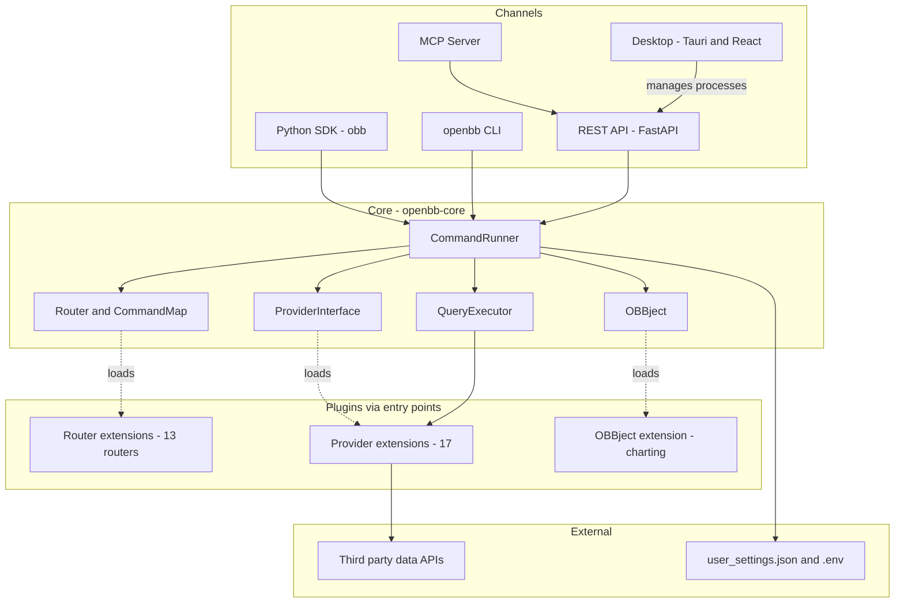

# 01 — System Overview: OpenBB Open Data Platform

| Thuộc tính | Giá trị |
|---|---|
| Phạm vi | Cấu trúc kho, cấu hình đóng gói, điểm khởi chạy, mô hình kiến trúc |
| Phương pháp | Quét thư mục và đọc `pyproject.toml`, `Cargo.toml`, `package.json`, `tauri.conf.json`, Dockerfile, workflow CI |
| Tài liệu liên quan | `docs/WF_SRS.md` (đặc tả yêu cầu chi tiết) |
| Nhãn | `[OK]` đã xác minh trong mã; `[UNKNOWN]` không tìm thấy trong kho |

## 1. Tóm tắt điều hành (Business)

OpenBB Open Data Platform hợp nhất truy xuất dữ liệu tài chính từ nhiều nhà cung cấp qua một mô hình truy vấn và một đối tượng kết quả chuẩn (`OBBject`). Một lệnh được khai báo một lần và được phơi bày qua bốn kênh: Python SDK, REST API, CLI và MCP. Ứng dụng Desktop quản lý môi trường Python và các tiến trình backend.

| Giá trị nghiệp vụ | Cơ chế kỹ thuật |
|---|---|
| Một giao diện dữ liệu cho nhiều nguồn | Mô hình `QueryParams` / `Data` chuẩn; `Fetcher` theo provider |
| Mở rộng không sửa lõi | Python entry points: router, provider, OBBject extension |
| Nhiều kênh sử dụng | Cùng `CommandRunner` phục vụ SDK, REST, CLI, MCP |
| Phát hành độc lập | Mỗi extension/provider là một gói PyPI riêng, có workflow `publish-*` riêng |

## 2. Cấu trúc kho

| Thư mục | Vai trò | Quy mô `[OK]` |
|---|---|---|
| `openbb_platform/core` | Lõi: API, runner, provider abstraction, mô hình chuẩn (`openbb-core` 2.0.1) | 1 gói |
| `openbb_platform/extensions` | 13 router lệnh (equity, economy, technical, news…) và 3 gói giao diện (`mcp_server`, `platform_api`, `devtools`) | 16 gói có `pyproject.toml` |
| `openbb_platform/providers` | Kết nối nguồn dữ liệu (fred, sec, nasdaq, tmx, imf, oecd…) | 17 gói |
| `openbb_platform/obbject_extensions` | Mở rộng đối tượng kết quả (`charting` 4.0.0) | 1 gói |
| `openbb_platform` (gốc) | Meta-package `openbb` 5.0.0, `dev_install.py`, Dockerfile, docker-compose | 1 gói |
| `cli` | `openbb-cli` 2.0.1 | 1 gói |
| `desktop` | Ứng dụng Tauri (Rust) + React/Vite, phiên bản 2.0.0 | `package.json`, `src-tauri/Cargo.toml` |
| `cookiecutter` | Mẫu sinh extension mới | 1 gói |
| `examples`, `assets` | Notebook, ví dụ Streamlit/Beam; tài nguyên | — |
| `.github/workflows` | CI: lint, test theo gói, `publish-openbb-*`, build Desktop | — |
| `rev`, `docs` | Tác vụ và tài liệu reverse-engineering | — |

Tổng số `pyproject.toml` ngoài `node_modules`: 39. Không có `requirements.txt` ở cấp gói lõi; chỉ `examples/openbb-apachebeam` và `examples/streamlit` có tệp này `[OK]`. Quản lý phụ thuộc dùng `pyproject.toml` và `uv.lock` theo từng gói.

## 3. Cấu hình đóng gói và phụ thuộc

| Hạng mục | Giá trị | Nguồn |
|---|---|---|
| Ngôn ngữ / runtime | Python >= 3.11, < 4 | `pyproject.toml` các gói |
| Build backend | hatchling | `openbb_platform/pyproject.toml` |
| Lõi (`openbb-core`) | uvicorn, fastapi, pydantic >= 2.12.3 < 3, aiohttp, requests, python-dotenv, websockets, pyjwt, uuid7, ruff | `core/pyproject.toml` |
| Extra của lõi | `flask`, `pandas` | meta-package `openbb-core[flask,pandas]` |
| Meta-package `openbb` | Phụ thuộc cứng: core, devtools, mcp-server, news, platform-api, charting, cli và 17 provider; extra `routers` kéo thêm 12 router | `openbb_platform/pyproject.toml` |
| Charting | plotly >= 6.3.1; extra `pywry` | `obbject_extensions/charting/pyproject.toml` |
| Desktop | Tauri 2.11, React 18.3, Vite 7, TanStack Router | `desktop/package.json`, `src-tauri/Cargo.toml` |
| Container | Python 3.11-slim, hai giai đoạn, cài editable bằng `dev_install.py --routers`, người dùng không phải root `openbb` | `openbb_platform/Dockerfile` |

## 4. Điểm khởi chạy (Entry Points)

### 4.1 Lệnh console (`[project.scripts]`)

| Lệnh | Đích | Gói | Chức năng |
|---|---|---|---|
| `openbb` | `openbb_cli.cli:main` | openbb-cli | CLI tương tác |
| `openbb-api` | `openbb_platform_api.main:main` | openbb-platform-api | REST API (Workspace); mặc định `0.0.0.0:6900` |
| `openbb-mcp` | `openbb_mcp_server.main:main` | openbb-mcp-server | MCP server; transport `streamable-http`, `sse`, `stdio` |
| `openbb-build` | `openbb_core.build:main` | openbb-core | Sinh mã gói Python tĩnh |
| `generate-fred-release-map` | `openbb_fred.utils.generate_release_map:main` | openbb-fred | Công cụ tiện ích |

Ứng dụng FastAPI lõi nằm tại `openbb_core.api.rest_api:app`, chạy qua `python -m openbb_core.api.rest_api` hoặc uvicorn `[OK]`.

### 4.2 Nhóm entry point mở rộng

| Nhóm | Người đăng ký | Ví dụ | Người nạp |
|---|---|---|---|
| `openbb_core_extension` | Router lệnh | `equity = openbb_equity.equity_router:router` | `ExtensionLoader.core_objects` |
| `openbb_provider_extension` | Provider | `fred = openbb_fred:fred_provider` | `ExtensionLoader.provider_objects` |
| `openbb_obbject_extension` | Accessor của `OBBject` | `openbb_charting = openbb_charting:ext` | `ExtensionLoader.obbject_objects` |
| `openbb_charting_extension` | View biểu đồ theo router | `equity = openbb_equity.equity_views:EquityViews` | Charting |

## 5. Mô hình kiến trúc

Kiến trúc là **modular monolith theo mô hình plugin** (microkernel): lõi nhỏ cung cấp hợp đồng, các gói độc lập đăng ký năng lực qua entry points khi cài đặt. Không có cơ sở dữ liệu quan hệ; trạng thái cấu hình lưu bằng tệp JSON/`.env` `[OK]`.

### 5.1 Luồng thực thi lệnh

1. Kênh gọi nhận lệnh (SDK, CLI, REST hoặc MCP).
2. `CommandRunner` dựng tham số từ `ProviderInterface` (`StandardParams`, `ExtraParams`, `ProviderChoices`).
3. Hàm router gọi `OBBject.from_query(Query(...))`.
4. `QueryExecutor` chọn provider và `Fetcher`, lọc credential, gọi `transform_query` -> `extract_data` -> `transform_data`.
5. Hệ thống đóng gói kết quả thành `OBBject`, ghi `Metadata` và trả về kênh gọi.

### 5.2 Các nguyên tắc kiến trúc

| Nguyên tắc | Biểu hiện |
|---|---|
| Hợp đồng ổn định | `QueryParams`, `Data`, `Fetcher`, `Provider`, `OBBject` trong `openbb_core` |
| Khai báo một lần, phục vụ nhiều kênh | Lệnh `@router.command(model=...)` sinh chữ ký SDK và tuyến REST |
| Cách ly nguồn dữ liệu | Mỗi provider là gói riêng; thiếu provider thì lệnh không có lựa chọn provider tương ứng |
| Tách Desktop khỏi lõi | Desktop chỉ khởi chạy và giám sát tiến trình backend; giao tiếp với Python qua tiến trình và HTTP cục bộ |
| Sinh mã thay cho cấu hình thủ công | `package_builder` sinh gói `openbb` tĩnh từ extension đã cài |

## 6. Vận hành và chất lượng

| Hạng mục | Hiện trạng `[OK]` |
|---|---|
| CI | Workflow `test-*` và `lint-*` theo gói; `publish-openbb-*` cho từng gói; `build-desktop-*` (macOS x64/ARM, Windows) |
| Chất lượng mã | `ruff.toml`, `ty.toml`, `.pre-commit-config.yaml`, `.codespell.*`, `.secrets.baseline` |
| Kiểm thử | `pytest.ini` với marker `integration`, `requires_extensions`, `requires_pandas`, `linux` |
| Bảo mật mặc định | Xác thực REST tắt, CORS `*` — cần cấu hình khi triển khai công khai |
| Health check, retry/circuit breaker toàn cục | `[UNKNOWN]` ở tầng lõi |

## 7. Rủi ro và điểm cần lưu ý

| ID | Nội dung |
|---|---|
| R-01 | Phiên bản không đồng bộ giữa các gói và Desktop (`tauri.conf.json` 2.0.0, `Cargo.toml` 1.0.2, `package.json` 2.0.0). |
| R-02 | Bề mặt API phụ thuộc gói đã cài; cùng một kho cho ra tập lệnh khác nhau tùy môi trường. |
| R-03 | Provider dữ liệu equity phổ biến (fmp, yfinance, intrinio) không thuộc kho; 32/70 lệnh equity không có provider trong kho. |
| R-04 | Mặc định host/port MCP Server không nhất quán trong `app/args.py` (127.0.0.1:8001 và 0.0.0.0:8005). |
