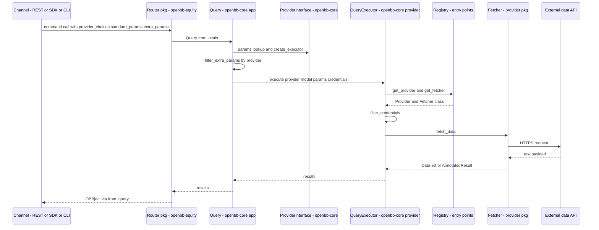
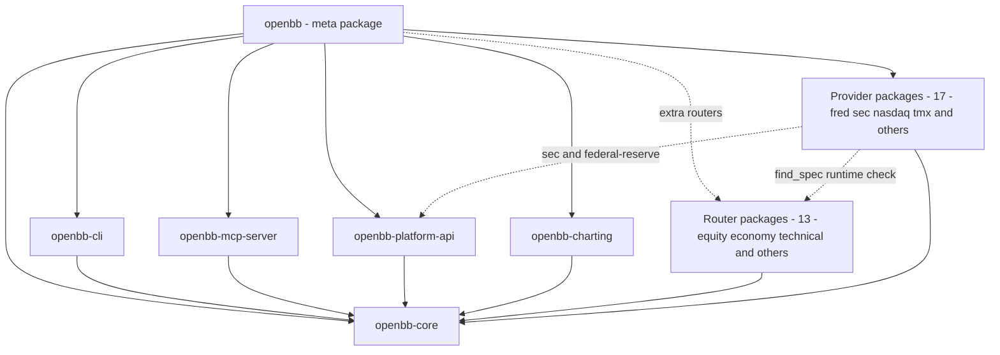
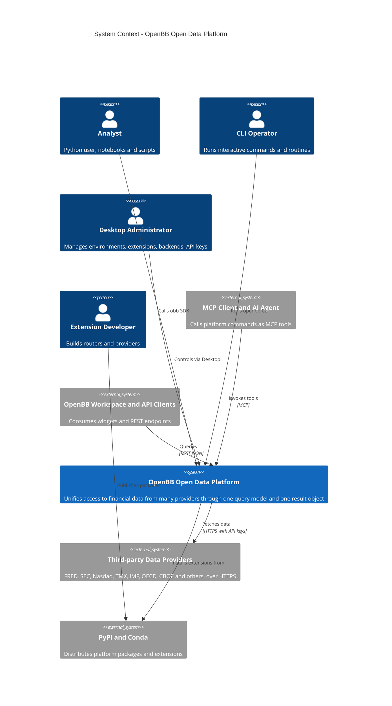

# 02 — Architecture C4: Tương tác giữa các package trong `openbb_platform`

| Thuộc tính | Giá trị |
|---|---|
| Phạm vi | Luồng từ Router/Controller xuống Service layer và Provider layer; sơ đồ C4 mức 1 (System Context) và mức 2 (Container) |
| Phương pháp | Đọc `pyproject.toml` (đồ thị phụ thuộc), entry points, `query.py`, `provider_interface.py`, `query_executor.py`, `registry.py`, `router.py`, `rest_api.py` |
| Tài liệu liên quan | `01_System_Overview.md`, `docs/WF_SRS.md` |
| Nhãn | `[OK]` đã xác minh trong mã; `[UNKNOWN]` không tìm thấy trong kho |

## 1. Kết luận về tương tác giữa các package

| # | Phát hiện | Bằng chứng |
|---|---|---|
| 1 | Cấu trúc phụ thuộc là **hình sao quanh `openbb-core`**. Mọi router, provider, `charting`, `cli`, `mcp-server`, `platform-api` chỉ khai báo phụ thuộc cứng vào `openbb-core`. | Quét `[project].dependencies` của mọi gói trong `openbb_platform` và `cli` `[OK]` |
| 2 | Không có router nào phụ thuộc router khác; không có provider nào phụ thuộc router. Giao tiếp ngang hàng diễn ra gián tiếp qua lõi. | Cùng nguồn `[OK]` |
| 3 | Ngoại lệ: `openbb-sec` và `openbb-federal-reserve` phụ thuộc thêm `openbb-platform-api`. | `providers/sec/pyproject.toml`, `providers/federal_reserve/pyproject.toml` `[OK]` |
| 4 | Meta-package `openbb` gom lõi, 17 provider, news, devtools, charting, cli, mcp-server, platform-api; 12 router còn lại là extra `routers`. | `openbb_platform/pyproject.toml` `[OK]` |
| 5 | Liên kết lúc chạy dùng **entry points**: `openbb_core_extension` (router), `openbb_provider_extension` (provider), `openbb_obbject_extension` (OBBject), `openbb_charting_extension` (view biểu đồ). | `extension_loader.py`, `pyproject.toml` từng gói `[OK]` |
| 6 | Provider nhận biết router bằng `find_spec` (ví dụ `EQUITY_INSTALLED = find_spec("openbb_equity") is not None`) để chọn khóa model chuẩn hoặc bí danh riêng, tránh phụ thuộc cứng. | `providers/nasdaq/openbb_nasdaq/__init__.py:70`, `providers/sec/openbb_sec/__init__.py:60` `[OK]` |
| 7 | Một số provider tự phơi bày router riêng (`openbb_core_extension`), ví dụ `nasdaq = openbb_nasdaq.nasdaq_router:router` và sub-router `routers/equity.py` với tiền tố `/equity`. | `providers/nasdaq/pyproject.toml:22-23` `[OK]` |
| 8 | `mcp-server` và `platform-api` bao bọc ứng dụng FastAPI của lõi (`from openbb_core.api.rest_api import app`) thay vì gọi lõi trực tiếp. | `mcp_server/app/app.py:39` `[OK]` |
| 9 | `cli` dùng gói `openbb` (SDK tĩnh) qua `LocalBackend` và `Session`, kế thừa `UserSettings` từ lõi. | `cli/openbb_cli/backend.py`, `session.py` `[OK]` |

## 2. Phân tầng Router/Controller → Service → Provider

| Tầng | Thành phần | Package | Trách nhiệm |
|---|---|---|---|
| Presentation | Python SDK `obb`, `openbb` CLI, Desktop | `openbb`, `openbb-cli`, `desktop` | Nhận lệnh từ tác nhân |
| Gateway | `rest_api.app` (FastAPI), MCP Server, Platform API | `openbb-core`, `openbb-mcp-server`, `openbb-platform-api` | Phơi bày HTTP/MCP; xác thực, CORS, OpenAPI |
| Router/Controller | Hàm `@router.command(model=...)` | `openbb-equity`, `openbb-economy`, `openbb-technical`… | Khai báo lệnh và model; thân hàm `OBBject.from_query(Query(**locals()))` |
| Service (Application) | `CommandRunner`, `StaticCommandRunner`, `Query`, `ProviderInterface`, `AuthService`, `UserService`, `SystemService`, `ExtensionLoader` | `openbb-core` (`app/`) | Dựng tham số, gộp default, lọc `ExtraParams` theo provider, ghi `Metadata`, gọi callback |
| Domain/Provider abstraction | `QueryExecutor`, `Registry`, `RegistryMap`, `Fetcher`, `QueryParams`, `Data`, `Provider` | `openbb-core` (`provider/`) | Chọn provider và fetcher, lọc credential, chạy `transform_query` → `extract_data` → `transform_data` |
| Provider (Infrastructure) | `<Provider>Fetcher` | `openbb-fred`, `openbb-sec`, `openbb-nasdaq`… | Gọi API ngoài, chuẩn hóa về `Data` chuẩn |
| Cross-cutting | `OBBject` + accessor `charting`, `LoggingService` | `openbb-core`, `openbb-charting` | Đóng gói kết quả, biểu đồ, log |

### 2.1 Trình tự gọi giữa các package (một lệnh dữ liệu)

### 2.2 Phụ thuộc giữa các package

## 3. C4 Mức 1 — System Context

Ranh giới hệ thống: các tác nhân và nguồn dữ liệu ngoài kho. `my.openbb.co` chỉ xuất hiện trong biểu ngữ khởi động `rest_api.py` và không được mô hình hóa như phụ thuộc chạy `[OK]`.

## 4. C4 Mức 2 — Container Diagram

```mermaid
C4Container
    title Container Diagram - OpenBB Open Data Platform
    Person(analyst, "Analyst", "Python user")
    Person(operator, "CLI Operator", "Terminal user")
    Person(admin, "Desktop Administrator", "Manages environments and backends")
    System_Ext(agent, "MCP Client", "AI agent")
    System_Ext(workspace, "Workspace and API Clients", "REST consumers")
    System_Ext(data, "Third-party Data APIs", "HTTPS")

    System_Boundary(odp, "OpenBB Open Data Platform") {
        Container(desktop, "Desktop App", "Tauri Rust and React", "Creates conda environments, installs extensions, starts and monitors backends, edits API keys")
        Container(cli, "openbb-cli", "Python", "Menu CLI, argparse translation, routine scripts")
        Container(sdk, "openbb meta-package and static SDK", "Python", "Generated obb namespace, package_builder output")
        Container(papi, "openbb-platform-api", "Python FastAPI", "Merges widgets, apps, agents for Workspace")
        Container(mcp, "openbb-mcp-server", "Python FastMCP", "Exposes REST routes as MCP tools, Bearer auth")
        Container(rest, "REST API", "openbb-core api, FastAPI", "rest_api app, command routes, coverage, exception handlers, HTTP Basic auth")
        Container(core, "Core Application", "openbb-core app", "CommandRunner, Query, ProviderInterface, services, OBBject, settings")
        Container(routers, "Router Extensions", "13 Python packages", "equity, economy, technical, fixedincome and others; declare commands by model")
        Container(providers, "Provider Extensions", "17 Python packages", "Fetchers per model; credentials per provider")
        Container(charting, "Charting Extension", "openbb-charting, plotly", "OBBject accessor for charts")
        ContainerDb(files, "Configuration Files", "JSON and .env", "user_settings.json, system_settings.json, mcp_settings.json, .env")
    }

    Rel(analyst, sdk, "Calls", "Python")
    Rel(operator, cli, "Types commands", "Terminal")
    Rel(admin, desktop, "Uses", "GUI")
    Rel(agent, mcp, "Invokes tools", "MCP streamable-http, sse, stdio")
    Rel(workspace, papi, "Loads widgets", "HTTP JSON")
    Rel(workspace, rest, "Queries", "HTTP JSON")
    Rel(desktop, rest, "Starts and monitors", "OS process and HTTP")
    Rel(desktop, files, "Reads and writes", "File I/O")
    Rel(cli, sdk, "Executes commands", "Python")
    Rel(sdk, core, "CommandRunner", "Python")
    Rel(rest, core, "CommandRunner", "Python")
    Rel(papi, rest, "Wraps app", "Python import")
    Rel(mcp, rest, "Wraps app", "Python import")
    Rel(core, routers, "Loads via openbb_core_extension", "entry points")
    Rel(core, providers, "Loads via openbb_provider_extension", "entry points")
    Rel(core, charting, "Loads via openbb_obbject_extension", "entry points")
    Rel(routers, core, "Query and OBBject", "Python")
    Rel(providers, core, "Fetcher and Data base classes", "Python")
    Rel(core, files, "Reads settings and credentials", "File I/O")
    Rel(providers, data, "Fetches data", "HTTPS")
```

### 4.1 Bảng Container

| Container | Package / đường dẫn | Công nghệ | Giao diện vào | Giao diện ra |
|---|---|---|---|---|
| Desktop App | `desktop/` | Tauri 2, Rust, React 18, Vite 7 | GUI | Tiến trình backend, tệp cấu hình, conda/pip |
| openbb-cli | `cli/openbb_cli` | Python | Terminal | Gói `openbb` (`LocalBackend`) |
| SDK tĩnh | `openbb_platform/pyproject.toml`, sinh bởi `openbb_core/app/static/package_builder` | Python | `obb.<router>.<command>` | `CommandRunner` |
| REST API | `openbb_core/api/rest_api.py` | FastAPI, uvicorn | HTTP/JSON | `CommandRunner` |
| Platform API | `extensions/platform_api` | FastAPI | `openbb-api` (cổng 6900) | `rest_api.app`, widgets/apps/agents JSON |
| MCP Server | `extensions/mcp_server` | FastMCP | `openbb-mcp` | `rest_api.app` |
| Core Application | `openbb_core/app` | Python, pydantic | Lời gọi từ kênh | `QueryExecutor`, tệp cấu hình |
| Router Extensions | `extensions/*` (13 gói) | Python | Entry point `openbb_core_extension` | `Query`, `OBBject` |
| Provider Extensions | `providers/*` (17 gói) | Python, aiohttp | Entry point `openbb_provider_extension` | API dữ liệu ngoài |
| Charting Extension | `obbject_extensions/charting` | plotly | Accessor trên `OBBject` | `Chart` |
| Configuration Files | `~/.openbb_platform`, `~/OpenBBUserData` | JSON, `.env` | `UserService`, `Env` | — |

## 5. Quy tắc tương tác rút ra

| ID | Quy tắc | Hệ quả |
|---|---|---|
| IR-01 | Router và provider chỉ được phụ thuộc cứng vào `openbb-core`. | Thêm/gỡ gói không làm hỏng gói khác; bề mặt API đổi theo gói cài đặt. |
| IR-02 | Giao tiếp router ↔ provider chỉ qua tên model (`model="EquityHistorical"`) và `ProviderInterface`. | Provider thay thế được mà không sửa router. |
| IR-03 | Credential đi từ `UserSettings` qua `Query.execute` tới `QueryExecutor.filter_credentials`; provider chỉ nhận khóa của chính nó. | Giới hạn phạm vi lộ khóa. |
| IR-04 | Kênh REST/MCP/Platform API dùng chung một ứng dụng FastAPI và một `CommandRunner`. | Hành vi nhất quán giữa các kênh. |
| IR-05 | Provider dùng `find_spec` để chọn khóa model. | Cùng một provider chạy được khi có hoặc không có router tương ứng. |

## 6. Hạn chế

| ID | Nội dung | Nhãn |
|---|---|---|
| L-01 | Tương tác giữa Desktop và backend (cổng, URL) suy từ `backends.rs`; chưa xác minh luồng HTTP cụ thể từ giao diện React tới API. | `[UNKNOWN]` |
| L-02 | Đồ thị phụ thuộc chỉ gồm `[project].dependencies`; extra tùy chọn (ví dụ `openbb-cboe[charting]`) không đưa vào sơ đồ 2.2. | `[OK]` |
| L-03 | Mô hình C4 mức 3 (Component) cho `openbb_core` không thuộc phạm vi tài liệu này. | `[OPEN]` |
