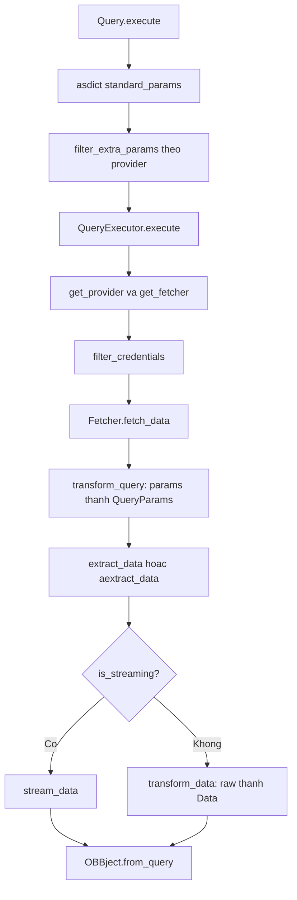

# 03 — Core Business Logic: Xử lý dữ liệu tài chính và tích hợp Data Provider

| Thuộc tính | Giá trị |
|---|---|
| Phạm vi | Pipeline tích hợp provider, quy tắc chuyển đổi dữ liệu, xử lý lỗi, chuẩn hóa schema đầu ra, công thức tài chính |
| Mã nguồn khảo sát | `openbb_core/provider/**`, `openbb_core/app/{query,provider_interface,static/utils/decorators}.py`, `api/exception_handlers.py`, `extensions/{quantitative,technical}`, `providers/{fred,sec}` |
| Tài liệu liên quan | `01_System_Overview.md`, `02_Architecture_C4.md`, `docs/WF_SRS.md` |
| Nhãn | `[OK]` xác minh trong mã; `[!]` bất thường cần xử lý; `[UNKNOWN]` không xác định được |

---

## 1. Tích hợp Data Provider

### 1.1 Hợp đồng tích hợp

| Thành phần | Vai trò | Nguồn |
|---|---|---|
| `Provider` | Khai báo `name`, `description`, `website`, `credentials`, `fetcher_dict`, `deprecated_credentials`, `instructions`. Khóa credential được tạo theo mẫu `<name>_<credential>` (ví dụ `fred_api_key`). | `provider/abstract/provider.py` |
| `Fetcher[Q, R]` | Ba pha bắt buộc: `transform_query`, `extract_data` hoặc `aextract_data`, `transform_data`. `__init_subclass__` từ chối lớp thiếu cả hai biến thể `extract_*`. | `provider/abstract/fetcher.py:42-88` |
| `QueryParams` | Tham số truy vấn; `__alias_dict__` đổi tên khóa chỉ khi `model_dump`; `__json_schema_extra__` hợp nhất thuộc tính theo provider. | `provider/abstract/query_params.py` |
| `Data` | Bản ghi kết quả; `extra="allow"`; `populate_by_name=True`. | `provider/abstract/data.py` |
| `AnnotatedResult[T]` | Cho phép fetcher trả `result` kèm `metadata` (không nằm trong `results`). | `provider/abstract/annotated_result.py` |
| `Registry` / `RegistryMap` | Nạp provider qua entry point, dựng bản đồ model → provider → (QueryParams, Data). | `provider/registry.py`, `registry_map.py` |
| `QueryExecutor` | Chọn provider và fetcher; lọc credential; gọi `fetch_data`. | `provider/query_executor.py` |

### 1.2 Vòng đời một truy vấn tại tầng Provider

### 1.3 Quy tắc tích hợp

| ID | Quy tắc | Bằng chứng |
|---|---|---|
| PRV-R01 | `Query.execute` phải chỉ chuyển tới provider các `ExtraParams` có giá trị khác mặc định và thuộc danh sách provider hỗ trợ trường đó (`f.title` chứa tên provider). Tham số không được hỗ trợ phát `OpenBBWarning` và bị loại bỏ. | `app/query.py: filter_extra_params` |
| PRV-R02 | Hệ thống phải truyền `credentials` và `preferences` của `UserSettings` vào `execute`; `preferences.request_timeout` ghi đè timeout mặc định 10 giây của `amake_request`. | `query.py`, `helpers.py:amake_request` |
| PRV-R03 | `QueryExecutor.filter_credentials` chỉ trả khóa thuộc provider; thiếu khóa và `require_credentials` = true thì từ chối bằng `OpenBBError` trước khi gọi API. | `query_executor.py:38-64` |
| PRV-R04 | `RegistryMap` hợp nhất trường QueryParams/Data giữa các provider: nhóm `openbb` giữ trường chuẩn; mỗi provider giữ trường bổ sung (`extra`). | `registry_map.py:_get_maps` |
| PRV-R05 | `__json_schema_extra__` của từng provider được gắn vào trường tương ứng dưới khóa tên provider (ví dụ `symbol.fred.multiple_items_allowed`). | `registry_map.py:_update_json_schema_extra` |
| PRV-R06 | Provider chọn khóa model chuẩn hay bí danh bằng `find_spec` (ví dụ `EQUITY_INSTALLED`). | `providers/sec/openbb_sec/__init__.py:60`, `nasdaq/__init__.py:70` |
| PRV-R07 | HTTP: `amake_request` chỉ cho phép `GET` và `POST`; phần cấu hình `python_settings.http` (CA, chứng chỉ, proxy, timeout, headers, cookies) áp dụng chung cho `requests` và `aiohttp`. | `helpers.py:97-146, 350-398` |
| PRV-R08 | `ClientResponse` phải che giá trị nhạy cảm trong query và header (`obfuscate`) trước khi lưu `request_info`. | `utils/client.py:14-60` |

---

## 2. Quy tắc chuyển đổi dữ liệu (Data Transformation Rules)

### 2.1 Quy tắc chung (lõi)

| ID | Quy tắc | Bằng chứng |
|---|---|---|
| DT-01 | Mô hình `Data` nhận khóa theo alias camelCase (`to_camel`) và xuất theo snake_case (`to_snake`); đồng thời chấp nhận tên trường gốc (`populate_by_name`). | `abstract/data.py: model_config` |
| DT-02 | `__alias_dict__` của `Data` được đảo ngược trước khi validate để lỗi tham chiếu đúng tên trường chuẩn. | `data.py: _use_alias` |
| DT-03 | `QueryParams.__alias_dict__` chỉ đổi tên khóa khi `model_dump`, nhằm ánh xạ tên chuẩn sang tên tham số của API ngoài. Ví dụ FRED: `symbol→series_id`, `start_date→observation_start`, `end_date→observation_end`, `transform→units`. | `query_params.py`, `fred/models/series.py` |
| DT-04 | Trường `symbol` của `EquityHistoricalQueryParams` phải chuyển thành chữ hoa; `date` chứa ký tự `:` được phân tích ISO 8601 thành `datetime`, ngược lại thành `date`. | `standard_models/equity_historical.py:31-61` |
| DT-05 | `filter_by_dates` giữ bản ghi có thuộc tính `date` nằm trong `[start_date, end_date]`; `datetime` được quy về `date`; bản ghi không có `date` bị loại. | `helpers.py:613-633` |
| DT-06 | Hàm `safe_fromtimestamp` xử lý timestamp âm trên Windows bằng phép cộng `timedelta` từ `1970-01-01`. | `helpers.py:636-640` |
| DT-07 | `check_int` ép giá trị về `int`; lỗi chuyển đổi phát `TypeError`. | `data.py: check_int, ForceInt` |
| DT-08 | `check_item` kiểm tra giá trị thuộc danh sách cho phép; nếu độ tương đồng (`SequenceMatcher`) > 0,75 thì gợi ý giá trị gần nhất. | `helpers.py:36-60` |
| DT-09 | `get_querystring` bỏ giá trị `None`, mở rộng danh sách thành nhiều cặp `key=value`. | `helpers.py:63-95` |

### 2.2 Ví dụ chuỗi chuyển đổi: FRED Series (`FredSeriesFetcher`)

| Bước | Quy tắc | Bằng chứng |
|---|---|---|
| 1 | `symbol` chứa dấu phẩy tách thành nhiều `series_id`; mỗi chuỗi gọi `series/observations` và `series` song song bằng `asyncio.gather`. | `series.py:113-135` |
| 2 | Bỏ `realtime_start`, `realtime_end` khỏi mỗi quan sát. | `series.py:150` |
| 3 | Giá trị `"."` (thiếu dữ liệu của FRED) thay bằng `None`, ép `float`, loại giá trị rỗng (`dropna`). | `series.py:154-160` |
| 4 | Lỗi `KeyError`/`TypeError` khi dựng khung dữ liệu trả `{}` và chuỗi đó bị bỏ qua. | `series.py:161-162` |
| 5 | `transform_data` tách `data` khỏi metadata từng chuỗi (`title`, `units`, `frequency`, `seasonal_adjustment`, `notes`), xoay bảng theo `date`, sắp xếp chỉ mục, thay `NaN` bằng `None`. | `series.py:200-219` |
| 6 | Kết quả trả `AnnotatedResult(result=validated, metadata=metadata)`; metadata đi vào `OBBject.extra["results_metadata"]`. | `series.py:219`, `obbject.py:359-377` |

Mã chuyển đổi FRED (`transform` / `units`): `chg` thay đổi, `ch1` thay đổi so với cùng kỳ năm trước, `pch` % thay đổi, `pc1` % thay đổi so với cùng kỳ năm trước, `pca` tỷ lệ thay đổi kép hằng năm, `cch` tỷ lệ thay đổi kép liên tục, `cca` tỷ lệ thay đổi kép liên tục hằng năm, `log` logarit tự nhiên. Phép tính do FRED thực hiện phía máy chủ, hệ thống chỉ chuyển tham số `[OK]` (`series.py:73-86`).

### 2.3 Quy tắc ép kiểu đầu ra theo sở thích người dùng

| `preferences.output_type` | Phép chuyển đổi | Bằng chứng |
|---|---|---|
| `OBBject` | Giữ nguyên | `preferences.py:17` |
| `dataframe` | `OBBject.to_dataframe` (chỉ mục mặc định `date`) | `obbject.py:79-160` |
| `polars` | `to_polars` | `obbject.py:289` |
| `numpy` | `to_numpy` | `obbject.py:296` |
| `dict` | `to_dict` theo `orient` | `obbject.py:300-330` |
| `llm` | `to_llm` | `obbject.py:332` |

---

## 3. Chuẩn hóa schema đầu ra

### 3.1 Phong bì kết quả `OBBject`

| Trường | Nội dung | Ghi chú |
|---|---|---|
| `results` | Danh sách `Data` hoặc một `Data`; kiểu sinh theo model chuẩn + trường bổ sung của provider | `obbject.py:41` |
| `provider` | Provider đã phục vụ | gán trong `StaticCommandRunner._command` |
| `warnings` | Danh sách `Warning_(category, message)` từ `catch_warnings` | `command_runner.py:392-397` |
| `chart` | `Chart(content, format, fig)` | `model/charts/chart.py` |
| `extra` | `metadata` (`arguments`, `duration` ns, `route`, `timestamp`), `results_metadata` | `metadata.py` |

### 3.2 Quy tắc chuẩn hóa

| ID | Quy tắc | Bằng chứng |
|---|---|---|
| SC-01 | Schema của một model là hợp của trường chuẩn (`openbb`) và trường riêng từng provider; trường riêng được gắn nhãn provider trong JSON schema. | `registry_map.py`, `provider_interface.py` |
| SC-02 | Tên trường đầu ra phải là snake_case; `ProviderInterface` dùng `to_snake_case` khi dựng trường. | `provider_interface.py:404, 488` |
| SC-03 | `metadata.arguments` chỉ chứa `standard_params`, `extra_params`, `provider_choices`; giá trị callable, rỗng hoặc không mã hóa JSON được bị xóa. | `command_runner.py:502-530` |
| SC-04 | Thân phản hồi REST loại bỏ trường bị loại trừ theo cấu hình mô hình (`validate_output`, `exclude_fields_from_api`). | `api/router/commands.py:45-104` |
| SC-05 | Phản hồi dạng luồng (`OBBStream`) mang `id`, `provider`, `warnings` qua header `X-OpenBB-Stream-Id`, `X-OpenBB-Provider`, `X-OpenBB-Warning`. | `commands.py` |
| SC-06 | Lệnh thống kê/định lượng nhận dữ liệu qua `POST` với `data: list[Data]` và khai báo cột đầu ra bằng `__output_columns__` (ví dụ `("date","sharpe_ratio")`). | `quantitative/performance.py` |

---

## 4. Cơ chế xử lý lỗi

### 4.1 Phân cấp ngoại lệ

| Lớp | Nguồn | Ý nghĩa | HTTP |
|---|---|---|---|
| `OpenBBError` | `app/model/abstract/error.py` | Lỗi nghiệp vụ chung; bọc ngoại lệ gốc | 400 |
| `EmptyDataError` | `provider/utils/errors.py` | Không có dữ liệu; thông báo mặc định `No results found. Try adjusting the query parameters.` | 204 |
| `UnauthorizedError` | `provider/utils/errors.py` | Provider từ chối thông tin xác thực; thay `<provider name>` trong thông báo mặc định | 502 |
| `ValidationError` / `RequestValidationError` | pydantic / FastAPI | Tham số sai | 422 |
| `Exception` | — | Lỗi không dự kiến: `Unexpected Error -> <class> -> <msg>` | 500 |

`EmptyDataError` xuất hiện trong 444 tệp provider; `raise OpenBBError` xuất hiện 832 lần trong `providers/`; `UnauthorizedError` không được ném ở đâu trong kho; chỉ được kiểm tra ở `amake_requests`, `decorators.py` và `app_loader.py` `[OK]`.

### 4.2 Quy tắc xử lý theo tầng

| Tầng | Quy tắc | Bằng chứng |
|---|---|---|
| Provider/HTTP | `amake_requests` chạy song song bằng `gather(return_exceptions=True)`; phải ném ngay `UnauthorizedError` hoặc khi `raise_for_status`; ngoại lệ khác bị gom, chỉ ném ngoại lệ đầu tiên khi không có kết quả nào; kết quả rỗng bị bỏ qua; `return_exceptions` giữ ngoại lệ trong danh sách. | `helpers.py:401-470` |
| Fetcher | Bọc ngoại lệ không phải `OpenBBError` thành `OpenBBError(message)` với thông báo gốc hoặc `FRED request failed (<type>)`. | `series.py:192-197` |
| Credential | Thông báo lỗi thiếu khóa nêu tên khóa, website provider, liên kết tài liệu API keys. | `query_executor.py:55-60` |
| SDK (Python) | Decorator `exception_handler` chuẩn hóa: `ValidationError` thành `OpenBBError` đa dòng với nhãn `[Data Model]`, `[Arg] <loc> -> input: <v> -> <msg>`; `UnauthorizedError` thêm `[Error]`; `EmptyDataError` thêm `[Empty]`; `OpenBBError` thêm `[Error]`; ngoại lệ khác thành `[Unexpected Error]`. Traceback gốc được giữ ở khung cuối. | `app/static/utils/decorators.py:55-104` |
| REST | `ExceptionHandlers` ánh xạ ngoại lệ sang HTTP (mục 4.1); lỗi validate gắn tiền tố `loc` là `query`. | `api/exception_handlers.py` |
| Cảnh báo | Cảnh báo Python được thu qua `catch_warnings(record=True)`, đổi thành `Warning_` và chỉ in khi `preferences.show_warnings` bật. | `command_runner.py:392-405` |
| Metadata/callback | Lỗi khi ghi `Metadata` hoặc gọi callback đầu ra chỉ phát `OpenBBWarning`, trừ khi `DEBUG_MODE` bật (khi đó ném `OpenBBError`). | `command_runner.py:462, 502, 563` |
| Logging | Khi `logging_suppress` là false, `LoggingService.log` ghi route, tham số và `exc_info`. | `command_runner.py:408-419` |
| Rò rỉ khóa | `_API_KEY_RE` che `api_key=` trong URL ở FRED; `ClientResponse` che query/header. | `fred/utils/rate_limiter.py:58`, `client.py` |

### 4.3 Cơ chế chịu lỗi riêng của FRED (`fred_get`)

| Tham số | Mặc định | Biến môi trường |
|---|---|---|
| Khoảng cách tối thiểu giữa yêu cầu | 0,6 giây | `OPENBB_FRED_MIN_INTERVAL` |
| Số lần thử lại tối đa | 4 | `OPENBB_FRED_MAX_RETRIES` |
| Backoff ban đầu / tối đa | 2,0 / 30,0 giây | `OPENBB_FRED_BACKOFF`, `OPENBB_FRED_MAX_BACKOFF` |
| TTL bộ đệm bộ nhớ / số mục | 300 giây / 512 | `OPENBB_FRED_CACHE_TTL`, `OPENBB_FRED_CACHE_SIZE` |

Thông báo giới hạn tần suất: `FRED API rate limit exceeded (HTTP 429). Please wait a moment and try again.` Chính sách retry/backoff tương đương cho các provider khác: `[UNKNOWN]` (chưa khảo sát từng provider).

---

## 5. Công thức tài chính

Quy ước ký hiệu: `r_t` lợi suất kỳ, `N = 252` kỳ/năm (`_PERIODS_PER_YEAR`), `σ` độ lệch chuẩn mẫu (`ddof=1` cho pandas `rolling.std`), `W` cửa sổ cuốn chiếu. Mọi công thức dưới đây được trích từ mã nguồn.

### 5.1 Tỷ lệ hiệu suất điều chỉnh rủi ro (`openbb_quantitative/performance.py`)

| Chỉ số | Công thức | Chi tiết triển khai |
|---|---|---|
| Lợi suất kỳ | `r_t = P_t / P_{t-1} − 1` | `pct_change(fill_method=None)`, bỏ NaN |
| Lãi suất phi rủi ro theo kỳ | `rf_p = (1 + rfr)^(1/N) − 1` | `rfr` là tỷ lệ năm dạng thập phân, mặc định 0 |
| **Sharpe cuốn chiếu** | `Sharpe_t = [ mean_W(r) − rf_p ] / σ_W(r) × √N` | Cửa sổ mặc định 252; loại giá trị không hữu hạn; từ chối khi `W` > số quan sát |
| MAR theo kỳ | `mar_p = (1 + target_return)^(1/N) − 1` | `target_return` mặc định 0 |
| Độ lệch xuống (downside deviation) | `DD_t = sqrt( mean_W( min(r − mar_p, 0)² ) )` | Cuốn chiếu theo `W` |
| **Sortino cuốn chiếu** | `Sortino_t = mean_W(r − mar_p) / DD_t × √N` | Nếu `adjusted`: chia thêm `√2` |
| Ngưỡng theo kỳ (Omega) | `θ_p = (1 + θ)^(1/N) − 1` | `θ` là ngưỡng lợi suất năm |
| **Omega** | `Ω(θ) = Σ max(r − θ_p, 0) / ( Σ max(θ_p − r, 0) + ε )`, `ε = 1e−6` | Đánh giá tại `bins` (mặc định 50) ngưỡng chia đều trong `[0; 1,5]` |

### 5.2 Mô hình định giá tài sản vốn và hồi quy nhân tố

| Chỉ số | Công thức | Chi tiết |
|---|---|---|
| **CAPM** (`metrics.py:capm`) | OLS: `(R_i − R_f) = α + β · (Mkt − Rf) + ε` | Lợi suất tháng (`resample("MS")`, `pct_change`) ghép với nhân tố Fama-French (`get_fama_raw`); tối thiểu 3 quan sát (`_CAPM_MIN_OBSERVATIONS`) |
| Kết quả CAPM | `market_risk = β`, `systematic_risk = R²`, `idiosyncratic_risk = 1 − R²` | `statsmodels.OLS` + hằng số |
| **Phân rã lợi suất** (`attribution.py`) | `Σ_t y_t = α·n + Σ_i β_i · Σ_t f_{i,t} + Σ_t ε_t` | OLS theo từng kỳ nhìn lại; cần số quan sát > số nhân tố + 1 |
| **Phân rã rủi ro** (`risk_decomposition.py`) | `Var(y) = Σ_i β_i · Cov(f_i, y) + Var(ε)`; hàng `Residual` = `1 − R²` | Tổng tỷ trọng nhân tố bằng `R²` |
| Thống kê mô tả (`_stats_helpers.py`) | Phương sai và độ lệch chuẩn mẫu `ddof = 1`; độ nhọn là **excess kurtosis**; độ lệch `scipy.stats.skew` | — |

### 5.3 Ước lượng biến động (`openbb_technical/helpers.py`)

`N = 252`, hoặc `365` khi `is_crypto`; `trading_periods` do người dùng đặt ghi đè `is_crypto` (có cảnh báo). `H, L, O, C` là giá cao, thấp, mở, đóng; `ln` logarit tự nhiên.

| Ước lượng | Công thức | Ghi chú |
|---|---|---|
| **Parkinson** | `rs_t = ln(H/L)² / (4·ln 2)`; `σ = sqrt( N · mean_W(rs) )` | `window` < 1 đặt lại 30 |
| **Standard deviation** | `σ = std_W( ln(C_t / C_{t−1}) ) × √N` | `window` < 2 đặt lại 30 |
| **Garman-Klass** | `rs_t = 0,5·ln(H/L)² − (2·ln 2 − 1)·ln(C/O)²`; `σ = sqrt( N · mean_W(rs) )` | — |
| **Hodges-Tompkins** | `σ_adj = σ_std × 1 / ( 1 − h/n + (h² − 1)/(3n²) )`, `h = W`, `n = count(ln return) − h + 1` | Hiệu chỉnh chệch cho cửa sổ hữu hạn |
| **Rogers-Satchell** | `rs_t = ln(H/O)·(ln(H/O) − ln(C/O)) + ln(L/O)·(ln(L/O) − ln(C/O))`; `σ = sqrt( N · mean_W(rs) )` | — |
| **Yang-Zhang** | `σ² = σ_o² + k·σ_c² + (1 − k)·σ_rs²`, `k = 0,34 / ( 1,34 + (W + 1)/(W − 1) )`; `σ = sqrt(σ²) × √N` | `σ_o²` theo `ln(O_t/C_{t−1})`, `σ_c²` theo `ln(C_t/C_{t−1})`, mỗi thành phần là tổng cuốn chiếu chia `(W − 1)` |

### 5.4 Động lượng, sức mạnh tương đối và mức Fibonacci

| Chỉ số | Công thức | Nguồn |
|---|---|---|
| **Clenow momentum** | Hồi quy tuyến tính `ln P_t = a·t + b` trên `W` quan sát gần nhất (mặc định 90). `R² = 1 − SS_res/SS_tot` (0 nếu chuỗi hằng). Hệ số năm hóa `= exp(a)^252 − 1`. | `helpers.py:471-513` |
| **Fibonacci retracement** | `Price_f = max − (max − min) × f`, với `f ∈ {0; 0,235; 0,382; 0,5; 0,618; 0,65; 1}`; làm tròn 4 chữ số; hoán đổi `min/max` nếu mốc thấp xuất hiện sau mốc cao | `helpers.py:516-` |
| **Relative Strength Ratio** | `RS_i = 100 × P_i / P_benchmark` | `relative_rotation.py:174-` |
| **RS Momentum** | `Mom = ln(1 + r_long + ε) − ln(1 + r_short + ε)`, `r_long` lợi suất 252 kỳ, `r_short` 21 kỳ, `ε = 1e−10` | `relative_rotation.py:105-` |
| Chuẩn hóa | Z-score: `(x − mean)/std`; min-max: `(x − min)/(max − min)`; absolute max: `x/|x|max` | `relative_rotation.py:14-27` |

### 5.5 Tốc độ tăng trưởng báo cáo tài chính (SEC, `utils/company_facts.py:_compute_pct_change`)

| Chế độ | Công thức | Điều kiện loại bỏ |
|---|---|---|
| `yoy` | `g = (V_t − V_{t−1y}) / |V_{t−1y}|`, cùng `fiscal_period`, `fiscal_year − 1` | Bỏ khi không có kỳ trước hoặc `V_{t−1y} = 0` |
| `pop` | `g = (V_t − V_{t−1}) / |V_{t−1}| × 100`, kỳ liền trước theo `period_ending` | Bỏ khi `V_{t−1} = 0` |

Giá trị làm tròn 4 chữ số, đơn vị ghi là `percent`.

**[!] Bất thường đơn vị:** chế độ `yoy` trả tỷ lệ thập phân (ví dụ 0,12), chế độ `pop` trả phần trăm (ví dụ 12,0), cả hai cùng gắn `unit = "percent"`. Chuỗi `source` luôn in hậu tố `%` (`company_facts.py:381-389`). Hệ quả: giá trị `yoy` bị hiểu thấp 100 lần nếu người dùng tin nhãn đơn vị. Khuyến nghị: thống nhất phép nhân 100 hoặc đổi nhãn `unit`.

### 5.6 Phạm vi chưa phân tích

| Nhóm | Ghi chú |
|---|---|
| Chỉ báo kỹ thuật tiêu chuẩn (RSI, MACD, SMA…) | Gọi thư viện `pandas-ta-openbb` (`technical/pyproject.toml`); không phải công thức trong kho `[OK]` |
| Phân tích chuỗi thời gian và hồi quy (`econometrics`) | Dùng `statsmodels`; chưa trích công thức `[OPEN]` |
| Định giá trái phiếu, đường cong lợi suất, Greeks quyền chọn | `fixedincome`, `derivatives`, `options_chains_properties.py` (1.851 dòng) chưa khảo sát `[OPEN]` |
| Tỷ số tài chính (`fundamental/ratios`, `metrics`) | Do provider ngoài kho tính; chưa có công thức trong kho cho các provider không hiện diện `[UNKNOWN]` |

---

## 6. Tổng hợp rủi ro và khuyến nghị

| ID | Phát hiện | Mức | Khuyến nghị |
|---|---|---|---|
| BL-01 | Đơn vị tăng trưởng SEC `yoy` (tỷ lệ) khác `pop` (phần trăm) nhưng cùng nhãn `percent`. | Cao | Thống nhất đơn vị trong `_compute_pct_change`. |
| BL-02 | Omega cộng `ε = 1e−6` vào mẫu số, làm lệch kết quả khi không có lỗ trong cửa sổ (giá trị rất lớn thay vì vô hạn). | Thấp | Ghi chú trong tài liệu API. |
| BL-03 | `window` không hợp lệ ở các hàm biến động bị âm thầm đặt lại 30 kèm `warn` thay vì từ chối. | Trung bình | Chuyển sang `ValueError` hoặc ghi rõ trong tài liệu. |
| BL-04 | Quy ước 252 kỳ/năm cố định cho Sharpe/Sortino/Omega; dữ liệu không phải ngày giao dịch (tuần, tháng, tiền mã hóa) cho kết quả sai tỷ lệ. | Trung bình | Thêm tham số `periods_per_year`. |
| BL-05 | Chính sách retry/rate-limit tồn tại ở FRED nhưng không có cơ chế chung ở lõi. | Trung bình | Đưa vào `amake_request` hoặc lớp nền dùng chung. |
| BL-06 | Không có dòng nào trong `openbb_core` hoặc `providers/` ném `UnauthorizedError`; lớp chỉ được kiểm tra bằng `isinstance` và có handler 502. Cách HTTP 401/403 từ nguồn ngoài được xử lý chưa xác minh. | Thấp | Chuẩn hóa ánh xạ 401/403 sang `UnauthorizedError` tại `amake_request`. |
